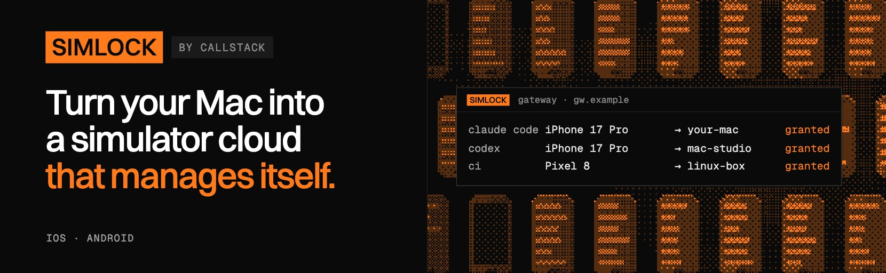

<p align="center">
  
</p>

### One device per agent

Simlock leases iOS simulators, Android emulators and enrolled phones to coding agents that run in
parallel. An agent asks for a device and gets one back, booted and checked, that no other agent
touches until it is released. Simlock creates devices when none is free, queues requests when the
machine is full, and cleans up devices nobody uses. Start on one Mac; put more Macs and Linux
machines behind a gateway when one is not enough.

```sh
npm i -g simlock
simlock doctor
simlock lease --platform ios --device "iPhone 16"
```

## Documentation

Everything is on the website: **https://callstackincubator.github.io/simlock/docs/introduction**

- [Getting started](https://callstackincubator.github.io/simlock/docs/getting-started): install,
  lease a first device, connect your agent
- [Using devices](https://callstackincubator.github.io/simlock/docs/using-devices/lease-lifecycle):
  for agents and the people who set them up
- [Worker](https://callstackincubator.github.io/simlock/docs/worker/running-the-daemon): run the
  machine that owns the devices
- [Gateway](https://callstackincubator.github.io/simlock/docs/gateway): one URL for a fleet
- [Reference](https://callstackincubator.github.io/simlock/docs/reference/cli): every command,
  configuration key, event and error

## Made with ❤️ at Callstack

`simlock` is an open source project and will always remain free to use. If
you think it's cool, please star it 🌟. [Callstack][callstack-readme-with-love]
is a group of React and React Native geeks, contact us at
[hello@callstack.com](mailto:hello@callstack.com) if you need any help with
these or just want to say hi!

Like the project? ⛸️ [Join the team](https://callstack.com/careers/?utm_campaign=Senior_RN&utm_source=github&utm_medium=readme) who does amazing stuff for clients and drives React Native Open Source! 🔥

[callstack-readme-with-love]: https://callstack.com/?utm_source=github.com&utm_medium=referral&utm_campaign=simlock&utm_term=readme-with-love
