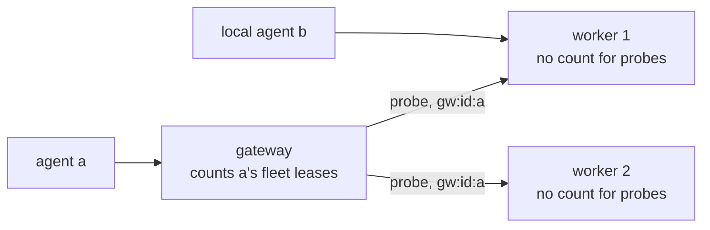

# 0023. A requester may hold up to a configured number of leases

- **Status:** Proposed
- **Date:** 2026-10-12
- **Issue:** [#464](https://github.com/callstackincubator/simlock/issues/464)
- **Supersedes:** nothing. Narrows [ADR 0005](0005-gateway-and-worker-modes.md)
  §14 ("one lease per requester is fleet-wide"): the number of leases is now
  a config value, and a worker leaves the count of its gateway's requests to
  the gateway.

## Context

A requester (the agent id a lease is for, e.g. `--agent-id a`) holds at most
one lease, and has at most one waiting request. A second request is refused
with `REQUESTER_ALREADY_LEASED`. An agent that needs two devices has to
invent a second agent id. Operators want to allow a few leases per agent.

A worker also counts the requests its gateway forwards, under the gateway's
namespaced requester id `gw:<instance>:<agent id>`. If the worker kept that
count, a gateway that allows two leases would see the second refused by
whichever worker already holds the first, even with another worker free.

## Decision

### 1. The limit is `lease.maxPerRequester`, and one request waits at a time

`lease.maxPerRequester` is a positive integer, default `1`. A request is
refused at admission when either holds:

- the requester already has a waiting request (queued or being
  provisioned), as today;
- the requester already holds `lease.maxPerRequester` active leases.

Physical and virtual leases count the same. With the default, every answer
is what it is today, message included.

The refusal stays `REQUESTER_ALREADY_LEASED` (exit 13, HTTP 409), with the
event reason `already-leased`. At the lease limit it names the requester's
earliest-granted active lease.

Allowing one waiting request keeps `lease.cancel` exact: it finds the
request by requester id, and there is never more than one to find.

The check stays where it is, in one place per side: the worker's admission,
and the gateway's own index for the fleet. Idempotency replay still runs
before it, so a keyed repeat gets its stored answer at the limit.

### 2. The gateway counts its own requests; the worker does not

A worker does not run the check for a probe: a request that carries the
gateway's `fleetRequestId`, which only the worker's own uplink to its
configured gateway may send. The gateway already counted it, fleet-wide,
from its own index. Every other request on a worker is checked as in §1,
against the worker's own limit. So the gateway's limit is the one a fleet
agent sees, and gateway and worker limits never have to agree.

The gateway's lease index keeps every lease of a requester. Adding one never
drops another.

## Consequences

- Above a limit of 1, agents that lease one device after another can block
  each other: each holds one and waits for a second. That is the operator's
  choice, and the configuration docs say so. Atomic multi-device leases
  (#328) are the fix for that use case.
- Above a limit of 1, a client that lost its grant and asks again without
  an idempotency key gets a new lease, not a refusal naming the lost one.
  The lost lease lives until its TTL.
- A worker no longer declines a probe as `already-leased`. A gateway bug
  could hand one agent more leases on a worker than intended; the worker's
  capacity limits still hold.

## Alternatives considered

- **Waiting requests count toward the limit too.** An agent could queue for
  several devices at once, but `lease.cancel`, HTTP `DELETE` and a client
  abort would then have to name the request, which needs a new contract
  field and a new push. Rejected as more than the need.
- **The worker keeps its own count, and the gateway warns when a worker's
  limit is lower.** Simpler to state, but a fleet agent's second lease
  fails or succeeds by which worker routing picks.
