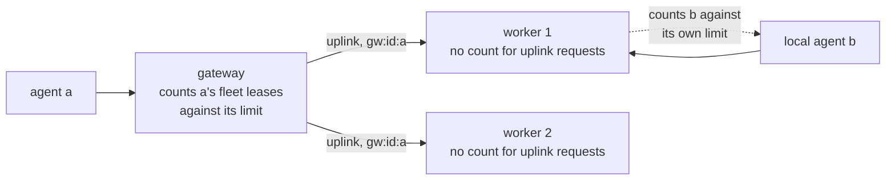
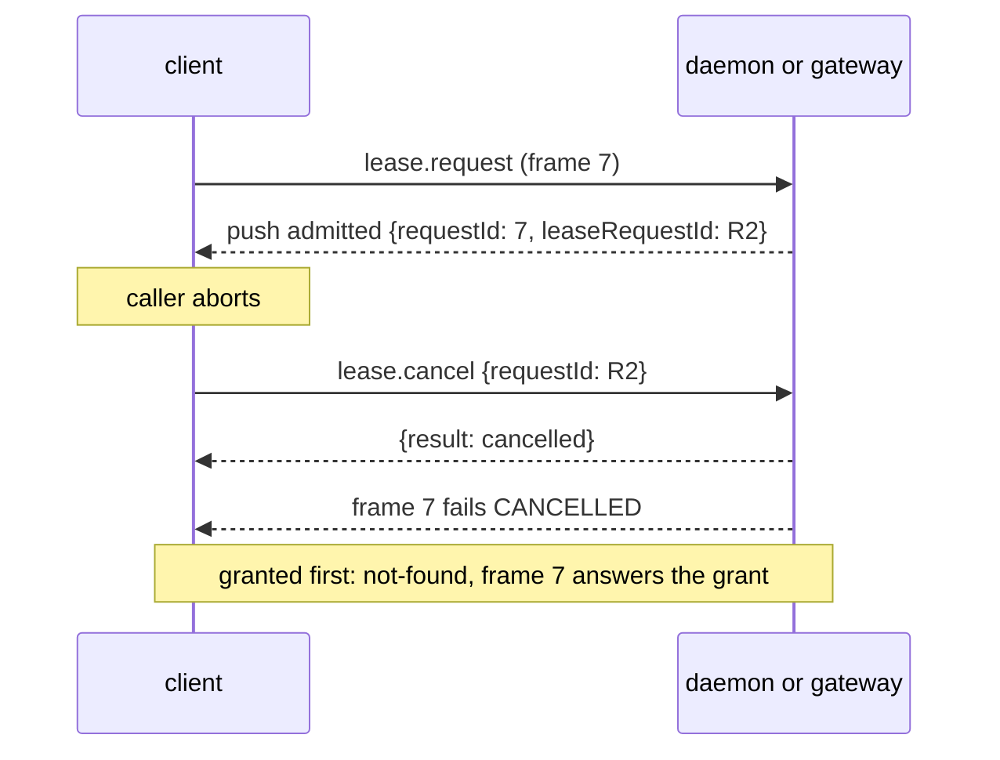

# 0023. A requester may hold up to a configured number of leases, and a cancel names its request

- **Status:** Proposed
- **Date:** 2026-10-12
- **Issue:** [#464](https://github.com/callstackincubator/simlock/issues/464)
- **Supersedes:** nothing. Narrows [ADR 0005](0005-gateway-and-worker-modes.md)
  §14 ("one lease per requester is fleet-wide"): the count is now a config
  value, and a worker leaves the count of its gateway's requests to the
  gateway. Narrows [ADR 0003](0003-one-typed-daemon-contract-behind-every-frontend.md)
  §9 ("cancels this principal's pending request by requester id") and §10
  (the client's abort): a cancel may name the request instead, and must
  when the requester has more than one waiting.

## Context

A requester (the agent id a lease is for, e.g. `--agent-id a`) holds at most
one lease, and has at most one waiting request. A second request is refused
with `REQUESTER_ALREADY_LEASED`. An agent that needs two devices has to
invent a second agent id. Operators want to allow a few leases per agent.

Two other parts of the system lean on "at most one":

- `lease.cancel` finds the request to cancel by requester id. With two
  waiting requests, that is ambiguous: an HTTP `DELETE` or a client abort
  could cancel the other one.
- A worker counts the requests its gateway forwards, under the gateway's
  namespaced requester id `gw:<instance>:<agent id>`. If the worker kept its
  own count, a gateway that allows two would see its second lease refused
  by any worker already holding the first, even with another worker free.

## Decision

### 1. The limit is `lease.maxPerRequester`

A positive integer, default `1`. A request is refused at admission when the
requester's active leases plus its waiting requests are already at the
limit. Leases and waiting requests count the same; physical and virtual
devices count the same. With the default, every answer is what it is
today, message included.

The refusal stays `REQUESTER_ALREADY_LEASED` (exit 13, HTTP 409), with the
event reason `already-leased`. It names the requester's earliest-granted
active lease, when it holds one.

The check stays where it is, in one place per side: the worker's admission,
and the gateway's own index for the fleet. Idempotency replay still runs
before it, so a keyed repeat gets its stored answer at the limit.

### 2. The gateway counts its own requests; the worker does not

A request that arrives on a worker's uplink to its own configured gateway
is not counted by the worker. The gateway already counted it, fleet-wide,
from its own index. Every other request on a worker is counted as in §1,
against the worker's own limit. So the gateway's limit is the one a fleet
agent sees, and gateway and worker limits never have to agree.

The uplink session is the one the worker trusts already: it dialled the
gateway itself and accepted that connection as admin.

### 3. A cancel can name its request

`lease.cancel` takes an optional `requestId`, the lease request's own id
(the `:id` of `/v1/lease-requests/:id`).

- **Given:** exactly that request is cancelled, if it is still queued (a
  physical one in any live state, as today). Any `requesterId` is ignored.
  Authorized by the request's recorded owner; admin always passes.
  Unknown or already settled: `not-found`. Device work started:
  `not-cancellable`.
- **Omitted:** the requester's one waiting request is cancelled, as today.
  With more than one waiting, the answer is `BAD_REQUEST`, asking for
  `requestId`. A non-admin caller gets `FORBIDDEN` first when any of those
  requests belongs to another principal.

A socket client learns the id from a new request-scoped push, `admitted`,
sent once per `lease.request` frame when the request is admitted:

The daemon sends `admitted` before any `progress` push for that frame. A
client that aborts before `admitted` waits for it or for the call's answer,
whichever comes first; a connection that dies ends the call either way.
HTTP already knows the id and sends it.

## Consequences

- The gateway–worker and client protocol version goes up by one, for the
  push and the new field.
- Above a limit of 1, agents that lease one device after another can block
  each other: each holds one and waits for a second. That is the operator's
  choice, and the configuration docs say so. Atomic multi-device leases
  (#328) are the fix for that use case.
- Above a limit of 1, a client that lost its grant and asks again without
  an idempotency key gets a new lease, not a refusal naming the lost one.
  The lost lease lives until its TTL.
- A worker no longer enforces any per-requester limit on its gateway's
  requests. A gateway bug could hand one agent more leases on a worker than
  intended; the worker's capacity limits still hold.

## Alternatives considered

- **Count only granted leases; at most one waiting request.** Keeps cancel
  by requester id exact with no contract change. Rejected by the
  maintainer: an agent should be able to queue for several devices at once.
- **The worker keeps its own count, and the gateway warns when a worker's
  limit is lower.** Simpler to state, but a fleet agent's second lease
  fails or succeeds by which worker routing picks.
- **Cancel by the frame id of the `lease.request` call.** No push needed,
  but the cancel has to wait inside admission for the frame to be admitted,
  and HTTP has no frame.
