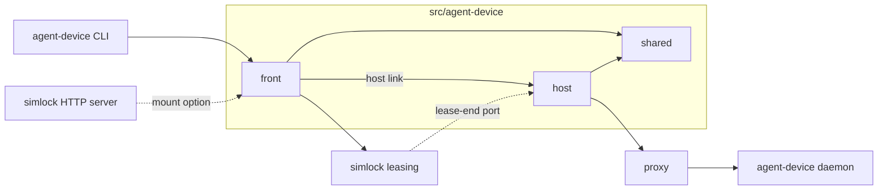

# 0023. agent-device is served by an optional edge module, and the simlock lease is the only clock

- **Status:** Accepted
- **Date:** 2026-10-12
- **Issue:** [#466](https://github.com/callstackincubator/simlock/issues/466)
- **Supersedes:** nothing. Builds on [ADR 0020](0020-a-requester-may-choose-its-lease-id.md)
  (the agent-device lease and the simlock lease share one id) and
  [ADR 0024](0024-leasing-calls-lease-end-participants-before-reclaim.md)
  (how the edge hears that a simlock lease ended).

## Context

Agents drive apps with the agent-device CLI. Pointed at a URL, the CLI talks
to `@agent-device/proxy`, which forwards to an agent-device daemon that
drives the devices. agent-device has its own daemon, leases, sessions and
tokens, so the two tools overlap on every word that matters.

Feature #466 makes a simlock worker serve that URL. The agent gets a device
by simlock's rules, and simlock's lease decides how long the agent keeps
it. The agent-device protocol and the agent-device daemon are agent-device's
to change; simlock must not spread knowledge of them through its core.

## Decision

### 1. One optional module, split by role

agent-device support lives in one module, `src/agent-device/`, with three
parts:

- **shared:** what simlock knows about agent-device's wire format: the
  route list, the RPC names and selector flags, the lease id format, the
  error shapes.
- **front:** where the CLI connects (`/v1/agent-device/*`). It checks the
  simlock token, turns agent-device lease calls into simlock lease
  operations, applies the request rules (§4) and sends each request to a
  host.
- **host:** on every worker. It runs the agent-device daemon and the proxy,
  and ends agent-device leases when simlock leases end.

The front reaches a host through a **host link** port. In worker mode the
adapter is in-process. Gateway mode adds a relay adapter in a later feature;
neither part changes for it.

The simlock core imports none of the three parts. They plug in through two
neutral extension points, each with no agent-device word in it: an HTTP
mount option that lets an optional module serve routes under `/v1/<prefix>`,
and the lease-end port of ADR 0024. The edge is off unless the operator
turns it on.

The core still names agent-device in two places, as data rather than code:
the `agentDevice` config keys, and one `simlock doctor` finding kind,
`agent-device-unavailable`, which the edge fills. Neither imports the edge.

### 2. The simlock lease is the only clock

An agent-device lease and its simlock lease share one id (the CLI chooses
it; ADR 0020 lets simlock keep it) and one lifetime.

- `allocate` becomes `lease.request` as the agent's principal, with the
  CLI's selectors mapped to `platform`, and `model` or `class`. A request
  that waits in simlock's queue holds the CLI's request open. When the CLI
  hangs up, the front cancels it; a grant that lands after that is released
  at once.
- Each heartbeat goes to the agent-device daemon first, then renews the
  simlock lease. While a command runs, the front keeps renewing the simlock
  lease, as agent-device protects its own lease during a command.
- A release goes to the agent-device daemon first, then releases the
  simlock lease. If the agent-device release fails, the simlock lease stays,
  so simlock never frees a device agent-device still holds.
- When simlock ends a simlock lease on its own, the host releases the
  agent-device lease through ADR 0024's port, before the device is wiped. The
  next heartbeat for it answers that simlock ended the lease, so the CLI
  fails the command instead of quietly leasing a new device.

The agent-device daemon is started with a lease ceiling far above simlock's,
and the front raises the `ttlMs` of every lease call it forwards to that
ceiling, so an agent-device lease never ends before its simlock lease.

### 3. simlock runs the agent-device daemon

One agent-device daemon per worker, started and watched by the host's
supervisor:

- installed by the operator, never downloaded; a version simlock does not
  support, or a daemon that cannot start, leaves the rest of simlock
  running. While the edge is turned on, its routes stay mounted and answer
  every request with why agent-device is not available, and
  `simlock doctor` says the same. Turned off, nothing is mounted;
- a private state directory, device claims included, so it shares nothing
  with an agent-device the operator runs by hand;
- every simlock driver's lease environment, passed through unread, so it
  sees simlock's devices and no others. One key is also mapped: the iOS
  driver's device set becomes agent-device's daemon-wide device set
  (`AGENT_DEVICE_IOS_SIMULATOR_DEVICE_SET`), so agent-device lists only
  simlock's simulators. The driver itself names nothing of agent-device;
- a policy file that refuses `boot` and `shutdown`: simlock owns whether a
  device runs;
- reaped and restarted when the simlock daemon starts, and restarted when it
  dies. A restart loses its agent-device leases; the front answers their
  next heartbeat as ended by simlock and releases the simlock lease.

### 4. One simlock token is one tenant

The proxy's `authenticate` callback checks the simlock token and sets
agent-device's tenant to its principal on every request, overwriting any
tenant the client sent. Upload tickets carry the agent's own simlock token. Agents
on different simlock tokens never see each other's agent-device sessions.
Agents sharing a token share a tenant; the docs say not to.

The front also refuses what would reach past the agent's grant:

- a platform other than iOS or Android;
- a device selector naming any device but the granted one;
- a route outside a fixed list;
- an `install` or `reinstall` of a path on the worker rather than an upload.

`devices` answers with only the devices the token holds.

## Consequences

- The edge depends on agent-device changes not yet released (a lease id the
  caller chooses, `open` sending its selectors, sessions ending with their
  lease, refusing a request's own device set, the proxy's `authenticate`,
  the CLI releasing its lease after `close`, upload resume through the
  proxy). simlock builds no stand-ins;
  it tests against a local agent-device build until they ship.
- A new agent-device selector flag can slip past the front's check until
  agent-device refuses it itself.
- The agent-device daemon trusts its loopback port. Any process running as
  the simlock user can read its token and skip the edge.
- A simlock daemon restart loses the front's memory of which leases are its
  own; the leases survive and end on their next heartbeat or at their TTL.

## Alternatives considered

- **Keep the agent-device lease and the simlock lease apart, mapped by the
  edge.** Two clocks to keep in step, and a mapping to lose on restart.
  Rejected: sharing one id and one clock removes the mapping.
- **Put agent-device knowledge in the core.** Fewer files, but every
  agent-device protocol change would touch leasing and HTTP. Rejected.
- **Split the module by mode (worker, gateway).** The front runs on both a
  gateway and a worker, and the host runs on every worker. Splitting by role
  lets gateway mode add one adapter instead of a second copy.
- **Let the agent run its own agent-device daemon.** Nothing would stop it
  touching other agents' devices, and simlock could not end its sessions.
