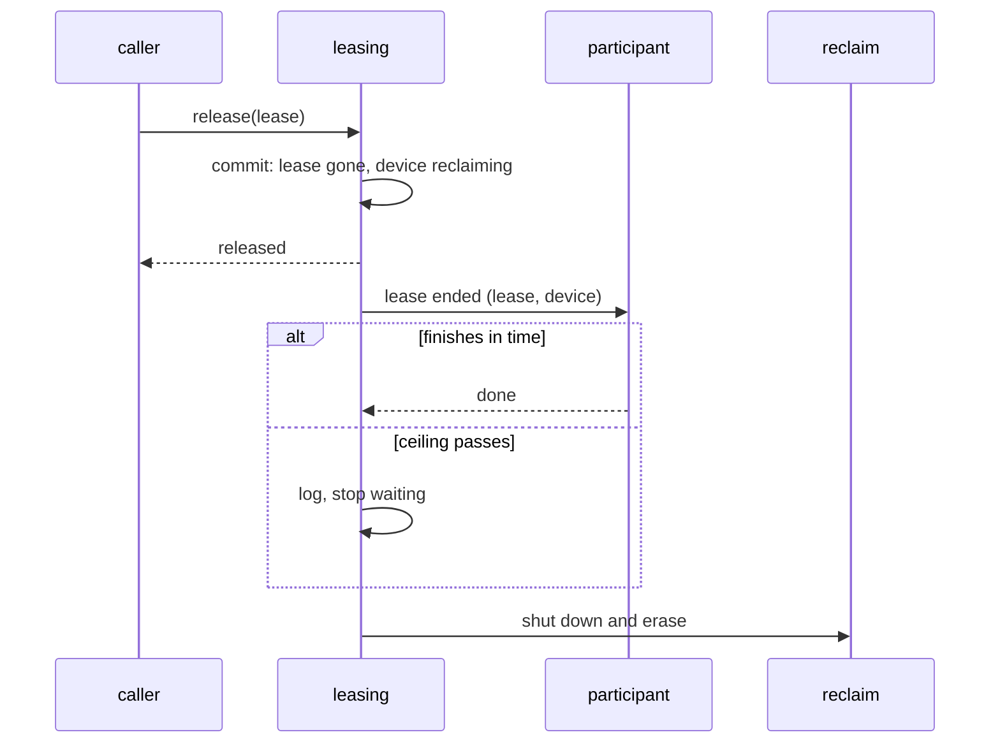

# 0024. Leasing calls lease-end participants before it reclaims a device

- **Status:** Accepted
- **Date:** 2026-10-12
- **Issue:** [#466](https://github.com/callstackincubator/simlock/issues/466)
- **Supersedes:** nothing.

## Context

When a simlock lease ends (release, release-all, expiry, device lost, or at
startup), leasing commits the end and starts the reclaim in the background:
the device goes to `reclaiming`, then the driver shuts it down and erases
it. Nothing runs between the two.

The agent-device edge ([ADR 0023](0023-agent-device-is-served-by-an-optional-edge-module.md))
must end the agent-device lease and its agent-device session on that device
before the wipe. A command may still be running there. agent-device lets a
running command finish rather than cut it off, and feature #466 keeps that.

An event handler cannot do this. Events are for observers: they run after
the fact, nobody waits for them, and a step of a workflow placed in one can
be skipped or reordered.

## Decision

### 1. A port in leasing, called before reclaim

Leasing exposes a **lease-end port**. An optional module registers a
participant. For every simlock lease that ends, leasing calls each
participant with the lease and its device after the end is committed and
before the reclaim starts:

The caller does not wait: the port runs inside the background reclaim, so a
release answers as fast as it does today. The device stays `reclaiming` the
whole time, so it is never granted meanwhile.

### 2. The wait has a ceiling

Leasing waits for the participants until they finish or a ceiling passes
(a config value, default 10 minutes, the same as `exec.timeoutMs`). Then the
reclaim goes ahead whatever the participants did. A participant that fails
is logged and does not stop the reclaim.

Two callers cannot wait that long and cut it short: graceful daemon shutdown
and maintenance (`nuke`, an operator reset). They tell the participants to
stop and reclaim at once.

### 3. Every ending calls it

Release, release-all, expiry, device lost and startup all call the port.
Where an ending starts no reclaim (a device that is missing, or one whose
wipe is put off at startup), the port is still called, and nothing waits on
it.

### 4. It knows nothing of its participants

The port has a neutral name and payload: lease id, owner, device id and
platform, and the reason the lease ended. The core imports no participant.
No event changes: `lease.released` still fires when the end is committed.

## Consequences

- The time from a lease ending to its device being free grows by however
  long the participants take: usually seconds, at most the ceiling.
- `simlock status` shows such a device as `reclaiming` while it waits; no
  new state is added.
- A daemon that dies mid-wait leaves the reclaim to the existing startup
  recovery, which runs it without calling the participants again; their own
  restart handles their side.

## Alternatives considered

- **A `lease.released` event handler.** Runs after the fact with nobody
  waiting, so the wipe could start under a running command. Rejected.
- **The edge renews the lease until its work is done.** Cannot stop an
  operator's release-all or a lost device, which end the lease regardless.
- **A short fixed grace (about 10 seconds).** Cuts off any longer command.
  Rejected in #466: agent-device lets commands finish, and simlock follows.
- **No ceiling.** A stuck command would hold the device forever.
