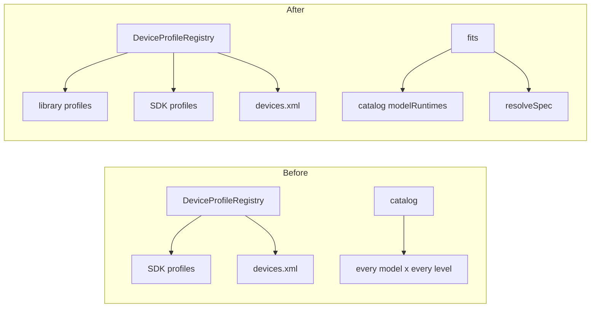
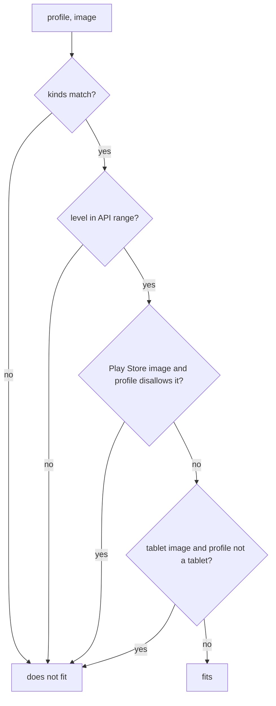

# 0025. Simlock ships Android device profiles, and a model pairs only with images that fit it

- **Status:** Accepted
- **Date:** 2026-10-12
- **Issue:** [#485](https://github.com/callstackincubator/simlock/issues/485)
- **Supersedes:** nothing. Amends [ADR
  0008](0008-the-catalog-pairs-models-with-runtimes-and-status-carries-host-facts.md)
  §3: on Android a model pairs only with the API levels that have an image
  that fits it (§3 here). Amends [ADR
  0015](0015-a-lease-request-is-a-set-of-constraints.md) §3: a library
  profile states its class, a `devices.xml` profile's tag sets its class,
  and Android `tablet` holds a model (§5). Amends ADR 0015 §4: Android's
  built-in default lists name library models (§5). Amends ADR 0015 §5:
  under an image tag, the driver may refuse the level the core picked (§4).
- **Depends on:** ADR 0008, 0015.

## Context

Android model names come from two places today, the SDK's profiles
(`avdmanager list device`) and Android Studio's `devices.xml`. A name can mean
different hardware on two hosts, or be missing on one. A gateway assumes a
name means the same device on every worker. Simlock's own default models per
class exist only when the installed SDK ships them.

`avdmanager create avd` pairs any profile with any system image. Android
Studio does not. Its device dialog offers a profile only the images that fit
it, by one rule in sdklib, `DeviceSystemImageMatcher.matches`:

- the image's kind matches the profile's: a TV profile takes only
  `android-tv` and `google-tv` images, a Wear profile only `android-wear`, an
  automotive profile only its exact automotive tag, a desktop profile only
  `android-desktop`; a profile with no kind takes none of those;
- the image's API level is inside the profile's API range, e.g. Pixel 9 is
  `35-`;
- a Play Store image only on a profile that allows Play Store; sdklib makes
  every Wear profile allow it;
- an image tagged `tablet` only on a tablet profile: no kind, a screen of 7
  inches or more, not foldable.

Simlock followed `avdmanager`. A TV lease gets a phone image and boots phone
software, and Pixel 9 is accepted on API 33. ADR 0008 §3 wrote that down:
"On Android every model pairs with every installed API level". This record
replaces that, and gives Simlock profiles of its own.



## Decision

### 1. The library is a profile source, read first

`src/drivers/android/profiles/` holds one TypeScript file per profile, named
after it (`pixel-9.ts`), and an `index.ts` that imports every file. The
library is a `DeviceProfileSource` placed first in the registry's list:
library, then SDK, then `devices.xml`. First match wins, as today, so a
library name hides the same name in the other two.

A library profile holds what the SDK's profile of that name holds: its name
and other names, its class, its image kind, its API range, whether it allows
Play Store, its hardware keys (screen, density, RAM, cores, keys, sensors,
cameras) and its boot properties. Each file names the `cmdline-tools` version
its values were copied from. A test checks that the folder and the index list
the same profiles, that each file is named after its profile, that no name is
in two profiles, and that every profile sets every key on one fixed list.

The library ships the 16 models #485 lists. Any other name resolves through
the SDK or `devices.xml`, as today.

### 2. A library device does not depend on the SDK listing it

`avdmanager create avd` still needs some SDK profile to seed the device. For a
library profile the driver seeds with any SDK profile, then writes the
library's keys into `config.ini` and its boot properties next to it. No
hardware key (`hw.*`) and no boot property the seed wrote survives unless the
library profile sets it, and no skin key (`skin.*`): a library device has no
skin, so its screen comes from its `hw.lcd.*` keys alone. Keys that describe
the image (`image.sysdir.*`, `tag.*`, `abi.type`, `target`, `hw.cpu.arch`)
come from the image, not the profile, and stay as `avdmanager` wrote them. The config hash
is taken after that, as it is for a `devices.xml` profile today.

A device keeps the `config.ini` it was created with. A changed library
profile affects only devices created after the change.

### 3. One function decides whether an image fits a profile

The Android driver has one function, `fits(profile, image)`, that applies
Android Studio's rule above. `listCatalog` and `resolveSpec` both call it, so
the catalog and `resolveSpec` still cannot disagree (ADR 0008 §3). A model
pairs with an API level when that level has an image that fits it. ADR 0008
§3's sentence "On Android every model pairs with every installed API level"
no longer holds; "An image of a foreign ABI is listed and counts" still
does.

Each check applies only where the profile states the value it reads:

| Profile from | Kind | API range | Play Store | Tablet test |
|---|---|---|---|---|
| library | stated | stated | stated | stated |
| SDK | `Tag :` line | not printed: any level | not printed: allowed | not printed: not a tablet |
| custom, as `avdmanager` lists it (`OEM : User`) | `Tag :` line | its `devices.xml` entry's `<d:api-level>`, else any | its entry's `<d:playstore-enabled>`, else allowed | its entry's screen size, as sdklib |
| `devices.xml` only (`avdmanager` does not list it) | `<d:tag-id>`, else none | `<d:api-level>`, else any | `<d:playstore-enabled>`, else allowed | screen size, as sdklib |

`avdmanager list device` reads `devices.xml` itself and lists each custom
profile with `OEM : User`, before Simlock's own `devices.xml` source is
asked, so a custom name resolves to that entry. It prints only the name, id
and tag; the driver adds the rest from the `devices.xml` profile of the same
name. The device is still created by `avdmanager -d <id>`. A custom entry
with no readable `devices.xml` profile of its name gets no details: any
level, Play Store allowed, not a tablet.

What makes an image a Play Store image follows sdklib too: a
`google_apis_playstore` tag; or `android-automotive-playstore` as its only
tag; or `android-wear` as its only tag at a level sdklib counts as having
Play.



### 4. A lease picks among fitting images only

`resolveSpec` with no version picks the newest API level that has a fitting
image. A version or an `--image-tag` with no fitting image fails with
`RUNTIME_MISSING`, naming what to install. Within one level the image is
picked by today's order, applied to fitting images only: a host-native
`google_apis` image, then any host-native image, then any `google_apis`
image, then any.

`allowDownload` works as today, through `downloadable`: the core installs a
level only when `resolveSpec` refuses with `downloadable: true`, and then
installs that level's `google_apis` image. That is the only
image Simlock ever downloads. A `RUNTIME_MISSING` for an exact version says
`downloadable: true` only when the level has no image installed at all and
its `google_apis` image would fit the model; otherwise `downloadable: false`,
so a client does not retry with `allowDownload` for nothing. A level that is
installed with only misfit images is `downloadable: false`: the component
installer counts that level as installed and would download nothing. A TV
model is always `downloadable: false`.

A request that names an image tag picks its level as ADR 0015 §5 says: a
level counts when the model pairs with it and the catalog's `images` lists
an image of that tag there. The image of that tag may not fit the model even
when another image at that level does. `resolveSpec` then refuses with
`RUNTIME_MISSING`, though a lower level in the range might have fitted. ADR
0015 §5's promise that the driver accepts the pairing it is asked for holds
only for a request with no image tag.

An existing device is not checked against `fits`. A lease fits an idle device
by model and OS as ADR 0015 §6 says, but the core resolves the model and
level first (ADR 0015 §5), and only levels with a fitting image are picked.
So a device made before this change is reused as it is when its level still
fits its model, e.g. a Pixel 9 on API 36 built from the SDK's values. One on
a level that no longer fits, e.g. a TV on a phone image, is not picked by a
lease that names its model and an exact level or no OS. A lease that names a
class or an OS range matches idle devices by range, not by fit, so it can
still pick such a device until idle cleanup removes it. The maintainer
accepted this: it affects only devices made before the upgrade.

```mermaid
sequenceDiagram
  participant A as agent
  participant D as daemon
  participant V as Android driver
  A->>D: lease Television (1080p), no --os
  D->>V: resolveSpec
  V->>V: profile = library; images that fit
  alt a fitting image is installed
    V-->>D: model, newest fitting level, its image tag
    D-->>A: lease granted
  else none fits
    V-->>D: RuntimeMissingError (names a TV image)
    D-->>A: RUNTIME_MISSING, exit 12
  end
```

### 5. A profile's class

A library profile states its class. An SDK profile's class comes from its
`Tag :` line, as ADR 0015 §3 says. A custom profile `avdmanager` lists takes
its class from that `Tag :` line too. A `devices.xml` profile `avdmanager`
does not list takes its class from its `<d:tag-id>` by the same map; without
one it is `phone`, as today. So a
profile's class and its image kind always agree.

No class is derived from a name or a screen size. The screen-size test of §3
decides only which images fit, never a class. Medium Tablet is a `tablet`
because its library profile says so. ADR 0015 §3's "on Android `tablet` holds
no model" no longer holds.

ADR 0015 §4's built-in default lists on Android name library models, so they
exist on every host. Android's `tablet` list is Medium Tablet; the other
lists stay as they are. Whether a default counts on a host still depends on
it pairing with an installed level, which now means a fitting image.

### 6. `doctor` reports a `devices.xml` profile the library hides

The Android driver's `advisories()` reports a `driver-advisory` finding, code
`device-profile-hidden`, for each `devices.xml` profile whose name a library
profile answers to. It has no `--fix`. A name the library shares with the SDK
is not reported: the library copies the SDK's values, so the two agree.

### 7. What does not change

- The gateway's catalog. It is still the union of each worker's own answer
  (ADR 0008 §4), and each worker answers with `fits`. One gateway rule
  changes, on every platform: for a request that names a model and no OS,
  the runtime a worker will pick is the newest it pairs with the model,
  which is what both drivers do (it was `defaultRuntime` when paired, else
  the only paired one).
- iOS.
- Events. Nothing here emits or changes one.
- Simlock never writes to the SDK or `devices.xml`.

## Consequences

- A name in the library is the same device on every host and every SDK.
- A TV, Wear, automotive or desktop lease on a host with only phone images
  now fails with `RUNTIME_MISSING`, where it used to succeed on the wrong
  software. A pinned level below a library model's range fails too.
- Pixel 6's SDK profile does not allow Play Store, so the library's Pixel 6
  does not take Play Store images. A host whose only image at a level is a
  Play Store image loses that level for Pixel 6.
- A lease with an image tag whose image does not fit the model at the level
  the core picked fails, even when a lower level in its range would fit.
  It needs both a tag and a misfit, so it is rare.
- `avdmanager list device` prints no screen size, so an SDK-only tablet
  model, such as Pixel Tablet, is never a tablet profile and takes no
  `tablet` image. Android Studio would offer one. Medium Tablet, from the
  library, does.
- The library is data to maintain. A new SDK model is not in the library
  until someone copies it in; it still resolves through the SDK until then.
- If sdklib changes its rule, Simlock follows only in a release that changes
  `fits`. The library records which `cmdline-tools` version each profile came
  from so a reviewer can compare.
- Two workers on different Simlock releases can define one library model
  differently until both upgrade.
- The docs change with the implementation: `docs/CLI.md` (where Android
  models come from, `modelClasses`, `modelRuntimes`, lease failures,
  `doctor`) and `docs/CONFIGURATION.md` (default models per class).

## Alternatives considered

- **Let a profile name a recommended image and report a missing one in
  `doctor`.** The request asked for this. Rejected: a TV lease would still get
  a phone image, and `doctor` would report on every host that serves only
  phones.
- **Fit only library models.** Rejected: an SDK-only TV model such as
  "Television (720p)" would still boot phone software.
- **Fit by kind and API range only, without the Play Store and tablet
  checks.** Smaller, and SDK profiles do not print either value. Rejected by
  the maintainer: Simlock should give the same answer as Android Studio.
- **The catalog lists, per model and level, the image tags that fit.** The
  core and the gateway would then pick a level only where the asked tag
  fits, so the image-tag gap in §4 would close. Rejected by the maintainer:
  a new catalog field and a protocol bump for a rare case.
- **Retire idle devices that no longer fit.** Rejected by the maintainer:
  nothing retires them; a profile change affects new devices only.
- **Check idle devices before picking a level, so old misfit devices stay
  reusable.** Rejected by the maintainer: a change to the lease coordinator,
  the planner and the gateway, worth a feature of its own.
- **Ignore `avdmanager`'s copy of a custom profile and read `devices.xml`
  only.** One source, but the device would be built from a seed plus a few
  keys instead of by `avdmanager -d <id>`, changing its hardware. Rejected by
  the maintainer.
- **Read profiles from the SDK's own `sdklib` jar at run time.** Same values
  with no copy to maintain. Rejected: the jar is an SDK implementation detail,
  differs by `cmdline-tools` version, and is exactly the per-host variance
  this record removes.
- **Report every library name the SDK also defines in `doctor`.** Rejected:
  about 15 findings on every normal host, for two definitions that agree.
