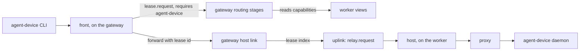
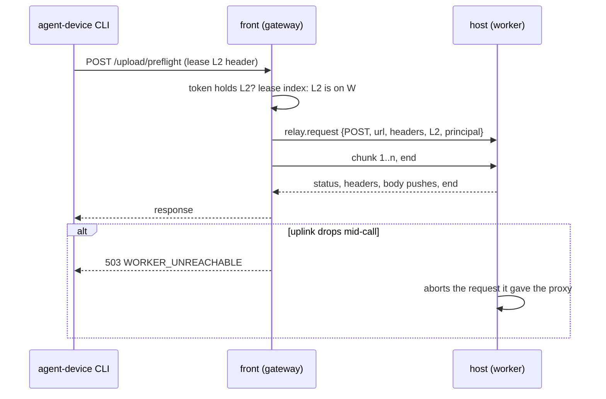

# 0026. agent-device through a gateway: workers advertise capabilities, and the host link relays over the uplink

- **Status:** Accepted; §3's in-process link narrowed by [ADR 0043](0043-physical-devices-reach-agent-device-through-a-second-daemon.md)
- **Date:** 2026-10-13
- **Issue:** [#511](https://github.com/callstackincubator/simlock/issues/511)
- **Narrows:** [ADR 0023](0023-agent-device-is-served-by-an-optional-edge-module.md)
  §1, the line "Gateway mode adds a relay adapter in a later feature; neither
  part changes for it": the host-link port and the front change as §3 says.
  [ADR 0005](0005-gateway-and-worker-modes.md)'s line that agent-device gets
  fleet support with no change no longer holds; this ADR is that change.
  [ADR 0009](0009-gateway-routing-is-a-list-of-stages.md): §2's stage list
  gains `has-capabilities`, which also decides whether a request can be
  served, and §5's cannot-serve codes gain `CAPABILITY_MISSING` (§1 below).
- **Builds on:** ADR 0005 (workers dial out; the gateway never reaches in),
  [ADR 0009](0009-gateway-routing-is-a-list-of-stages.md) (routing is a list
  of stages, and a request no worker can serve fails at once),
  [ADR 0020](0020-a-requester-may-choose-its-lease-id.md) (the CLI's lease id
  passes through the gateway bare).

## Context

ADR 0023 puts agent-device support in one module with a **front** (where
the agent-device CLI connects; it checks the simlock token, turns
agent-device lease calls into simlock lease operations and applies the
request rules) and a **host** (on the worker; it runs the agent-device
daemon and its proxy). The front reaches the host through a **host link**:
`status()` and `forward(request, identity)`. In worker mode the link is
in-process and there is one host.

Feature #511 serves the same CLI from a gateway. Four facts shape it:

- A gateway has many hosts, one per worker, and some workers run no
  agent-device daemon at all. Today only `simlock doctor` on the worker says
  so; a gateway cannot run doctor, and its worker view has no such field.
- The gateway never opens a connection to a worker. Everything it sends a
  worker goes over the worker's uplink: newline-delimited JSON, shared with
  lease renewals, status refreshes and events.
- Commands, heartbeats and releases name their agent-device lease in the
  RPC body. Uploads, artifact downloads and diagnostics name only the tenant
  (the token's principal), so nothing in them says which worker to use.
- The front treats a lease missing from `lease.list` as ended. A gateway's
  `lease.list` skips a lease whose worker view is missing, so a worker that
  disconnects would look like simlock ended the lease.

## Decision



### 1. Workers advertise capabilities; a lease request may require one

A **capability** is an optional module a worker serves, by name. The worker's
status lists each capability it knows of, with a state: `available`,
`unavailable` with the reason the module gives, or `off` when the operator
turned the module off. For agent-device the reason is the one the front would
answer an agent with, so what an operator sees always matches what agents
get. The gateway keeps this list in each worker view and refreshes it with
the rest of the status.

`lease.request` takes an optional `requires`: a list of capability names.
The gateway's routing gains one stage, early in the list, that leaves out a
worker which does not list every required capability as `available`. When
that leaves no connected worker that could serve the request, it fails at
once with `CAPABILITY_MISSING`, as ADR 0009 answers a request no worker can
serve; a waiting request is checked again on every pass, like ADR 0009's
other rows, so it fails too once no capable worker is left. A worker that
answers `CAPABILITY_MISSING` to a gateway's dispatch (its view was stale)
is left out and the request goes to the next worker, as for `UNKNOWN_MODEL`.
A worker answering a request directly applies the same check to itself, as
a fleet of one.

`simlock worker list`, `simlock status` and the console show each worker's
capabilities, with the reason when one is unavailable.

The core names no module in code. `agent-device` appears in the core as
data only: a capability name the edge registers, as it already registers
its doctor finding kind.

### 2. The host link relays over the uplink

One new contract operation, `relay.request`, carries one HTTP exchange from
the gateway to the worker's host. Its call names the method, the URL, the
headers, the agent-device lease id and the caller's principal.

- **Request body.** Sent after the call as acknowledged chunk calls, each
  naming the relay call, base64 in the existing JSON framing, then an end
  marker. The gateway sends the next chunk only once the worker has
  acknowledged enough of the earlier ones, so a slow worker holds back the
  upload rather than the gateway's memory.
- **Response.** The worker answers with the status and headers, then the
  body as pushes keyed by the call's frame id, as `device.exec` output is
  today, then an end marker.
- **Cancellation.** When the CLI hangs up, the gateway cancels the call on
  the worker, and the host aborts the request it gave the proxy. When the
  uplink drops, the gateway fails every relayed call on it with
  `WORKER_UNREACHABLE`, and the worker aborts every relayed request it was
  serving.
- **Deadline.** A relayed call has a gateway deadline of agent-device's
  proxy upstream timeout (5 minutes) plus a margin. Past it the gateway
  cancels on the worker and answers with a timeout.
- **Versions.** The gateway–worker protocol version goes up by one. A worker
  on an older version lists no capabilities, so §1 never picks it.

The host on the worker takes a relayed request exactly as it takes an
in-process one. The agent-device daemon token never leaves the worker, and
an agent's gateway token never reaches it: the gateway drops the caller's
`Authorization` and `x-agent-device-token` before relaying, and adds them to
an upload ticket itself when it answers the preflight. A worker that is
compromised holds nothing it could use on the gateway.



### 3. The front names the lease; the host link finds the worker

The host link's `forward` takes the agent-device lease id the request is
for, and `status` answers for one lease's host or for the fleet:

- **In-process link (worker mode):** ignores the lease id; one host, as
  today.
- **Gateway link:** looks the lease id up in the gateway's lease index,
  which already maps every lease the gateway issued to its worker, checks
  its owner, and relays to that worker. It remembers each lease's worker for
  a while after the index drops it (as `simlock release --all` does), so the
  worker's agent-device still answers for that lease. A lease id it cannot
  place, or one another principal owns, is refused before anything is
  relayed.

The front already reads the lease id out of each RPC for its own rules; it
passes it on. For each kind of request:

| Request | Lease id it is forwarded with |
|---|---|
| allocate | the id the CLI chose, once simlock has granted it |
| heartbeat, release, command | the one in the RPC body |
| `devices` | each lease the token holds; the front merges the answers before it filters them |
| upload, artifact, diagnostics | the agent-device lease header (§4) |
| `GET /health` | none: relayed to any capable worker |

Any other request with no lease id is refused.

### 4. Uploads, artifacts and diagnostics carry the lease id

agent-device sends the agent-device lease id in a header on every upload
call (`/upload`, preflight, the direct upload and finalize),
every artifact download and every diagnostics read. This is an
agent-device change, made as a draft pull request on its
`simlock-integration` branch before delivery starts; simlock builds no
stand-in for it.

The front checks that the token holds the lease the header names before it
forwards. A header naming a lease the token does not hold is refused, as
is any such call with no header. On a gateway, the refusal for a missing
header tells the agent to update agent-device. On a worker the header is
optional, since there is one host.

### 5. A lease on an unreachable worker is not an ended lease

A gateway keeps a disconnected worker's view, leases included, so its
`lease.list` still lists them. What the front lacks is a way to tell a
disconnected worker from a failed call. On a gateway, the host link says
which of three a lease is: live, gone, or unreachable. A lease is gone only
once its worker has said so, through the same worker events and views the
gateway already uses for ordinary leases. A lease whose worker is
disconnected is unreachable: the front answers `WORKER_UNREACHABLE` without
forwarding and keeps its entry, and the simlock lease runs out on the
worker's own clock, as every gateway lease does.

After a gateway restart the front has no entries, and the lease index is
empty until the workers reconnect. On the first call for a
lease it does not hold, it rebuilds the entry from the lease index and the
worker's lease record when the lease is owned by the calling token's
principal and its requester is the lease id itself (the mark every
agent-device lease the front makes carries). Any other lease gets the
answer a worker gives today for a lease the front does not know.

Until the workers reconnect the front cannot tell a lease it lost from one it
never had. For 60 seconds after the gateway starts, a heartbeat, command,
release or upload for a lease the index lacks, before its worker has
reconnected, gets the unreachable answer (`WORKER_UNREACHABLE`) and the
entry is kept for the rebuild; the agent's session does not end. After the
window an unknown lease gets the unknown-lease answer.

```mermaid
sequenceDiagram
  participant CLI as agent-device CLI
  participant F as front (gateway)
  participant W as worker
  Note over F: gateway restarts; W reconnects; lease index rebuilt
  CLI->>F: heartbeat L1
  F->>F: no entry; L1 owned by this principal, requester = L1
  F->>F: rebuild entry from the lease record
  F->>W: relay heartbeat, then renew the simlock lease
  W-->>F: ok
  F-->>CLI: ok
```

### 6. The tenant on the worker carries the gateway's prefix

A relayed request's agent-device tenant on the worker is
`gw.<gateway instance id>.<principal>`, the prefix the gateway already puts
on the requester of every lease it dispatches, with dots for colons because
agent-device accepts only letters, digits, dot, underscore and hyphen (up to
128 characters; a character it refuses is escaped, and a longer name is cut and
ends in a hash). Tokens minted on a gateway and
on a worker are separate, so two agents can share a principal name; with the
prefix they never share an agent-device tenant, and neither can drive the
other's device. The simlock lease's owner stays the bare principal, as for
every gateway lease.

## Consequences

- One new contract operation, one new optional `lease.request` field, a
  `capabilities` list in worker status and in the worker view, and one new
  routing stage. Every one is neutral: none names agent-device in code.
- Base64 costs a third more bytes on the uplink, and a large transfer can
  delay renewals and events for other leases on the same worker. Binary
  frames and fair sharing of the uplink are left for later; nothing in the
  operation changes for them.
- The agent-device change of §4 is one more unreleased agent-device change
  simlock depends on, with those ADR 0023 lists.
- An agent with a worker-minted token and an agent with a gateway-minted
  token that share a principal name still share ownership of the worker's
  simlock leases, as today, but not an agent-device tenant.
- The gateway's capability list lags the worker by one status refresh. An
  allocate that lands on a worker whose agent-device daemon just stopped
  fails after the grant, and the front releases the simlock lease, as it
  does on a worker today.

## Alternatives considered

- **A data socket per relayed request, dialled by the worker.** Raw bytes,
  flow control from TCP, and the uplink never blocked. Rejected for now: a
  second kind of worker connection to authenticate, bound and test, and one
  more round trip per request.
- **The gateway host link parses each request to find its lease.** Keeps
  the front unchanged, as ADR 0023 planned. Rejected: agent-device's wire
  format would be read in two places, and the merge of `devices` would live
  apart from the filter it depends on.
- **The front pins a worker on `lease.request`.** Rejected: it bypasses the
  routing stages (warm devices, capacity), and needs a worker pin on the
  contract anyway.
- **An `agentDevice` block in status and on `lease.request`.** Simpler, but
  puts agent-device in the core contract's code, against ADR 0023 §1.
- **Remember upload tickets on the gateway instead of a header on every
  call.** A smaller agent-device change, but a gateway restart mid-upload
  loses the ticket's worker, and artifacts and diagnostics need the lease id
  anyway.
- **Route lease-less calls by token.** Works only while a token's devices
  sit on one worker. Rejected with the one-worker-per-token rule it needs.
