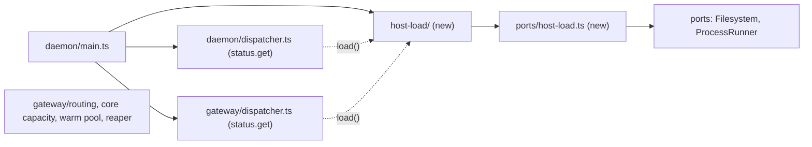
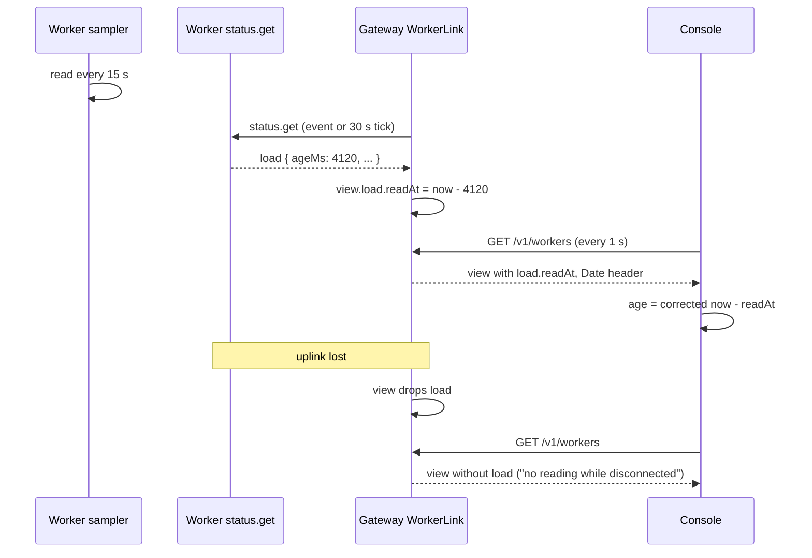

# 0026. Host load is an optional module whose readings ride on status

- **Status:** Proposed
- **Date:** 2026-10-13
- **Issue:** [#527](https://github.com/callstackincubator/simlock/issues/527)
- **Supersedes:** nothing. Adds to [ADR
  0008](0008-the-catalog-pairs-models-with-runtimes-and-status-carries-host-facts.md):
  status gains a second block about the machine beside `host`. Leaves [ADR
  0009](0009-gateway-routing-is-a-list-of-stages.md) as it is: no stage
  reads the new block.
- **Depends on:** ADR 0005 (worker views, the uplink refresh), ADR 0008
  (host facts in status and in the view), ADR 0013 §4 (the console corrects
  for clock skew with the `Date` header), architecture rules 9, 14 and 15.

## Context

#527 asks every place that shows a machine's host facts to also show its
current load: CPU busy %, available memory, swap, the macOS memory pressure
level, and free disk on the disk that holds Simlock's data folder. Readings
are for people. Nothing in Simlock acts on them.

Four questions have answers that bind every task under #527 and any later
feature that uses the readings (a console chart, routing on load):

- Where the code lives, and who may depend on it.
- How a reading travels from a worker to a gateway and the console. The
  first sketch of #527 had a command that asks a worker to start or stop
  sending readings.
- How a reading says how old it is when the worker, the gateway and the
  browser have three clocks.
- What the wire shape is. It moves the protocol.

Two facts shape the answers. A CPU percentage needs two readings some time
apart, so something has to read the machine on a timer whether or not
anyone is looking. And the gateway already calls `status.get` on every
worker, on every capacity event and on a 30 s tick, and the console
already polls `GET /v1/workers` every second.

## Decision

### 1. One module outside the core, wired only by the composition root

`src/host-load/`, entered through its `index.ts`, holds the sampler and the
reading's types. It depends on ports only: `Clock`, `Logger` and the new
`HostLoadProbe` (§2). It imports nothing from `core`, `leasing`, `gateway`,
`drivers` or any frontend. A boundary test, modelled on
`src/core/warm-pool/boundary.test.ts`, keeps every file outside the
directory off everything but `index.ts`, and a lint override keeps `fs` and
`child_process` out of it.

It sits outside `src/core/` because a gateway runs it too, and a gateway
has no core.

`src/daemon/main.ts` builds it in both modes and hands each status
handler a function, `load: () => HostLoadReading | undefined`. No other
file imports it. Built or left out, the daemon behaves the same apart from
the `load` block (architecture rule 15).



The last box has no arrow on purpose. Nothing that decides anything reads
the readings.

### 2. One port, two adapters, raw counters

`src/ports/host-load.ts` declares:

```ts
interface HostLoadProbe {
  /** Never throws. A part that cannot be read is absent. */
  read(): Promise<HostLoadCounters>;
}
```

`HostLoadCounters` holds raw figures, not percentages: cumulative CPU busy
and total time with the core count, memory total, available and swap used,
the macOS pressure level, and disk free and total. CPU and memory each say
whether a limit applies (`limited`). The composition root picks the adapter
from `process.platform`, as it does for `NodeHostInfo`, and a
`FakeHostLoadProbe` serves tests.

- **macOS** (`DarwinHostLoadProbe`). CPU from Node's `os.cpus()` times.
  Memory from one bounded `sysctl -n hw.memsize kern.memorystatus_level
  kern.memorystatus_vm_pressure_level vm.swapusage` call: available is
  `hw.memsize` times the free percentage `kern.memorystatus_level` reports,
  the figure macOS's own `memory_pressure` tool prints. Pressure 1, 2 and 4
  are `normal`, `warn` and `critical`. Never `limited`.
- **Linux** (`LinuxHostLoadProbe`), through the `Filesystem` port so tests
  seed `/proc` and `/sys` files. The cgroup comes from the `0::` line of
  `/proc/self/cgroup`, and its files from under `/sys/fs/cgroup`.
  - CPU: when `cpu.max` sets a quota, `cpu.stat` `usage_usec` against
    quota ÷ period cores, `limited`. Otherwise the `cpu` line of
    `/proc/stat` against the machine's cores.
  - Memory: when `memory.max` is a number, total is that limit, available
    is the limit minus `memory.current` plus `inactive_file` from
    `memory.stat` (never below zero), swap is `memory.swap.current`,
    `limited`. Otherwise `MemTotal`, `MemAvailable` and `SwapTotal −
    SwapFree` from `/proc/meminfo`.
  - No `0::` line (cgroup v1), a missing file, or `max` means no limit.
- **Disk**, both adapters: free and total from one `statfs` of the data
  folder, the folder the cleanup reaper's `diskFree` reads. The
  `Filesystem` port gains `diskSpace(path)`, returning both, beside
  `diskFree`.

A limit is detected, not a container. Linux has no reliable "am I in a
container" signal. A cgroup limit is both detectable and the figure
Simlock can actually use.

### 3. The sampler reads every 15 seconds, one read at a time

- The sampler starts when the daemon starts, before startup convergence,
  so a starting daemon already has a reading. The first read is
  immediate. After that, a `Clock` timer fires every 15 s, re-armed each
  time it fires. The interval is fixed, with no config key.
- One read is in flight at most. A tick that finds one still running is
  skipped. Each read is bounded at 10 s, after which that read counts as
  failed. The `sysctl` call has its own process timeout below that.
- Busy % is the difference between this read's CPU counters and the
  previous successful read's. With no previous read, or after a change of
  `limited` or core count, CPU is absent from that reading.
- A part absent from a read is absent from the reading. The sampler does
  not carry an older value forward: "unavailable" is shown rather than a
  stale figure. A part that starts or stops failing is logged once per
  change, at warn.
- The reading records when it was taken, on the sampler's clock.
- `dispose()` cancels the timer, and the daemon's stop sequence calls it.

### 4. On the wire, `status.get` carries the age, not a timestamp

`status.get` gains an optional `load` block, on the starting answer and the
running one alike:

```json
"load": { "ageMs": 4120,
  "cpu": { "busyPercent": 34.2, "cores": 10, "limited": false },
  "memory": { "totalBytes": 34359738368, "availableBytes": 10522669875,
              "swapUsedBytes": 1288490188, "pressure": "normal", "limited": false },
  "disk": { "freeBytes": 120689623040, "totalBytes": 530870820864 } }
```

- `ageMs` is how old the reading is at the moment the daemon answers. It
  compares no clocks across machines.
- `cpu`, `memory` and `disk` are each optional. `pressure` is present only
  where the operating system reports one.
- The block is absent when no reading has finished yet, and when the
  module is not wired.
- Every number is finite and not negative, `busyPercent` is at most 100,
  `cores` is above zero (a cgroup quota can allow half a core), and
  `pressure` is one of `normal`, `warn` and `critical`. A gateway parses
  every worker's answer, so the schema bounds all of it. The sampler
  leaves out a part whose figures break these bounds, so a bad read never
  fails `status.get`.
- The protocol moves up by one. The CLI and the console read the block
  only when it is present.

### 5. In a worker view, the age becomes a time on the view holder's clock

The worker view gains an optional `load` block with the same parts, plus
`readAt` in place of `ageMs`. `workerViewFields` builds it as "now, minus
`ageMs`", where "now" is when the `status.get` answer arrived, on the
clock of whoever holds the view: the gateway's, or the worker's own for
its `worker.list`. Every time in a view is then on one clock, and the
console's existing `Date`-header correction makes the age right in the
browser.



The worker registry owns the rule that a view not `connected` carries no
`load`. It drops `load` when a worker disconnects or turns incompatible, as
it already drops `installs` and `waiting`. A refresh never adds `load` to
such a view, even when a `status.get` answer lands after the disconnect.
A refresh that carries no `load` removes the old one rather than keeping
it. A reconnect fills `load` in again on the next refresh.

### 6. A gateway reports its own machine, and sums nothing

A gateway runs its own sampler. Its `status.get` `load` is the gateway
machine's. It does not add up its workers' loads: "the fleet is 40% busy"
hides the one machine that is at 100%. Each worker's load is in its view.

### 7. Readings go only where status goes

There is no command to start or stop readings, no subscription, no event
per reading and no history. A reading travels only inside a `status.get`
answer someone already asked for. Per connected worker that adds about 300
bytes to each gateway refresh.

## Consequences

- An operator sees each machine's load in `simlock status`, `simlock
  worker list`, `--json`, the HTTP API and the console, with its age.
- A gateway shows a worker's load up to about 45 s old: 15 s of sampling
  plus the 30 s refresh tick. Events that change capacity refresh sooner.
- Each daemon spawns one `sysctl` every 15 s on macOS, and reads a few
  small files on Linux.
- A later feature that wants live charts, alerts or routing on load starts
  from the module and the wire shape here. Routing on load needs its own
  ADR: it would make a pick depend on readings up to 45 s old, which the
  fixed views routing reads today are not.
- The disk pressure cleanup is unchanged. It still reads `diskFree`
  itself, on its own tick, against its own threshold. The two numbers come
  from the same `statfs` call, at different moments.
- An older worker sends no `load`. Its view has none, and the console and
  the CLI show nothing for it.

## Alternatives considered

- **A command that asks a worker to start or stop sending readings.**
  Rejected: it puts subscription state on the worker across a link that
  drops. A gateway that restarts, or a console tab that closes, leaves
  nobody to stop it, and several viewers would need reference counting.
  The worker samples anyway, for the CPU delta, so asking for the latest
  reading costs nothing.
- **A stream or an event per reading.** Rejected: one event every 15 s per
  worker would push business events out of the ring buffer, for the same
  reason `device.exec` emits none.
- **Read on demand, with no timer.** No reads while nobody looks.
  Rejected: busy % needs two reads a known time apart. A delta over
  whatever time passed between two status calls is a different number
  every time. A load average needs no delta, but inside a container it is
  the host's.
- **Put it in `HostFactsReader`.** Rejected: host facts change when someone
  installs a tool and are re-read every minute. Load changes every second.
  It also lives in the core, which a gateway does not run.
- **A timestamp on the wire.** Rejected: it would compare a worker's clock
  with the gateway's and the browser's. `ageMs` needs no shared clock.
- **Detect containers and say `in container`.** Rejected: no reliable
  signal exists across container runtimes, and a systemd service limit is
  the same constraint without a container. See §2.
- **Node's `os.freemem()`.** Rejected: on macOS it counts only free pages,
  so a healthy Mac looks nearly full.
