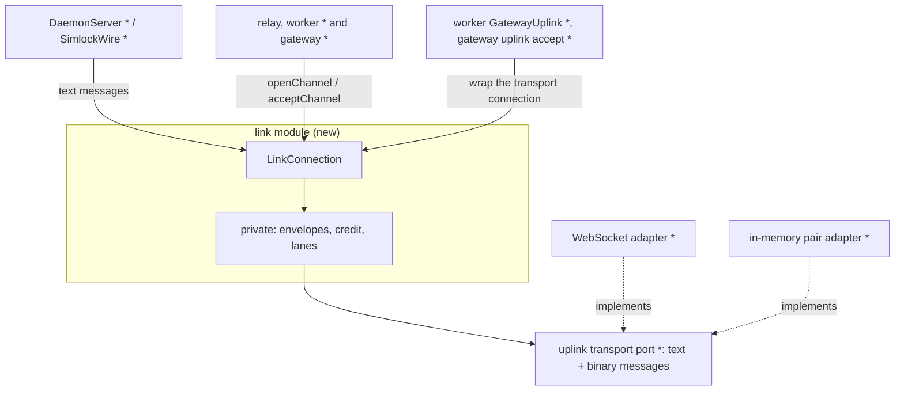
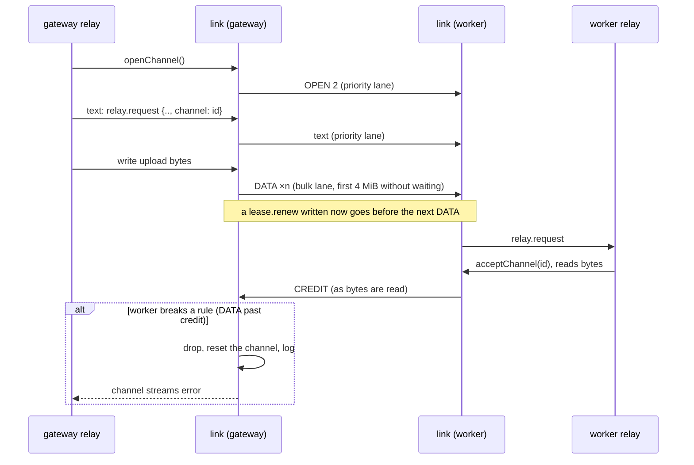

# 0028. The uplink carries byte channels beside its messages, and small messages go first

- **Status:** Accepted
- **Date:** 2026-10-14
- **Issue:** [#552](https://github.com/callstackincubator/simlock/issues/552)
- **Narrows:** [ADR 0026](0026-agent-device-through-a-gateway-relays-over-the-uplink.md)
  §2: a relayed body no longer travels as base64 `relay.body` calls and
  `relay-chunk` pushes, but on a byte channel (§4 below), and the relay's
  limits change. Its consequence "binary frames and fair sharing of the
  uplink are left for later" is this ADR.
- **Builds on:** [ADR 0005](0005-gateway-and-worker-modes.md) (workers dial
  out; the gateway has one inbound port; a version mismatch marks a worker
  `incompatible`),
  [ADR 0018](0018-leasing-is-one-module-and-every-module-is-entered-through-its-index.md)
  (a module is entered through its index),
  [ADR 0023](0023-agent-device-is-served-by-an-optional-edge-module.md) (the
  agent-device host on the worker forwards every agent-device request).

## Context

The uplink is the one WebSocket a worker opens to its gateway. Every
message on it is a line of JSON sent as a text message; binary messages are
dropped. The worker's `DaemonServer` and the gateway's `SimlockWire` read
it, and each writes straight to the connection in call order. Nothing
orders writes or watches what is still unsent.

ADR 0026 relays agent-device HTTP exchanges over it. Bodies go as base64 in
256 KiB pieces: uploads as `relay.body` calls (at most 4 unanswered),
downloads as `relay-chunk` pushes paced only by the worker's socket. The
gateway runs at most 8 relays per worker and queues the rest. That has four
costs, which #552 removes:

- About a third more bytes on the wire, and encoding on both sides.
- Everything behind a large body waits: other agents' commands, lease
  renewals, `status.get`. A command can also wait minutes for one of the 8
  relay slots. Two `status.get` calls that wait over 10 s close the link.
- A download to a slow reader piles up on the gateway; past 64 MiB the
  gateway cancels it.
- No size is promised.

agent-device bounds what simlock can promise. Its daemon refuses uploads
over 2 GiB, and its CLI falls back to a chunked upload after a refused
preflight, so the refusal comes once 2 GiB has arrived. Its proxy ends an
exchange after 5 minutes, its CLI ends an upload after 5 minutes and an
artifact download 90 s after it starts. Its daemon ends a transfer idle for
60 s.

## Decision

(`*` = changed.)

### 1. One link module; its users see messages and byte channels

A new module, the **link module**, entered through its index, wraps one
uplink transport connection and hands out a `LinkConnection`. It is told
which end it is (the worker dials, the gateway accepts). To its users it
offers two things, and nothing else:

- **Messages.** `LinkConnection` is an `IpcConnection`: `write`, `onData`,
  `onClose`, `onError`, `close` work exactly as today. `DaemonServer` and
  `SimlockWire` read and write messages through it as they do now; neither
  knows that messages go ahead of bulk bytes.
- **Byte channels.** `openChannel()` returns a channel: an opaque `id`
  string, a `readable` and a `writable` (standard Web streams of bytes,
  with ordinary backpressure), and `abort(reason)`. The peer gets the
  matching channel with `acceptChannel(id)`. A channel carries bytes both
  ways. Closing the `writable` ends that direction; cancelling the
  `readable` tells the peer to stop sending that direction, whose writer
  then errors with `stopped` and acknowledges with `END` (a `STOP` that
  crosses an `END` already sent needs no answer), while the other
  direction goes on; `abort`
  ends both, on both sides. A channel ends once both directions are done.
  The id is 1–32 characters of `[A-Za-z0-9-]`; a user passes it to its
  peer in a message and reads no other meaning into it. `acceptChannel` throws for an id the peer never opened,
  one already accepted, and one already ended.
- **Credit is visible.** A channel's `credit` is the number of bytes its
  writer may hand the link now without waiting, and `whenCredit()`
  resolves when more arrives; waiting on it counts as a waiting write. A writer that writes no more than `credit` never waits, so
  it can skip data instead, as a live stream drops frames for a viewer that
  fell behind. The streams stay standard Web streams.

`openChannel()` takes an abort signal, always: no wait in the link is
unbounded. `whenCredit()` rejects when the channel fails.

A channel fails, and both its streams error, when the peer aborts it, when
the peer breaks the link's rules on it (§2), when the peer does not accept
it within 30 s, when a write has waited 60 s for the reader to make room
(§2), or when the connection closes. Only a write that is actually waiting
counts toward the 60 s, and the 60 s start again whenever credit arrives,
so a slow reader that keeps reading is never reset; a writer that writes no more than `credit` never
waits and is never reset. The error says which of these it was.
That is the only way a user learns of anything inside the link. The link
bounds only the waits it causes; a wait for bytes the peer has not sent yet
is the user's to bound, as the relay's deadline does. Each side opens at
most 64 channels at once on a connection. A 65th `openChannel()` waits
until one of them ends, and stops waiting when the caller's abort signal
fires. A peer's 65th `OPEN` is a rule break (§2). A channel stops counting
once this side's `END` or `RESET` has been written to the transport and
the peer's `END` or `RESET` has arrived, so a new `OPEN` can never reach
the peer before the end of the channel it replaces.

The link wraps the transport connection where the uplink is made: the
worker's `GatewayUplink` when it dials, the gateway when it accepts. Tests
wrap the in-memory pair the same way. The Unix-socket IPC the CLI uses does
not change and has no channels.

### 2. Inside the link: envelopes, credit and two lanes

Everything here is private to the link module. No user and no user's test
names it.

- **Envelope.** A channel's bytes travel as binary WebSocket messages: a
  type, the channel's number on this connection, then the payload. Types:
  `OPEN`, `DATA` (at most 64 KiB of bytes), `END` (this direction is done),
  `STOP` (send no more in this direction), `CREDIT` (the sender may send
  this many more bytes, at least 1), `RESET` (the channel is aborted, with
  a reason code: aborted, stalled, not-accepted or invalid; a user's own
  abort reason stays on its side). Text messages stay as they are. An
  `OPEN` goes out before any message written after `openChannel()`
  resolves, so a peer always knows a channel before a message names it.
- **Numbers.** The side that opens a channel numbers it: the worker with
  odd numbers, the gateway with even ones, so the two never collide.
  Numbers are 32-bit and never reused on a connection.
- **Opening.** `openChannel()` sends `OPEN`. Each side may send 4 MiB on a
  channel before any `CREDIT`, so bytes can follow `OPEN` at once. The
  receiver holds up to 4 MiB for a channel its user has not accepted yet,
  and resets a channel not accepted within 30 s.
- **Credit.** Past the first 4 MiB, a side sends only as many bytes as the
  other side granted. A side grants more only as its user reads bytes off
  the `readable`. A reader that stops reading stops the sender of that
  channel only. A side holds at most 4 MiB unread per channel. A write
  that has waited 60 s for credit, while the peer already holds every
  byte this channel sent, resets the channel; waiting behind the bulk
  lane never counts. The link takes a chunk larger than the credit in
  parts.
- **Two lanes.** Each side sends through one scheduler per connection.
  Text messages, `OPEN`, `STOP`, `CREDIT` and `RESET` go in the priority lane;
  `DATA` and `END` in the bulk lane. A bulk message is handed to the socket
  only while less than 256 KiB is still unsent there; the transport says
  when bytes leave, which wakes the bulk lane. A channel's `writable`
  holds at most one 64 KiB message of its own before its writer waits. Channels take turns
  in the bulk lane, one message each. When both lanes have something to
  send, the priority lane goes first, but the bulk lane sends at least one
  message for every 64 KiB of priority messages, so neither starves.
- **Rule breaks fail one channel.** `DATA` past the allowed bytes, an
  envelope naming a channel number the peer never opened, an `OPEN`
  reusing a live number, carrying the wrong parity or past the peer's 64,
  `DATA` over 64 KiB, `DATA` or `END` after that direction ended, a
  `CREDIT` of 0 or beyond 4 MiB outstanding, an unknown envelope type, and
  an envelope too short to read are dropped, never buffered. The channel they name, when
  this side holds it, is reset, and the link logs why. Since numbers are
  never reused, a message for a number the peer opened earlier but this
  side no longer holds is late traffic for an ended channel: it is
  dropped quietly and never answered. Only a number the peer never opened
  is a rule break. The connection stays up.

### 3. The uplink transport port carries text and binary messages

The uplink port's connection gains binary messages, a count of the bytes
written and not yet sent, and a notice when that count drops. The uplink connector and listener hand out this
transport connection, and the code that makes the uplink wraps it (§1). The
WebSocket adapter sends a `Uint8Array` as a binary message and stops
dropping binary messages it receives. The in-memory pair adapter carries
both kinds, so a test of a link user runs without sockets. The link module
is the only user of the binary half.

### 4. A relay is a channel and a few messages

ADR 0026 §2's operation changes as follows:

- The gateway opens a channel for each relay, and `relay.request` names it.
  The worker accepts it as soon as it reads the `relay.request`, before the
  request waits out the worker's startup, hands its `readable` to the relay
  target as the request body, and writes the target's response body to its
  `writable`.
  So `DaemonServer`'s relay handling and `SimlockWire`'s relay pushes
  change; their message handling does not.
- `relay.body` and the `relay-chunk` push are gone. `relay-head` stays, and
  `relay.request` still answers once the response body has ended or the
  relay was cancelled. The answer travels in the priority lane and can
  arrive before the last body bytes, so the gateway ends the caller's body
  only at the channel's `END`, never at the answer. A body whose channel
  fails before its `END` errors; it never ends cleanly short.
- `relay.cancel` stays. A cancel, an uplink drop, the deadline and every
  failure also abort the channel.
- A relay ends its channel on every path. The worker stops the request
  direction (`STOP`) once its target has answered without reading the
  whole body, or at once for a relay with no body; the gateway then stops
  reading the caller's body. Every failure of `relay.request`, before or
  after the target runs, aborts its channel.
- The gateway's limit of 4 unanswered `relay.body` calls and its 64 MiB
  unread buffer are gone: credit replaces both. A slow reader slows its own
  transfer and nothing else.
- The relay has no limit of its own. Each relay takes one channel. When the
  gateway has 64 channels open to a worker, the next relay's
  `openChannel()` waits for one to free, and the wait counts against its
  deadline. The gateway's limit of 8
  relays per worker and the worker's limit of 16 per connection are gone.
  Below 64 relays on a worker, no relay waits for another.
- A failed channel fails its relay. On the worker, a rule break by the
  gateway is `BAD_REQUEST`. On the gateway, a rule break by the worker is
  `INTERNAL` (`worker <id> sent an invalid relay response`), as invalid
  relay data is today.
- Unchanged: the 330 s deadline over the whole exchange, the header
  filtering, and the URL and header bounds.

### 5. The agent-device host caps a download at 2 GiB

The agent-device host on the worker forwards every agent-device request,
direct and relayed, and sees each response as agent-device's proxy hands
it over. The proxy keeps `content-length` on artifact downloads only. The
host checks each response before passing it on:

- A `Content-Length` over 2 GiB (2 147 483 648 bytes): the host answers an
  error instead, before any body byte, with a message naming the 2 GB
  limit. Through a gateway, no byte of it crosses the uplink.
- No `Content-Length`: the host counts the bytes and aborts the response
  once it passes 2 GiB. The agent sees a failed transfer, never a short
  body that ends cleanly.

agent-device's CLI reports the up-front refusal as `Failed to download
remote artifact`, with the host's message naming the limit in the details
it prints with its details flag. A download aborted midway is reported as
agent-device's own transfer error.

Uploads over 2 GiB are refused by agent-device's own daemon, when it
decides; simlock does not check them again. The relay and the link know no
size limit.

### 6. Protocol version

The protocol version goes up by one. As with every bump, a worker on the
older version shows as `incompatible` on the gateway, with its uplink left
open, and an older CLI or client library is refused by the newer daemon.

## Consequences

- A relayed transfer of 1 MB or more costs about 1% more on the wire (the
  envelope per 64 KiB, plus the relay's messages), not a third, and nothing
  is encoded.
- A small message waits behind at most 256 KiB of bulk bytes and one 64 KiB
  message in simlock, plus the operating system's send buffer, which macOS
  and Linux cap at 4 MiB by default, in each direction. On a link of 24
  MB/s, the speed a 2 GiB download needs, that is under 0.2 s each way.
- A relay's body, a command's included, waits behind at most one 64 KiB
  message per other active channel, since channels take turns and the first
  4 MiB needs no credit.
- A relay waits for another only when 64 run on its worker at once.
- A relay sent to a worker that is still starting holds its channel, but
  its upload waits for credit until the worker's relay starts reading. An
  upload parked that way for over 60 s fails, and the agent retries.
- Memory per transfer is bounded by credit: about 4 MiB per direction on
  each side, whatever the transfer's size and however slow its reader.
  Each side opens at most 64 channels per connection, so a gateway buffers
  at most about 512 MiB for one worker's relays.
- One channel moves at most 4 MiB per round trip. On a LAN that is far above
  the link's speed; across a slow, distant link a single transfer is
  slower than a direct connection would be.
- A transfer must fit in agent-device's limits: 2 GiB downloads need about
  24 MB/s (90 s), 2 GiB uploads about 7 MB/s (5 minutes). simlock promises
  nothing slower.
- Channels are not specific to the relay. Another module that needs bulk
  bytes over the uplink uses them as they are. The link bounds the waits it
  causes (30 s to accept, 60 s for a waiting write); the user bounds its
  wait for the peer's bytes.
- The link is ready for live streams without being changed. Either side
  can open a channel, and a producer that writes no more than `credit`
  skips data instead of waiting and is never reset. A stream still needs its own rules
  above the link: no 330 s total cap, its own message boundaries, and an
  agent-facing endpoint. Adding a priority class for live channels later
  is an ordinary protocol bump.
- The link module is new code that every gateway–worker message goes
  through. Its tests own the envelope, credit and lane rules, against the
  in-memory pair and the real WebSocket.

## Alternatives considered

- **Every message binary, JSON inside the envelope.** One framing, but it
  rewrites every message and both readers for nothing the promises need.
- **A data socket per transfer, dialled by the worker.** Flow control from
  TCP and no shared queue. Rejected: a second kind of worker connection to
  authenticate, bound and test, and one more round trip per transfer.
- **Credit as JSON calls.** Two messages per grant, waiting in the same
  queue as other calls, and the link's users would see them.
- **At most 4 relays per agent-device lease.** One agent's transfers would
  not queue another agent's command, but a lease's own heartbeat would
  wait behind its own 4 transfers.
- **Bodies on the call itself (`call(op, input, { body })`).** Hides channel
  ids from the relay too, but puts streams into every call `SimlockWire` and
  `DaemonServer` make, not only the relay's.
- **Keep base64, add only the priority lane.** Fixes the waiting, keeps the
  third more bytes and the 64 MiB cancel.
- **A separate relay pool for agent-device commands.** Needs the relay to
  know which requests are commands, which only the front knows.
- **The size cap in the front.** Through a gateway the front never sees the
  size: the relay drops `content-length`, and a relayed request reaches the
  host without passing the worker's front.
