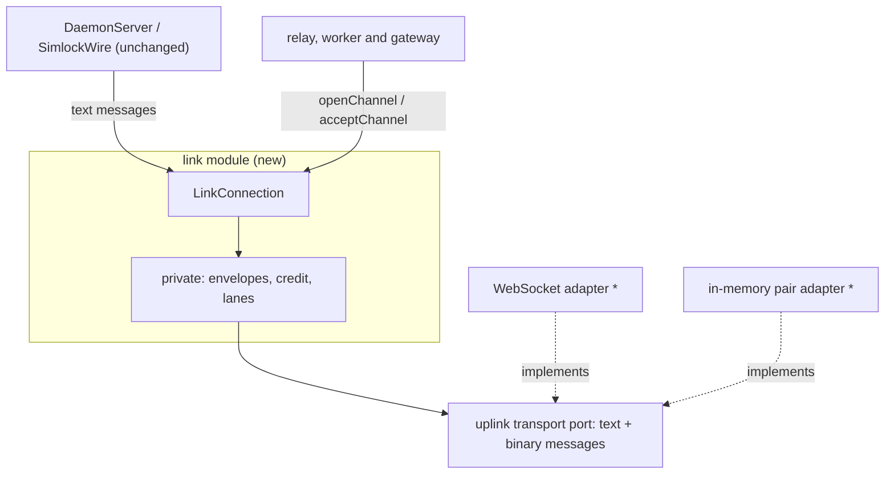
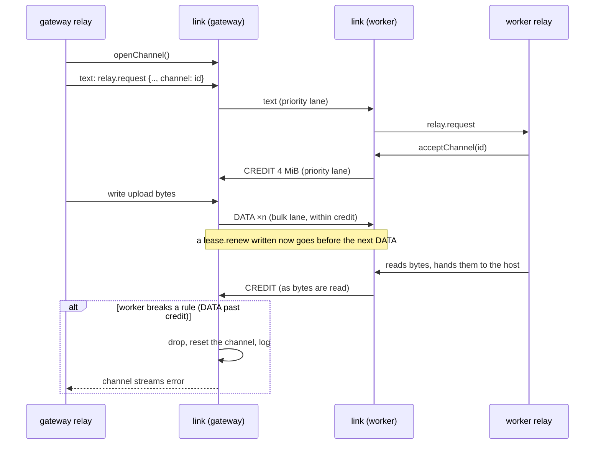

# 0028. The uplink carries byte channels beside its messages, and small messages go first

- **Status:** Proposed
- **Date:** 2026-10-14
- **Issue:** [#552](https://github.com/callstackincubator/simlock/issues/552)
- **Narrows:** [ADR 0026](0026-agent-device-through-a-gateway-relays-over-the-uplink.md)
  §2: a relayed body no longer travels as base64 `relay.body` calls and
  `relay-chunk` pushes, but on a byte channel (§4 below). Its consequence
  "binary frames and fair sharing of the uplink are left for later" is this
  ADR.
- **Builds on:** [ADR 0005](0005-gateway-and-worker-modes.md) (workers dial
  out; the gateway has one inbound port),
  [ADR 0018](0018-leasing-is-one-module-and-every-module-is-entered-through-its-index.md)
  (a module is entered through its index),
  [ADR 0023](0023-agent-device-is-served-by-an-optional-edge-module.md) (the
  agent-device front sees every agent-device request, on a worker and on a
  gateway).

## Context

The uplink is the one WebSocket a worker opens to its gateway. Today every
message on it is a line of JSON sent as a text message, and binary messages
are dropped. Two readers parse it: the worker's `DaemonServer` and the
gateway's `SimlockWire`. Each writes straight to the connection in call
order; nothing orders writes or watches what is still unsent.

ADR 0026 relays agent-device HTTP exchanges over it. Bodies go as base64 in
256 KiB pieces: uploads as `relay.body` calls (at most 4 unanswered), and
downloads as `relay-chunk` pushes, paced only by the worker's socket. That
has four costs, which #552 removes:

- About a third more bytes on the wire, and encoding on both sides.
- Everything behind a large body waits: other agents' commands, lease
  renewals, `status.get`. Two `status.get` calls that wait over 10 s close
  the link, which fails every lease call on that worker.
- A download to a slow reader piles up on the gateway; past 64 MiB the
  gateway cancels it. A slow reader loses its download, and up to
  8 × 64 MiB sits in the gateway's memory per worker.
- No size is promised.

Two facts from agent-device bound what simlock can promise: its daemon
refuses uploads over 2 GiB, and its proxy and CLI end any exchange after
5 minutes.

## Decision

(`*` = changed.)

### 1. One link module; its users see messages and byte channels

A new module, the **link module**, entered through its index, wraps one
uplink transport connection and hands out a `LinkConnection`. To its users
it offers two things, and nothing else:

- **Messages.** `LinkConnection` is an `IpcConnection`: `write`, `onData`,
  `onClose`, `onError`, `close` work exactly as today. `DaemonServer` and
  `SimlockWire` take it unchanged. They do not know that their messages go
  ahead of bulk bytes.
- **Byte channels.** `openChannel()` returns a channel: an opaque `id`
  string, a `readable` and a `writable` (standard Web streams of bytes,
  with ordinary backpressure), and `abort(reason)`. The peer gets the
  matching channel with `acceptChannel(id)`. A channel carries bytes both
  ways. Closing the `writable` ends that direction; `abort` ends both, on
  both sides. The id has no meaning a user may read; a user only passes it
  to the peer, in a message.

A channel fails, and both its streams error, when the peer aborts it, when
the peer breaks the link's rules on it (§2), or when the connection closes.
That is the only way a user learns of anything inside the link. A
connection holds at most 64 open channels; a 65th `openChannel()` throws.

The uplink connector (worker) and listener (gateway) hand out
`LinkConnection`s. The Unix-socket IPC the CLI uses does not change and
has no channels.

### 2. Inside the link: envelopes, credit and two lanes

Everything here is private to the link module. No user and no user's test
names it.

- **Envelope.** A channel's bytes travel as binary WebSocket messages: a
  type, the channel's number on this connection, then the payload. Types:
  `DATA` (at most 64 KiB of bytes), `END` (this direction is done),
  `CREDIT` (the sender may send this many more bytes), `RESET` (the channel
  is aborted). Text messages stay as they are.
- **Credit.** Each side may send on a channel only as many bytes as the
  other side granted. A side grants 4 MiB when it has the channel (on
  `openChannel` or `acceptChannel`), and grants more only as its user reads
  bytes off the `readable`. A reader that stops reading stops the sender of
  that channel only. A side holds at most 4 MiB unread per channel.
- **Two lanes.** Each side sends through one scheduler per connection. Text
  messages, `CREDIT` and `RESET` go in the priority lane and always go
  first. `DATA` and `END` go in the bulk lane: one message at a time, taking
  turns across channels, and only while less than 256 KiB is still unsent
  on the socket. A text message therefore waits for at most 256 KiB plus
  one `DATA` message, plus whatever the operating system holds.
- **Rule breaks fail one channel.** `DATA` past the granted credit, any
  envelope naming a channel number this side does not hold, and an
  envelope too short to read are dropped, never buffered. The channel they
  name, when there is one, is reset, and the link logs why. The connection
  stays up.

### 3. The uplink transport port carries text and binary messages

The uplink port's connection gains binary messages and a count of the bytes
written and not yet sent. The WebSocket adapter sends a `Uint8Array` as a
binary message and stops dropping binary messages it receives. The
in-memory pair adapter carries both kinds, so a test of a link user runs
without sockets. The link module is the only user of the binary half.

### 4. A relay is a channel and a few messages

ADR 0026 §2's operation changes as follows:

- `relay.request` names the channel the gateway opened for it. The worker
  accepts that channel and hands its `readable` to the relay target as the
  request body; it writes the target's response body to the channel's
  `writable`.
- `relay.body` and the `relay-chunk` push are gone. `relay-head` stays, and
  `relay.request` still answers once the response body has ended or the
  relay was cancelled.
- `relay.cancel` stays. A cancel, an uplink drop, the deadline and every
  failure also abort the channel.
- The gateway's limit of 4 unanswered `relay.body` calls and its 64 MiB
  unread buffer are gone: credit replaces both. A slow reader slows its own
  download and nothing else.
- A failed channel fails its relay: `BAD_REQUEST` on the side that saw the
  rule break, `INTERNAL` on the other.
- Unchanged: the 330 s deadline over the whole exchange, at most 8 relays
  at once per worker on the gateway and 16 per connection on the worker,
  the header filtering and the URL and header bounds.

### 5. The agent-device front caps a download at 2 GiB

The front, on a worker and on a gateway alike, checks every response it
passes to an agent:

- A `Content-Length` over 2 GiB (2 147 483 648 bytes): the front answers
  an error instead, before any body byte, with a message naming the 2 GB
  limit.
- No `Content-Length`: the front counts the bytes and aborts the response
  once it passes 2 GiB. The agent sees a failed transfer, never a short
  body that ends cleanly.

Uploads over 2 GiB are refused by agent-device's own daemon; simlock does
not check them again. The relay and the link know no size limit.

### 6. Protocol version

The gateway–worker protocol version goes up by one. A worker on the older
version is refused when it connects, as on any version mismatch.

## Consequences

- Relayed bytes cost about 1% more on the wire (the envelope per 64 KiB),
  not a third, and nothing is encoded.
- A small message waits behind at most 256 KiB of bulk bytes in simlock,
  plus the operating system's send buffer. At the speed the 2 GiB promise
  needs (§5 and the 5-minute limit: about 7 MB/s), that is well under a
  second.
- Memory per transfer is bounded by credit: about 4 MiB per direction on
  each side, whatever the transfer's size and however slow its reader.
- A transfer must fit in agent-device's 5-minute limit. 2 GiB fits on a
  link of about 7 MB/s or faster; simlock promises nothing slower.
- Channels are not specific to the relay. Another module that needs bulk
  bytes over the uplink uses them as they are.
- The link module is new code that every gateway–worker message goes
  through. Its tests own the envelope, credit and lane rules, against the
  in-memory pair and the real WebSocket.

## Alternatives considered

- **Every message binary, JSON inside the envelope.** One framing, but it
  rewrites every message and both readers for nothing the promises need.
- **A data socket per transfer, dialled by the worker.** Flow control from
  TCP and no shared queue. Rejected: a second kind of worker connection to
  authenticate, bound and test, and one more round trip per transfer.
- **Credit as JSON calls.** Two messages per grant, waiting in the same
  queue as other calls, and the link's users would see them.
- **Bodies on the call itself (`call(op, input, { body })`).** Hides
  channel ids from the relay too, but changes `SimlockWire` and
  `DaemonServer`, which every call uses.
- **Keep base64, add only the priority lane.** Fixes the waiting, keeps the
  third more bytes and the 64 MiB cancel.
- **A size cap in the relay.** One more place for a rule that belongs to
  what is transferred; the front already sees both worker and gateway
  traffic.
