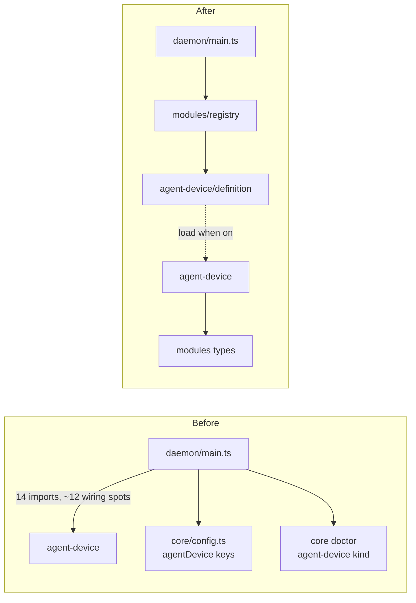
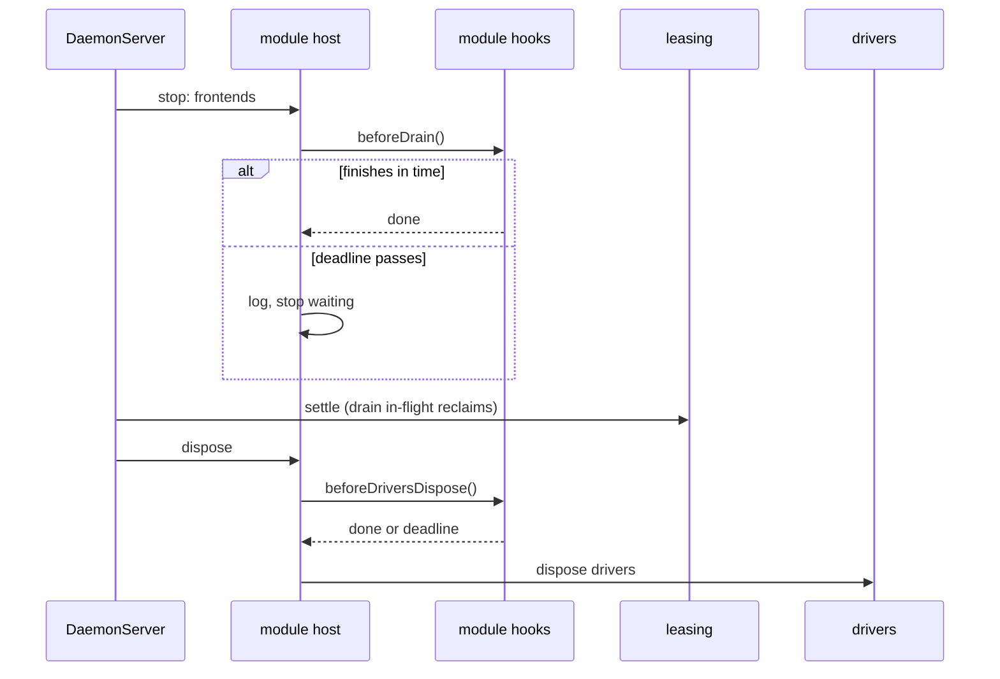

# 0030. Optional modules share one contract and load only when turned on

- **Status:** Accepted — not yet implemented; §2 narrowed by [ADR 0046](0046-a-standalone-worker-serves-agent-device-by-default-with-a-private-profile.md)
- **Date:** 2026-10-15
- **Issue:** [#591](https://github.com/callstackincubator/simlock/issues/591)
- **Supersedes:** nothing. Narrows [ADR
  0023](0023-agent-device-is-served-by-an-optional-edge-module.md) §3, the
  line "reaped and restarted when the simlock daemon starts": a leftover
  agent-device daemon is reaped only when simlock starts with agent-device
  turned on (§2). Keeps [ADR
  0024](0024-leasing-calls-lease-end-participants-before-reclaim.md) as it
  is: the lease-end port and its ceiling do not change; the host adapts a
  module's hook to it (§3). Keeps [ADR
  0026](0026-agent-device-through-a-gateway-relays-over-the-uplink.md)'s
  capabilities and relay as they are, and fixes where their names come
  from (§1).
- **Depends on:** ADR 0023, 0024, 0026, architecture rules 5, 12, 18–21.

## Context

An optional module is a part of simlock a worker runs only when its config
turns it on. agent-device is the only one on `main`. Screen streaming (PR
#576) is being built as the second.

Each one is wired by hand in `src/daemon/main.ts`. agent-device's index
exports 14 names. The start-up file builds its supervisor, its edge parts,
its capability source, its relay target, its lease-end participant, its
HTTP front on both roles, its gateway fleet port, and calls its stop steps
in the right order. #576 adds about 180 lines for streaming next to it.

Nothing ties a module's parts together, and the second module already shows
the cost:

- The name is typed out in several places. #576's capability is
  `screen-stream` and its relay target is `stream`.
- A disabled agent-device reports `off`. A disabled stream reports nothing.
- agent-device's config lives in the core (`src/core/config.ts`), and
  its doctor finding is a kind of its own in the wire contract.
- #576 re-declares the HTTP mount type, because a module that imports
  `src/http` creates a dependency cycle.

Architecture rules 19 and 20 say to add an extension point once a second
implementation exists, in one shape. Streaming is that second
implementation. This ADR fixes the shape before streaming lands, and moves
agent-device onto it first.



## Decision

### 1. A module is one definition in one registry

A new component, `src/modules/`, owns the extension point: its
`index.ts` exports the types below and the host. A second component,
`src/module-registry/`, lists every module's definition, one line each.
The daemon and the CLI read the registry. No other file names a module.
The registry is its own component so that the registry, a module's
definition and `src/modules` form no import cycle.

```ts
export interface OptionalModuleDefinition<C> {
  readonly name: string;
  readonly config: ModuleConfig<C>;
  loadWorker(): Promise<{ createWorker(ctx: WorkerContext<C>): WorkerModule }>;
  loadGateway?(): Promise<{ createGateway(ctx: GatewayContext<C>): GatewayModule }>;
}
```

A module's directory has a small `definition.ts` that exports its
definition. It imports its own module only as types, or through the
dynamic `import()` inside a loader, so reading the registry loads no
module code. A module with no `loadGateway` has no gateway side, and a
gateway never loads it. Each side loads only its own code.

`name` is the module's only name:

- the capability a worker reports;
- the relay target a gateway sends to;
- the `module` field of its doctor finding (§7);
- its key under `capabilities` in the config (§5).

The name passes the capability name check (`^[a-z][a-z0-9-]{0,31}$`). A
test over the registry checks every name.

### 2. A module is loaded only when it is turned on

The host reads `capabilities.<name>.enabled`. When it is `false` or the
section is missing, the host calls
nothing of the module and loads none of its code. It reports the module's
capability as `off` itself.

When it is `true`, the host awaits `loadWorker()` on a worker, or
`loadGateway()` on a gateway, and calls `createWorker` or `createGateway`.
Creating a module starts nothing; a module starts in its
`afterSocketClaimed` hook. A start that fails before the socket is claimed
leaves the modules created and not started, with nothing to stop. One that
fails after it (convergence, the HTTP gateway) stops the daemon through the
normal stop, which runs every module's stop hooks.

A module turned off runs nothing, so it cannot clean up after a crash. If
simlock crashes while agent-device is on and starts again with it off, the
agent-device daemon the crash left keeps running. It is reaped the next
time simlock starts with agent-device on, as today. This needs a crash and
a config change at once. We accept it.

### 3. The handle: what a module provides, and hooks

`createWorker` returns a handle. Fields the module provides are nouns. The
host reads them once, when it builds itself. Calls the host makes at a
moment are grouped under `hooks`. Each hook is named for the host step it
runs at.

```ts
export interface WorkerModule {
  readonly capability: CapabilitySource;
  readonly relayTarget?: RelayTarget;
  readonly mount?: (deps: MountDeps) => ModuleHandler;
  readonly findings?: () => readonly ModuleFinding[];
  readonly hooks?: WorkerHooks;
}

export interface WorkerHooks {
  readonly afterSocketClaimed?: () => void;
  readonly beforeDeviceReclaim?: (lease: EndedLease, signal: AbortSignal) => Promise<void>;
  readonly beforeDrain?: () => Promise<void>;
  readonly beforeDriversDispose?: () => Promise<void>;
}

export interface GatewayModule {
  readonly mount?: (deps: MountDeps) => ModuleHandler;
  readonly hooks?: { readonly beforeDrain?: () => Promise<void> };
}
```

Each hook's name is a promise the host keeps:

| Hook | Runs | Awaited | Bounded by |
|---|---|---|---|
| `afterSocketClaimed` | once this daemon holds its socket; never in a daemon that lost the race | no | — |
| `beforeDeviceReclaim` | after leasing commits a lease's end, before it reclaims the device | yes, by leasing | leasing's lease-end ceiling (ADR 0024 §2) |
| `beforeDrain` | on stop, after new work is refused, before leasing settles | yes | the host's hook deadline, 30 s |
| `beforeDriversDispose` | on stop, before any driver is disposed | yes | the host's hook deadline, 30 s |

The host keeps these rows in one table and runs every module's hooks
through it. It is the one place that bounds them and logs a hook that runs
out of time. For one step, every module's hook starts at once, and the step
waits at most its deadline in total. Both stop steps share one deadline of
30 s. It sits above
agent-device's slowest stop: a start still in progress, then 10 s after
SIGTERM and 2 s after SIGKILL.
`beforeDeviceReclaim` reaches leasing through the lease-end port ADR 0024
already defines; leasing does not change.

Hooks are function-valued properties, not methods, so the host can call
them without binding `this`.

A module's HTTP routes sit under its name. `mount` returns only a handler;
the host serves it at `/v1/<name>` and `/v1/<name>/*`. A module cannot pick
a route that clashes with another module's or with a core route: the
contract lists the first segments of the core routes, a test keeps that
list true to the HTTP app, and the host refuses a module named after one
at start, whether or not HTTP is on.

A module's `findings()` returns `{ message, remedy }`. The host adds the
finding's kind and the module's name (§7), so the name in a finding cannot
drift from the module's.



### 4. The module gets a context, and observes through the bus only

`createWorker(ctx)` gets everything the module uses: its own config
section, a logger named for it, the clock, the ports it may use, the
drivers' platforms and lease environment, and `events.subscribe`.

The event bus is for observing. A module may subscribe to business events
to watch them. A step that has to finish before the host goes on is a hook,
never an event handler. Bus handlers are not awaited, and ADR 0024 already
rejected an event handler for the lease-end step.

`createGateway(ctx)` gets a fleet context bound to the module's name. It
also carries the gateway's granted devices, which agent-device's fleet port
reads:

```ts
export interface GatewayContext<C> {
  readonly config: C;
  readonly instanceId: string;
  readonly startedAt: number;
  readonly requesterPrefix: string;
  workers(): readonly WorkerView[];
  worker(id: string): WorkerView | undefined;
  serving(): readonly WorkerView[];
  readonly leases: FleetLeases;
  relay(workerId: string, request: Request, tenant: string, leaseId?: string): Promise<Response>;
}
```

`serving()` lists connected workers that report this module `available`.
`relay` sends to the relay target named after this module. A module cannot
send to another module's target. `FleetLeases` and the other fleet types
are declared in `src/modules` by shape, because a module may not import
`src/gateway`.

agent-device's gateway fleet port moves out of `main.ts` into the module
and is built from this context.

### 5. A module owns its config, under `capabilities`

Every module's config sits under one key, `capabilities`, keyed by the
module's name:

```json
{ "capabilities": { "agent-device": { "enabled": true, "command": "agent-device" } } }
```

Users meet one word: they turn a capability on here, see its state in
status, and name it in a lease request's `requires`. The top-level
`agentDevice` key goes. agent-device's integration has not been released,
so nothing migrates it: an old `agentDevice` key is an unknown key, warned
about and ignored like any other.

`ModuleConfig<C>` holds the module's validator, its defaults, the keys a
gateway reads, and a check that may read the rest of the merged config
(agent-device's `leaseTtlCapMs` must not exceed `lease.maxTtlMs`). It
follows the shape capacity strategies already use: a validator and
defaults beside the definition.

`loadConfig` takes the registry's configs from its caller, the daemon or
the CLI. The core declares the shape it takes and imports nothing from a
module. A section for a name no module has is an unknown key. A gateway
warns about a module key it does not read, as it does today.

`config.get` returns the same layout. The contract types the section by
shape, so it never changes for a new module:

```ts
capabilities: z.record(capabilityNameSchema, z.object({ enabled: z.boolean() }).catchall(z.unknown())),
```

A client reads `enabled` typed and the rest as `unknown`. The daemon has
already checked each section with its module's validator.

### 6. Shared types live in `src/modules`

`src/modules` declares the handler shape a module's routes have. The host
turns each handler into the mount the HTTP app already takes, so being
mounted needs nothing from `src/http`, and `src/http` does not change. A
module may still use `src/http`'s helpers to build its own front, as
agent-device does.

`src/modules` imports only `src/ports`, `src/contract`, `src/core`, and
types from `src/bus`. A dependency-cruiser rule enforces it. Types it needs
from elsewhere (the capability source, the relay target, the lease-end
participant, the daemon's dispatch, the gateway's lease index) are declared
by shape, and a test checks each copy against the original.
The core, leasing, the drivers, the gateway and the contract import
nothing from `src/modules` or from any module.

### 7. One doctor finding for every module

The doctor finding `agent-device-unavailable` becomes:

```json
{ "kind": "module-unavailable", "module": "agent-device", "message": "…", "remedy": "…" }
```

The host builds it from what a module's `findings()` returns and the
module's name. The core doctor, the contract and the CLI know the one kind,
not any module. The protocol version moves up with
no shim, and the changelog says so.

### 8. Tests swap modules, not module parts

`startDaemon` drops the `agentDeviceUpstream` and `agentDeviceHealth`
options. It takes `optionalModules`, which replaces the registry. A
module's `testing.ts` exports a definition backed by its fakes. A
conformance suite runs over the registry with `describe.each`:

- a module turned off is not loaded and reports `off`;
- creating a module starts nothing;
- each hook it declares settles within its row's deadline in §3;
- the name passes §1's check and no two modules share one.

## Consequences

- Adding an optional module is a directory, a `definition.ts` and one
  registry line. `main.ts`, the core config, the doctor and the contract do
  not change.
- `agentDevice` in `config.json` becomes `capabilities.agent-device`, and
  `config.get` and the client's `SimlockConfig` change with it. The
  protocol version moves up.
- `main.ts` names no module. agent-device's 14 imports and its gateway
  fleet port leave it.
- Every module turned off reports `off`, and its code is never loaded.
- A script matching `agent-device-unavailable` breaks. The protocol bump
  makes an old client refuse a new daemon rather than misread it.
- A leftover agent-device daemon is not reaped while agent-device is off.
  `docs/CONFIGURATION.md`'s line "A daemon a killed Simlock left behind is
  stopped at the next start" gains "with
  `capabilities.agent-device.enabled` `true`".
- The supervisor's path for `enabled: false` is deleted, with its test.
- Streaming lands on this contract when it becomes a feature. Its
  capability and relay target then share one name.

## Alternatives considered

- **Hooks as event-bus events** (`daemon.stopping`, `drivers.disposing`).
  Rejected: bus handlers are not awaited, so `settle` could start while
  agent-device's waiting allocates are still open, and the Android driver
  could stop the adb server under agent-device. Bus events are also public
  facts in `EVENTS.md`.
- **One `onInit(ctx)` that registers everything on the context**
  (`ctx.mount(…)`, `ctx.beforeDrain(…)`). Rejected: nothing checks that a
  module registered what it must, a late registration does nothing
  silently, and the type no longer shows what a module provides.
- **Generic names** (`onInit`, `onDispose`). Rejected: agent-device has two
  start moments and two stop moments with different guarantees. A name that
  fits both hides the one it needs.
- **A definition-level cleanup hook, or a `loadWhenOff` flag,** so a module
  turned off can reap a crash's leftovers. Rejected: it serves only a crash
  followed by a config change, and splits agent-device's start order
  between host and module.
- **The host records and reaps every detached process modules start.**
  Rejected: a shared mechanism with one user.
- **Gateway adapters stay in `main.ts`, one per module.** Rejected: about
  120 lines of per-module code stay in the start-up file, and a module's
  code is split across two places.
- **One top-level key per module (`agentDevice`), typed in the contract
  and checked by a test.** Rejected: every module would add a contract
  entry, and the key would need a camelCase rule to match the name.
- **The namespace called `modules`.** Rejected: users see `capabilities`
  in status, `requires` and `CAPABILITY_MISSING`, and would meet a second
  word for the same thing.
- **Any extra top-level key let through untyped (`catchall`).** Rejected:
  the core's own keys would lose their strictness.
- **The core keeps every module's config, checked by a test.** Rejected:
  each module would still edit the core.
- **A doctor finding kind per module.** Rejected: each module would edit
  the contract, the core doctor and the CLI.
- **One `load()` for both sides.** Rejected: a gateway would have to load
  a module to learn it has no gateway side, and would load its worker code.
- **The registry inside `src/modules`.** Rejected: the registry imports
  each definition and each definition imports `src/modules`, a cycle
  between components.
- **A module picks its own route prefix.** Rejected: a second name per
  module, and a prefix could clash with a core route.
- **Hooks for one step run one after another.** Rejected: a hanging module
  either holds up every module after it or makes the stop grow by 30 s per
  module.
- **Always load every module.** Rejected: a module turned off should cost
  nothing, and streaming's capture code has no reason to load when off.
