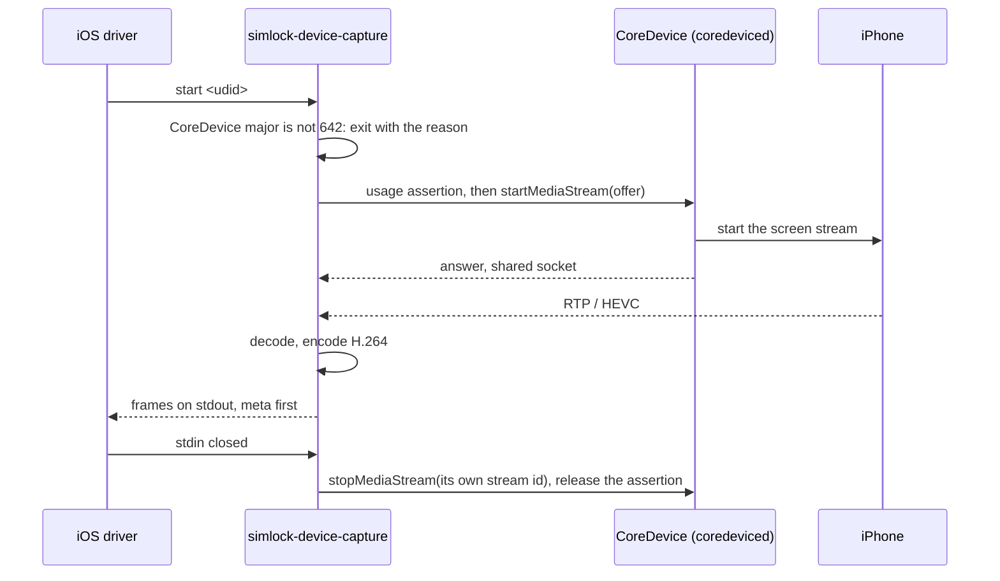
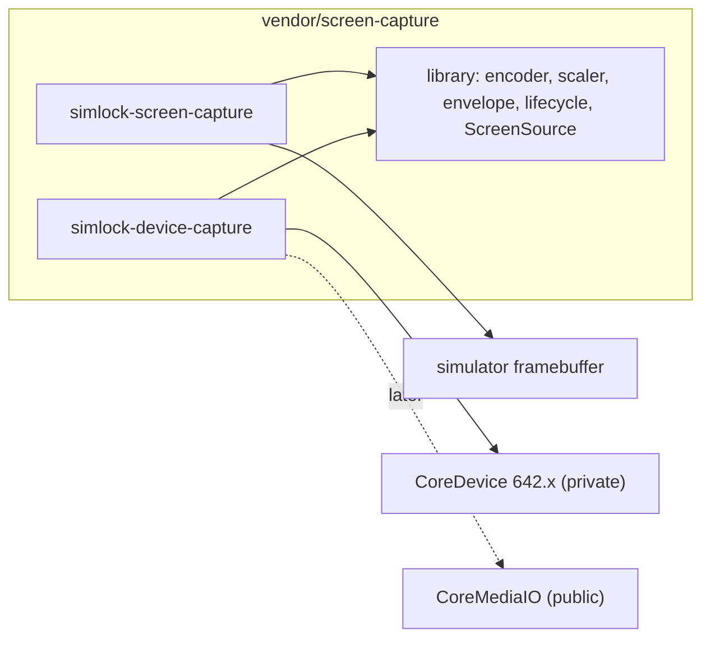

# 0031. A physical iPhone streams through CoreDevice's media stream, behind a screen-source seam

- **Status:** Accepted — not yet implemented
- **Date:** 2026-10-16
- **Issue:** [#617](https://github.com/callstackincubator/simlock/issues/617), task [#619](https://github.com/callstackincubator/simlock/issues/619)
- **Supersedes:** nothing. Builds on the stream module as it is, and on
  [ADR 0022](0022-a-physical-device-is-a-second-device-type-the-core-knows.md)'s
  physical iPhone (USB, enrolled by UDID).
- **Evidence:** [`0031-device-stream-poc/`](0031-device-stream-poc/), a
  proof of concept that mirrors a USB iPhone with this design. Its
  `README.md` and `findings/` say what was tried and what was measured.

## Context

A lease on a simulator streams its screen: `simlock-screen-capture` (Swift,
in `vendor/screen-capture/`) reads the simulator's framebuffer, encodes
H.264 and writes simlock's frame envelope on stdout. The iOS driver runs it
and the stream module serves the bytes. A lease on a physical iPhone gets
`415 STREAM_NOT_SUPPORTED`.

Apple offers two ways to see an iPhone's screen from a Mac.

- **DeviceHub, Xcode 27's device window.** It asks CoreDevice, a private
  framework in `/Library/Developer/PrivateFrameworks`, to start a media
  stream. The iPhone then sends RTP video over the paired tunnel. That
  works over USB and Wi-Fi. DeviceHub hands the stream to `avconferenced`,
  which draws it into a layer. `avconferenced` refuses any client without
  the restricted entitlement `com.apple.videoconference.allow-conferencing`.
  A third-party binary that claims it is killed before `main`
  (`findings/entitlements.md`).
- **QuickTime.** CoreMediaIO's `kCMIOHardwarePropertyAllowScreenCaptureDevices`
  shows a USB iPhone as an `AVCaptureDevice`. The API is public. It works
  over USB only, and the process must hold the Camera permission, which a
  person grants in a dialog on that Mac.

The PoC proved a third path. It drives DeviceHub's negotiation itself
(CoreDevice's `startMediaStream`, and AVConference's negotiator object for
the offer and answer). Then it receives the RTP packets on its own socket
and decodes the HEVC in its own process with VideoToolbox. Nothing goes
through `avconferenced`, so no entitlement is needed, and no Camera
permission either. It streamed over USB and over Wi-Fi
(`proof/usb-packets.stats.json`, `proof/wifi-packets.stats.json`).

The price:

- CoreDevice ships no Swift interface. The PoC calls it through
  hand-written `.swiftinterface` stubs (`Stubs/`). They match CoreDevice
  642.x (Xcode 27), checked on 642.16. Another major version may rename or
  drop what they declare.
- DeviceHub's default HEVC settings produced torn pictures in a decoder of
  our own. The PoC overrides the negotiator's HEVC feature string, and
  turns off long-term reference pictures, inside its own process. That
  fixed it (`findings/hevc-artifacts.md`).
- Without DeviceHub running, CoreDevice does not load the iPhone's
  services. The PoC takes a usage assertion, as DeviceHub does
  (`findings/device-preparation.md`).

## Decision

### 1. A physical iPhone's screen comes from CoreDevice's media stream, decoded by simlock

The capture asks CoreDevice for the iPhone's media stream. It negotiates
through AVConference's negotiator object, receives the RTP packets on the
socket CoreDevice shares with it, and decodes the HEVC with VideoToolbox.
It never uses `avconferenced`, never claims a restricted entitlement, and
never asks for the Camera permission.

### 2. The iPhone has its own program, sharing a library with the simulator's

`vendor/screen-capture/` becomes one Swift package with:

- a library target: the encoders, the scaler, the frame envelope writer,
  the stdin and signal lifecycle, and the `ScreenSource` seam (§3);
- `simlock-screen-capture`: the simulator source, as today;
- `simlock-device-capture`: the CoreDevice source, the only target that
  links CoreDevice and its stubs.

A CoreDevice change can then never stop a simulator stream. macOS refuses
to start a program whose linked frameworks no longer match, before its own
code runs. Only the iPhone program carries that risk.

### 3. A screen source is one shape, with two implementations now and a third named

A `ScreenSource` starts on a device id and hands decoded pictures
(`CVPixelBuffer`) to the shared encode loop. It stops on request. It
reports a failure as one line of text. A source delivers at least 5
pictures a second while it runs, repeating its last one when the screen
is still, as the simulator source does today. A still screen then never
looks like a dead capture to the stream's silence limit.

The two implementations are the simulator framebuffer and CoreDevice.
CoreMediaIO, the QuickTime path, is the named third. It would replace
CoreDevice inside `simlock-device-capture` if CoreDevice's private API
stops being usable. That change touches no TypeScript: the driver runs the
same program with the same arguments.

### 4. CoreDevice major 642 only, and a mismatch is a reason, not a crash

`simlock-device-capture` weak-links the private frameworks. Before it
calls into them, it reads CoreDevice's `CFBundleShortVersionString`.

- Major `642`: it goes on.
- Anything else, or no CoreDevice: it writes one log line and exits with a
  non-zero code, before it touches the iPhone. The line says that physical
  iPhone streams need Xcode 27 (CoreDevice 642.x) and names the version it
  found. The viewer gets that line in a 503.

The program is the one place that enforces the pin. `pnpm build` tries to
build `simlock-device-capture` on every Mac and copies it when it builds.
When it does not build, the build warns and goes on, and a physical
iPhone's stream answers 503 saying the program is missing. A program built
on a Mac with another major refuses at run time, as above. Moving to a new
major means checking the stubs on it and changing the pin, in one change.

### 5. HEVC is decoded and re-encoded as H.264

The iPhone sends HEVC. The program decodes it and encodes H.264 with the
same encoder the simulator program uses. The frame envelope, the console's
decoder and every browser stay as they are. The cost is one decode and one
encode per picture on the worker, both in VideoToolbox.

### 6. The program changes only what it started

- It stops only the media stream it started, by that stream's id. It never
  stops all streams, so DeviceHub or Xcode showing the same iPhone keeps
  its own.
- It releases its usage assertion on every way out: stop, error, the
  stream ending, and an assertion that CoreDevice invalidates.
- The negotiator overrides named in Context are made in its own process, before
  it builds its offer. No system file and no other process is changed.

## Consequences

- Physical iPhone streams need Xcode 27 on the worker, and a simlock built
  on such a Mac. A worker on another Xcode answers 503 with the reason.
- Each new Xcode major costs a check of the stubs against it, and a pin
  change. Until then, iPhone streams on that Xcode are off; simulator
  streams are not affected.
- `vendor/screen-capture/` gains code that is ours (the CoreDevice source,
  the stubs, the RTP receiver) next to serve-sim's. Its `NOTICE.md`
  records which is which. The HEVC feature string comes from the MIT
  `idevice` project and is credited there.
- A worker pays an HEVC decode and an H.264 encode per streamed iPhone.
- The stream module, the frame envelope, the HTTP API and the console do
  not change.

## Alternatives considered

- **QuickTime's CoreMediaIO path now.** Public and stable. Rejected for
  now: the PoC never confirmed sustained frames on it (its log shows a 0x0
  format at start), and it needs the Camera permission granted by a person
  in a dialog on each worker. It stays the named replacement (§3).
- **DeviceHub's own path through `avconferenced`.** Rejected: it needs a
  restricted entitlement Apple does not grant to third parties.
- **One program with two sources.** Rejected: the iPhone source would link
  the private frameworks, so a CoreDevice change would also stop simulator
  streams on that Mac.
- **Pass HEVC to the browser.** Rejected: the console, the envelope's
  `codec` and every viewer would change, and not every browser decodes
  HEVC.
- **Pin the exact version 642.16.** Rejected: every Xcode patch update would
  turn iPhone streams off until someone re-checks the stubs. Apple builds
  these frameworks with library evolution, so a minor version keeps their
  calls.
