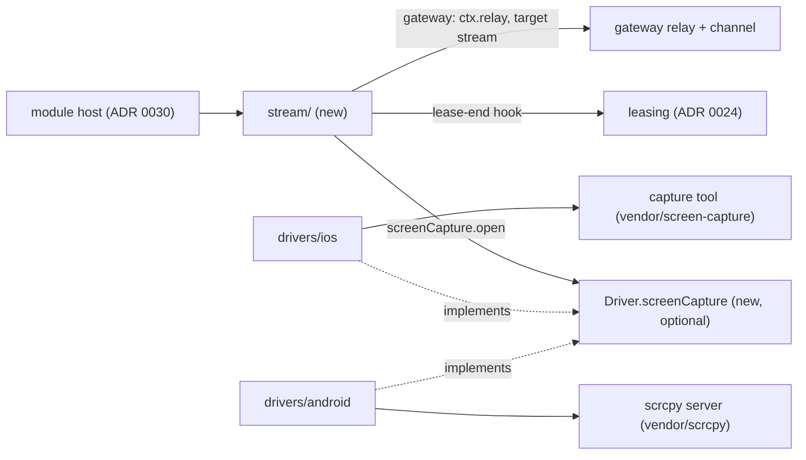
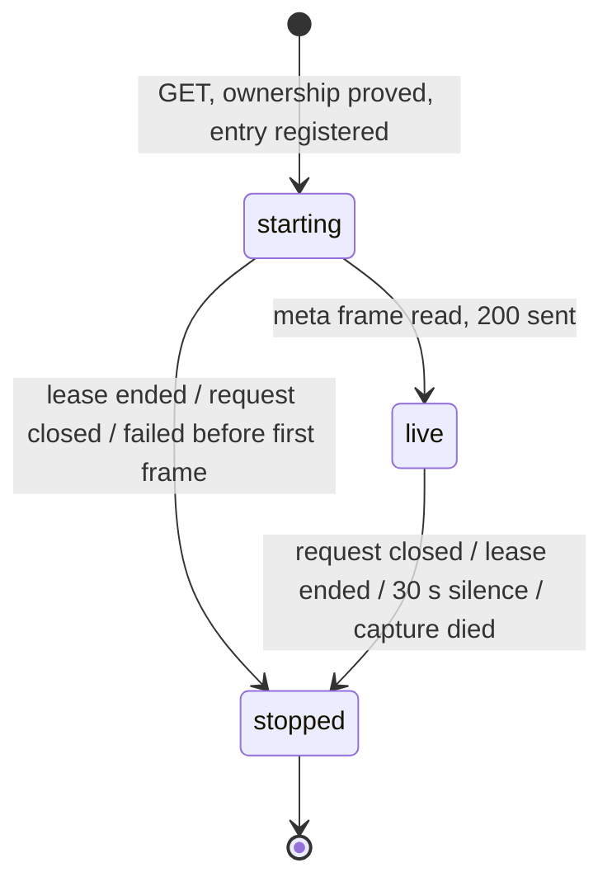
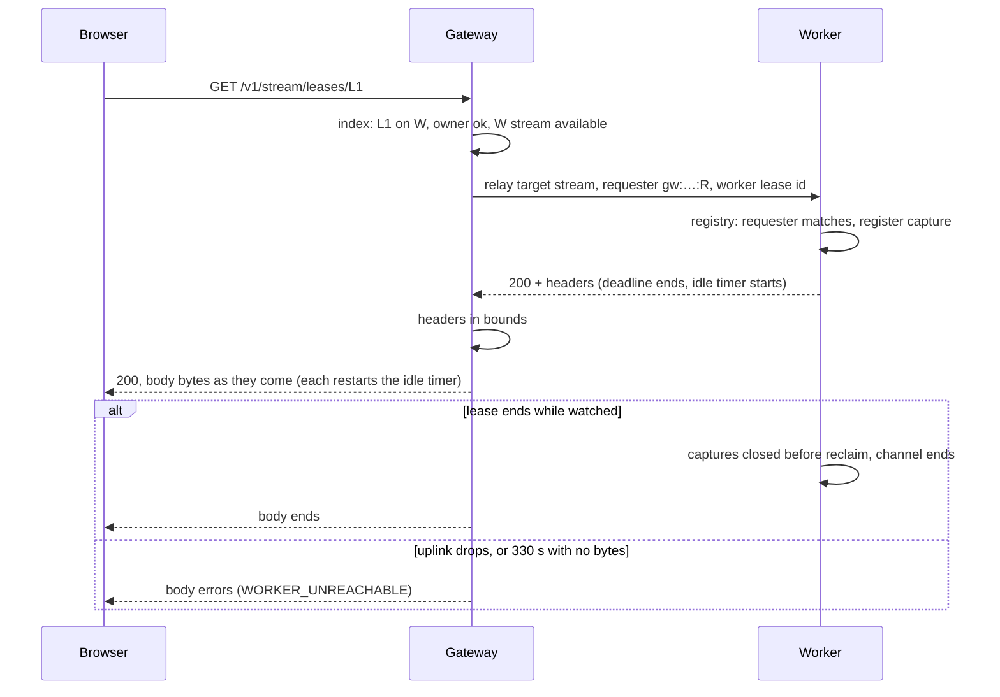

# 0031. A screen stream is an optional module, and a driver films the device

- **Status:** Proposed
- **Date:** 2026-10-15
- **Issue:** [#593](https://github.com/callstackincubator/simlock/issues/593)
- **Supersedes:** nothing. Amends [ADR
  0028](0028-the-uplink-carries-byte-channels-and-small-messages-go-first.md)
  §4, the line "Unchanged: the 330 s deadline over the whole exchange": for
  every relay, the 330 s deadline now covers only the wait for a channel
  and for the response head, and after the head a 330 s idle timer bounds
  the body (§7). Adds a second relay target beside agent-device's ([ADR
  0026](0026-agent-device-through-a-gateway-relays-over-the-uplink.md) §2)
  and a second optional capability to the driver interface.
- **Depends on:** ADR 0030 (the optional-module contract; not merged yet,
  PR #592), [ADR
  0024](0024-leasing-calls-lease-end-participants-before-reclaim.md) (the
  lease-end port), ADR 0026 and 0028 (the relay and its byte channels),
  [ADR 0001](0001-simlock-owned-device-roots.md) (Simlock's own simulator
  set and adb server), [ADR
  0022](0022-a-physical-device-is-a-second-device-type-the-core-knows.md)
  (physical devices), architecture rules 1–3, 9, 11, 12, 15, 18–21, safety
  rules 4, 9 and 10.

## Context

#593 lets a person or an agent watch a leased device's screen live: in the
console, or over the HTTP API, on a worker or through a gateway. PR #576 was
a proof of concept for iOS simulators. It found:

- A leased simulator's screen reaches a browser through Simlock's existing
  links. Swiping measured 18.6–23.2 fps at about 1 Mbit/s at 720 px, and the
  relay through a gateway cost nothing measurable.
- No existing tool can be a dependency. serve-sim, whose capture pipeline
  #576 used, finds devices only in CoreSimulator's default set, and Simlock
  boots every simulator in its own set (ADR 0001). The capture tool has to
  be a patched copy.
- On Android, the scrcpy server (Apache-2.0) films an emulator. It was
  measured at about 21 fps while scrolling, under heavy host load. It
  sends Annex-B H.264, not the AVCC a browser decoder takes.
- The PoC wired one capture command, with every driver's environment
  flattened into it, and refused every device that was not an iOS
  simulator. That does not extend to a second platform.

Several choices bind every task under #593 and any later feature that
builds on streams (input, recording): where the code lives, what the wire
shape is, how a capture is started and stopped, how the core stays
platform-free while two drivers film devices differently, how a gateway
relays a body with no end, and whether a stream is a business event.

## Decision



### 1. One optional module, `src/stream`, on the module contract

Streams live in `src/stream/`, an optional module on ADR 0030's contract.
Its one name is `stream`: the capability a worker reports, the relay target
a gateway sends to, and the config key. The capability is `off` when the
module is turned off, `available` when at least one driver on the worker
can film a device now, and `unavailable` with the drivers' reasons
otherwise.

On a worker the module provides an HTTP mount, a relay target and the
lease-end hook (§3). On a gateway it provides an HTTP mount only.

The module names no platform. It imports from the core only the driver's
screen types (§4), and from leasing only the lease-end types. No required
component imports it. dependency-cruiser (ADR 0027) checks both
directions.

### 2. One `GET` is the only start, and closing it the only stop

`GET /v1/stream/leases/{leaseId}` answers `200` with the picture described
in headers and the video as the body:

| Header | Value |
|---|---|
| `content-type` | `application/vnd.simlock.stream+h264` |
| `simlock-stream-codec` | `h264` |
| `simlock-stream-width`, `simlock-stream-height` | the encoded picture's size in pixels |
| `simlock-stream-fps` | the frame rate the encoder was asked for: a ceiling, not a rate |
| `x-simlock-lease` | the lease id |
| `cache-control` | `no-store` |

The body is the **envelope**: frames of a 4-byte big-endian length that
counts the tag, a 1-byte tag, and the payload.

| Tag | Payload |
|---|---|
| `0x05` | JSON `{ codec, width, height, fps }`; always the first frame |
| `0x01` | codec description: an `avcC` record |
| `0x02` | key frame, length-prefixed AVCC NAL units |
| `0x03` | delta frame, the same |

Other tags are reserved. A reader skips a frame whose tag it does not know.
The worker writes the headers from the meta frame, and the meta frame stays
in the body, so a reader needs nothing else.

The request is the only start: nothing is filmed until someone asks. There
is no stop endpoint and no stop frame. Closing the request, by any route
(Stop in the console, leaving the page, a client abort, a lost network),
stops the capture. Two viewers of one lease get two captures. v1 sends
H.264 only; the codec header exists so a later codec needs no new route.

Who may watch follows `GET /v1/leases/{id}`: an agent its own lease, an
operator any lease. A lease that does not exist, has ended, or belongs to
someone else gets the same `404 UNKNOWN_LEASE`, so asking for pictures
cannot list leases. Refusals use the API's one shape, `{ "error": { "code",
"message" } }`:

| Status, code | When |
|---|---|
| `404 UNKNOWN_LEASE` | unknown, ended or not yours; a lease id that will not URL-decode |
| `405 BAD_REQUEST` | any method but `GET` |
| `415 STREAM_NOT_SUPPORTED` | the lease's device can never be filmed here (§4) |
| `503 STREAM_UNAVAILABLE` | it could be, but not now: tool missing, capture failed before its first frame, the worker has streaming off (gateway) |
| `503 WORKER_UNREACHABLE` | gateway only: the lease's worker is not connected, or did not answer in time |

With the module turned off, the route does not exist.

### 3. Every capture ends, and no later than its lease



- **Registered before it starts.** The worker adds a capture to its
  registry of running captures, keyed by lease, before it asks the driver
  to open the screen. A lease that ends while a capture is starting
  therefore finds it, and a screen that opens after that is closed at
  once. After the first frame the worker reads the lease again; a lease
  that ended in between closes the capture instead of answering `200`.
  Each exit of a capture removes its entry exactly once.
- **The lease end stops it, before the reclaim.** The module's lease-end
  hook (ADR 0030's `beforeDeviceReclaim`, through ADR 0024's port) closes
  every capture of the ended lease and waits for those closes to finish.
  The wait is bounded by each driver's `close` and by leasing's own signal
  (ADR 0024 §2), so the reclaim starts on a device nothing films. What a
  daemon killed mid-capture left on an Android emulator, the reclaim
  sweeps (§6). A lease end by any route (release, release-all, expiry,
  device lost, startup) stops the stream, viewers connected or not.
- **Silence ends it.** A capture that writes nothing for 30 s ends its
  stream with an error, before and after the first frame. A viewer sees a
  stream fail, never a frozen picture that looks live. Both platforms paint
  often enough on an idle screen (iOS every 200 ms, Android about once a
  second), so 30 s means the capture is broken.
- **The daemon stopping stops it.** The module's `beforeDriversDispose`
  hook closes every capture before a driver is disposed, so the Android
  driver never stops its adb server under a running capture.
- **A viewer that stops reading.** Through a gateway, the byte channel
  resets after a write waits 60 s for credit (ADR 0028 §1), which aborts the
  relay and stops the capture. On a worker answering directly, the
  capture is bounded by its lease.

Timers and processes go through ports (architecture rule 9): the clock,
the process runner, and a loopback socket port for the Android client's
connection to the adb server. A
fake clock then decides when silence fires, which also removes the PoC's
flaky silence test.

### 4. A driver films a device through one optional capability

`Driver` gains one optional field, in one shape, as `passthrough` is today.
It is declared in `src/core/screen.ts`:

```ts
interface ScreenCapture {
  /** Why this driver cannot film any device now; undefined when it can. */
  unavailable(): Promise<string | undefined>;
  /** Throws ScreenNotSupportedError or ScreenUnavailableError. */
  open(
    device: VirtualDriverDevice | PhysicalDriverDevice,
    settings: { fps: number; maxDimension: number; bitrateKbps: number },
  ): Promise<ScreenFeed>;
}
interface ScreenFeed {
  readonly body: ReadableStream<Uint8Array>;
  close(): Promise<void>;
}
// Driver: readonly screenCapture?: ScreenCapture;
```

- The body is the envelope of §2, meta frame first. The tag values and the
  meta shape are declared in `src/core/screen.ts`, once, and both drivers
  and the stream module read them from there.
- A driver films only devices it owns, with its own tools and its own
  per-device environment (`leaseEnvironment(device)`). The PoC's flattened
  environment, in which an Android capture would see iOS's keys, is gone.
- The stream module maps outcomes without naming a platform. No
  `screenCapture` field, or a `ScreenNotSupportedError`, is
  `415 STREAM_NOT_SUPPORTED`. A reason from `unavailable()`, a
  `ScreenUnavailableError`, or an `open` that fails before the meta frame
  is `503 STREAM_UNAVAILABLE`.
- Physical devices are refused not-supported by both drivers in v1.

### 5. iOS: a vendored capture tool, shipped built

The iOS driver runs `simlock-screen-capture`, a Swift tool derived from
serve-sim (Apache-2.0) under `vendor/screen-capture/`.

- It is patched to find the device in Simlock's own simulator set,
  through `SIMLOCK_IOS_DEVICE_SET`, which the driver sets from its device
  root.
- The driver passes the picture options and the device's UDID, and keeps
  the tool's stdin open. stdin is the liveness handle: closing it stops
  the tool, and a daemon killed outright closes it too. A tool that has not
  exited 500 ms after its stdin closed gets `SIGKILL`.
- The release workflow builds the tool on macOS, and the npm package
  carries the binary. Nothing is built or downloaded on the user's machine
  (safety rule 4). The driver runs the binary inside the installed
  package; `drivers.ios.screenCaptureCommand` overrides that path, for a
  checkout or a hand-built tool. When the program is not there,
  `unavailable()` says so, and requests get `STREAM_UNAVAILABLE`.
- A physical iPhone is refused: the tool reads a simulator's framebuffer
  and has no path to a phone.

### 6. Android: our client, a vendored scrcpy server, Simlock's adb

The Android driver films an emulator with the scrcpy server v5.0.1
(Apache-2.0), vendored byte-identical under `vendor/scrcpy/` with its
SHA-256 pinned. The client that drives it is ours, in TypeScript, inside
`src/drivers/android/`, running in the daemon. All adb calls go through the
driver's own adb, which for an emulator is Simlock's private adb server.

For each capture the client:

1. picks a random 31-bit `scid` and pushes the jar to a path of its own,
   `/data/local/tmp/simlock-scrcpy-<scid>.jar`, so two captures of one
   emulator never overwrite each other's jar;
2. starts the server with `app_process` and fixed options: the version
   `5.0.1`, `scid`, `tunnel_forward=true`, `audio=false`, `control=false`,
   `send_dummy_byte=true`, `cleanup=true`, `video_codec=h264`, and
   `max_size`, `video_bit_rate` and `max_fps` from the picture options. No
   option that changes a device setting is passed;
3. connects to the server's socket through the adb server's own
   smart-socket protocol: it opens a connection to Simlock's adb server,
   sends `host:transport:<serial>`, then `localabstract:scrcpy_<scid>`,
   and retries until the device socket accepts. No `adb forward` is
   created, so no host port is opened and nothing host-side is left to
   leak;
4. turns scrcpy's stream into the envelope: the codec header gives the
   meta frame, a config packet gives the description (an `avcC` built from
   its SPS and PPS), and each media packet becomes a key or delta frame,
   its Annex-B start codes replaced by AVCC lengths;
5. drops frames only when its reader falls behind, and then only deltas,
   until the next key frame; a description or key frame is never dropped.

`cleanup=true` with no setting options only unlinks the jar when the server
ends, and it runs in its own process, so it survives a `SIGKILL` of the
server. On stop the client closes the socket and stops the server. The
Android reclaim also removes every `simlock-scrcpy-*.jar` on that emulator,
which covers a daemon that died mid-capture.

A physical Android device is refused in v1. It is reached through the
host's default adb server (safety rule 9), and pushing and running a
program on a phone Simlock did not create is a decision of its own. scrcpy
could support it later.

### 7. Through a gateway: the second relay target, unparsed

On a gateway the same URL relays to the worker that holds the lease, as
relay target `stream` (beside `agent-device`) over ADR 0026/0028's byte
channels:

- **Ownership is proved twice.** The gateway resolves the lease in its
  lease index and checks the caller as §2 says. It relays with the
  namespaced requester from its own lease index (`requesterPrefix` plus the
  lease's recorded requester), never a name the caller sent, and with the
  worker's own lease id. The worker proves the requester again against its
  own registry, as for `device.exec`. Both answer unknown and not-yours the
  same way.
- **The worker must serve streams.** A worker whose `stream` capability is
  not `available` in its view gets no relay; the caller gets
  `STREAM_UNAVAILABLE` with the worker's reason. A disconnected worker is
  `WORKER_UNREACHABLE`.
- **The deadline bounds the head; silence bounds the body.** This amends
  ADR 0028 §4 for every relay target alike. The gateway relay's 330 s
  deadline now covers only the wait for a channel and for the response
  head. Once the head is in, an idle timer bounds the body: it restarts on
  every chunk, and when 330 s pass with no response bytes it ends the
  exchange as a dead worker does (`WORKER_UNREACHABLE`, `relay.cancel`,
  the channel aborted). The default is `DEFAULT_IDLE_MS`, and
  `GatewayRelayOptions.idleMs` sets it. The relay still names no target
  (architecture rule 21). 330 s, not less, because an agent-device `/rpc`
  body may sit silent between progress lines, and agent-device's proxy
  already aborts every exchange 300 s after it starts on the worker, so
  agent-device behaves as before. A stream body is bounded first by the
  worker's 30 s silence timer, its lease and the channel's 60 s waiting
  write (§3); the idle timer is the gateway's own backstop.
- **The gateway forwards bytes unparsed.** It reads the worker's head and
  never a video byte.
- **A worker's answer is a claim.** On a `200`, each picture header must be
  present and in bounds (codec `h264`; width and height whole numbers from
  1 to 8192; fps a whole number from 1 to 60), or the caller gets
  `STREAM_UNAVAILABLE`. On a refusal, the gateway reads at most 16 KiB of
  body. It passes the worker's status and code on only when the status is
  4xx or 5xx, the code matches `^[A-Z][A-Z0-9_]{0,63}$` and the message is a
  string, cut to 1,000 characters. Anything else becomes
  `STREAM_UNAVAILABLE`, naming the worker.



### 8. A stream emits no business event

There is no `stream.opened` or `stream.ended`. Events are facts about state
Simlock owns, emitted after it is committed. Watching a screen changes no
lease and no device: the lease that allows it already emitted
`lease.granted`. `device.exec` emits no event for the same reason. A
console that reconnects, or a viewer that toggles the panel, would also
put many events in the 1000-entry ring with no fact behind them.

The daemon log records each stream as a request: opened (lease, requester,
picture), refused (code), and ended (reason, duration, bytes). Both
`EVENTS.md` files say that a stream emits no event, and why. An audit of
who watched what is a separate feature with its own retention, as it is for
`device.exec`.

### 9. Third-party code lives under `vendor/`, and only there

- Each first-level directory under `vendor/` holds one upstream's code or a
  build derived from it, its license texts under `LICENSES/`, and a
  `NOTICE.md`: upstream and commit, what was taken and left out, every
  deviation with its reason, the command that re-checks provenance, and a
  per-file origin table. A vendored binary is byte-identical, with
  `SHA256SUMS.txt` beside it. A test fails a directory without a license
  text or a notice. The rule is
  `docs/internal/agent-rules/vendor-and-third-party-code.md`, which lands
  with this feature.
- Our own code never lives under `vendor/`. The Android client goes in
  `src/drivers/android/`, not beside the jar.
- Nothing under `vendor/` is fetched at install, build or start.

### 10. Configuration

`stream.enabled` (both sides, default `false`), and on the worker
`stream.fps` (1–60, default 30), `stream.maxDimension` (96–4096, default
720) and `stream.bitrateKbps` (64–40000, default 1500). A gateway reads
only `stream.enabled` and warns about the rest, as ADR 0030 §5 says.
There is no `stream.command`: the capture program is the driver's. The iOS
driver's `drivers.ios.screenCaptureCommand` overrides its path (§5).

## Consequences

- An operator can watch any leased simulator or emulator in the console,
  on one worker or through a gateway; an agent can watch its own over HTTP.
- A watched device costs its worker a capture: on iOS about 66–78 MB and
  an encoder, on Android an encoder inside the emulator. Two viewers cost
  two captures.
- The npm package grows by a macOS binary and the scrcpy jar (about
  730 KB). The release workflow needs a macOS job to build the binary.
- Simlock opens its first connection into an emulator and writes its first
  file there. Because it goes through the adb server's smart-socket
  protocol, no host port is opened and no `adb forward` can be left behind.
- Every relayed body, agent-device's included, is now bounded by 330 s of
  silence instead of 330 s in total. An agent-device exchange still ends
  by 300 s, at its proxy.
- scrcpy documents its server protocol as internal and checks its version
  by exact string. Moving off 5.0.1 is a deliberate upgrade of the jar,
  the client and the notice together. It has had one breaking wire change
  in about eight years.
- The capture tool uses private CoreSimulator API. A new Xcode can break it;
  the provenance diff in its notice is the early warning.
- A stream holds one byte channel for its life. A worker with 64 open
  channels makes the next relay, a stream or an agent-device call, wait.
- No event marks a stream, so `simlock events` cannot say who watched.

## Alternatives considered

- **A stop endpoint or a stop frame.** Rejected: a viewer that vanishes
  never sends it, so the request's own end has to stop the capture anyway,
  and then the endpoint is a second way to do one thing.
- **One capture program per platform, named in config (the PoC's
  `stream.command`).** Rejected: the module would pick a program by
  platform, which only a driver may know, and the program would need every
  driver's environment, flattened.
- **The stream module calls `simctl` and `adb` itself.** Rejected: platform
  code outside the drivers.
- **serve-sim as an npm dependency.** Not possible: it cannot see a device
  outside the default set.
- **The scrcpy client program instead of our own client.** Rejected: it
  decodes and displays or records, rather than passing H.264 through, and
  needs an install Simlock does not ship. Third-party scrcpy front ends
  under GPL and AGPL were not considered.
- **`raw_stream=true` from scrcpy.** Rejected: it drops the codec id and the
  picture size the meta frame needs.
- **`cleanup=false`.** Rejected: the jar would stay in the emulator after a
  daemon was killed. With no setting options, `cleanup=true` changes no
  device setting.
- **`adb screenrecord`.** Rejected: capped at three minutes and slow to
  start.
- **WebRTC or a WebSocket.** Rejected for v1: a second transport through the
  gateway and the uplink. A plain `GET` body rides the existing relay, and
  the browser's `fetch` and `VideoDecoder` read it.
- **The gateway re-frames or re-encodes.** Rejected: it would parse video
  it does not need to, at a cost on every stream.
- **`stream.opened` and `stream.ended` events.** Rejected: §8.
- **The relay knows `stream` needs no total deadline.** Rejected: the relay
  would name an implementation.
- **A head-only deadline that the caller asks for, with no bound after
  the head.** Rejected: a relayed body would then have no bound of the
  gateway's own. One idle timer for every target bounds every body and
  needs no option.
- **An idle timer shorter than 330 s.** Rejected: an agent-device `/rpc`
  body may be silent between progress lines for most of its proxy's 300 s.
- **`adb forward` to a host port (the draft Android capture program).**
  Rejected: it opens a loopback port any local process can reach first,
  and leaves a forward to remove after a crash. The smart-socket connection opens neither.
- **The lease-end hook resolves without waiting for captures to close.**
  Rejected: the reclaim could start while a capture still films the
  device it is wiping.
