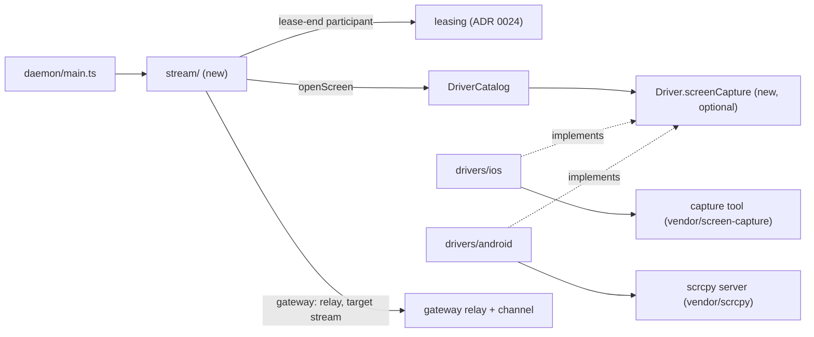
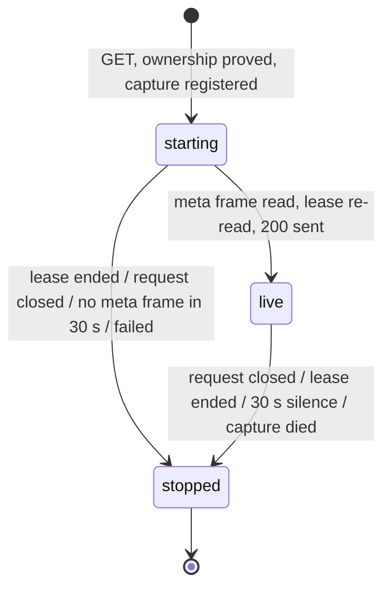
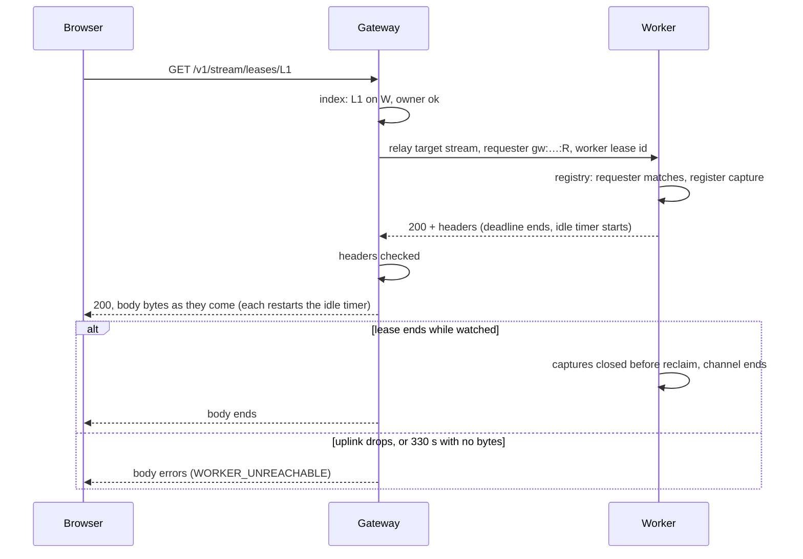

# 0031. A screen stream is an optional module, and a driver films the device

- **Status:** Accepted — not yet implemented
- **Date:** 2026-10-15
- **Issue:** [#593](https://github.com/callstackincubator/simlock/issues/593)
- **Supersedes:** nothing. Amends [ADR
  0028](0028-the-uplink-carries-byte-channels-and-small-messages-go-first.md)
  §4, the line "Unchanged: the 330 s deadline over the whole exchange": for
  every relay, the 330 s deadline now covers only the wait for a channel
  and for the response head, and after the head a 330 s idle timer bounds
  the body (§7). Adds a second relay target beside agent-device's ([ADR
  0026](0026-agent-device-through-a-gateway-relays-over-the-uplink.md) §2)
  and a second optional capability to the driver interface.
- **Depends on:** [ADR
  0024](0024-leasing-calls-lease-end-participants-before-reclaim.md) (the
  lease-end port), ADR 0026 and 0028 (the relay and its byte channels),
  [ADR 0001](0001-simlock-owned-device-roots.md) (Simlock's own simulator
  set and adb server), [ADR
  0022](0022-a-physical-device-is-a-second-device-type-the-core-knows.md)
  (physical devices), architecture rules 1–3, 9, 11, 12, 15, 18–21, safety
  rules 4, 9 and 10. Related: ADR 0030 (the optional-module contract, PR
  #592, not merged); §1 says how this module meets it.

## Context

#593 lets a person or an agent watch a leased device's screen live: in the
console, or over the HTTP API, on a worker or through a gateway. PR #576
builds it. On the way it found:

- A leased simulator's screen reaches a browser through Simlock's existing
  links. Swiping measured 18.6–23.2 fps at about 1 Mbit/s at 720 px, and the
  relay through a gateway cost nothing measurable.
- No existing tool can be a dependency. serve-sim, whose capture pipeline
  the iOS tool comes from, finds devices only in CoreSimulator's default
  set, and Simlock boots every simulator in its own set (ADR 0001). The
  capture tool has to be a patched copy.
- On Android, the scrcpy server (Apache-2.0) films an emulator, at about
  21 fps while scrolling under heavy host load. It sends Annex-B H.264, not
  the AVCC a browser decoder takes. On a still screen its encoder repeats
  the last frame once and then sends nothing.
- A first draft wired one capture command, with every driver's environment
  flattened into it, and refused every device that was not an iOS
  simulator. That does not extend to a second platform.

Several choices bind this feature and any later one that builds on
streams (input, recording): where the code lives, what the wire shape is,
how a capture is started and stopped, how the core stays platform-free
while two drivers film devices differently, how a gateway relays a body
with no end, and whether a stream is a business event.

## Decision



### 1. One optional module, `src/stream`

Streams live in `src/stream/`, turned on by `stream.enabled`. Its one name
is `stream`: the capability a worker reports, the relay target a gateway
sends to, and the config key.

The module hands out parts, and the composition root wires them, as it
does agent-device's edge. A worker gets four: an HTTP mount, a relay
target, a lease-end participant (§3) and a capability source. A gateway
gets one: the HTTP mount. With the module off, `daemon/main.ts` builds
nothing: no route, no relay target, no capability row.

The capability is `available`, with no reason, when at least one driver
can film a device now; the wire carries no reason for `available`. It is
`unavailable` with each platform's reason otherwise. A platform that
cannot film on a host where another can says why in its stream's `503`.

ADR 0030's module host is not merged. This module does not wait for it.
If ADR 0030 is accepted, `stream` moves onto its contract with the same
parts.

The module names no platform. It imports from the core only the screen
types (§4) and registry records, and from leasing only the lease-end
type. Only `daemon/main.ts` imports it. dependency-cruiser (ADR 0027)
checks both directions.

### 2. One `GET` is the only start, and closing it the only stop

`GET /v1/stream/leases/{leaseId}` answers `200` with the picture described
in headers and the video as the body:

| Header | Value |
|---|---|
| `content-type` | `application/vnd.simlock.stream+<codec>` |
| `simlock-stream-codec` | `h264` (or `mjpeg`, §4) |
| `simlock-stream-width`, `simlock-stream-height` | the encoded picture's size in pixels |
| `simlock-stream-fps` | the frame rate the encoder was asked for: a ceiling, not a rate |
| `x-simlock-lease` | the lease id |
| `cache-control` | `no-store` |

The body is the **envelope**: frames of a 4-byte big-endian length that
counts the tag, a 1-byte tag, and the payload.

| Tag | Payload |
|---|---|
| `0x05` | JSON `{ codec, width, height, fps }`; always the first frame |
| `0x01` | codec description: an `avcC` record |
| `0x02` | key frame, length-prefixed AVCC NAL units |
| `0x03` | delta frame, the same |
| `0x04` | a JPEG still (seed), which the iOS tool may write |
| `0x06` | `alive`: empty; the capture is alive with nothing new to paint |

A reader skips a frame whose tag it does not know. The worker writes the
headers from the meta frame, and the meta frame stays in the body, so a
reader needs nothing else.

The request is the only start: nothing is filmed until someone asks. There
is no stop endpoint and no stop frame. Closing the request, by any route
(Stop in the console, leaving the page, a client abort, a lost network),
stops the capture. Two viewers of one lease get two captures, and v1 sets
no limit per lease: only the lease holder or an operator can open one,
and each costs one capture and, through a gateway, one of 64 channels.

Who may watch follows `GET /v1/leases/{id}`: an agent its own lease, an
operator any lease. A lease that does not exist, has ended, or belongs to
someone else gets the same `404 UNKNOWN_LEASE`, so asking for pictures
cannot list leases. Refusals use the API's one shape, `{ "error": { "code",
"message" } }`:

| Status, code | When |
|---|---|
| `404 UNKNOWN_LEASE` | unknown, ended or not yours; a lease id that will not URL-decode |
| `405 BAD_REQUEST` | any method but `GET` |
| `415 STREAM_NOT_SUPPORTED` | the lease's device can never be filmed here (§4) |
| `503 STREAM_UNAVAILABLE` | it could be, but not now: program missing, capture failed before its meta frame; gateway: the worker has streaming off |
| `503 WORKER_UNREACHABLE` | gateway only: the lease's worker is not connected, or did not answer in time (any fleet code the relay fails with is passed on as `503`) |
| `502` | gateway only: the worker answered `2xx` with no `simlock-stream-codec` header or no body; the code is the worker's if shaped like ours, else `STREAM_UNAVAILABLE` |
| `500 INTERNAL` | anything else, e.g. a relay that fails with no code |

With the module turned off, the route does not exist.

### 3. Every capture ends, and no later than its lease



- **Registered before it starts.** The worker adds a capture to its
  registry of running captures, keyed by lease, before it asks the driver
  to open the screen, and passes the driver a signal that aborts when the
  viewer leaves or the lease ends. A driver stops an open in progress on
  that signal and cleans up what it started before it throws. A capture
  that attaches after its viewer or lease left is closed at once. After
  the meta frame the worker reads the lease again; a lease that ended in
  between closes the capture instead of answering `200`. The viewer, the
  body's end and the lease end can each close a capture; the driver's
  close runs once.
- **The lease end waits for the device to be left alone.** The module's
  lease-end participant (ADR 0024) aborts every open of the ended lease,
  waits for each open in progress to settle, then closes what attached
  and waits for those closes. A capture whose viewer already left stays
  registered until its open settles and what it attached is closed, so
  the lease end waits for it too. The wait is bounded by each driver's own
  bounds and by leasing's signal (ADR 0024 §2), which fires at
  `lease.endWaitMs` (default 10 minutes). Within that the reclaim starts on
  a device nothing films. Past it the wipe starts anyway, and an Android
  open still pushing (up to 30 s) or starting its server (up to 15 s) can
  overlap the reclaim; that is accepted, with that bound. A lease end by any route (release, release-all,
  expiry, device lost, startup) stops the stream, viewers connected or
  not. A nuke or a daemon shutdown aborts the participants first, so its
  wipe may run while a capture is still closing; that is accepted, since
  maintenance is an operator's reset.
- **Every step is bounded, on the Clock port.** The driver bounds its own
  open (Android: the push 30 s, then 15 s to the server's size packet;
  iOS: a spawn). Then the meta frame must come within 30 s, and after it a
  capture that writes nothing for 30 s ends its stream with an error. A
  viewer sees a stream fail, never a frozen picture that looks live. The
  iOS tool paints at least every 200 ms. On a still Android screen scrcpy
  sends nothing, so the Android driver sends an `alive` frame after 5 s
  with nothing new, once its first key frame is out; an encoder that never
  paints meets the silence bound. The bounds nest: 5 s alive < 30 s
  silence < 330 s relay idle (§7). The console waits 90 s for a stream's
  headers, not the 10 s every other console request gets ([ADR
  0013](0013-the-console-reads-routes-and-follows-the-event-stream.md)):
  a worker may take up to 75 s (push, server start, meta frame) before it
  answers, and a console that gave up first would show its own timeout
  instead of the worker's reason.
- **A device rebooted under a lease.** On Android the stream ends when
  the device socket closes or at the silence bound, and close runs its
  cleanup against the serial it stored at open. On iOS the capture
  program checks that the simulator is booted only at start, then repaints
  its last surface every 200 ms, so after a reboot the viewer can see the
  old picture until Stop and Show screen. That is a known gap, accepted
  for v1; the lease end stops the capture as usual.
- **The daemon stopping.** The module has no stop hook of its own. The
  daemon stops its HTTP front first, which ends every request, and each
  viewer's abort releases its capture. An iOS tool also stops when the
  daemon's process ends and its stdin closes; on Android the host-side
  `adb shell` ends with the daemon, which ends the device server.
- **A viewer that stops reading.** Nothing is dropped on the worker: the
  body is pulled, so a slow viewer slows its capture to its pace. Through
  a gateway, the byte channel resets after a write waits 60 s for credit
  (ADR 0028 §1), which aborts the relay and stops the capture. On a worker
  answering directly, the capture is bounded by its lease. The console's
  decoder drops deltas when it falls behind and resumes at the next key
  frame.

Timers and processes go through ports (architecture rule 9): the clock, a
byte-pipe launcher (binary stdout, stdin as liveness) for the iOS tool,
the process runner for `adb`, and a TCP stream connector for the Android
client's connection to the adb server.

### 4. A driver films a device through one optional capability

`Driver` gains one optional field, in one shape, as `passthrough` has. It
is declared in `src/core/screen.ts`:

```ts
interface ScreenCapture {
  /** Why this driver cannot film any device now; undefined when it can. */
  unavailable(): Promise<string | undefined>;
  /** Throws ScreenNotSupportedError or ScreenUnavailableError. */
  open(
    device: VirtualDriverDevice | PhysicalDriverDevice,
    settings: { fps: number; maxDimension: number; bitrateKbps: number },
    signal: AbortSignal, // the viewer left or the lease ended
  ): Promise<ScreenFeed>;
}
interface ScreenFeed {
  readonly body: ReadableStream<Uint8Array>;
  close(): Promise<void>; // bounded by the driver, idempotent
}
// Driver: readonly screenCapture?: ScreenCapture;
```

- `DriverCatalog.openScreen(platform, device, settings)` and
  `screenAvailability()` route to it. A platform whose driver has no
  `screenCapture` throws `ScreenNotSupportedError`.
- The body is the envelope of §2, meta first. The tag table, the meta
  shape and the frame encoder are declared in `src/core/screen.ts`, once;
  the Android driver writes with them, the stream module reads with them,
  and a test pins the console's copy of the tags to core's.
- A driver films only devices it owns, with its own tools and its own
  per-device environment. The draft's flattened environment, in which an
  Android capture would see iOS's keys, is gone.
- The stream module maps outcomes without naming a platform.
  `ScreenNotSupportedError` is `415 STREAM_NOT_SUPPORTED`. Any other
  failure before the meta frame is `503 STREAM_UNAVAILABLE`, with the
  driver's reason.
- Both drivers ask for H.264. The meta and the headers also accept
  `mjpeg`, the iOS tool's other mode, which the console paints as stills.
- Physical devices are refused not-supported by both drivers in v1.

### 5. iOS: a vendored capture tool, built on the host

The iOS driver runs `simlock-screen-capture`, a Swift tool derived from
serve-sim (Apache-2.0) under `vendor/screen-capture/`.

- It is patched to find the device in Simlock's own simulator set,
  through `SIMLOCK_IOS_DEVICE_SET`, which the driver sets from its device
  root.
- The driver passes the UDID and the picture options, and keeps the
  tool's stdin open. stdin is the liveness handle: closing it stops the
  tool, and a daemon killed outright closes it too. Close: stdin, then
  `SIGKILL` if the tool has not exited after 2 s.
- Simlock is not published to npm; it installs from a checkout with
  `pnpm build`. `pnpm build` builds the tool with the host's Swift
  toolchain on macOS into `dist/bin/simlock-screen-capture`. The Swift
  package has no dependencies, so the build fetches nothing (safety rule
  4). Elsewhere, or without Xcode, the build skips it and iOS streams
  report unavailable. `drivers.ios.screenCaptureCommand` names another
  program. Built on the host for the host, the tool needs no signing,
  notarization or universal binary.
- A physical iPhone is refused: the tool reads a simulator's framebuffer
  and has no path to a phone.

### 6. Android: our client, a vendored scrcpy server, Simlock's adb

The Android driver films an emulator with the scrcpy server v5.0.1
(Apache-2.0), vendored byte-identical under `vendor/scrcpy/` with its
SHA-256 pinned. `pnpm build` copies it to `dist/vendor/scrcpy/` after
checking that digest; a mismatch fails the build. The client that drives
it is ours, in TypeScript, in `src/drivers/android/screen/`, running in
the daemon. All adb traffic goes through Simlock's private adb server.

For each capture the client:

1. picks a random 31-bit `scid` and pushes the jar to a path of its own,
   `/data/local/tmp/simlock-scrcpy-<scid>.jar`, so two captures of one
   emulator never touch each other's jar or socket;
2. starts the server with `app_process` and fixed options: `5.0.1`,
   `scid`, `tunnel_forward=true`, `video=true`, `audio=false`,
   `control=false`, `video_codec=h264`, `send_dummy_byte=true`,
   `cleanup=true`, and `max_size`, `max_fps` and `video_bit_rate` from the
   picture options. No option that changes a device setting is passed;
3. connects to the server's socket through the adb server's smart-socket
   protocol: a TCP connection to Simlock's adb server sends
   `host:transport:<serial>`, then `localabstract:scrcpy_<scid>`, retried
   every 100 ms until the server listens, within one 15 s start budget.
   The open checks its stop signal before and after the push (the push
   itself cannot be interrupted) and between connection attempts.
   No `adb forward` is created, so no host port is opened and nothing
   host-side is left to leak;
4. turns scrcpy's stream into the envelope: each session packet gives a
   meta frame, a config packet gives the description (an `avcC` built from
   its SPS and PPS), and each media packet becomes a key or delta frame,
   its Annex-B start codes replaced by AVCC lengths. A rotation starts a
   new session: a new meta frame, then a new description, which the
   console follows mid-stream;
5. reads the socket only when the body is pulled, so nothing is dropped,
   and, once its first key frame is out, sends `alive` after 5 s with
   nothing new (§3);
6. closes within 5 s: the socket, then `SIGKILL` for the `adb shell` if it
   has not exited after 1 s, then `rm -f` of the jar.

`cleanup=true` with no setting options only unlinks the jar: the server
starts a clean-up process, which survives the server and unlinks the jar
as it starts. Killing the
host-side `adb shell` ends the server on the device. So a closed capture
leaves no jar and no server behind, and so does a daemon that dies
mid-capture, since its host-side `adb shell` dies with it.

A physical Android device is refused in v1. It is reached through the
host's default adb server (safety rule 9), and pushing and running a
program on a phone Simlock did not create is a decision of its own.

### 7. Through a gateway: the second relay target, unparsed

On a gateway the same URL relays to the worker that holds the lease, as
relay target `stream` (beside `agent-device`) over ADR 0026/0028's byte
channels:

- **Ownership is proved twice.** The gateway resolves the lease in its
  lease index and checks the caller as §2 says. It relays with the
  namespaced requester from its own lease index (`requesterPrefix` plus the
  lease's recorded requester), never a name the caller sent, and with the
  worker's own lease id. The worker proves the requester again against its
  own registry, as for `device.exec`. Both answer unknown and not-yours the
  same way.
- **A relay that fails is a stream refusal.** A worker with streaming off
  has no `stream` relay target; its `RELAY_TARGET_MISSING` becomes `503
  STREAM_UNAVAILABLE`, naming the worker. A disconnected worker, or one
  that does not answer in time, is `503 WORKER_UNREACHABLE`; any other
  fleet code the relay fails with is passed on with `503`. A failure with
  no code, such as an abort, is `500 INTERNAL`.
- **The deadline bounds the head; silence bounds the body.** This amends
  ADR 0028 §4 for every relay target alike. The gateway relay's 330 s
  deadline now covers only the wait for a channel and for the response
  head. Once the head is in, an idle timer bounds the body: it restarts on
  every chunk, and when 330 s pass with no response bytes it ends the
  exchange as a dead worker does (`WORKER_UNREACHABLE`, `relay.cancel`,
  the channel aborted). Both timers run on the daemon's Clock port;
  `GatewayRelayOptions.idleMs` sets the idle one. The relay
  still names no target (architecture rule 21). 330 s, not less, because
  an agent-device `/rpc` body may sit silent between progress lines, and
  agent-device's proxy already aborts every exchange 300 s after it starts
  on the worker, so agent-device behaves as before. A stream body is
  bounded first by the worker's 30 s silence bound, its lease and the
  channel's 60 s waiting write (§3); the idle timer is the gateway's own
  backstop.
- **The gateway forwards bytes unparsed.** It reads the worker's head and
  never a video byte.
- **A worker's answer is a claim.** On a `200`, the picture headers pass
  the same check as a meta frame (`checkedMeta`: codec `h264` or `mjpeg`;
  width and height whole numbers from 1 to 16384; fps a whole number from
  0 to 240), or the caller gets `STREAM_UNAVAILABLE`. A `2xx` with no
  `simlock-stream-codec` header or no body is `502`. On a refusal, the
  gateway reads at most 16 KiB of
  body. It passes the worker's code on only when it matches
  `^[A-Z][A-Z0-9_]{0,63}$` and the message is a non-empty string, cut to
  1,000 characters; anything else becomes `STREAM_UNAVAILABLE`, naming the
  worker. A status outside 4xx–5xx becomes `502`.



### 8. A stream emits no business event

There is no `stream.opened` or `stream.ended`. Events are facts about state
Simlock owns, emitted after it is committed. Watching a screen changes no
lease and no device: the lease that allows it already emitted
`lease.granted`. `device.exec` emits no event for the same reason. A
console that reconnects, or a viewer that toggles the panel, would also
put many events in the 1000-entry ring with no fact behind them.

The daemon log records each stream opened (lease, codec, size) and each
one refused (lease, code, message). Both `EVENTS.md` files say that a
stream emits no event, and why. An audit of who watched what is a
separate feature with its own retention, as it is for `device.exec`.

### 9. Third-party code lives under `vendor/`, and only there

- Each first-level directory under `vendor/` holds one upstream's code or a
  build derived from it, its license texts under `LICENSES/`, and a
  `NOTICE.md`: upstream and commit, what was taken and left out, every
  deviation with its reason, the command that re-checks provenance, and a
  per-file origin table. A vendored binary is byte-identical, with
  `SHA256SUMS.txt` beside it. A test fails a directory without a license
  text or a notice. The rule is
  `docs/internal/agent-rules/vendor-and-third-party-code.md`, which lands
  with this feature.
- Our own code never lives under `vendor/`. The Android client goes in
  `src/drivers/android/`, not beside the jar.
- Nothing under `vendor/` is fetched at install, build or start.

### 10. Configuration

`stream.enabled` (both sides, default `false`), and on the worker
`stream.fps` (1–60, default 30), `stream.maxDimension` (96–4096, default
720) and `stream.bitrateKbps` (100–40000, default 1500; the iOS encoder
takes nothing lower). A gateway reads only `stream.enabled` and warns
about the rest. There is no `stream.command`: the capture program is the
driver's. The iOS driver's `drivers.ios.screenCaptureCommand` overrides
its program (§5). The config shape `config.get` returns gains `stream`,
a contract change, so the daemon protocol goes up by one.

## Consequences

- An operator can watch any leased simulator or emulator in the console,
  on one worker or through a gateway; an agent can watch its own over HTTP.
- A watched device costs its worker a capture: on iOS about 66–78 MB and
  an encoder, on Android an encoder inside the emulator. Two viewers cost
  two captures, with no limit per lease in v1.
- A lease end on a lease whose capture is still opening waits for that
  open to stop, up to the driver's own bounds or `lease.endWaitMs`.
- iOS streams need Xcode on the worker when `pnpm build` runs. A worker
  built without it reports why in its `stream` capability.
- A slow viewer slows its own capture rather than losing frames on the
  worker. A still Android screen costs a 5-byte frame every 5 s.
- Simlock opens its first connection into an emulator and writes its first
  file there. Because it goes through the adb server's smart-socket
  protocol, no host port is opened and no `adb forward` can be left behind.
- Every relayed body, agent-device's included, is now bounded by 330 s of
  silence instead of 330 s in total. An agent-device exchange still ends
  by 300 s, at its proxy.
- scrcpy documents its server protocol as internal and checks its version
  by exact string. Moving off 5.0.1 is a deliberate upgrade of the jar,
  the client and the notice together. It has had one breaking wire change
  in about eight years.
- The capture tool uses private CoreSimulator API. A new Xcode can break it;
  the provenance diff in its notice is the early warning.
- A stream holds one byte channel for its life. A worker with 64 open
  channels makes the next relay, a stream or an agent-device call, wait.
- No event marks a stream, so `simlock events` cannot say who watched.
- After a reboot under its lease, an iOS viewer can see a stale picture
  until Stop and Show screen.
- If ADR 0030 is accepted, the module's wiring moves out of
  `daemon/main.ts` onto its contract.

## Alternatives considered

- **A stop endpoint or a stop frame.** Rejected: a viewer that vanishes
  never sends it, so the request's own end has to stop the capture anyway,
  and then the endpoint is a second way to do one thing.
- **One capture program per platform, named in config (the draft's
  `stream.command`).** Rejected: the module would pick a program by
  platform, which only a driver may know, and the program would need every
  driver's environment, flattened.
- **The stream module calls `simctl` and `adb` itself.** Rejected: platform
  code outside the drivers.
- **serve-sim as an npm dependency.** Not possible: it cannot see a device
  outside the default set.
- **Ship the iOS tool prebuilt, from a release workflow.** Rejected:
  Simlock is installed from a checkout, so the host builds it. That also
  removes the signing, notarization and universal-binary questions.
- **Wait for ADR 0030's module host.** Rejected: it is not merged, and the
  module's parts are the ones that contract asks for, so moving later is
  wiring only.
- **The scrcpy client program instead of our own client.** Rejected: it
  decodes and displays or records, rather than passing H.264 through, and
  needs an install Simlock does not ship. Third-party scrcpy front ends
  under GPL and AGPL were not considered.
- **`raw_stream=true` from scrcpy.** Rejected: it drops the codec id and the
  picture size the meta frame needs.
- **`cleanup=false`.** Rejected: the jar would stay in the emulator after a
  daemon was killed. With no setting options, `cleanup=true` changes no
  device setting.
- **A reclaim sweep of `simlock-scrcpy-*` jars.** Not needed: the
  server's clean-up process unlinks the jar as it starts, and close runs `rm -f` for one that never
  started.
- **Drop deltas in the Android client when its reader falls behind.**
  Rejected: the body is pulled, so the client never holds a backlog;
  dropping belongs to the viewer's decoder, which knows it is behind.
- **No alive frame, and a longer silence bound.** Rejected: a still
  Android screen would need a bound longer than any real failure, and the
  gateway's 330 s idle timer would still end it.
- **`adb screenrecord`.** Rejected: capped at three minutes and slow to
  start.
- **WebRTC or a WebSocket.** Rejected for v1: a second transport through the
  gateway and the uplink. A plain `GET` body rides the existing relay, and
  the browser's `fetch` and `VideoDecoder` read it.
- **The gateway re-frames or re-encodes.** Rejected: it would parse video
  it does not need to, at a cost on every stream.
- **`stream.opened` and `stream.ended` events.** Rejected: §8.
- **The relay knows `stream` needs no total deadline.** Rejected: the relay
  would name an implementation.
- **A head-only deadline that the caller asks for, with no bound after
  the head.** Rejected: a relayed body would then have no bound of the
  gateway's own. One idle timer for every target bounds every body and
  needs no option.
- **An idle timer shorter than 330 s.** Rejected: an agent-device `/rpc`
  body may be silent between progress lines for most of its proxy's 300 s.
- **`adb forward` to a host port (the draft Android capture program).**
  Rejected: it opens a loopback port any local process can reach first,
  and leaves a forward to remove after a crash. The smart-socket connection
  opens neither.
- **The lease-end participant resolves without waiting for captures to
  close, or for an open in progress.** Rejected: the reclaim could start
  while a capture still films, or is still being started on, the device
  it is wiping.
- **A limit on captures per lease.** Not in v1: only the lease holder or
  an operator can open one, and the gateway's 64 channels bound a fleet
  viewer. A limit can come with a need for one.
