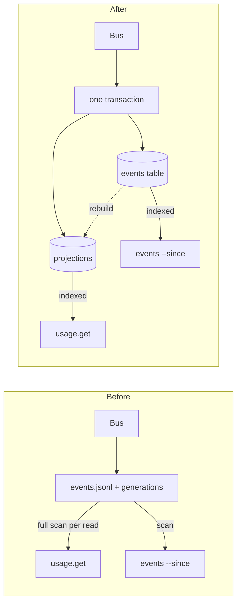
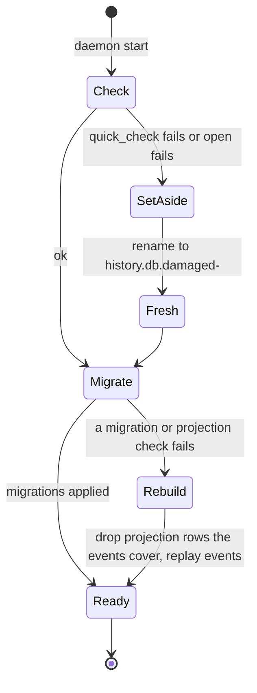

# 0032. The event history is a SQLite database, with projections beside it

- **Status:** Accepted — not yet implemented
- **Date:** 2026-10-16
- **Issue:** [#623](https://github.com/callstackincubator/simlock/issues/623)
- **Supersedes:** [ADR
  0016](0016-usage-figures-are-derived-on-read-from-the-event-history.md)
  §1 (no store; figures computed on read) and §4 (the event file's
  generations), and its Consequences on read cost. Narrows [ADR
  0006](0006-events-and-log-are-two-records.md) §2: events keep a record of
  their own, but it is a database, not `events.jsonl`. ADR 0016 §2, §3, §5,
  §7 and §8, and §6 as amended by [ADR
  0021](0021-a-gateway-dispatch-is-a-probe-and-names-its-fleet-request.md),
  stay.

## Context

The console can show only the last hour. It counts back from events it
holds, and a reload starts it from zero. ADR 0016 planned to compute every
figure on read from the event file. That has two costs that grow with the
window:

- A wide window reads the whole retained history. The file can reach
  256 MiB, about 1.1 million events, and one full read and parse takes about
  1.3 to 1.5 s on a developer Mac. A console that shows 24-hour figures and
  refreshes every 15 s would pay that again whenever anything happened.
- Figures live only as long as the raw events: seven days, or less when the
  size cap drops a generation first. A quarter of trends means keeping a
  quarter of events.

Each read also joins three or four events by id for every request. That join
was the part of the reader that took the most review rounds (#347).

Events stay the record of what happened (the audit trail). Reading them is
what needs to be fast.



## Decision

### 1. The event history is one SQLite file, `history.db`

The event history is `history.db` in the data directory, opened through
Node's built-in `node:sqlite`. Its `events` table holds every envelope
unchanged, keyed by `id`, indexed by `timestamp`. An event whose `id` is
already present is not written again. This is how a gateway's relayed
events stay single (ADR 0014).

`events.jsonl` is no longer written or read. A host that upgrades starts
with an empty `history.db`. Its old event files stay where they are, untouched.

`history.db` holds history only. The registry, tokens, the worker list,
`instance.json` and the other files stay as they are.

`node:sqlite` is unflagged from Node 22.13, so `engines` becomes
`>=22.13`. The daemon silences that module's experimental warning and no
other warning.

### 2. Projections are written with the event, in the same transaction

Beside `events`, the database keeps projections: tables built only from
event envelopes, by one function.

- **One row per lease request:** when it was requested, granted or
  rejected, and ended; its outcome and reason; the grant source; platform,
  model, worker and requester; whether it was refused at admission or was
  a gateway's probe. A wait, a held time and a turnaround are read from one
  row. On a gateway, held time is measured on the worker's clock (ADR 0021
  §5).
- **One row per minute,** per worker and platform, plus one row per worker
  for all its platforms and, on a gateway, one for the whole fleet. Each
  row holds leases held, device slots used and their maximum, RAM used and
  its limit when the strategy keeps a budget, queue depth and requests
  waiting. Each value is kept three ways: its peak in the minute, its
  value at the minute's end, and its integral over the minute (value ×
  milliseconds). The all-platforms and fleet rows are updated on every
  step, so their peak is the highest the total reached at once, not a sum
  of separate peaks. The integral gives an exact time-weighted mean.
- **One row per device fact:** provisioning and boot durations, incidents
  (quarantined, recovered, lost) and declined probes, with time, platform
  and worker.

The bus subscriber that writes events writes each event and its projection
changes in one transaction, synchronously, as the event file is written
today. The database runs in WAL mode with `synchronous=NORMAL`: a process
crash loses nothing that was committed, and a power loss can lose the last
few transactions. That matches today's file, which is written without
fsync. One transaction with its projection changes costs about 31 µs on a
developer Mac.

Batching was rejected. A batch lost in a crash loses the events
themselves, and nothing else holds them.

A write that fails stops writing, logs once, and keeps the daemon running,
as today. `status.get` then says the history is not being written.

```mermaid
sequenceDiagram
  participant M as Module (under its lock)
  participant B as Bus
  participant H as History writer
  participant D as history.db
  M->>B: emit(event) after commit
  B->>H: envelope
  H->>D: BEGIN; INSERT event; apply projection; COMMIT
  alt write throws
    H->>H: stop writing, log once, status notice
  end
  B-->>M: return
```

### 3. Each record keeps its own window

| Record | Kept for | Key | Default |
|---|---|---|---|
| `events` rows | by timestamp | `eventLog.retention` | 7 days |
| all of `history.db` | by size on disk, `history.db` and its `-wal` file, oldest events first | `eventLog.maxBytes` | 256 MiB, at least 16 MiB |
| projection rows | by timestamp | `metrics.retention` | 90 days |

Pruning runs at daemon start, once the daemon holds its socket, and every
hour. It deletes rows, not files, then returns the freed pages to the disk
(`auto_vacuum=INCREMENTAL`, set when the file is created), so the size on
disk follows the cap down as well as up. Because it deletes rows, an event
older than `retention` never stays just because a newer one shares its file. `eventLog.rotateBytes` is removed: there is no file left to rotate.
A config that still sets it gets the usual unknown-key warning.

Projection rows outlive the events they came from. A row older than the
oldest event is final: it can no longer be rebuilt.

### 4. A damaged file is set aside; a broken projection is rebuilt



- At start, once it holds its socket, the daemon runs `PRAGMA quick_check`.
  A lock held by another process waits up to 5 s and is never taken for
  damage. A file that fails it, or
  will not open, is renamed to `history.db.damaged-<time>` and never
  deleted. A fresh file takes its place. Leasing carries on. The log and
  `status.get` say so.
- The projections' shape has a version. An upgrade that changes it ships a
  SQL migration, so 90 days of rows survive it.
- When a migration or a projection check fails at start, the daemon drops
  the projection rows the retained events cover and rebuilds them by
  replaying those events through the same function. Rows older than the
  oldest event are kept.

### 5. Every reader goes through the database

- `usage.get` answers from the projections. Wait percentiles come from the
  request rows by nearest rank, over every request in the window. ADR 0016
  §5 (`coversFrom`, `partial`, `HISTORY_NOT_KEPT`) is judged against the
  oldest projection row.
- `events.replay` with `sinceTs`, `simlock events --since` and the
  console's event feed read the `events` table by timestamp. When no daemon
  answers, the CLI opens `history.db` read-only, as it reads the file today.
- Series keep ADR 0016 §8's bucket widths. A point is the peak of its
  bucket, so a short spike stays visible on a week-wide chart.

### 6. A gateway keeps its own history

A gateway writes its own `history.db` from its own events and the worker
events it relays. No message is added between gateway and worker. Fleet
request figures come from the gateway's own events (ADR 0021 §5). A
worker's minute rows on the gateway have gaps while it was disconnected.
A gap reads as no data, not zero.

## Consequences

- One more file in the data directory. `events.jsonl` and its generations
  are left behind on upgraded hosts until the operator removes them.
- The history depends on `node:sqlite`, which Node still marks experimental.
  An API change between Node majors lands in one port.
- The event write stays inside the emitter's call, as today. Its cost moves
  from one appended line to one small transaction.
- Projection rows are a second record of the last seven days. They cannot
  disagree with the events, because both commit in one transaction, and a
  failed check rebuilds them.
- A figure added later covers only the time since its migration, plus what
  a rebuild can reach from the retained events.
- `docs/CLI.md`, `docs/CONFIGURATION.md`, `docs/EVENTS.md`, both event
  catalogs and the bus manual stop naming `events.jsonl`.

## Alternatives considered

- **Keep deriving on read (ADR 0016 §1).** Rejected: the read cost grows
  with the window, and figures cannot outlive raw events.
- **A projection file beside `events.jsonl`.** Rejected: two files cannot
  commit together, so the figures could disagree with the events after a
  crash.
- **Batched writes.** Rejected: a crash loses the batch's events, and
  nothing holds them to rebuild from.
- **Minute rollups only, with a wait histogram.** Rejected: percentiles
  would be approximate, and per-request figures (held time, the CSV ledger)
  would be lost.
- **Moving the registry, tokens and workers into the same file.** Left to
  [#624](https://github.com/callstackincubator/simlock/issues/624). It needs
  a different rule for a damaged file: a damaged registry must stop the
  daemon, while damaged history can be set aside. In one file, history
  writes would also hold up lease commits on SQLite's single writer lock.
