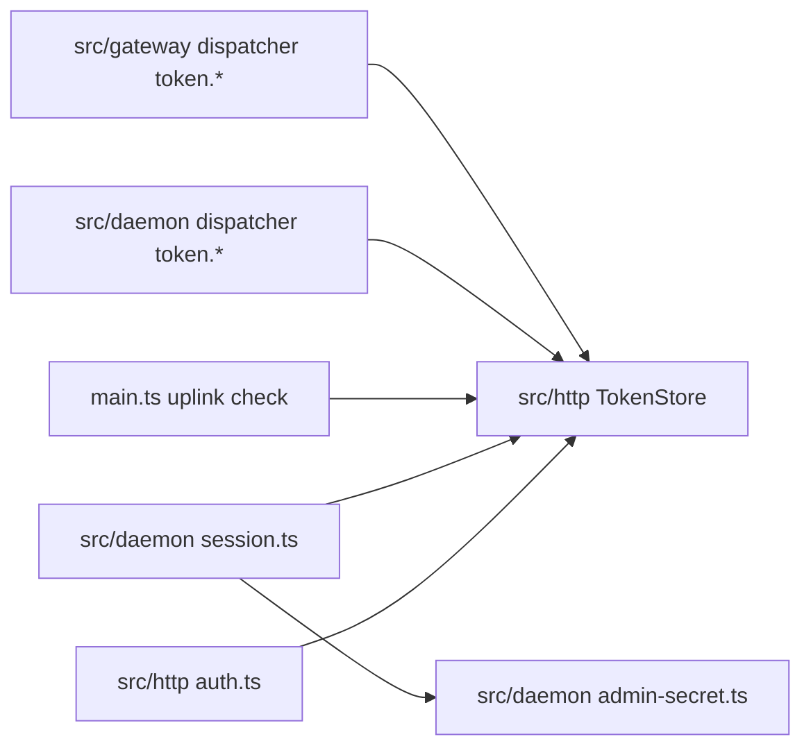
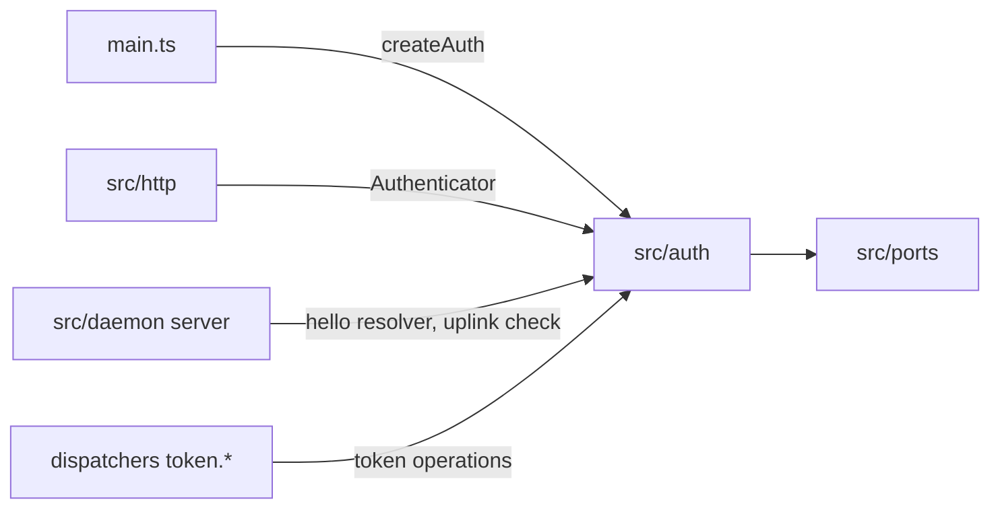

# 0033. A sign-in proxy is a second way to sign in, and auth is one module

- **Status:** Proposed
- **Date:** 2026-10-19
- **Issue:** [#701](https://github.com/callstackincubator/simlock/issues/701)
- **Supersedes:** nothing. Amends [ADR
  0003](0003-one-typed-daemon-contract-behind-every-frontend.md) §4 (an HTTP
  principal may come from a sign-in proxy, not only a token), [ADR
  0005](0005-gateway-and-worker-modes.md) §24 (a gateway's clients may sign
  in through a proxy too) and [ADR
  0011](0011-the-console-is-a-built-app-the-daemon-serves.md) (Context, §6
  and the rejected cookie session: a proxy cookie now reaches the API, so
  the CSRF defence that alternative named is built).
- **Depends on:** ADR 0003 §4–§5 (principal, role, the hello credential),
  ADR 0005 §4 and §25 (the join token), ADR 0011 §6 (console sign-in), ADR
  0013 (the console follows the event stream with `fetch`), ADR 0027 (the
  module boundaries lint checks).

## Context

Today the only way to sign in over HTTP is a Simlock bearer token. The
console asks a person to paste an operator token. Many teams already put
internal tools behind a sign-in proxy: Cloudflare Access, Google IAP,
Pomerium, oauth2-proxy. The proxy signs the person in with the team's
identity provider and adds a signed JWT to each request it lets through.
Simlock ignores that JWT and asks for a token anyway.

The code that turns a credential into an identity is in four places: the
HTTP middleware and token store (`src/http/auth.ts`, `token-store.ts`), the
socket hello resolver and admin secret (`src/daemon/session.ts`,
`admin-secret.ts`), and the uplink check inline in `src/daemon/main.ts`.
`main.ts` builds the token store twice, once per mode. A second way to sign
in would touch all of them.



## Decision

### 1. `src/auth` owns every credential check

A new component, `src/auth`, owns everything that turns a credential into
an identity: the token store (`tokens.json`), the per-start admin secret,
the socket hello's credential check, the uplink's join-token check, and
the HTTP request check. Every token is verified in one place.

- Its index hands out `createAuth(config, ports)`, which returns the
  capabilities the hosts use: an `Authenticator` for HTTP requests, the
  socket hello resolver, the uplink check and the token operations behind
  `token.*`. A host sees those and the `Identity` type, never a strategy.
- Only the composition root (`src/daemon/main.ts`) calls `createAuth`, once
  per daemon, whatever the mode.
- `src/auth` imports only ports and contract. dependency-cruiser checks
  that, and that no component imports a file under `src/auth/strategies/`.



### 2. One strategy shape, tried in order

An HTTP request is checked by an ordered list of strategies. Each one
answers one of three ways:

| Answer | Means | Next |
|---|---|---|
| `identified` | Its credential is present and good. Carries the `Identity`. | Stop; the request has this identity. |
| `not-mine` | Its kind of credential is absent. | Try the next strategy. |
| `rejected` | Its credential is present and bad. Carries a reason. | Stop; `401`. |

A present but bad credential is never `not-mine`, so a broken credential
never falls through to a weaker one. When every strategy says `not-mine`,
the answer is `401`, with today's messages: "Missing bearer token" when no
`Authorization` header was sent, else "Unknown bearer token".

`Identity` is `{ principal, name, role, via, expiresAt?, ambient }`.
`ambient` is true when a browser attaches the credential by itself (a
cookie the proxy turns into a JWT). It drives §5 without the HTTP module
knowing which strategy set it.

The list is: the token strategy, then the proxy strategy when
`http.proxyAuth` is configured. The token strategy claims only a bearer
that starts `slk_`, the prefix every Simlock token has. Any other bearer is
`not-mine` to it, so a proxy that puts its JWT in `Authorization`
(oauth2-proxy) still reaches the proxy strategy. A Simlock token therefore
wins whenever one is sent.

### 3. The proxy strategy checks a signed JWT

Configured by five keys. The first four are a set: all or none, else the
daemon refuses to start and names the missing key.

| Key | Example |
|---|---|
| `http.proxyAuth.header` | `cf-access-jwt-assertion`, or `authorization` for a `Bearer` JWT |
| `http.proxyAuth.jwksUrl` | `https://team.cloudflareaccess.com/cdn-cgi/access/certs` |
| `http.proxyAuth.issuer` | `https://team.cloudflareaccess.com` |
| `http.proxyAuth.audience` | the proxy application's audience tag |
| `http.proxyAuth.signOutUrl` (optional) | `https://team.cloudflareaccess.com/cdn-cgi/access/logout` |

`jwksUrl` must be `https://`, or `http://` on a loopback host only (the
rule `gateway.url` already follows for `ws://`).

The check, with the `jose` library:

- Signature: `RS256` or `ES256` only, with a key from `jwksUrl`. Keys are
  fetched through a port (`fetch` behind an interface with a fake), with
  jose's defaults: 5 s timeout, a refetch for an unknown key at most every
  30 s, keys kept 10 minutes. Time comes from the `Clock` port.
- Claims: `iss` equals `issuer`, `aud` contains `audience`, `exp` and `nbf`
  hold with 60 s of clock difference allowed.
- A person: a non-empty `sub` and an `email`. A JWT without them is
  `not-mine`, not `rejected`: it is a machine credential that opened the
  proxy's door (a Cloudflare service token has an empty `sub`), and the
  request is judged by its Simlock token instead.
- Any other failure is `rejected`, with one of these reasons:
  `malformed`, `algorithm`, `unknown-key`, `bad-signature`,
  `wrong-issuer`, `wrong-audience`, `expired`, `not-yet-valid`,
  `keys-unavailable`. Keys that cannot be fetched refuse the request: the
  check fails closed.

An identified person is:

| Field | Value |
|---|---|
| `principal` | `proxy:<iss>#<sub>` |
| `name` | the `name` claim, else `email`, else `sub` |
| `role` | `admin` (an operator). Who gets in is the proxy's policy. |
| `via` | `proxy` |
| `expiresAt` | `exp` + 60 s |
| `ambient` | `true` |

```mermaid
sequenceDiagram
  participant B as Browser
  participant P as Sign-in proxy
  participant H as Simlock HTTP
  participant A as src/auth
  participant K as Proxy key URL
  B->>P: GET /v1/identity (proxy cookie)
  P->>H: + signed JWT header
  H->>A: authenticate(headers)
  A->>K: keys (cached; 5 s timeout)
  alt keys unreachable
    A-->>H: rejected keys-unavailable
    H-->>B: 401 with reason
  else good JWT
    A-->>H: identified proxy:<iss>#<sub>
    H-->>B: 200 identity
  end
```

### 4. `identity.get` says who the caller is

A contract operation any role may call. Output:
`{ principal, name, role, via, signOutUrl? }`. `via` is `token`, `proxy` or
`socket`. Over the socket the principal is the one the hello declared, and
`name` is that principal. A token's `name` is its label, else its id.
`signOutUrl` is present only for `via: "proxy"` when configured. HTTP serves
it as `GET /v1/identity`, the CLI as `simlock whoami`. The protocol moves up
by one.

### 5. A request a browser could be tricked into sending is refused

A request whose identity is `ambient`, with a method other than `GET`,
`HEAD` or `OPTIONS`, must carry `Sec-Fetch-Site: same-origin`. Any other
value, or no header, is `403 FORBIDDEN`. A bearer token is not ambient, so
agents and scripts are not affected.

### 6. A stream ends when its identity expires

An event stream (`text/event-stream`) opened with an identity that has
`expiresAt` ends at that time. The console reconnects, and the proxy sends a
fresh JWT. Without this a person whose access was removed keeps watching an
open stream.

### 7. The console signs in through the proxy without a form

- Requests go with `credentials: "same-origin"`, so the proxy's cookie
  reaches it. ADR 0011 §6's "omit" changes; a stored token still goes as
  `Authorization: Bearer` and still wins.
- With no stored token, the console calls `GET /v1/identity` first. `200`
  with `via: "proxy"`: the console opens, the person's name is in the
  sidebar. `401` with a proxy reason: the token form, with a line saying the
  proxy's identity was refused and why. `401` without one: the token form as
  today.
- Sign out goes to `signOutUrl` for a proxy identity, and is hidden when
  there is none. For a token it forgets the token, as today.

## Consequences

- New: `src/auth` and its manual; `http.proxyAuth.*` in CONFIGURATION.md;
  `GET /v1/identity` and the proxy section in HTTP-API.md; `simlock whoami`
  in CLI.md; "Behind a sign-in proxy" in CONSOLE.md, with one Cloudflare
  Access and one oauth2-proxy example. The docs say the daemon fetches the
  proxy's public keys from `jwksUrl`.
- The docs tell the operator to let `/v1/uplink` and `/v1/healthz` through
  the proxy, and how agents reach the API: a proxy bypass or service token
  plus a Simlock token. oauth2-proxy replaces `Authorization`, so behind it
  agents reach the daemon around the proxy.
- `jose` becomes a direct dependency.
- Protocol +1 for `identity.get`. A gateway and its workers upgrade
  together, as for every contract change.
- A real-proxy test lane (oauth2-proxy and Dex in Docker) runs in CI on
  changes to `src/auth` and weekly. It is the first lane that uses Docker.
- Nothing records who did an action; that is
  [#703](https://github.com/callstackincubator/simlock/issues/703).

## Alternatives considered

- **Trust a plain identity header** (`X-Forwarded-Email`). Rejected: any
  process that reaches the port can send it. A claim on the wire is checked,
  not believed.
- **Built-in OIDC login in Simlock.** Rejected for now: a login route,
  cookie sessions and client secrets in Simlock, for teams that already run
  a proxy. It can be a third strategy later, in the same shape.
- **Proxy sign-in on a gateway only.** Rejected: it lives in the HTTP
  check, so it works wherever HTTP is on. A mode check in auth would be a
  second rule about modes.
- **Map identity-provider groups to `operator` or `agent`.** Rejected: an
  agent does not sign in through a browser, and the proxy already decides
  who gets in.
- **A configurable principal or name claim.** Rejected: `iss` and `sub` are
  stable for every provider; the name order covers Cloudflare (email only)
  and Dex (name and email).
- **Allow a missing `Sec-Fetch-Site`.** Rejected: it fails open for a
  cookie-carrying client, and every supported browser sends it.
