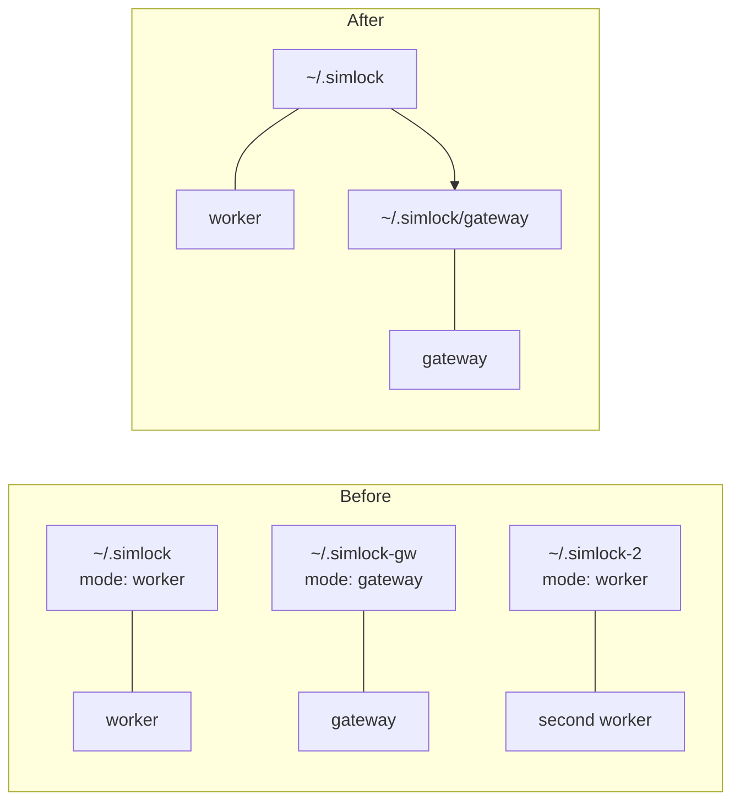
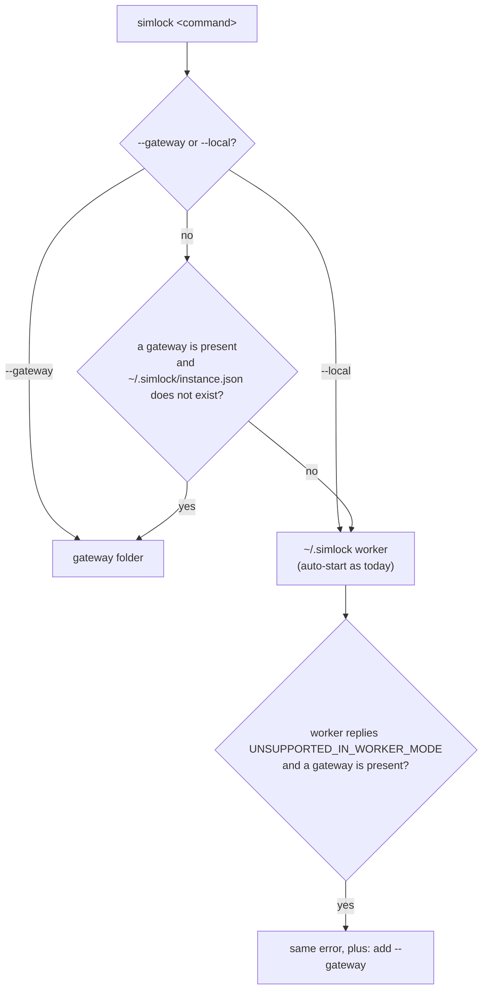

# 0034. One worker per user, and the folder says what a daemon is

- **Status:** Accepted — not yet implemented
- **Date:** 2026-10-19
- **Issue:** [#700](https://github.com/callstackincubator/simlock/issues/700)
- **Supersedes:** in part, [ADR 0005](0005-gateway-and-worker-modes.md):
  requirement 1 (`config.mode` picks the mode), the `mode: "gateway"` wording
  of requirements 2 and 3, requirement 3a's "two `SIMLOCK_HOME`s", and the
  two-Mac case under Consequences and Alternatives (two homes, two daemons).
  In part, [ADR 0001](0001-simlock-owned-device-roots.md): "per-home device
  isolation" stays true, but it is no longer a feature users are told to use.
- **Depends on:** ADR 0005 (gateway and worker), ADR 0001 (owned roots,
  `instance.json`).

## Context

Today every `SIMLOCK_HOME` is a separate Simlock. Each has its own
`state.json`, device roots, adb server and instance id. The docs recommend
`SIMLOCK_HOME` to run several instances on one machine, and the
gateway-plus-worker setup on one Mac depends on two homes.

That breaks every rule that says "this instance only" (each line is in a
module manual's Known gaps today):

- `component remove` counts only its own devices, so it can remove a
  runtime another instance still uses.
- Two instances can enrol one physical device, and each release uninstalls
  the other's apps.
- A console port one instance handed out but has not booted yet reads free
  to another.

The planned disk lifecycle feature makes this worse: a garbage collector
deletes runtimes and system images. Several instances means several
collectors, each blind to the others.

Keeping every instance self-contained does not work. iOS runtimes are
installed by `xcodebuild -downloadPlatform` into
`/Library/Developer/CoreSimulator`, mounted by CoreSimulator, one copy per
machine. No flag puts a runtime anywhere else: `simctl --set` moves devices
only. Android could keep a private SDK per home, at the cost of a duplicate
emulator and duplicate system images per instance, but that solves only the
smaller half.

A gateway owns no devices, no `state.json` and no components. It causes
none of these problems, and it normally runs on a machine of its own.

## Decision

### 1. One worker per OS user

A user runs one worker. Its data lives in `~/.simlock`, always.

No new lock is needed. The worker's socket is `~/.simlock/daemon.sock`, and
`DaemonEndpointHost` already refuses a second daemon on a live socket with
`DaemonAlreadyRunningError`. With the folder fixed, every second worker of
that user meets that socket.

Two macOS users on one machine can each run a worker. They share the iOS
runtimes. This is a known gap, written down and not prevented.

### 2. The folder says what a daemon is

| Folder              | Role    |
| ------------------- | ------- |
| `~/.simlock`        | worker  |
| `~/.simlock/gateway`| gateway |

A gateway always lives in `~/.simlock/gateway`, also when it is alone on its
machine. The `mode` config key is removed. A config file that still sets
`mode` is rejected at load, and the message names the folder that replaces
it. `status` and the HTTP API keep their `daemon.mode` field; it now reports
the role the folder gave.

ADR 0005's other gateway rules stay: a gateway starts no drivers, warns
about and ignores worker-only keys, and refuses `http.enabled: false`. Each
rule that said "in `mode: "gateway"`" now says "in the gateway folder".

The worker never reads or writes `~/.simlock/gateway`. The gateway never
reads or writes the worker's files. A daemon learns its role from how it was
started (`--gateway` or not) and takes its folder from the role; only the
CLI and MCP look at the folders to choose.

A worker's HTTP listens on port 4701 by default and a gateway's on 4700, so
both can run with defaults on one machine.

### 3. The CLI and MCP pick the daemon by folder

A global `--gateway` flag sends a command to the gateway folder, and a
global `--local` flag to the worker's (not `--worker`: `component install`
already takes `--worker <id>` to name fleet members). Without either, the CLI and
`simlock mcp` choose:

- A machine with one daemon never needs the flag.
- "A gateway is present" means `~/.simlock/gateway/instance.json` or
  `~/.simlock/gateway/config.json` exists. The gateway writes the first on
  its first start; `simlock --gateway config set` writes the second before
  that. An empty `gateway` folder is not a gateway.
- A gateway becomes present only through `simlock --gateway daemon start`
  or `simlock --gateway config set`. On a machine where no gateway is
  present, every other `--gateway` command fails before it does anything, with the new error code
  `GATEWAY_NOT_PRESENT` and a message that says to run
  `simlock --gateway daemon start`. An MCP tool call fails the same way; MCP
  checks again on every call, so a gateway started mid-session is found. A
  present gateway that is not running is auto-started like a worker. The
  code is raised only by the CLI and MCP; no daemon sends it.
- `--local` always reaches the worker and auto-starts it. On a machine that
  got its gateway first, `simlock --local daemon start` starts the worker;
  from its first start on, plain commands reach it.
- "The root holds a worker" means `~/.simlock/instance.json` exists. A worker
  writes it on its first start, before anything else. `config set` alone
  never writes it, so a stray plain `config set` on a gateway-only machine
  does not turn it into a worker machine.
- With both, a plain command reaches the worker. A command only a gateway
  answers gets the worker's own `UNSUPPORTED_IN_WORKER_MODE` refusal, and
  the CLI adds a hint to use `--gateway` when it chose the worker and a
  gateway is present. The CLI keeps no list of
  gateway-only commands: the worker's reply is the list.
- Auto-start follows the same choice. On a gateway-only machine a plain
  command starts the gateway, never an empty worker.

### 4. `SIMLOCK_HOME` is for tests only

`SIMLOCK_HOME` stays and replaces `~/.simlock` as the root: the worker in
`$SIMLOCK_HOME`, the gateway in `$SIMLOCK_HOME/gateway`. It leaves the user
docs. It is how the test suite runs many workers at once, each with its own
socket, as it does today.

## Consequences

- The user docs drop `SIMLOCK_HOME` and every "several instances on one
  machine" passage. The gateway-plus-worker section becomes
  `simlock --gateway daemon start` beside the running worker.
- The Known gaps above stop applying to a normal setup. They remain for test
  roots and for several OS users.
- The disk lifecycle feature can treat the user's one worker as the only
  owner of what it installs.
- `drivers.android.adbServerPort` stays. Tests and a second OS user still
  need a different port.
- The e2e harness puts a gateway in `<home>/gateway` in place of writing
  `mode: "gateway"`.
- Breaking for anyone who set `SIMLOCK_HOME` or `mode`. Simlock has no users
  yet, so there is no migration.
- ADR 0022 (Proposed) lists "one Simlock instance per host" as rejected
  because the docs and the e2e suite rely on several instances. This ADR
  removes the first reason. Section 4 keeps the second working.

## Alternatives considered

- **A private Android SDK per home, several instances kept.** Rejected: iOS
  runtimes are per machine whatever Simlock does, and they are the large
  ones.
- **A shared ledger for the machine, several instances kept.** Every
  instance records what it uses in one file under a lock. Rejected: locking
  between processes and cleaning up records of dead instances, for a setup
  nobody needs.
- **Several instances, one allowed to install and delete.** Rejected in
  favour of one worker: the other instances still lose runtimes they use.
- **A gateway that also runs a worker in its own process** (over an
  in-memory uplink). Deferred: one daemon per machine, but one crash takes
  both roles down and the config mixes both key sets. Revisit if two
  processes prove awkward.
- **A lock for the whole machine, across OS users.** Rejected for now:
  permissions between users and stale locks after a crash, for a rare setup.
- **Keep `mode`, require it to match the folder.** Rejected: two places that
  say the same thing can disagree.
- **Always require `--gateway` to reach a gateway.** Rejected: a lone
  gateway's operator would type it every time, and forgetting it would
  auto-start an empty worker.
