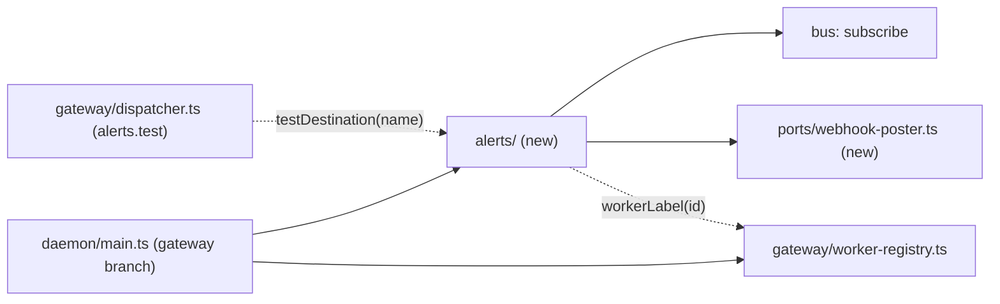
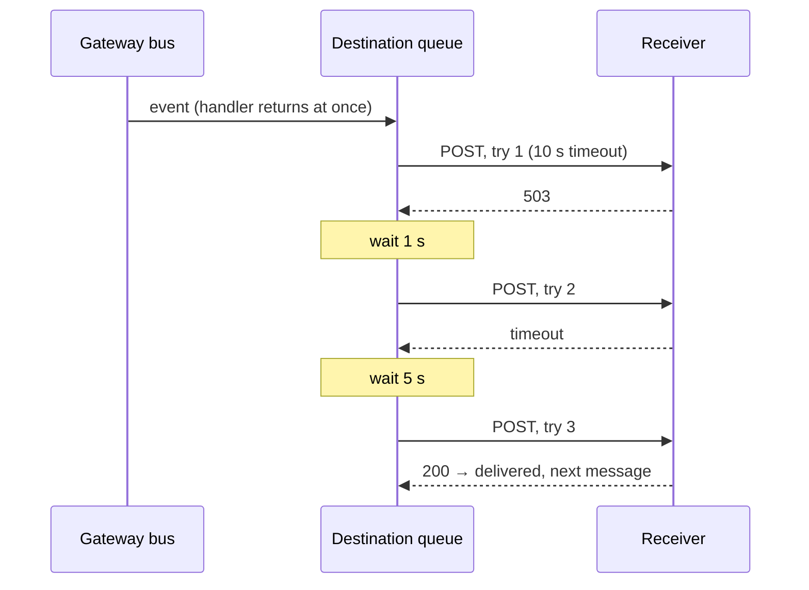

# 0035. A gateway sends chosen fleet events to webhook destinations

- **Status:** Accepted — not yet implemented
- **Date:** 2026-10-19
- **Issue:** [#707](https://github.com/callstackincubator/simlock/issues/707)
- **Supersedes:** nothing. Leaves [ADR
  0030](0030-optional-modules-share-one-contract-and-load-only-when-turned-on.md)
  as it is: the sender is not an optional module.
- **Depends on:** ADR 0005 (gateway mode, relayed worker events with
  `workerId`), ADR 0006 (events and the log are two records), ADR 0014 (an
  event has one id), architecture rules 1, 9, 11 and 15, events rules 4–6,
  safety rule "wire input is a claim".

## Context

#707 asks a gateway to tell its operators about fleet facts without
anyone watching the console: a worker joined or dropped, a device needs a
person, a machine is low on disk. Every one of these facts is already on
the gateway's bus. A worker's own events arrive there with `workerId`
added (`src/gateway/worker-link.ts:533`).

Five answers bind every task of #707 and every later alerting feature:

- Where the sender lives. ADR 0030's optional modules all have a worker
  side (`loadWorker`), and a gateway module cannot subscribe to the bus
  (`src/modules/types.ts:183`). The sender has no worker side and does
  nothing but listen.
- How Simlock talks to the outside. No code sends HTTP to a remote host
  today. Architecture rule 1 says every external API goes through a port.
- What a receiver can rely on. A `generic` body and its signature are a
  contract with code Simlock does not own, so it is expensive to change.
- How a send stays bounded. A slow or dead receiver must never hold up the
  bus, a lease or a stop.
- Where secrets go. A Slack webhook URL is itself a credential.

## Decision

### 1. One gateway-only module, built by the composition root

`src/alerts/`, entered through its `index.ts`, holds the sender. It
depends on `bus` (subscribe and types), `ports` (`Clock`, `Logger` and
the new `WebhookPoster`, §2) and `core` for the config types only. No
module but `src/daemon/main.ts` imports it. dependency-cruiser (ADR 0027)
checks both directions.

`main.ts` builds it in the gateway branch only, when
`gateway.alerts.destinations` is not empty. A worker never builds it and
reads none of its config. With no destinations, the gateway behaves
exactly as before (architecture rule 15).

It subscribes per event name, one subscription for each of the eleven
events (§3) that at least one destination lists, with `EventBus.subscribe`. The handler only puts a message on
a queue and returns. It never awaits and never throws to the emitter
(events rules 4 and 5).

To show a worker's label, it gets one function, `workerLabel(workerId)`,
which `main.ts` builds from the `WorkerRegistry` view. It falls back to
the id. It gets no other part of the gateway.



`alerts.test` (§6) reaches the module through one function too, handed to
the `GatewayDispatcher` by `main.ts`.

### 2. One port for outbound HTTP

`src/ports/webhook-poster.ts` declares:

```ts
interface WebhookPoster {
  /** Resolves with the HTTP status. Rejects on a network error or the abort. */
  post(request: {
    url: string;
    headers: Readonly<Record<string, string>>;
    body: string;
    signal: AbortSignal;
  }): Promise<{ status: number }>;
}
```

The production adapter calls the global `fetch` with `redirect: "manual"`.
A redirect is never followed, so a message never leaves the URL the
operator wrote (a `3xx` is a failure, §4). Tests use a fake.

### 3. Config: named destinations, a fixed event list

```json
"gateway": {
  "alerts": {
    "destinations": [
      { "name": "ops-slack", "format": "slack",
        "url": "https://hooks.slack.com/services/…",
        "events": ["worker.disconnected", "device.quarantine-abandoned"] },
      { "name": "audit", "format": "generic",
        "url": "https://n8n.example/hook", "secret": "…",
        "events": ["worker.connected", "worker.disconnected"] }
    ]
  }
}
```

The config is read once at start, like every key. A bad destination stops
the start (fails closed), on a gateway and on a worker alike, as
`gateway.routing` does. The rules:

| Field | Rule |
|---|---|
| `name` | `^[a-z][a-z0-9-]{0,31}$`, unique in the list |
| `format` | `slack` or `generic` |
| `url` | absolute; no user name or password; `https:`, or `http:` only when the host is `localhost`, `127.0.0.1` or `[::1]` |
| `events` | not empty, no repeats, each one of the eleven below |
| `secret` | required and not empty for `generic`; refused for `slack` |
| the list | at most 16 destinations; default `[]` |

The eleven events: `worker.connected`, `worker.disconnected`,
`worker.rejected`, `worker.drain-started`, `worker.drain-ended`,
`device.quarantine-abandoned`, `device.quarantine-stranded`,
`device.recovery-failed`, `device.stalled-transition-detected`,
`disk.pressure-detected`, `component.install-failed`. The list is written
once, in `src/core/config.ts`, and the alerts module takes its type from
there.

`driver.root-rejected` and `driver.adb-server-rejected` are left out. A
worker emits them once at its start, before its uplink subscribes, and the
gateway gets no replay (`src/daemon/server.ts:551`,
`src/daemon/dispatcher.ts:775`), so a gateway almost never sees them.

### 4. Delivery: in order, bounded, in memory



- Each destination has its own queue and sends one message at a time, so
  a receiver gets events in the order the gateway's bus saw them. A slow
  destination never delays another.
- A try ends after 10 s. A network error, a timeout, `429` or a `5xx` is
  tried again after 1 s, then after 5 s: three tries in all. Any other
  status that is not `2xx` gives up at once.
- A queue holds at most 100 waiting messages. A new message on a full
  queue drops the oldest waiting one. The one being sent is never dropped.
- Nothing is written to disk. A gateway restart loses what was waiting.
- On stop, the module aborts the send in flight and drops the queues. It
  waits for nothing. It stops before the HTTP gateway closes the worker
  uplinks, so a gateway's own stop sends no `worker.disconnected`.

Every message ends in one named way, each a log line on the `alerts`
child logger that names the destination, never its URL. A failed try is
logged by a code (`timeout`, `build-failed`, a network code such as
`ECONNREFUSED`, or `network-error`), never by an error's message, which can
hold the URL:

| End | Log |
|---|---|
| delivered | `debug` "Alert delivered" |
| gave up | `warn` "Alert send gave up", with the last status or error |
| dropped, queue full | `warn` "Alert dropped: queue full" |
| dropped at stop | `info` "Alerts discarded at stop", with the count per destination |

A failed send is not a bus event. It is not a fleet fact, and an event
about a failed alert could itself be sent to the failing destination.

### 5. What a receiver gets

**`generic`.** The body is the event envelope exactly as the bus holds
it and `simlock events --json` prints it: `id`, `seq`, `timestamp`,
`event`, `payload` (with `workerId` for a relayed event), `module`. It is
the existing event contract, so it changes only additively (events rule
6). Headers:

| Header | Value |
|---|---|
| `Content-Type` | `application/json` |
| `User-Agent` | `simlock/<version>` |
| `X-Simlock-Event` | the event name |
| `X-Simlock-Delivery` | the event `id`; the same on every try |
| `X-Simlock-Signature` | `sha256=` and the hex HMAC-SHA256 of the raw body with the destination's `secret` |

The receiver checks the signature over the bytes it received, and can
drop a repeat by `X-Simlock-Delivery`.

The `secret` is required and is the HMAC key.

**`slack`.** The body is `{"text": "<message>"}`, Slack's incoming-webhook
body. Slack is the promised receiver; other services that take the same body
may work. Each of the eleven
events has one written message, held in a table typed over the event list,
so a missing message fails the type check.

The `secret` is refused: the webhook URL is the credential, and the body is
not signed.

**Formats are an extension point** (architecture rules 19-21): a
definition per format in `src/alerts/formats/<name>/`, one registry typed
over core's `ALERT_FORMATS`, and a conformance suite. The queue never
names a format. A message names the worker by
`workerLabel`. Its words are part of #707's spec, not of this ADR.

### 6. Secrets and the test command

- `redactConfig` masks every destination's `url` and `secret`, so
  `daemon.log`, the `daemon.started` payload and `events.jsonl` never hold
  them. `config.get` keeps answering admins with the config as written, as
  it does for `gateway.token`.
- `alerts.test`: an admin operation a gateway serves and a worker refuses
  with `UNSUPPORTED_IN_WORKER_MODE`. It sends one sample message to one
  destination, once, with no retry and outside its queue, and answers the
  HTTP status or the error. Socket only, no HTTP route.

## Consequences

- An operator can follow the fleet in Slack or in their own tooling with
  config only.
- Simlock makes outbound HTTP calls to hosts the operator names. Each is
  bounded, and none is followed through a redirect.
- `worker.disconnected` fires on every worker restart and every Mac sleep.
  A later "host down" rule with a grace period answers that; this ADR
  does not.
- A gateway restart sends one `worker.connected` per worker as they
  reconnect.
- A gateway that dies sends nothing about itself. That needs a check from
  outside.
- A later alerting feature (rules over time, PagerDuty) adds beside
  `destinations` under `gateway.alerts`, and reuses the port and the
  queues.

## Alternatives considered

- **An optional module (ADR 0030).** It would give a
  `capabilities.alerts.enabled` switch and lazy loading, but it needs a
  worker side the sender does not have, and a bus field on the gateway
  context. Both change a contract every module shares, for one module.
- **Inside `src/gateway/`.** The gateway would grow an HTTP client and
  formats that have nothing to do with routing or workers.
- **Any event name.** Lets `lease.*` noise reach Slack, and leaves events
  with no written message. A later feature can widen the list.
- **Persisted queues.** Survives a restart, but needs a store, cleanup and
  ordering rules across restarts. Not worth it for notifications.
- **Following redirects.** A `301` to `http://` would send the payload and
  the signature in clear text.
