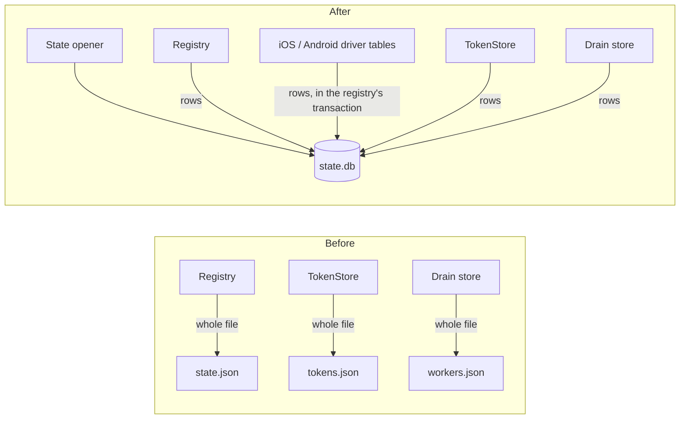
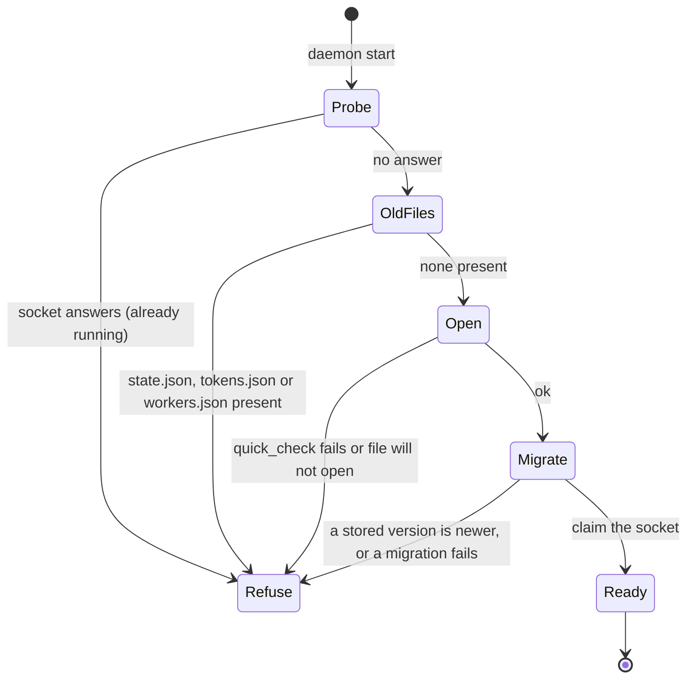

# 0036. Daemon state is a SQLite database, and each owner keeps its own tables

- **Status:** Accepted — not yet implemented
- **Date:** 2026-10-20
- **Issue:** [#754](https://github.com/callstackincubator/simlock/issues/754)
- **Supersedes:** the line in [ADR
  0032](0032-the-event-history-is-a-sqlite-database-with-projections-beside-it.md)
  §1 that says the registry, tokens and the worker list stay as they are.
  Narrows [ADR 0001](0001-simlock-owned-device-roots.md) §1's layout
  (`state.json` becomes `state.db`), and the words "one `state.json` write"
  in [ADR 0018](0018-leasing-is-one-module-and-every-module-is-entered-through-its-index.md)
  §1 and [ADR 0019](0019-startup-ends-every-lease-whose-device-is-not-running.md)
  (Context, §4), which now read "one `state.db` transaction". What those
  sections decide stays. Supersedes the storage paragraph of [ADR
  0022](0022-a-physical-device-is-a-second-device-type-the-core-knows.md)
  §1 (physical records in their own `physicalDevices` list, so an older
  Simlock never sees them): a physical device is a `devices` row with
  `physical = 1`, and an older Simlock reads no `state.db` at all. The rest
  of §1 stays. Narrows [ADR 0019](0019-startup-ends-every-lease-whose-device-is-not-running.md)
  §4 once more: a replayed grant answers with the device as it is now, not
  as it was granted (section 4 below).

## Context

A daemon keeps its state in JSON files. A worker has `state.json`
(devices, physical devices, leases, lease requests, components) and
`tokens.json`. A gateway has `tokens.json` and `workers.json` (the drained
worker ids). Each change rewrites the whole file through a temporary file
and a rename. `state.json` holds up to 10,000 lease-request records
(`lease.maxRequestRecords`), so a renew rewrites all of them. A store that
reads, changes and writes back can lose a concurrent change (#616 was one,
in the token store).

The three files also treat damage three ways. A bad `state.json` stops the
worker from starting. A bad `tokens.json` fails every request that checks a
token. A bad `workers.json` is logged and the drains are forgotten.

`history.db` (ADR 0032) already opens a SQLite file through `node:sqlite`.
ADR 0032 kept the state out of it on purpose: damaged history can be set
aside, damaged state cannot, and history writes would hold up lease commits
on SQLite's one writer lock.

## Decision

### 1. One `state.db` per daemon, beside `history.db`

Each daemon keeps its state in `state.db` in its own data directory:
`<root>/state.db` for a worker and `<root>/gateway/state.db` for a gateway.
It is a separate file from `history.db`. It is opened through the same
`SqliteOpener` port, mode `0600`, in WAL mode with `synchronous=NORMAL` and
a 5 s lock wait, as `history.db` is. A process crash loses nothing that was
committed. A power loss can lose the last few transactions, which matches
today's files, written without fsync.

| Daemon | Tables | Owner |
|---|---|---|
| worker | devices, physical apps, leases, lease requests, grants, components | core (`Registry`) |
| worker | one device-data table per driver | each driver |
| worker and gateway | tokens | auth (`TokenStore`) |
| gateway | drained workers | gateway (drain store) |

`instance.json`, `adb-server.json`, `config.json`, `admin.token`,
`daemon.log` and `history.db` stay as they are.

### 2. Every value is a column; each owner keeps its own tables

Every stored field is a column, in `STRICT` tables. A list is a child
table: a physical device's enrolled apps, a component's receipt (its key
and value pairs), and a grant's environment. Nothing is stored as JSON
text, the test drivers' tables included.

A device is one row in `devices`, which holds what every driver shares
(id, platform, physical, state, spec, timestamps, quarantine fields,
address). What only a driver knows (today's `driverData`) is one row in
that driver's own table, keyed by `device_id`: `ios_device_data`,
`android_device_data`, and later e.g. `vega_device_data`. The registry picks
the table by the device's platform (`devices.platform`), through a map from
platform to table that the daemon gives it. A physical device
(`devices.physical = 1`) has no driver row; its driver data is `{}`. The
fake test driver keeps one table, `fake_device_data`, and the test map
points both `android` and `ios` at it.

Each owner creates its own tables and keeps its own schema version. It
ships one SQL migration step per version change. The code outside an owner
never reads or writes its tables. In memory nothing changes: a device
record still carries `driverData`, and only the registry and the drivers'
table code turn it into rows and back.

### 3. A change is one transaction, and a device and its driver row commit together

A registry commit is one SQLite transaction. It writes only the rows that
changed. When a device changes, the registry calls the device's driver
table code inside the same transaction, so a device and its driver data can
never disagree after a crash. A grant, the device's move to `leased` and
the request's result stay one transaction (ADR 0019 §4). The registry
updates its memory only after the commit succeeds, and a failed commit
rolls back and throws to its caller, as a failed write does today.

A driver's table code is a separate export of its driver package. The
registry gets it before drivers are discovered, and it works when the
driver's tools are missing, so a refused driver's devices still load.

The transaction is synchronous (`node:sqlite`'s `DatabaseSync`), so no
other change can run between its read and its write.

### 4. A grant row freezes the answer, but not the device

A granted lease request keeps its answer in a `grants` row: the lease
fields as granted, the four timing estimates, and its environment as a
child table. The row names the device by id. A replayed answer reads the
device as it is at replay time: the current device record, not the one
recorded at the grant. This narrows ADR 0019 §4, which answers the grant as
recorded. A replay later than the lease can show the device in a later
state, but its lease part still names the lease that was granted.

### 5. Start: refuse old files, damage and newer versions

- **Old files.** A daemon whose folder still has `state.json`,
  `tokens.json` or `workers.json` refuses to start. Its message names the
  file and its role's upgrade step. A worker: with the old version, release
  every lease and run `simlock nuke --delete-devices`, then remove the
  file. A gateway (which has no devices and refuses `nuke`): remove the
  file, create each worker's join token again and set it as that worker's
  `gateway.token`, and drain workers again. Nothing is imported. Tokens are
  created again with `simlock token create`, and physical devices are added
  again with `simlock device add`.
- **Damage.** `PRAGMA quick_check` runs on open. A file that fails it, or
  will not open, refuses to start on both daemon kinds, naming the file.
  Nothing is set aside or deleted. A lock held by another process waits up
  to 5 s and is never taken for damage.
- **Order.** The daemon first checks whether its socket answers; if it
  does, it refuses with `DaemonAlreadyRunningError` before it opens
  anything. Only then does it run the old-file check, then open `state.db`
  (with its damage check) and migrate, and last claim its socket. A newer binary started beside a
  running daemon therefore never migrates that daemon's live file. Two
  daemons starting at the same moment are still caught by the socket claim.
- **Versions.** A stored version newer than the code's (a downgrade), or a
  migration that fails, refuses to start, naming the owner and the version,
  as `history.db` does.
- **Downgrade.** An older Simlock finds no `state.json` and starts empty.
  The docs say: before downgrading, release every lease and run
  `simlock nuke --delete-devices`.
- **Seen where it is started.** Every refusal is the daemon's start error.
  A CLI or MCP server that auto-started the daemon prints that error as
  soon as the daemon exits, in place of a timeout. A start through the
  user's service manager is the one exception (ADR 0041 §6).

## Consequences

- No whole-file rewrite is left. A renew writes one lease row, whatever
  the number of request records.
- The Driver contract gains a table part: each driver package exports its
  device-data table code with its migrations. A new driver adds its own
  table. The fake test driver gets one too.
- The registry's load-time fixes for records written by older versions
  (missing `ownerId`, ADR 0004's `ttlMs`, a missing `mode`, unknown fields
  kept and written back) go away, since nothing old is loaded. An older
  Simlock refuses a newer `state.db` by its version instead of keeping
  fields it does not know.
- Registry tests run on an in-memory SQLite database through the real
  adapter, and on a temporary file where a test restarts the daemon.
  About 36 test files switch from `statePath` and `MemoryFilesystem` to one
  helper.
- Upgrading from a Simlock that wrote JSON takes an operator step:
  release, nuke, remove the old files, create tokens again, add physical
  devices again. The component records are lost too, so `simlock component
  remove` refuses every component installed before the upgrade ("Simlock
  has no record of installing it"). The operator removes those by hand or
  leaves them.
- `docs/CONFIGURATION.md`, `docs/CLI.md`, ARCHITECTURE.md, the startup
  flow and the core, auth, gateway and daemon manuals stop naming the JSON
  files.

## Alternatives considered

- **Import the old files once.** Rejected by the maintainer, who prefers no
  migration code and a documented upgrade step (as in ADR 0007 and 0034).
- **One JSON text row per record.** Rejected: the maintainer wants the
  stored values as real columns.
- **`driverData` as one JSON column.** Rejected: each driver owns its data
  as a table of its own, with its own migrations.
- **A frozen copy of the device in each grant.** Rejected: it doubles the
  device schema and every driver's table for a replay that is kept 10
  minutes.
- **Drivers write their own rows outside the registry's transaction.**
  Rejected: two writes per change, so a crash could leave a device and its
  driver data disagreeing.
- **The state in `history.db`.** Rejected in ADR 0032: different damage
  rules, and one writer lock for both.
- **Set a damaged `state.db` aside, as `history.db` does.** Rejected: an
  empty registry orphans every device on disk, and an empty token store
  locks every worker out of its gateway.
