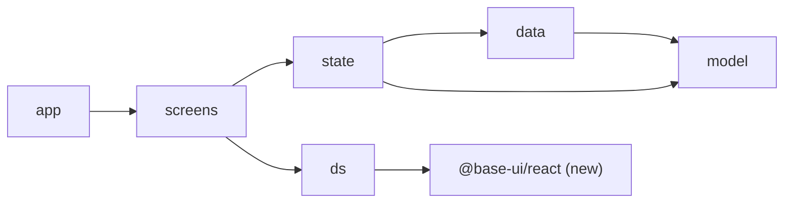
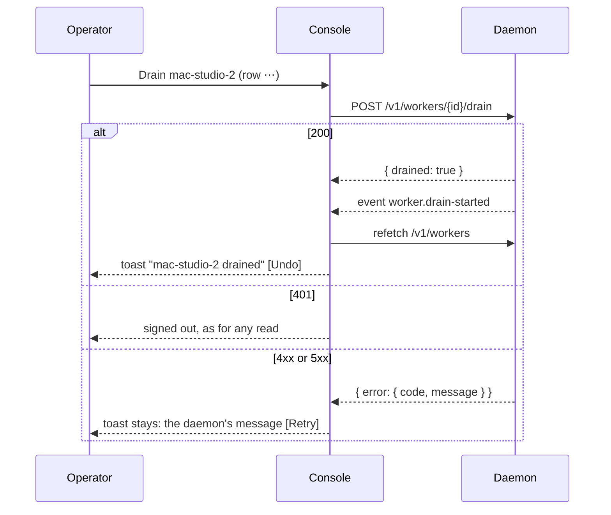

# 0037. The console acts through the HTTP routes, on Base UI

- **Status:** Accepted — not yet implemented
- **Date:** 2026-10-20
- **Issue:** [#756](https://github.com/callstackincubator/simlock/issues/756)
- **Supersedes:** nothing. Narrows [ADR
  0013](0013-the-console-reads-routes-and-follows-the-event-stream.md) §1 by
  one read (§4 here). Leaves [ADR
  0011](0011-the-console-is-a-built-app-the-daemon-serves.md) §4 as it is:
  still no `<style>` element.
- **Depends on:** ADR 0011 (a built app, dev dependencies, the CSP), ADR
  0012 (a single host answers the fleet operations as a fleet of one), ADR
  0013 (reads, the event stream, no state of its own), ADR 0027
  (dependency-cruiser checks every boundary), ADR 0033 (a sign-in proxy).

## Context

#756 rebuilds the console. Until now it only shows. An operator who sees a
stuck request or a lost worker must leave it for the CLI or the HTTP API,
though the HTTP API already offers what they need: release a lease
(`DELETE /v1/leases/{id}`), cancel a request (`DELETE
/v1/lease-requests/{id}`), drain and undrain a worker (`POST` and `DELETE
/v1/workers/{id}/drain`), and remove one (`DELETE /v1/workers/{id}`).

The redesign also needs parts `ui/src/ds/` does not have: a drawer over the
page, a menu on every table row, toasts, a confirm dialog and a ⌘K search.
Each must handle focus, the keyboard and screen readers. Writing them by
hand five times is where accessibility bugs come from.

Five answers bind every task of #756:

- Which library the new parts stand on, and how it meets the CSP.
- Where an item's details show, and how the address names them.
- How an action looks the same everywhere it appears, and what it may
  assume about the daemon's state afterwards.
- How the console knows it talks to a single host, where the worker
  actions do not exist.
- How the console reports the outcome of an action.

## Decision

### 1. Base UI is the base of the design system, inside `ds/` only

`@base-ui/react` (1.x, pinned) is a dev dependency, like React (ADR 0011
§1). Only `ui/src/ds/` imports it. Its parts are wrapped in `ds/`
components whose props are plain values and know nothing of Simlock.
`.dependency-cruiser.mjs`'s `uiLibrary` pattern gains it, so `model/` and
`data/` cannot import it. `.fallowrc.json` lists it with the other console
libraries.

`app/app.tsx` wraps the console in Base UI's `CSPProvider` with
`disableStyleElements`. Base UI renders a `<style>` element in two places
only, `Select` and `ScrollArea`, and that switch turns both off. ADR 0011
§4 stays as written. The one rule those elements carried, hiding a
scrollbar, moves into `ds/` CSS. The browser lane's existing check (no
`<style>` element, no CSP violation) grows to open every overlay, so a
later Base UI version that adds one fails the lane.

Why Base UI: it is stable (1.0 shipped 2025-12-11), supports React 19, and
covers the most of what the console needs (Dialog, Drawer, Menu with a
context menu, Toast, Tabs, Select, Popover, Tooltip, Autocomplete). It has
an official command-palette pattern. React Aria Components and Radix were
rejected: both create `<style>` elements with no switch to turn them off.
Ariakit was the runner-up: it is still 0.x and has no toast or drawer.

### 2. Details open in a drawer, and the address names the item

The list-plus-inspector layout goes. A page shows its items in the one
table component, and the chosen item opens in a drawer over the page.

- The drawer is a modal dialog. A dim layer covers the whole console,
  sidebar included. Escape, the close button or a click on the dim layer
  closes it, and focus goes back to the row that opened it.
- The drawer animates only when it opens. Switching its tabs, or a live
  update, never replays the motion.
- The address names the open item the way it does today:
  `/<page>/<id>`. Closing the drawer goes back to `/<page>`, keeping the
  page's query (filters, page, size).
- A worker is a container, not a row's detail. `/fleet/<id>` is its own
  page with tabs, and a device on it opens the drawer at
  `/fleet/<id>/<deviceId>`.

### 3. One list of actions per kind of item, read by every surface

`model/` holds, as pure functions, the actions each kind of item offers
(lease, waiting request, worker, Inbox item) and when each applies. The
row's ⋯ menu, a right-click on the row, the drawer's buttons, the Inbox's
fix button and ⌘K all read that list. So an action is never on one surface
and missing from another.

| Action | Route | Offered when | Before it runs | After |
| --- | --- | --- | --- | --- |
| Release lease | `DELETE /v1/leases/{id}` | the item is a held lease | a confirm naming the holder, device and worker | toast |
| Cancel request | `DELETE /v1/lease-requests/{id}` | the request is waiting | a confirm naming the requester and device | toast |
| Drain | `POST /v1/workers/{id}/drain` | gateway, worker not drained | nothing | toast with **Undo** (undrains) |
| Undrain | `DELETE /v1/workers/{id}/drain` | gateway, worker drained | nothing | toast |
| Remove worker | `DELETE /v1/workers/{id}` | gateway, worker `disconnected` | type the worker's name to confirm | toast |

An action that can be undone asks nothing; one that cannot names exactly
what it ends. Dangerous actions sit last in a menu, after a line, in the
error colour.

The console still keeps no state the daemon does not report (ADR 0013 §1).
It never shows an action's result before the daemon does. Each action is
followed by an event (`lease.released`, `lease.rejected` with `cancelled`,
`worker.drain-started`, `worker.drain-ended`, `worker.removed`), and the
existing refetch on any event (ADR 0013 §3) shows the change.

The write goes through the one API client in `data/`, which gains a method
and keeps everything else: the token as `Authorization: Bearer` (ADR 0011
§6), `credentials: "same-origin"`, and the session's handling of a 401.

### 4. The console reads the daemon's mode

On a single host the three worker routes answer 501
`UNSUPPORTED_IN_WORKER_MODE` (ADR 0012 §2). So the console offers Drain,
Undrain and Remove only when it knows it talks to a gateway. After sign-in,
and again after each reconnect, it reads `GET /v1/status` and keeps
`daemon.mode`. This narrows ADR
0013 §1, which says the console does not read that route: it reads this
one field and nothing else from it. If the read fails, the console offers
no worker action until the next successful read. It never guesses
`gateway`.

### 5. Toasts report outcomes

A toast is how the console tells the result of an action.

- Toasts stack in the bottom-right corner, at most three on screen, newest
  at the bottom.
- A success toast leaves after 6 seconds, paused while the pointer or focus
  is on it. An error toast stays until it is closed.
- A toast carries at most two actions (**Undo**, **View device**,
  **Retry**).
- Toasts are announced to screen readers: errors at once, the rest
  politely.

An error toast shows the daemon's own `message`, so it says why (for
example `WORKER_CONNECTED`: drain and stop the worker first). A refused
sign-in (401) is not a toast: the session handles it as it does for a
read.

## Consequences

- `docs/internal/DESIGN.md`'s list-plus-inspector, flat sidebar and
  component list, `docs/CONSOLE.md`'s "the console only shows these; it does
  not fix them", and `ui/AGENTS.md`'s pages and design system change with
  the tasks of #756.
- Who did an action is not recorded. The console adds no gap the CLI and
  the HTTP API do not have already. #703 covers it later.
- A later Base UI version that renders a `<style>` element outside the
  switch fails the browser lane rather than shipping.
- Signed in through a proxy, a change needs the browser's `Sec-Fetch-Site:
  same-origin` (ADR 0033). Browsers send it to `https://` addresses and
  loopback, so a console reached over plain `http://` on a network name
  cannot act, though it can still read. `docs/HTTP-API.md` already says
  this. The console shows the daemon's 403 message in the error toast.
