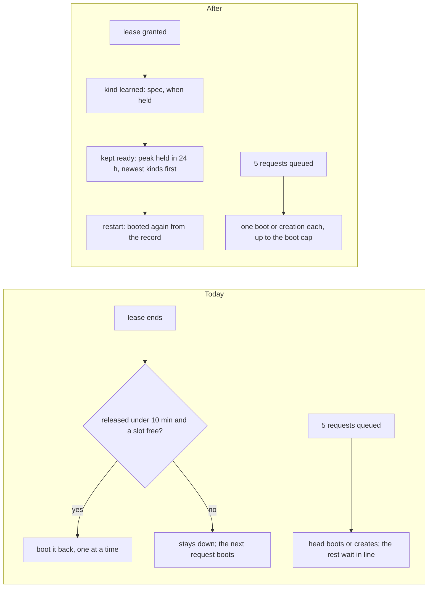
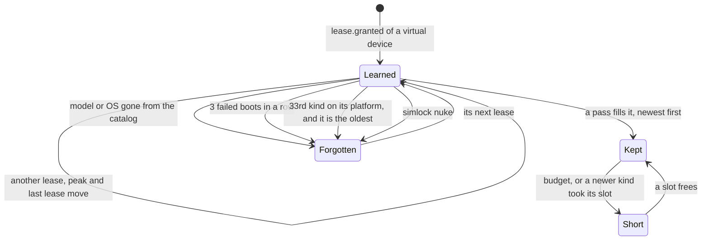

# 0038. The warm pool learns its kinds from leases, and boots for every queued request

- **Status:** Accepted — not yet implemented
- **Date:** 2026-10-20
- **Issue:** [#771](https://github.com/callstackincubator/simlock/issues/771)
- **Supersedes:** nothing. Narrows [ADR
  0017](0017-the-warm-pool-is-a-module-beside-the-lease-transaction.md):
  §2's and §8's `maxConcurrentBoots` "default 1" becomes a default from the
  CPU count (§7); §4's "while a request is waiting for capacity on a
  platform, the pool makes no boot or provision for a target on that
  platform" is replaced by §6, which serves the queue first and lets targets
  fill behind waiters the pass served; §5 step 2's keep rule (a released
  device is booted back only inside `idle.shutdownAfterMs`) is replaced by a
  learned kind (§1); §5's "a target never shuts a device down" stays for a
  configured target and is narrowed by §3 for a learned kind.
  Builds on [ADR 0036](0036-daemon-state-is-a-sqlite-database-whose-tables-each-owner-keeps.md)
  §2: the pool is one more owner of its own tables in `state.db` (§5).
- **Depends on:** ADR 0017 (the pool, its budget, `resolve`, the wait for a
  device on its way), ADR 0036 (`state.db`), [ADR
  0015](0015-a-lease-request-is-a-set-of-constraints.md) §6 (`fits`), [ADR
  0007](0007-a-lease-request-chooses-the-device-mode.md) §6 (pool identity
  is the spec's mode).

## Context

With no configuration a worker boots nothing ahead of demand. The only
proactive rule is reactive: a released device is booted back when its lease
ended less than `idle.shutdownAfterMs` ago and a slot is free, one boot at a
time. So the first lease of every model, OS and mode on a worker pays a
cold boot (about 60 s for an iOS simulator, about 160 s slim, about 70 s
for an Android emulator), and on a busy worker the next request often
arrives before the reboot lands. `warmPool.targets` fixes that only for an
operator who writes them into the config file and restarts the daemon;
nobody does.

The queue is served one request at a time. The pool boots a shut-down
device for the queue head only, and never creates one; a burst of five
agents asking for one kind pays five boots one after the other.

Nothing learns. The event history keeps every event's envelope for seven
days and its usage projection keeps a request's model and platform, and
nothing reads either for the pool. Two reliability
holes sit beside this: a keep boot the RAM budget refuses is declined
silently every pass, and a target short while any waiter sits on its
platform is never reported short.

## Decision

### 1. A worker learns a kind from every lease it grants

A **kind** is a virtual device's exact spec: platform, model, OS version,
mode (slim or full) and image tag, what `sameSpec` compares. On every
`lease.granted` for a virtual device the pool records the kind and the
lease; when the lease ends, it records when. A physical device is never
learned. With `warmPool.enabled: false` nothing is learned and nothing is
kept, as today.

A learned kind is kept ready as a target of its own, origin `learned`,
beside the configured ones. It is filled, reported and spared from the idle
shutdown the way a configured target is (ADR 0017 §5).

### 2. The count is the kind's peak over the last 24 hours, at least one, and held devices count toward it

A learned kind's count is the most leases of that kind held at the same
moment during the last 24 hours, counted from now; a lease held across the
window's start counts. Never below one. The kind **has** its idle ready
devices plus its leased and reclaiming ones, so during a burst of three
nothing more is made for a peak of three, and when the three are released
they come back ready for the next burst. A fourth agent mid-burst pays a
boot and raises the peak. A configured target keeps today's rule: its count
is ready devices only (ADR 0017 §5).

### 3. Newest kinds fill first, inside today's budget, and a newer learned kind may displace an older one

The budget is ADR 0017 §4, unchanged: the running limit minus the reserve
minus held slots, the device limit, the RAM budget and the boot cap. Within
it the pass fills, in this order: configured targets in config order, then
learned kinds by their last lease, newest first.

A learned kind short for a running slot may take the slot of an idle ready
device of an older learned kind, when that device is kept by no configured
target and serves no waiting request: the device is shut down (initiator
`warm-pool`, reason `displaced`), least recently used first, and the newer
kind boots or creates into the slot. A configured target's devices are never
displaced, and a configured target never displaces (as today). A kind both
configured and learned is one entry, origin `configured`, count the larger
of the two: the entry needs the larger of what the configured count lacks
in ready devices and what the learned count lacks in devices had.

### 4. A kind is forgotten, never retried forever

A learned kind is forgotten when:

- its model or OS version is no longer in its driver's catalog, or its
  platform has no driver (`unknown-model`, `runtime-missing`, `no-driver`).
  A catalog read that fails for no settled reason (`unresolvable`) keeps the
  kind and plans nothing for it that pass, as a target's stale spec is
  spared today;
- its boot or creation failed three times in a row (the pool logs one
  warning naming the kind and the last error);
- its platform already holds 32 kinds and it is the oldest by last lease;
- `simlock nuke` runs, with or without `--delete-devices`: the record is
  cleared, so a reset machine boots nothing back unasked.

The next lease of a forgotten kind learns it again. A configured target
keeps today's unbounded retry.

### 5. The record lives in `state.db`, owned by the pool

The pool is an owner of its own tables in `state.db` (ADR 0036 §2): owner
`warm-pool`, its own schema version, `warm_kinds` (one row per learned
kind, with its last lease) and `warm_kind_leases` (one row per lease of a
kind, with when it was granted and when it ended). Every value is a column.
Lease rows that ended more than 24 hours ago are deleted on each write. The
pool writes its rows in its own transaction, outside the registry's: the
registry never reads them and the record never changes a device or a lease.

The record survives a restart. The first pass after start boots or creates
what the record wants, within the budget. A lease row still open at start
whose lease the registry no longer holds is closed at that moment.

### 6. The pool serves the whole queue, not only its head

For each waiting virtual request, oldest first, that is not in flight, the
pass matches one device: an idle ready device that serves it, else a device
on its way (ADR 0017 §6) that serves it, each device matched to at most one
waiter, in queue order. A waiter left without one gets a shut-down device
that serves it booted, or, for a request behind the head, a device of its
resolved spec created. Both run beside the pass under an ownerless `boot`
claim, so the request is granted the device the moment it is ready, as it
is for a target's device today. The head's creation stays leasing's own:
its planner provisions under the lock, and a second creation for it would
race that one. A request being queued (`lease.queued`) triggers a pass.

Queue work comes before every kind, configured or learned, and like them is
bounded by the boot cap, the running slots, the device limit and the RAM
budget. A request the pool cannot start a device for plans itself when it
reaches the head, as today. A target no longer waits behind a waiter the
pass gave a device; it waits only behind one the pass could not serve, and
is not short for it. A keep boot the RAM budget refuses is not proposed,
instead of being declined silently in the act.

### 7. The boot cap defaults from the CPU

`warmPool.maxConcurrentBoots` defaults to `max(1, floor(cpuCount / 4))`,
read from the same `SystemStats` the capacity defaults read. An operator's
value still wins. The cap bounds queue boots, configured targets and learned
kinds together, and a waiting request whose own boot or creation is in
flight counts one toward it, so five requests queued at once start the cap's
worth of boots in all, the head's own included.

### 8. What the operator sees

Each entry of `status.get`'s `warmPool.targets` gains `origin`,
`"configured"` or `"learned"`, and names its image tag when the kind has
one; a learned kind is listed like a target, with its count, ready, booting
and short. The list's bound grows from 256 to 320, the configured limit plus
32 learned kinds per platform. The protocol version rises by one.
`simlock status` prints the origin; the console's warm pool table shows it.
`warm-pool.target-missed` fires for configured targets only, judged and
reported by the configured count even when a learned kind of the same spec
raised the entry's count, and its payload gains `origin: "configured"`. `doctor`'s `warm-pool-target-unreachable`
reads configured entries only. No new config key: `warmPool.enabled` is the
one switch, and `warmPool.targets` the one override.

## Consequences

- With no configuration, the first lease of a kind on a worker still boots;
  every later one finds a device ready while the budget allows, after a
  restart too. A burst of N requests of one kind starts `min(N, cap)` boots
  at once instead of one after another.
- Idle devices may fill every running slot, as today. A busy worker holds
  more RAM than before, within the same limits; a quiet one holds what it
  last leased.
- One displacement costs one boot. Kinds that alternate under a budget of
  one trade places; that is the LRU rule the maintainer chose.
- The `recently-released` keep rule and its reason go. The `waiting-request`
  reason gains creations and a `displaced` shutdown reason is added.
- One protocol bump for status; the event payload change is additive.
- The feature depends on `state.db` (#754, task #761), since the record is
  an owner there.
- A race is kept, bounded: a creation the pool starts for the next waiter is
  invisible to the planner between `claimProvision` and `registerDevice`. A
  head granted in that window may create its own device; the extra device
  is idle, never leased, and the idle rules shut it down and delete it.
- ADR 0017's status line gains "§2, §4, §5 and §8 narrowed by 0038".
- A catalog read for learned kinds runs beside the pass, bounded, so a hung
  `avdmanager` or `simctl` never stalls queue work or configured targets.

## Alternatives considered

- **Learn from `history.db`.** Rejected: its projection keeps a request's
  model and platform only, the envelopes it could be derived from are kept
  seven days and set aside on damage, and the history is a read-only
  consumer; the state belongs with the owner that acts on it.
- **Forget a kind after a fixed time, such as 24 hours.** Rejected by the
  maintainer: a kind stays until a newer one needs its slot.
- **Pre-boot one default device per platform at first start.** Rejected: a
  guess at a model nobody asked for, holding RAM before any lease.
- **Learn on the gateway, for the fleet.** Deferred: the gateway routes by
  warm hits; a worker's own demand is what it can serve.
- **Always one device per kind.** Rejected: parallel agents of one kind pay
  boots after the first.
- **Keep only a stored peak and its time.** Rejected: it loses every peak
  between the highest and now; lease rows are small and pruned.
- **Create for the head too.** Rejected: a race with the planner's own
  provision for the same request.
- **A `warmPool.learn` key.** Rejected: zero configuration is the point;
  `enabled` is the one switch.
- **Show nothing of learned kinds in status.** Rejected: an operator must
  see why RAM is held and why a kind is short.
