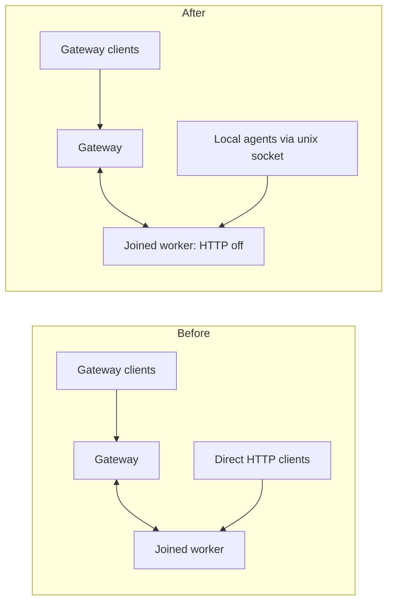

# 0039. Joined workers refuse their own HTTP listener

- **Status:** Accepted — not yet implemented; narrowed by [ADR 0046](0046-a-standalone-worker-serves-agent-device-by-default-with-a-private-profile.md)
- **Date:** 2026-10-21
- **Issue:** [#806](https://github.com/callstackincubator/simlock/issues/806), from request #705
- **Supersedes:** ADR 0005 requirement 3's “Nothing else on the worker changes” only as it permits HTTP on a joined worker. Its other membership rules remain.
- **Depends on:** ADR 0005 (fleet uplink), ADR 0034 (role comes from the daemon's folder).

## Context

The config loader checks worker membership after merging defaults, the file and overrides (`src/core/config.ts:535-597` at `d8404072da2ef7ac823c0269d1b987d20a040c62`). It validates the URL and token pair but does not restrict HTTP (`src/core/config.ts:772-791`). The daemon starts HTTP when enabled (`src/daemon/main.ts:496-500,656`) and creates the worker uplink separately (`src/daemon/main.ts:462-476`).

A joined worker can therefore expose a second API and console beside the gateway. Operators who put sign-in protection in front of the gateway can overlook this separate entrance. Fleet membership should make the gateway the worker's network contact point.

## Decision

In the worker role, a merged config with `gateway.url` set and `http.enabled: true` is invalid. Validate the existing URL/token rules first, then refuse the HTTP conflict with exactly:

```text
Invalid config value for "http.enabled": expected false when gateway.url is set (joined workers are reached through the gateway)
```

The existing config loader owns this rule. File values and overrides have the same effect after merging. No connection to the gateway is attempted to decide whether the configuration is valid; refusal also applies when it is unreachable. There is no warning period or silent override.

A standalone worker retains optional HTTP. A gateway retains required HTTP and its existing treatment of worker-only membership keys. No config key selects the role; ADR 0034 remains in force.



```mermaid
sequenceDiagram
  participant O as Operator
  participant C as CLI
  participant V as Config loader
  participant D as Daemon launcher
  O->>C: --local daemon start (no daemon listening)
  C->>V: Load worker config
  alt Joined worker with HTTP on
    V-->>C: ConfigError naming http.enabled
    C-->>O: Nonzero exit; daemon not launched
  else Valid config
    V-->>C: Config
    C->>D: Start daemon
  end
```

## Migration and limits

This is a breaking config change. Before joining, or before restarting an existing joined worker with HTTP enabled, run `simlock --local config set http.enabled false`, then restart the worker. The repair command validates the resulting config. A rejected config edit leaves the persisted file untouched.

Validation happens when config is loaded; there is no live listener shutdown, new reload mechanism or automatic config rewrite. An existing process keeps its listener until stopped or restarted. Local unix-socket access and the outbound uplink remain the access paths for joined workers.

## Alternatives

- Warn first: leaves an overlooked worker endpoint open and postpones the fleet boundary.
- Silently disable HTTP: reverses an explicit operator setting without explaining the conflict.
- Restrict all workers: removes a useful standalone mode unrelated to fleet membership.
- Live enforcement: adds lifecycle work beyond the config-load restriction requested here.

## Verification

One implementation task covers merged config validation and real CLI validation/startup with fake ports. Startup refusal at the CLI is checked with no daemon already listening; connecting to an existing daemon does not reload config.

Affected fixtures at `d8404072` include `src/agent-device/gateway-front.test.ts:252-265,821-831,1175-1196` and `e2e/slow-agent-device-gateway.test.ts:169-178,355-389`, and the console startup fixture `e2e/console/fixtures.ts:95,119-131,150-177,207-223`. Adapt the direct allocation test to use a standalone worker; remove the simultaneous direct-and-gateway HTTP tenant-isolation case. Preserve gateway isolation tests and production tenant-prefix behavior.

The maintainer chose to remove the direct-versus-gateway upload timing comparison, including its now-unused helpers. The joined slow-lane worker starts with HTTP off, keeping its configured numeric port because `withSharedDaemon` requires it (`e2e/helpers/env.ts:384-388`); keep the existing gateway install/upload correctness test and the rest of the gateway suite. Run that suite through the slow-lane script on real simulators/emulators. This removes the timing comparison's coverage; it makes no change to production upload behavior or performance limits in ADR 0028.

Console fixtures start joined workers with HTTP off, use socket/CLI readiness, and skip HTTP log/health/URL expectations for those workers. Standalone workers and gateways retain HTTP readiness and bind-failure checks. Keep the join-token browser redaction test on the gateway only; drop its joined-worker console half. Read quarantine/stall test readiness through the local worker-list CLI instead of worker HTTP; preserve its gateway assertions. These callers are at `e2e/console/events.spec.ts:263-290` and `attention.spec.ts:50-70,92-133,276-308` at the source commit; tasks #767/#768 move them to activity.spec.ts and inbox.spec.ts, so implementation waits for those tasks and edits the resulting files. Run the console lane in Chromium.

No wire shape or event is changed.
