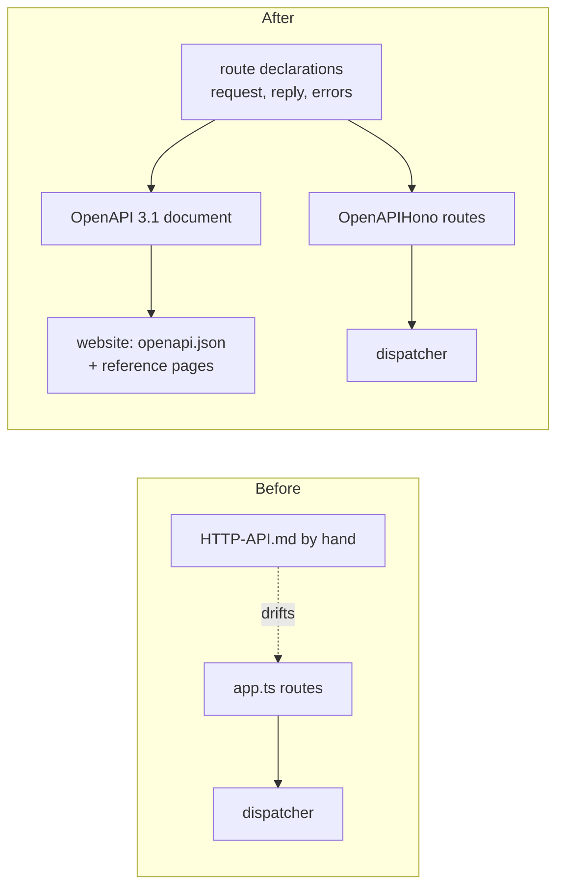
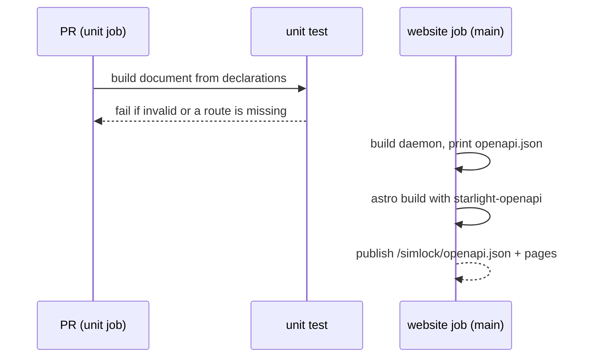

# 0040. Every HTTP route is declared once, and the OpenAPI document is built from the declarations

- **Status:** Accepted — not yet implemented
- **Date:** 2026-10-21
- **Issue:** [#813](https://github.com/callstackincubator/simlock/issues/813)
- **Supersedes:** nothing. Builds on [ADR
  0003](0003-one-typed-daemon-contract-behind-every-frontend.md) (the
  operations and their output schemas) and [ADR
  0030](0030-optional-modules-share-one-contract-and-load-only-when-turned-on.md)
  (a module serves `/v1/<name>` and `/v1/<name>/*`).

## Context

The HTTP API has 29 routes in `src/http/app.ts`, the uplink upgrade on a
gateway, and the `agent-device` and `stream` module mounts. Nothing
describes them in a form a tool can read. Integrators read
`docs/HTTP-API.md`, which is written by hand and leaves the docs with the
website rewrite (#812).

Only 4 routes check their body with a Zod schema. 7 check query values by
hand. No route declares its reply: most pass the dispatcher's answer
through, some reshape it (`{request}`, `{lease}`, `{device, released}`).
The contract's operations do have output schemas, but no route names them.

The libraries that turn Hono routes into OpenAPI (`@hono/zod-openapi` 1.x,
`@asteasolutions/zod-to-openapi` 9) need Zod 4. The repo is on Zod 3.25.

## Decision

### 1. Zod 4

The repo moves from Zod 3 to Zod 4. Every schema accepts and refuses the
same inputs as before, except whole numbers above 2^53−1 and ±Infinity,
which Zod 4 refuses with its own 400 message. A `ttlMs` above 2^53−1 was
already a 400 (the dispatchers refuse a `ttlMs` above `lease.maxTtlMs`), so
only its wording changes to Zod's. A `timeoutMs` above 2^53−1 was accepted
(no cap refuses it anywhere); now it is a 400. Our own messages (refinements, custom errors, the
hand-written query messages that move into schemas) stay word for word.
Zod's own default messages in a 400 `BAD_REQUEST` may change wording;
codes and statuses do not. The JSON Schema text MCP `tools/list` publishes
changes form with the library; what each tool accepts does not.

### 2. One declaration per route

Every core route is declared once with `@hono/zod-openapi`'s `createRoute`
and registered on an `OpenAPIHono` app from that declaration. A declaration
carries:

- method and path;
- path, query and body schemas: every input a route reads, Zod, no hand
  parsing. A rule other surfaces share (a usage window, a duration) stays
  in its one parser, which the route calls on the typed value;
- the reply schema for each success status. A reply that is an operation's
  answer reuses that operation's `output` schema; a reshaped reply gets its
  own schema in `src/http`, not in the contract;
- the error codes the route itself can return, each with its status from
  `ERROR_TABLE` or the HTTP layer's own codes, as documentation: nothing
  checks the list, and one shared error schema covers every code. The declaration helper adds
  a base set to every route: `UNAUTHENTICATED` and `FORBIDDEN` (not on
  `/v1/healthz`), `DAEMON_STOPPING`, `DAEMON_STARTUP_FAILED` and
  `INTERNAL`; `BAD_REQUEST` on a route with input; `UNSUPPORTED_MEDIA_TYPE`
  on a route with a JSON body;
- a tag (System, Devices, Lease requests, Leases, Workers, Components,
  Tokens, Events; `stream` for §4) and a
  description that names the role the operation needs and any mode that
  answers 501.

A route registered any other way is a bug, except the module mounts (§4).

### 3. The OpenAPI document

`src/http` builds an OpenAPI 3.1 document from the declarations and the
module definitions it is given, without a running daemon. The daemon side
passes the module registry's definitions, since only the daemon and the
CLI read the registry. A root script writes it to a file. It is not served by the daemon.
The document's `info.version` is the package version.

- **Auth:** one bearer security scheme; `/v1/healthz` declares none.
- **SSE:** a stream route declares `text/event-stream` with the schema of
  one message, `{event, data}`, `event` an enum of its event names. The
  exception is `/v1/events/stream`: its `event` is a string and its `data`
  the event envelope with an open payload. The
  description says the stream repeats such messages. OpenAPI 3.2's
  `itemSchema` is not used: the website renderer does not show it.
- **Events:** `/v1/events` and `/v1/events/stream` type the event envelope;
  the payload is an open object, documented in the Events reference.
- **Body media type:** a JSON body sent without a JSON content type is
  refused with 415 and the HTTP-local code `UNSUPPORTED_MEDIA_TYPE`.
  `@hono/zod-openapi` gates it with an `HTTPException(415)`, which the
  error mapper turns into that code. Today such a body is read as `{}` and
  refused with 400.
- **Malformed JSON:** a body that does not parse under a JSON content type
  is 400 `BAD_REQUEST`, "Invalid JSON body", on every body route. Today it
  is 500 `INTERNAL` on all but renew.

### 4. The document lists only what outside callers rely on

The document describes the routes an integrator calls: the core routes of
§2 and the stream module's `GET /v1/stream/leases/{id}`. It leaves out the
routes only simlock's own tools call:

- `/v1/agent-device/*`, agent-device's proxy URL. The agent-device CLI is
  its only caller, and what it relies on is the base URL.
- `/v1/uplink`, the connection a worker dials to join a gateway.

A module whose routes outside callers rely on describes them as plain data
on its definition (`http: { routes }`: each route's method, path,
description and statuses with their bodies), so the document needs no
module loaded. This extends ADR 0030's definition by one optional field;
`definition.ts` stays light. A definition with `http` goes into the
document under the module's tag, which names the config key that turns it
on (`capabilities.<name>.enabled`); one without it (agent-device) is left
out. The coverage check (§6) counts a mount as covered when its definition
carries `http`, and as left out when it does not. Nothing checks module
replies at run time.

### 5. Replies are held to their declarations by the compiler

`@hono/zod-openapi` types each handler's return against the route's
declared replies, and the dispatcher's answers are typed from the same Zod
schemas, so a handler whose JSON reply does not fit its declaration fails
the typecheck, on every route whose declared replies all carry JSON. A
`text/event-stream` or bodiless reply lets a handler return any
`Response`: the streaming routes, the stream module's route and
`DELETE /v1/lease-requests/{id}`'s 204 are described, not type-checked.
Nothing checks replies at run time. An extra field a type
allows can still reach a reply undocumented; that risk is accepted for
the code a runtime check would cost.

### 6. Where drift is caught

A root unit test builds the document and validates it as OpenAPI 3.1, and
checks that every route `app.routes` lists is in the document and the
reverse. It runs in the unit job on every PR. The website job builds the
document at build time, publishes it at `/simlock/openapi.json`, and
renders it with `starlight-openapi` under Reference → HTTP API.

## Consequences

- A new route is one declaration: it is in the spec and the website at
  once, and the compiler holds its handler to it.
- `app.ts` is rewritten route by route. The order of middleware (auth, then
  input checks) stays.
- A caller that sends a body without a JSON content type gets 415 instead
  of 400.
- Zod's default 400 texts change once, with the move to Zod 4.
- The spec does not type event payloads; it links to the Events reference.
- agent-device's proxy routes and the uplink stay undocumented in the spec:
  changing them breaks no integrator.
