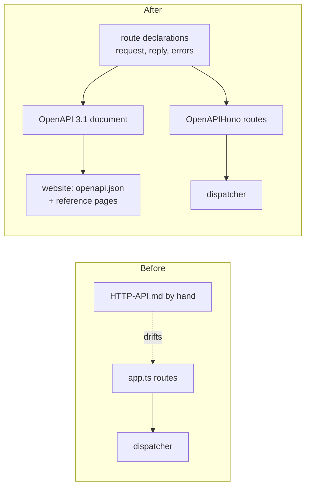
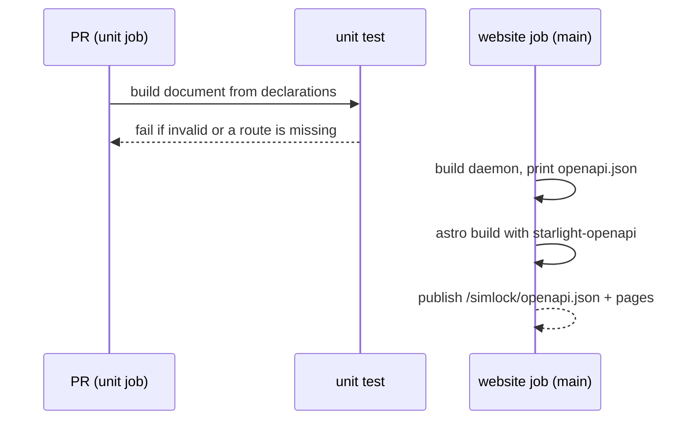

# 0040. Every HTTP route is declared once, and the OpenAPI document is built from the declarations

- **Status:** Proposed
- **Date:** 2026-10-21
- **Issue:** [#813](https://github.com/callstackincubator/simlock/issues/813)
- **Supersedes:** nothing. Builds on [ADR
  0003](0003-one-typed-daemon-contract-behind-every-frontend.md) (the
  operations and their output schemas) and [ADR
  0030](0030-optional-modules-share-one-contract-and-load-only-when-turned-on.md)
  (a module serves `/v1/<name>` and `/v1/<name>/*`).

## Context

The HTTP API has 29 routes in `src/http/app.ts`, the uplink upgrade on a
gateway, and the `agent-device` and `stream` module mounts. Nothing
describes them in a form a tool can read. Integrators read
`docs/HTTP-API.md`, which is written by hand and leaves the docs with the
website rewrite (#812).

Only 4 routes check their body with a Zod schema. 7 check query values by
hand. No route declares its reply: most pass the dispatcher's answer
through, some reshape it (`{request}`, `{lease}`, `{device, released}`).
The contract's operations do have output schemas, but no route names them.

The libraries that turn Hono routes into OpenAPI (`@hono/zod-openapi` 1.x,
`@asteasolutions/zod-to-openapi` 9) need Zod 4. The repo is on Zod 3.25.

## Decision

### 1. Zod 4

The repo moves from Zod 3 to Zod 4. Our own messages (refinements, custom
errors) stay word for word. Zod's own default messages in a 400
`BAD_REQUEST` may change wording; codes and statuses do not.

### 2. One declaration per route

Every core route is declared once with `@hono/zod-openapi`'s `createRoute`
and registered on an `OpenAPIHono` app from that declaration. A declaration
carries:

- method and path;
- path, query and body schemas: every input a route reads, Zod, no hand
  parsing;
- the reply schema for each success status. A reply that is an operation's
  answer reuses that operation's `output` schema; a reshaped reply gets its
  own schema in `src/http`, not in the contract;
- the error codes the route can return, each with its status from
  `ERROR_TABLE` or the HTTP layer's own codes;
- a tag (Leases, Lease requests, Devices, Workers, Components, Events,
  Tokens, System, Modules) and a description that names the role the
  operation needs and any mode that answers 501.

A route registered any other way is a bug, except the module mounts (§4).

### 3. The OpenAPI document

`src/http` builds an OpenAPI 3.1 document from the declarations, without a
running daemon. A root script prints it. It is not served by the daemon.
The document's `info.version` is the package version.

- **Auth:** one bearer security scheme; `/v1/healthz` declares none.
- **SSE:** a stream route declares `text/event-stream` with the schema of
  one message, `{event, data}`, `event` an enum of its event names. The
  description says the stream repeats such messages. OpenAPI 3.2's
  `itemSchema` is not used: the website renderer does not show it.
- **Events:** `/v1/events` and `/v1/events/stream` type the event envelope;
  the payload is an open object, documented in the Events reference.
- **Body media type:** a JSON body sent without a JSON content type is
  refused with 415 and the HTTP-local code `UNSUPPORTED_MEDIA_TYPE`, as
  `@hono/zod-openapi` gates it. Today such a body is read as `{}` and
  refused with 400.

### 4. Module and uplink routes are listed, not re-declared

The `agent-device` and `stream` mounts stay one handler each, served at
`/v1/<name>` and `/v1/<name>/*`. Each module lists its routes (method, path,
statuses) for the document, tagged with the module and the config key that
turns it on (`capabilities.<name>.enabled`). Bodies simlock owns are typed
(the stream's refusals); agent-device's own protocol bodies are not copied,
the route links to agent-device. `GET /v1/uplink` is listed as gateway only,
with 101, 401 and 403. A test keeps each module's list equal to the paths
its handler answers.

### 5. Replies are checked in tests

`createApp` takes a switch that parses every JSON reply against its
declared schema, and refuses an error code the route did not declare. A
mismatch answers 500 `INTERNAL` naming the route and the problem. The
switch is on in unit tests and in the e2e daemon
(`SIMLOCK_CHECK_HTTP_REPLIES=1`, set only by the e2e harness), and off in
production.

### 6. Where drift is caught

A root unit test builds the document and validates it as OpenAPI 3.1, and
checks that every route `app.routes` lists is in the document and the
reverse. It runs in the unit job on every PR. The website job builds the
document at build time, publishes it at `/simlock/openapi.json`, and
renders it with `starlight-openapi` under Reference → HTTP API.

## Consequences

- A new route is one declaration: it is in the spec, the website and the
  reply check at once.
- `app.ts` is rewritten route by route. The order of middleware (auth, then
  input checks) stays.
- A caller that sends a body without a JSON content type gets 415 instead
  of 400.
- Zod's default 400 texts change once, with the move to Zod 4.
- The spec does not type event payloads or agent-device's protocol; it
  links to where they are documented.
