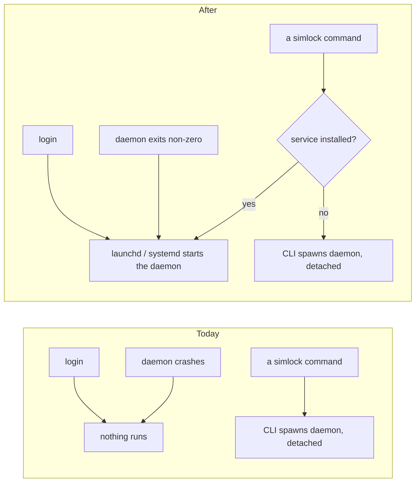
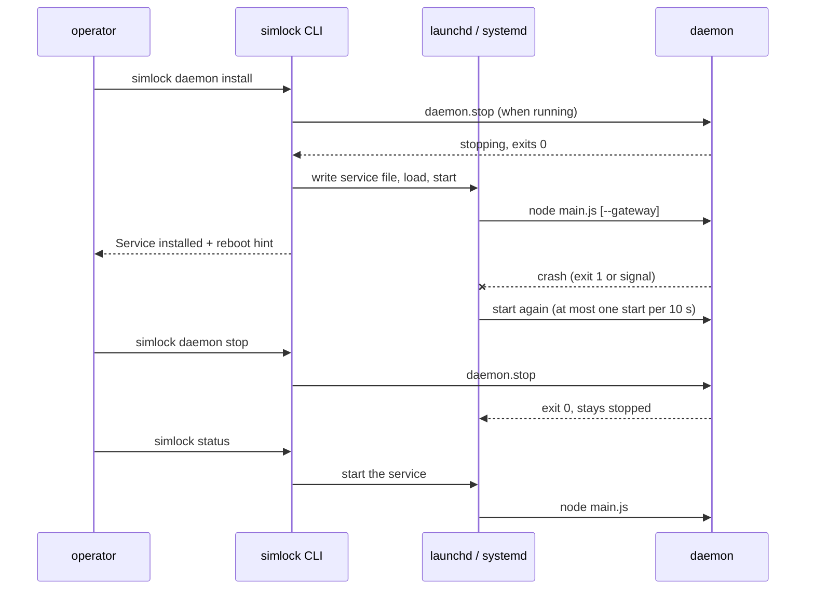

# 0041. The daemon can run under the user's service manager

- **Status:** Accepted — not yet implemented
- **Date:** 2026-10-21
- **Issue:** [#818](https://github.com/callstackincubator/simlock/issues/818)
- **Supersedes:** nothing. Builds on [ADR
  0034](0034-one-worker-per-user-and-the-folder-says-what-a-daemon-is.md):
  one service per role, because one worker runs per user and the folder
  says what a daemon is.

## Context

A daemon starts only when a command needs it: the CLI or the MCP server
spawns `dist/daemon/main.js` detached, with the Node binary that ran the
command, and points its stdout and stderr at `daemon.log`. Nothing starts
it at login, and nothing brings it back after a crash. A worker Mac that
reboots does not rejoin its fleet until someone types a `simlock`
command on it, and a gateway stays down until someone starts it.

Both service managers an operator would use stop a service with SIGTERM
(launchd at logout and on `bootout`, systemd on `systemctl stop`). The
daemon has no SIGTERM handler today, so it dies without its clean stop:
work in flight is cut, `daemon.stopping` is never sent and `admin.token`
stays behind.

## Decision

1. **`simlock daemon install` and `simlock daemon uninstall`** install
   and remove a per-user service for one role. The global `--gateway` and
   `--local` flags pick the role, as for every other `daemon` command, except that install and uninstall
   join `daemon start` and `config set` as commands that work on a host
   with no gateway present (ADR 0034), so a gateway service can be
   installed before the gateway ever ran. On
   macOS it is a launchd LaunchAgent in `~/Library/LaunchAgents`, loaded
   into the `gui/<uid>` domain. On Linux it is a systemd user unit in
   `$XDG_CONFIG_HOME/systemd/user` (or `~/.config/systemd/user`). On any
   other platform both commands are a usage error (exit 2). They run in
   the CLI, beside the auto-start launcher and `config set`: they set up
   the machine and hold no daemon state.
2. **One service name per role and home.** `com.callstack.simlock.worker`
   and `com.callstack.simlock.gateway` for the default home `~/.simlock`.
   For any other `SIMLOCK_HOME`, the name gains `.` and the first six hex
   digits of the SHA-256 of the resolved absolute home path, so a test or
   a second home never touches the operator's real service. On Linux the
   unit file is `<name>.service`.
3. **The service runs the daemon in the foreground**, with the command
   auto-start uses: the absolute Node path and the absolute
   `dist/daemon/main.js` path of the CLI that ran install, plus
   `--gateway` for a gateway. Install saves in the service file every
   variable the daemon or a tool it runs reads from the operator's
   environment, except `SIMLOCK_AGENT_ID`, each only when set: `SIMLOCK_HOME` (always, the resolved
   root), `SIMLOCK_DRIVERS_MODULE`, `PATH`, `ANDROID_HOME`,
   `ANDROID_SDK_ROOT`, `ANDROID_AVD_HOME`, `ANDROID_USER_HOME`,
   `ANDROID_PREFS_ROOT`, `ANDROID_SDK_HOME`, `JAVA_HOME` and
   `DEVELOPER_DIR`. `SIMLOCK_AGENT_ID` is not saved: the daemon only uses it as the default
   requester of a request that names none (`src/daemon/main.ts:548`,
   `:912`), and a daemon the service starts uses its process id instead,
   as an auto-started daemon does with no variable set. Nothing else from
   the shell: no tokens. A variable a
   later change starts reading joins this list in the same change. stdout
   and stderr are appended to the role's `daemon.log`, as with auto-start;
   install creates the file at mode 0600 first, because launchd and
   systemd would create it world-readable. The daemon keeps writing its
   own log there.
4. **Restart after a failure only.** launchd: `KeepAlive` with
   `SuccessfulExit` false, and its default throttle of one start per
   10 s. systemd:
   `Restart=on-failure`, `RestartSec=10`, `StartLimitIntervalSec=0`. A
   clean stop (`daemon stop`, SIGTERM) exits 0 and stays stopped until
   the next login or start. Every stop the daemon makes for a failure
   (`convergence-failed`, `http-start-failed`, `history-refused`, a start
   that throws) exits 1, as it does today. One start is not a failure: a
   daemon that finds another daemon answering on its socket logs
   `Daemon already running` and exits 0, so a service started at login
   beside a daemon a command spawned earlier stops retrying.
   A stop kills the daemon only, never the devices and tools it started,
   which outlive it as they do today: launchd `AbandonProcessGroup` true,
   systemd `KillMode=process`. A stop gets 300 s before the manager
   force-kills: launchd `ExitTimeOut` 300, systemd `TimeoutStopSec=300`.
5. **SIGTERM is a clean stop.** The daemon entry handles SIGTERM with the
   same stop as `daemon.stop`, reason `signal`, then exits 0.
6. **A start goes through the service when it can.** When the role's
   service is installed, loaded in the user's service manager and not
   broken (§9), `daemon start` and every auto-start (CLI and MCP) ask the
   manager to start it (`launchctl kickstart`, `systemctl --user start`)
   instead of spawning a child. The startup deadline and the probe stay
   as they are. The CLI has no child to watch, so a start the daemon
   refuses is seen at the startup deadline (`DAEMON_STARTUP_FAILED` after
   20 s) with the `daemon.log` lines written since the start, not as soon
   as the daemon exits: the one exception to ADR 0036's rule that a start
   error prints on exit. When the service is installed but not loaded (nobody
   logged in at the screen, no systemd user session) or broken, the start
   spawns the daemon as today and prints one notice on stderr naming the
   service and why, so a command never fails only because the service
   cannot run. Broken wins over not loaded. Every launchctl, systemctl
   and plutil call has a 10 s limit.
7. **Install is repeatable and takes over a running daemon.** Install
   stops the role's daemon if one is running (a clean stop; leases
   persist) and waits up to 300 s for it to exit; one still running then
   fails install with exit 1 and nothing changed. It then writes the
   service file, replacing any earlier one, and loads and starts the
   service. A load that fails removes the file it wrote and fails install
   with exit 1. Uninstall stops the role's daemon the same way, unloads
   the service and deletes the file. Both say on stdout what they
   stopped.
8. **Start at login, not at boot.** Install changes no system setting. It
   prints one line on how to start after a reboot: automatic login on
   macOS, `loginctl enable-linger` on Linux. On Linux without linger, the
   last logout stops the user's systemd and with it the daemon and the
   emulators it booted; the docs say so.
9. **The state is reported, not assumed.** `simlock daemon status` prints
   a `Service:` line for both roles: not installed, installed, not loaded,
   or broken (a saved Node or `main.js` path no longer exists). A worker's
   `simlock doctor` adds a `service-broken` finding when the service file
   names a Node or `main.js` path that is gone. Both read the state
   through one port, so the rule lives in one place.

## Consequences

- A worker rejoins its fleet and a gateway comes back at login, and both
  come back after a crash, without anyone typing a command.
- The service file freezes the Node and simlock paths of install time. A
  Node upgrade under nvm breaks it; `daemon status` and `doctor` say so,
  and running install again fixes it.
- A permanent start failure retries every 10 s forever and logs each try
  to `daemon.log`.
- `daemon.log` rotation renames the file under the service manager's open
  descriptor, so crash output after a rotation lands in `daemon.log.1`.
  Auto-start has the same limit today; `daemon logs` reads both files.
- The `service-broken` doctor finding is a contract shape change and
  bumps the protocol by one. The service-manager error code is raised by
  the CLI only and bumps nothing.

## Alternatives considered

- **Keep the daemon alive on any exit.** `daemon stop` would then have to
  go through `launchctl` or `systemctl`, or the daemon comes right back.
  Rejected: more code in stop, for no gain over restarting after a
  failure only.
- **A system LaunchDaemon or system unit started at boot.** Simulators
  belong to the user's login session, and a system service runs as root.
  Rejected.
- **Spawn as today even when a service is installed.** A daemon started by
  a command after `daemon stop` would run unsupervised until the next
  login, with no visible sign. Rejected.
- **Copy the whole shell environment into the service file.** Secrets and
  tokens from the shell would end up in a plist. Rejected for the named
  variables (§3).
- **Install enables linger on Linux.** It may prompt for a password
  through polkit and changes a system setting. Rejected for a hint.
