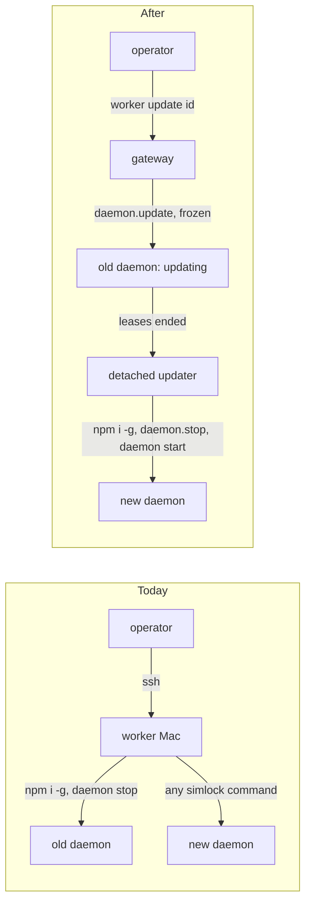
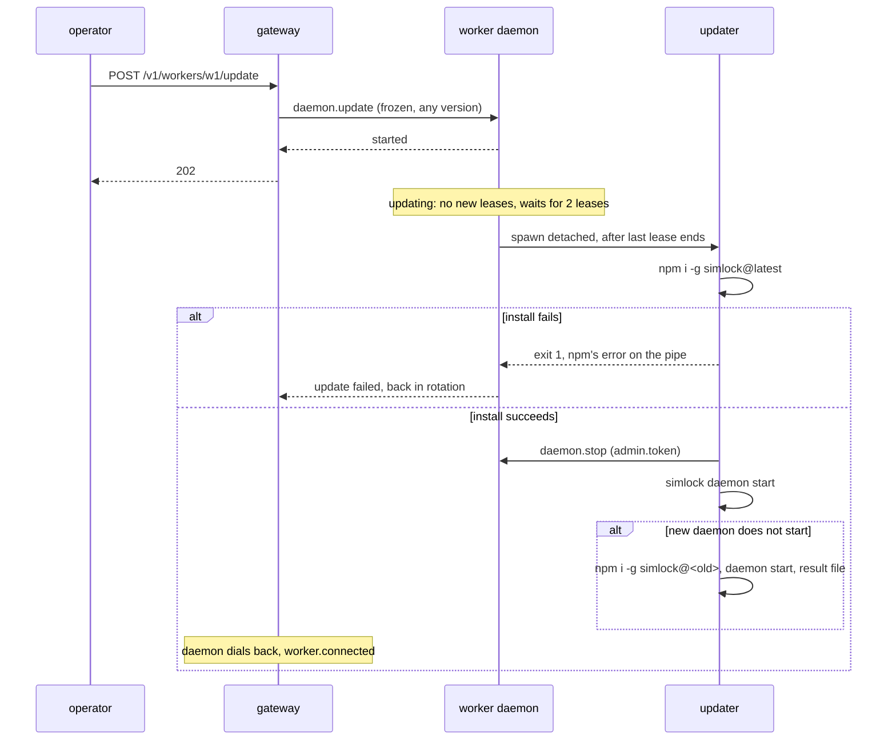
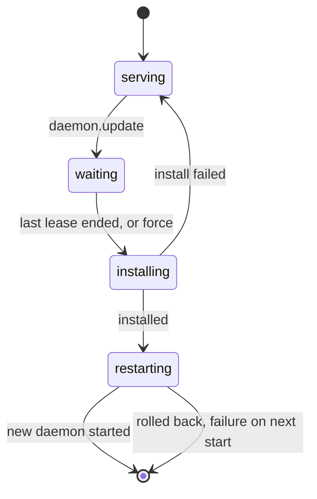

# 0042. Simlock updates itself through a frozen call and a detached updater

- **Status:** Proposed
- **Date:** 2026-10-21
- **Issue:** [#825](https://github.com/callstackincubator/simlock/issues/825)
- **Supersedes:** nothing. Extends [ADR
  0003](0003-one-typed-daemon-contract-behind-every-frontend.md) §6 (a
  second call accepted at every protocol version) and [ADR
  0005](0005-gateway-and-worker-modes.md) §9 (a worker can be out of
  rotation without being drained).

## Context

Updating Simlock is manual on every machine: install the new version,
stop the daemon, start it again. On a fleet that means a shell on each
worker. Three facts shape how an in-product update can work:

- A restart keeps leases. `daemon.stop` releases nothing, and leases are
  stored with their deadlines. (ADR 0003 §6 says a restart "would release
  every held lease"; that was true before leases were stored.)
- Every contract change bumps the protocol version. A worker on another
  version is `incompatible`: the gateway can send it nothing but
  `daemon.stop`, the one call frozen at every version.
- A drain is the operator's intent, stored on the gateway, and only
  `undrain` ends it. A daemon restart must not end it.

## Decision

1. **One call, `daemon.update`, frozen like `daemon.stop`.** It is
   accepted at every protocol version from the one that adds it: it
   skips the version gate, but still waits for the daemon to be ready, so
   a starting worker answers once its leases are loaded. It needs
   `admin`. The client sends it on a mismatched connection, as it does
   `daemon.stop`. Its input (`version?`, `force?`, `query?`)
   and its answer (`started`, `upToDate`, `resolved`, `version`, `health`,
   `update`, `lastUpdateFailure`, `latestVersion`) never change shape. `query`
   returns that answer and starts nothing, so it is also how a follower
   or the updater reads a daemon across a protocol change. So a gateway can update, and follow, a worker that
   shows `incompatible`, and the gateway and its workers can be updated
   in any order.
2. **Every surface reaches the same call.** `simlock update` on the
   machine, `POST /v1/update` on the daemon's own HTTP API, and, on a
   gateway, `worker.update` (`POST /v1/workers/{id}/update`, `simlock worker update <id>`), which sends
   `daemon.update` over that worker's uplink. A worker answers
   `worker.update` with `UNSUPPORTED_IN_WORKER_MODE`, as for the other
   fleet calls.
3. **The worker's own `updating` state, not the gateway's drain.** From
   the call until the daemon exits, a worker is `updating`. It refuses
   new lease requests and cancels queued ones with `DAEMON_UPDATING`, on
   every surface. The gateway's routing skips an `updating` worker as it
   skips a drained one. The drain set is never touched, so an operator's
   own drain survives the update, and the state ends by itself: at the
   restart, or when the install fails.
4. **The state is never stored.** A daemon that stops or crashes while
   `updating` starts as usual. The operator asks again.
5. **The version is resolved before the call answers.** Without
   `version`, the daemon asks npm for `latest`; with it, npm confirms
   the version exists. npm unreachable or no such version fails the call
   with `UPDATE_RESOLVE_FAILED` and changes nothing. A resolved version
   equal to the running one answers `upToDate` and changes nothing. The
   daily check (§12) uses the same lookup.
6. **A worker waits for its leases; a gateway does not.** A worker
   installs once its last lease has ended, or at once with `force`. A
   gateway's leases live on its workers and survive its restart, so it
   installs at once. `force` on a waiting update stops the wait;
   any other call during an update follows it. There is no cancel: a
   daemon restart ends a wait.
7. **A detached updater does the install and the restart.** The daemon
   spawns one detached process with the Node that runs it, given the
   target version, the role and `SIMLOCK_HOME`. It runs
   `npm i -g simlock@<version>` (the machine's npm, run with the
   daemon's Node and in its data directory, so `.npmrc` registries and
   proxies apply and no project folder interferes), with a 10-minute
   limit, while the old daemon still serves, and reports
   progress and npm's error as lines on a pipe the old daemon reads. On
   an install failure it exits non-zero and the old daemon, still
   running, reports the failure and leaves `updating`. On success it
   sends `daemon.stop` with the role's `admin.token` and waits for the
   old daemon to exit (after 10 minutes it kills it: leases are stored,
   and startup redoes an unfinished purge). It starts the new one with
   the new `simlock daemon start` for the same role, which goes through
   the service manager when one is installed (ADR 0041), and asks it
   with `query` until it is running the new version.
8. **A new version that does not start is rolled back.** Once the old
   daemon has stopped, the updater is the only one left to report. If the
   new daemon is not running within 2 minutes, it writes a result file,
   reinstalls the old version and starts that. That daemon reads the
   file and reports the failure (stage `restarting`) and emits
   `daemon.update-failed`. If the rollback fails too, the machine stays
   down and the updater logs it to `daemon.log`.
9. **npm only.** A Simlock not installed by global npm (a source
   checkout, a pnpm global) refuses the update before anything changes,
   naming how it was installed and the command to run by hand.
10. **Latest by default, any version by name.** Without `version` the
   updater installs `latest`; with it, that version, older ones included.
   Without `version`, a daemon newer than `latest` (a prerelease) is
   never downgraded. "Newer" is semver order against the `latest` tag,
   one rule for every surface.
   Rolling back across a protocol bump leaves the worker `incompatible`,
   which the frozen call can fix again.
11. **The call answers at once; progress is state and events.** The
   answer says the update started. Progress is the `update` field of
   `status.get` and of the worker view (`waiting` with the lease count,
   `installing`, `restarting`, or the last failure). Both are `null`,
   never absent, when there is nothing to show, so a gateway's view
   clears them. Events:
   `daemon.update-started` (from, to, forced), `daemon.update-failed`
   (stage, message). Success is the existing
   `daemon.started` with the new version.
12. **A daily notice, never an automatic update.** Every daemon runs
    `npm view simlock version` at start and every 24 h after, unless
    `update.check` is false, and reports `latestVersion` in `status.get`. A gateway's
    worker list shows each worker's version and its latest.

## Consequences

- `daemon.update`'s shape is frozen for good. A new option needs a new
  call.
- Simlock must be published to npm. The release workflow publishing it
  is a prerequisite outside this ADR.
- A worker with long-lived, always-renewed leases may wait forever. The
  operator sees the lease count and can force it.
- During `installing`, the files of the running daemon are replaced. A
  module it loads lazily after that would come from the new version, so
  the window is kept to the install alone.
- An update restart fires `worker.disconnected` and `worker.connected`,
  as every restart does.
