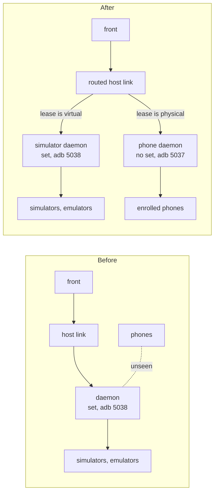

# 0043. Physical devices reach agent-device through a second daemon on the worker

- **Status:** Accepted — not yet implemented; §4 narrowed by [ADR 0046](0046-a-standalone-worker-serves-agent-device-by-default-with-a-private-profile.md) (default-on, command not found: `off`, no doctor line)
- **Date:** 2026-10-22
- **Issue:** [#870](https://github.com/callstackincubator/simlock/issues/870)
- **Supersedes:** in part, [ADR 0023](0023-agent-device-is-served-by-an-optional-edge-module.md)
  §3 ("one agent-device daemon per worker" and "sees simlock's devices and
  no others") and §4 (the refusal of `physical: true`). Builds on
  [ADR 0022](0022-a-physical-device-is-a-second-device-type-the-core-knows.md)
  (phones stay on the host's default adb server) and
  [ADR 0026](0026-agent-device-through-a-gateway-relays-over-the-uplink.md)
  (a host link that serves many hosts routes by the lease).
- **Narrows:** [ADR 0026](0026-agent-device-through-a-gateway-relays-over-the-uplink.md)
  §3's line "In-process link (worker mode): ignores the lease id; one host,
  as today": the worker's in-process link now holds one host per daemon and
  routes by the lease id (§2).

## Context

Simlock leases enrolled phones (ADR 0022). agent-device reaches Simlock's
simulators and emulators through the edge module (ADR 0023). The daemon the
worker runs for it is started inside Simlock's iOS simulator set and with
`ANDROID_ADB_SERVER_PORT` naming Simlock's private adb server, so it sees
Simlock's virtual devices and nothing else. A phone is neither: an iPhone is
outside every simulator set, and agent-device lists no physical device while
a set is active; an Android phone is on the host's default adb server, port
5037, and agent-device talks to one adb server per daemon, fixed when the
daemon starts. So no phone Simlock leases can be driven through agent-device,
and the front refuses `physical: true`.

Moving phones onto Simlock's adb server would reverse ADR 0022 §5 and ADR
0001 §4: Simlock's server would claim every phone on the host and fight the
operator's server for it. Dropping the iOS simulator set would remove the
ownership proof that root validation, `doctor --purge-orphans` and the
`simlock simctl` scope rest on (ADR 0001 §2, §3, §5). Both are far larger
changes than the problem.

## Decision

### 1. A worker runs two agent-device daemons

Beside the daemon of ADR 0023 §3 (the **simulator daemon**), the host's
supervisor runs a second one, the **phone daemon**, with:

- no simulator set, and `ANDROID_ADB_SERVER_PORT` set to 5037, the host's
  default adb server, as Simlock's own physical path sets it (the inherited
  adb keys are dropped first, so an operator shell cannot point it at the
  emulator server), so agent-device lists the host's physical devices as it
  would for an operator: iPhones through `devicectl` and `xctrace`, Android
  phones on the default adb server;
- its own state directory, pid record and process marker, so the two are
  reaped and stopped apart;
- the same policy file (no `boot`, no `shutdown`), lease ceiling, tenant
  rule and version check;
- the iOS signing values agent-device needs to build and sign its runner for
  a phone, taken from `capabilities.agent-device` config keys and passed as
  `AGENT_DEVICE_IOS_*` environment. The supervisor still drops every
  inherited `AGENT_DEVICE_*` key; config is the only way in.

Both daemons start when the edge starts and stop when it stops. The phone
daemon runs whether or not a phone is enrolled: it costs one idle process,
and starting it on demand would tie its lifecycle to enrolment events for no
gain.



### 2. The worker's host link routes by lease

The choice of daemon is made in the last hop before agent-device: the
worker's in-process host link holds one host per daemon and a map from lease
id to daemon. The link decides from the request alone, so a request relayed
from a gateway, which never passes the worker's front, is routed the same
way: an allocate whose `serial` or `udid` names an enrolled physical device
in the worker's registry goes to the phone daemon, and its lease id is
remembered; every later call names its lease, as the front's or the relay's
argument, in the RPC body or in the `x-agent-device-lease-id` header, and
goes to that lease's daemon. A request routed to the phone daemon while it
is not running is answered by the link with the not-available reply, so a
worker and a gateway give the agent the same reason. The link
declares that it reads the lease header, so the front's existing many-hosts
path (ADR 0026) routes non-RPC requests and fans out `devices` per lease; the
front itself changes nowhere for routing. A request naming no lease goes to
the simulator daemon.

The lease-end release follows the same map. When a simlock lease ends
(ADR 0024), the edge sends `agent_device.lease.release` to the daemon whose
scope record holds the lease, so a phone lease's release reaches the phone
daemon and never the simulator daemon.

The gateway's routing does not change. Simlock's own routing already places
a physical lease on the worker that holds the enrolled phone, and the
gateway relays every call to the lease's worker, whose link picks the
daemon. A phone's grant carries no address, only its device id (the serial
or udid), so wherever the edge needs a phone's address, on the gateway's
view of a live lease included, it reads that id.

```mermaid
sequenceDiagram
  participant CLI as agent-device CLI
  participant F as front
  participant L as routed link
  participant PD as phone daemon
  CLI->>F: lease.allocate {physical: true, platform}
  F->>F: lease.request {physical: true, …}
  alt refused by simlock
    F-->>CLI: refused by simlock: <message>
  else granted, driverDeviceId = serial | udid
    F->>L: allocate {serial | udid, ttlMs}
    L->>L: address is an enrolled phone → phones; remember lease id
    alt phone daemon not running
      L-->>F: agent-device is not available on this simlock: phone daemon: <reason>
      F->>F: lease.release
      F-->>CLI: that reply
    else
      L->>PD: allocate
      PD-->>CLI: lease {deviceKey}; front adds data.lease.device {…, physical: true}
    end
  end
  CLI->>F: command {lease id}
  F->>L: forward, lease id
  L->>PD: command
```

### 3. The front is the only scope

The phone daemon's own inventory is wider than Simlock's: every phone on the
host, enrolled or not, the operator's default-set simulators, and any
emulator on port 5037. That is accepted. Nothing reaches the daemon except
through the front, and the front already pins every command to the leased
`udid` or `serial` (ADR 0023 §4). No agent-device policy allowlist is used:
one would be read once at start and force a daemon restart, and a lost lease,
on every enrolment.

### 4. Availability is per daemon

The worker's `agent-device` capability follows the simulator daemon, as
today, so a phone daemon that cannot start never blocks simulator leases. A
physical allocate while the phone daemon is not running is refused with the
reason, and `simlock doctor` prints one line per daemon. The other direction
stays as today: a simulator daemon that is not running makes the worker
unavailable for agent-device, phones included.

## Consequences

- An Android phone leased through agent-device is driven by a daemon whose
  adb calls run without Simlock's protocol-version gate (ADR 0022 §5). A
  different adb protocol version from Simlock's would restart the
  operator's server; a different platform-tools version with the same
  protocol does not. The daemon finds adb as agent-device does, through the
  operator's SDK roots and `PATH`; the docs say to install one SDK.
- The phone daemon lists the operator's simulators and every phone on the
  host. An operator who reads agent-device's own files on the worker sees
  them; an agent never does.
- Two daemons double the supervisor's state, findings and stop order.
- The agent-device CLI needs its `physical` allocate key back
  (callstack/agent-device#3864) before `open --physical` works end to end;
  the front's path is proved with raw RPCs until then.

## Alternatives considered

- **One adb server on 5037, owned by Simlock.** Rejected: reverses ADR 0001
  §4 and ADR 0022 §5, makes Simlock's emulators visible to every tool, and
  turns a foreign server on 5037 into a startup failure or a kill.
- **USB on for Simlock's private server.** Rejected in ADR 0022; the race
  with the operator's server stands.
- **Drop the iOS simulator set.** Rejected: the set is Simlock's ownership
  proof on iOS; without it `doctor --purge-orphans` and passthrough reach the
  operator's simulators.
- **Change agent-device to list phones beside a set.** One line there, but
  the Android side still needs a daemon on 5037, so a second daemon is needed
  anyway; the change is deferred to agent-device.
- **Scope the phone daemon with agent-device's policy file.** Rejected: §3.
- **A per-request adb server port in agent-device.** Its ADR 0021 refuses it.
