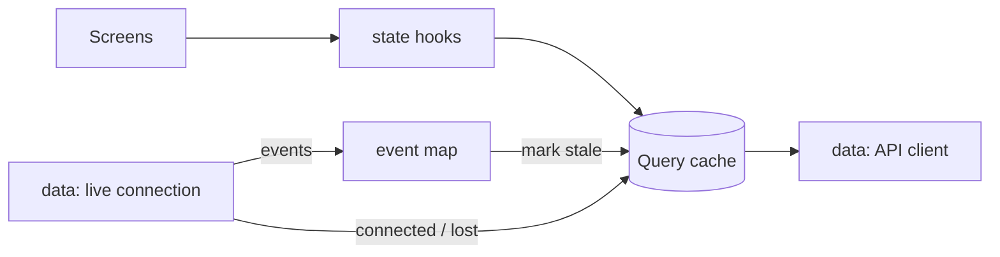
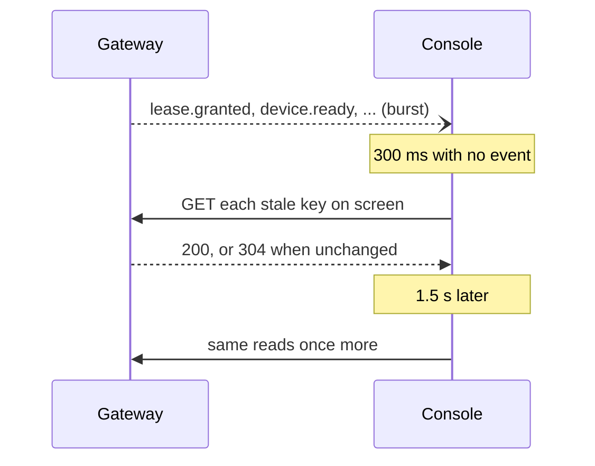

# 0044. The console reads what its page shows, and events mark it stale

- **Status:** Accepted — not yet implemented
- **Date:** 2026-10-23
- **Issue:** [#905](https://github.com/callstackincubator/simlock/issues/905)
- **Supersedes:** [ADR 0013](0013-the-console-reads-routes-and-follows-the-event-stream.md)
  §3 (refetch every second, and refetch the screen on every event). §1, §2,
  §4 and §5 stand.

## Context

ADR 0013 made the console re-read every route the screen uses once a second,
and again at once after any event. That was cheap for one host. On a gateway
it is not:

- The sidebar's Inbox count reads `/v1/workers`, `/v1/leases`, `/v1/tokens`
  and `/v1/lease-requests` on every page (`ui/src/state/shell.ts:12`), so
  every page polls the whole fleet every second.
- The only throttle on event reads is "one in flight, one queued"
  (`ui/src/data/live/connection.ts:181`). On a busy fleet the reads run back
  to back, as fast as the gateway answers. `lease.renewed` alone fires once
  per lease every TTL/3.
- A gateway's worker views change only after a worker event or on the 30 s
  tick (`src/gateway/service.ts:277`), so most 1 s reads return the same
  answer, in full: no route has an ETag.
- `GET /v1/leases/{id}` scans the whole lease list (`src/http/app.ts:797`).
- The read cache never drops a route, while each screen's event list is
  fetched again every time it opens.

The target is a gateway with 50 workers of 5–10 devices each, several tabs
open.

## Decision

### 1. One query cache, in the state layer

The console keeps server data in TanStack Query (`@tanstack/react-query`), in
`ui/src/state/`. `ui/src/data/` keeps the API client, the stream and the
connection status; the layer rules forbid `@tanstack/*` there.

One key per route. A key is read when a page that uses it mounts and polls
only while such a page is on screen, never in a hidden tab, never while the
console is disconnected:

| Key | Poll | Fresh for | Dropped after unused |
|---|---|---|---|
| `['lease-requests']` | 5 s | 2 s | 60 s |
| `['leases']`, `['lease', id]` | 10 s | 2 s | 60 s |
| `['inbox']` | 10 s | 2 s | 60 s |
| `['workers']` | 15 s | 2 s | 60 s |
| `['stats', range]` | 60 s | 30 s | 60 s |
| `['tokens']` | none | 5 min | 60 s |

The recent events the Inbox and lease drawers show come from one feed per
tab, filled by the stream and kept 60 s after its last user. Activity keeps
its own feed and scroll-back, dropped when the operator leaves it.

A read lost to the network leaves the key as it was; the sidebar says
Reconnecting, as today.

### 2. Events mark keys stale; they do not read

An event name maps to the keys it changes (the table in #905). An unknown
name maps to none. The console collects the keys of a burst and acts 300 ms
after the last event, or 1 s after the first, whichever comes first: a key a page on screen uses is read, any other key is
only marked stale and read when a page next needs it. The same keys are read
once more 1.5 s later, because a gateway passes a worker's event on before it
has refreshed that worker's view.

`lease.renewed` reads nothing. Its `newDeadline` is written into the cached
lease, matched by `workerId` and `workerLeaseId` on a gateway, by `id` on a
worker. When the cached Inbox shows that lease as ending, the Inbox is
marked stale too.

A change with an event shows within about a second. A change with none
(host load, a worker connecting as incompatible) shows within the slowest
poll of its page, 15 s, after the daemon serves it. On a gateway the view
changes only on the gateway's own 30 s refresh, so it shows within about
45 s.

### 3. The server helps

- **ETag.** Every `GET` under `/v1` that answers 200 with JSON carries a
  strong ETag, Hono's digest of its body (SHA-1, chained per 256 KiB). A matching `If-None-Match` gets 304
  with no body. Streams and mounts carry none. The console sends back the
  last ETag per key and keeps its data on a 304.
- **`lease.get`.** `GET /v1/leases/{id}` and its `/events` read one lease
  through a new `lease.get` operation instead of filtering `lease.list`. An
  unknown or not-owned id still answers 404.
- **`workerLeaseId`.** On a gateway, a lease record carries the worker's own
  lease id, so a relayed event can be matched to it.
- **`GET /v1/inbox`.** The Inbox rules move from the console
  (`ui/src/model/inbox.ts`) to `src/contract/inbox.ts`, and a new
  `inbox.get` operation answers them in both modes. Each item embeds a small
  copy of its subject: the worker's own fields (no devices, catalog, leases or
  downloads), or the device, the lease with its holder, or the request. Its
  times are the subject's timestamps; the browser ticks them. The sidebar
  count reads only this route. The Inbox page and the Overview's Needs you
  read it and `/v1/workers` (for names, links and lease counts), and no
  longer read leases, tokens or waiting requests.

## Consequences

- An idle tab on any page makes at most 40 requests a minute against a
  50-worker gateway, most of them 304s. A browser-lane test holds that line.
- The public console page changes "within about a second" to say which
  changes take up to 15 s, and up to about 45 s on a gateway.
- A new event that should refresh a page needs a row in the event map; until
  then it waits for the poll.
- The per-second clock still rebuilds views that show a time; making it
  cheaper is left to later work.
- The console gains one dependency, `@tanstack/react-query`.
- Two contract changes (`lease.get` with `workerLeaseId`, `inbox.get`) each
  bump the protocol.

## Alternatives considered

- **Keep the 1 s poll, add only ETags.** Rejected: still four full-fleet
  reads a second per tab on the gateway's side, and no fix for read storms.
- **A revision counter per worker view instead of a body hash.** Rejected:
  a missed bump shows stale data, and it covers two routes only. A hash
  covers every route and cannot go stale.
- **The gateway relays a worker's event only after refreshing its view.**
  Rejected for now: it changes the relay for every client and delays every
  event; a second read is nearly free with 304s.
- **Any unknown event marks every key stale.** Rejected: on a busy fleet it
  brings back a read of every list per burst.
- **Inbox items with ids only, the drawer reading its subject on open.**
  Rejected: a row's buttons need the subject's facts before any drawer
  opens, so the Inbox page would read the fleet lists again.
- **A count-only `GET /v1/inbox/summary`.** Rejected: the Inbox page would
  still read the four lists, and the rules would live on both sides.
- **An event for a worker that connects as incompatible, so every change
  shows within a second.** Rejected: a delay of 15 s, about 45 s on a gateway, is enough for a fact that rare.
