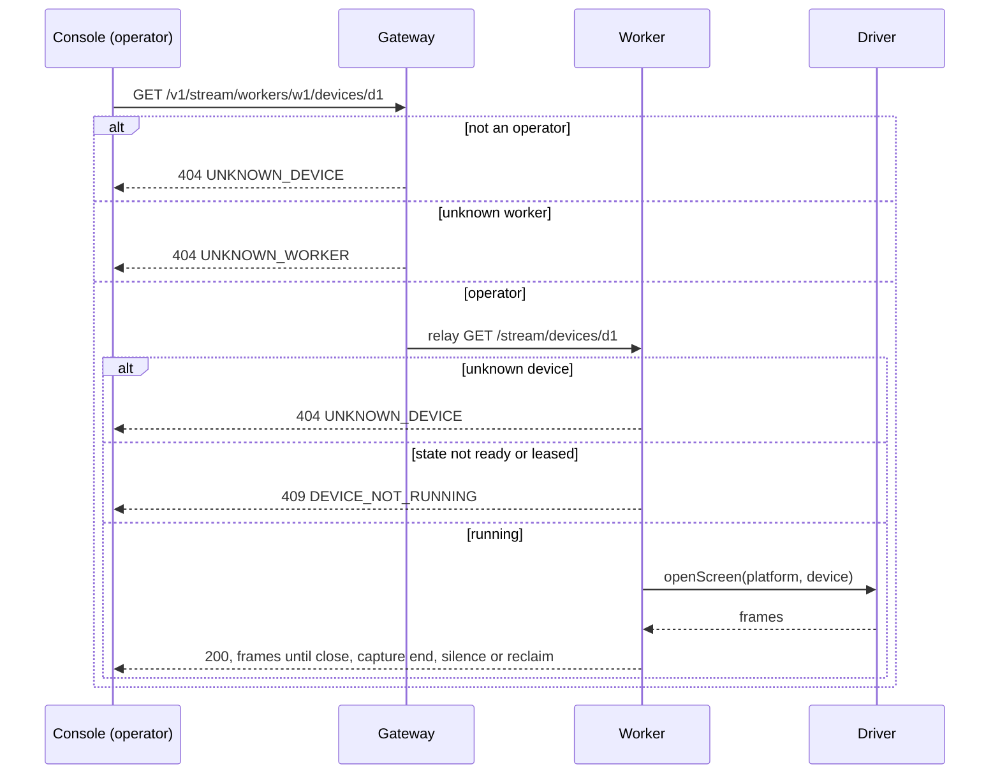
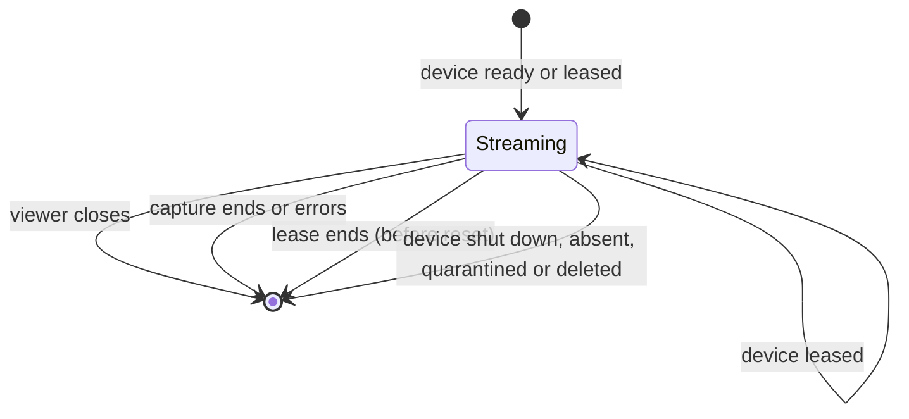

# 0045. A device's screen streams to operators, not a lease's

- **Status:** Accepted — not yet implemented
- **Date:** 2026-10-23
- **Issue:** [#906](https://github.com/callstackincubator/simlock/issues/906)
- **Depends on:** ADR 0012 (a worker answers fleet routes as a fleet of one), ADR 0030 (stream is an optional module), ADR 0031 (screen-source seam), ADR 0039 (joined workers serve no HTTP of their own).

## Context

Today the only stream route is `GET /v1/stream/leases/{id}` (`src/stream/definition.ts:27` at `192cb5fbb`). The worker finds the lease, checks that the caller owns it unless the caller is an operator (`src/stream/worker-link.ts:120-121`), and keys each capture by lease id (`src/stream/captures.ts:37`). The lease-end participant stops every capture of the ended lease (`src/stream/captures.ts:102`). The module manual says a capture never outlives its lease. No ADR decided that.

The driver opens a screen from a device and a platform, with no lease (`src/core/driver-catalog.ts:96-106`). The lease is there only to find the device and to check the caller.

The console is the only caller (`ui/src/state/screen.ts:129`). An operator therefore cannot watch an idle or warm-pool device, and has to find a device's lease before watching it.

## Decision

1. **The route names a worker and a device.** Every daemon serves `GET /v1/stream/workers/{workerId}/devices/{deviceId}`. A device id is unique only within one worker, so the path names the worker. A gateway relays the request to that worker over its uplink, to the worker's internal `/stream/devices/{deviceId}`. A worker answers the same public path as a fleet of one, as ADR 0012 has it: `{workerId}` is its own instance id, the id `worker.list` gives it. The console therefore builds one URL on either daemon. `GET /v1/stream/leases/{id}` is removed. Nothing published depends on it.
2. **Operators only.** An agent token gets 404 `UNKNOWN_DEVICE` for any device, so an agent cannot list a fleet's devices this way. On a gateway the gateway checks the role. The worker serves any relayed device stream: a relay arrives only on a gateway's uplink session, so it is trusted as far as that session is. The uplink message does not change.
3. **A running device streams.** A device in state `ready` or `leased` streams. Any other state (`provisioning`, `shutdown`, `reclaiming`, `quarantined`, `absent`, `deleted`) gets 409 `DEVICE_NOT_RUNNING`, with the device's state in the message. An unknown device gets 404 `UNKNOWN_DEVICE`. An unknown worker (on a gateway, an id not in its fleet; on a worker, any id but its own) gets 404 `UNKNOWN_WORKER`, the code the other `/v1/workers/{id}` routes use. A driver that cannot capture keeps 415 `STREAM_NOT_SUPPORTED`. Every other refusal stays as it is.
4. **A stream outlives a lease grant, not the device's running state.** A device that gets leased while it is watched keeps streaming, a physical iPhone included. A stream ends when:
   - the viewer closes it;
   - the capture ends or errors;
   - a lease on its device ends: the lease-end participant stops every capture on the ended lease's device before the device is reset;
   - the device stops running with no lease end. The worker stream module subscribes to `device.shutdown`, `device.absence-detected`, `device.quarantined` and `device.deleted` and stops every capture on that device. These events come after the fact, so the capture may run a moment on a stopped device. The silence bound cannot stand in: a simulator's capture repeats its last frame, and a physical device's never notices its own end (`vendor/screen-capture/Sources/simlock-screen-capture/FrameCapture.swift:241-244`, `SimulatorSource.swift:19-21`, `simlock-device-capture/DeviceScreenSource.swift:383-385`).
5. **One capture per viewer, as today.** Sharing one capture between viewers (#602) is left to that issue, keyed by device.
6. **No business events.** Watching changes no lease and no device, as before. The daemon log keeps recording each stream opened and refused.

## Consequences

- `src/stream/AGENTS.md`'s "a capture never outlives its lease" becomes "a capture never outlives its device's running state".
- ADR 0040 names the lease route as an example of a module route. That example goes stale; its README row notes it, and the rule itself does not change.
- The console shows the screen in the device drawer. The lease drawer has no Screen tab.
- The website's "Watching the screen" page describes the device routes and an operator token only.

## Alternatives

- **Keep the lease route beside the device route.** Rejected: only the console calls it, and it keeps a second access model (lease owners) to secure and test.
- **The relay carries the caller's role.** Rejected: it changes the uplink message, and it only defends against a gateway that is already trusted with every lease.
- **A second, worker-only path `/v1/stream/devices/{deviceId}`.** Rejected: the console would build two URLs by mode, against ADR 0012's one console for one host and for a fleet.
- **Reuse 415 for a device that is not running.** Rejected: 415 says the device can never stream, and 409 says it cannot stream now.

## Verification

The stream module's tests drive the route on a worker and through a gateway with faked drivers: role, state and lifetime cases. The slow-lane stream tests move to the device routes. The feature's tasks name them.
