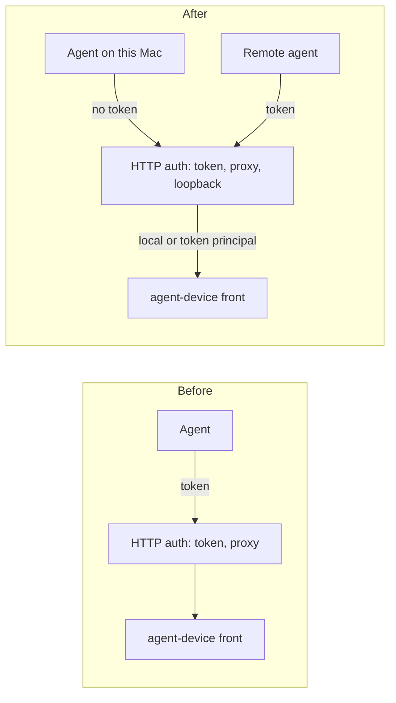
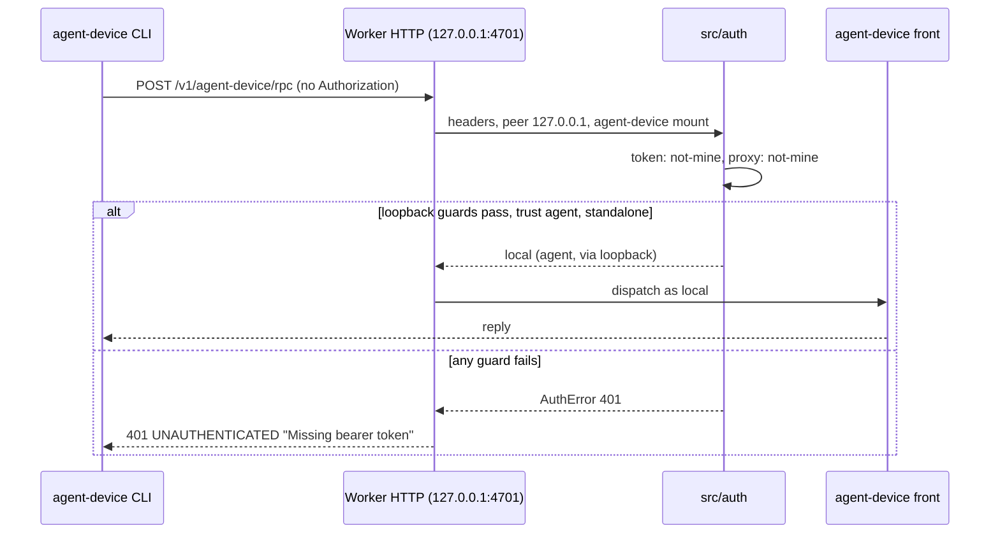

# 0046. A local agent reaches agent-device without a token

- **Status:** Proposed
- **Date:** 2026-10-23
- **Issue:** [#952](https://github.com/callstackincubator/simlock/issues/952), from request #950
- **Narrows:** [ADR 0023](0023-agent-device-is-served-by-an-optional-edge-module.md)
  §4 ("One simlock token is one tenant"): on a standalone worker, every
  trusted no-token loopback caller shares one identity and so one tenant.
  [ADR 0033](0033-a-sign-in-proxy-is-a-second-way-to-sign-in-and-auth-is-one-module.md)
  §2: a third strategy joins the chain, and a strategy may read the peer's
  address and whether the request is for the agent-device mount.
  [ADR 0039](0039-joined-workers-refuse-their-own-http-listener.md)'s
  "A standalone worker retains optional HTTP": it stays optional, but is on
  by default.
- **Builds on:** ADR 0039 (joined workers keep HTTP off), ADR 0030 (optional
  modules).

## Context

agent-device is the main way agents use Simlock. On the same Mac as a
standalone worker it takes four operator steps today: turn on
`capabilities.agent-device.enabled` and `http.enabled` (both `false` by
default, `src/core/config.ts:894`, `:942`), restart, and mint an agent
token per agent. The CLI path needs none of them: the Unix socket is guarded
by file permissions, and the agent's session id names the requester.

The agent-device CLI (0.21.28, the version `package.json` pins for
`@agent-device/proxy`) sends no token to a loopback daemon URL: only a
non-loopback URL "requires daemon authentication"
(`dist/src/daemon-client-lifecycle.js`). It sends its tenant in the JSON-RPC
body (`params.tenantId` for lease calls, `params.meta.tenantId` for
commands), in a header only on artifact downloads, and not at all on an
upload. So a per-request identity cannot be read from headers, and an
upload carries no hint of who sent it.

Simlock's auth sees request headers only (`src/auth/strategy.ts:10-12`,
`src/http/auth.ts:19`). The host sets agent-device's tenant to the
identity's principal and overwrites what the client sent
(`src/agent-device/host/host.ts:124-127`). agent-device accepts a tenant of
1–128 letters, digits, `.`, `_` and `-`.

Loopback TCP is open to every account on the Mac, and Node cannot read a
TCP peer's Unix user. ADR 0023 already accepts that any process running as
the Simlock user can skip the edge through agent-device's own loopback port.

## Decision

### 1. One local identity

A trusted loopback request with no credential is the identity
`{ principal: "local", name: "Local agent", role: "agent", via: "loopback", ambient: false }`.
Every local agent shares it, and so shares the agent-device tenant `local`.
Agents keep apart by their agent-device `--session` names, as on the CLI
path. Leases it opens are owned by `local`; the requester stays the
agent-device lease id, as today.

### 2. Where it applies

A new auth strategy, `loopback`, last in the registry after `token` and
`proxy`, answers `identified` only when all of these hold, and `not-mine`
otherwise, so the result is today's 401 `Missing bearer token`:

- the daemon is a worker with no `gateway.url` (never a gateway);
- `http.loopbackTrust` is `agent`;
- the request is for `/v1/agent-device` or a path under it. No other route
  accepts it: the console and the rest of the HTTP API keep tokens;
- the peer address is `127.0.0.1`, `::1` or `::ffff:127.0.0.1`.

`authenticateRequest` gains the peer address and whether the route is the
agent-device mount; the HTTP frontend passes them.

### 3. Only a local program, not a browser or a proxy

The strategy also answers `not-mine` when the request:

- carries a credential: `Authorization` or `X-Agent-Device-Token`. A
  credential is judged by its own strategy alone, so a bad token is never
  rescued as `local`;
- carries `Origin` or `Sec-Fetch-Site`, which browsers send and Node's HTTP
  clients do not (Node's `fetch` sends `Sec-Fetch-Mode` only);
- carries `Forwarded`, `X-Forwarded-For` or `X-Real-IP`, which a reverse
  proxy on the Mac adds;
- has a `Host` whose hostname is not `127.0.0.1`, `localhost` or `[::1]`
  (DNS rebinding).

### 4. The operator can turn it off

`http.loopbackTrust` is `agent` (the default) or `off`. `off` drops the
strategy; loopback callers need a token as today. Any other value is
refused at config load, naming the key. It has no effect on a gateway or a
joined worker.

### 5. On by default on a standalone worker

On a worker with no `gateway.url`, `http.enabled` and
`capabilities.agent-device.enabled` default to `true`. A joined worker keeps
both `false`, so ADR 0039's refusal is never hit by a default. A gateway
keeps `http.enabled: true` and agent-device off. A value the operator sets
wins everywhere.

When agent-device is on only by default and its binary is not found, the
capability is unavailable with today's not-found message in
`simlock status`, and `simlock doctor` lists no finding for it: a Mac
without agent-device is not a problem. Set explicitly, today's finding
stays.

A taken port is not handled specially: a worker whose HTTP cannot bind
fails to start, as it does today with `http.enabled: true`.

## Consequences

- Any account on the Mac, and any local program, can act as a local agent:
  lease devices, drive them, and end another local agent's lease. This is
  the exposure ADR 0023 accepts for agent-device's own loopback port,
  widened from the Simlock user to every account. A shared Mac sets
  `http.loopbackTrust off`.
- A program that forwards outside traffic to port 4701 without a
  forwarding header and with a loopback `Host` lets outside callers in. The
  docs tell an operator who fronts a worker to turn trust off.
- Local agents see each other's leased devices in `agent-device devices`.
- An upgraded standalone worker opens 127.0.0.1:4701 and starts
  agent-device daemons when the binary is on `PATH`. A port already in use
  stops the daemon from starting until the operator sets `http.port` or
  turns HTTP off.
- Test harnesses that start several workers on one machine pin
  `http.enabled` and `capabilities.agent-device.enabled` off unless a test
  needs them.

## Alternatives considered

- **The tenant the client sends, per session.** Each Claude Code session
  its own tenant, named by `--tenant`. The CLI sends the tenant in the
  RPC body and not at all on uploads, so the front would parse bodies and
  map uploads to leases to find it. Any local caller could still claim any
  tenant, so it would guard against accidents only, which `--session`
  already does. Rejected for cost.
- **Off by default, opt-in.** Safe on shared Macs, but leaves an operator
  step before the first use, which is the problem.
- **Every agent route, not only agent-device.** Local agents use the socket
  for the rest; opening `/v1/leases` and `exec` to every local account
  gains nothing.
- **A per-user secret file (mode 0600) passed as the token.** Proves the
  caller is the daemon's user. agent-device reads the token only from the
  environment, so it costs every shell call an `export`. Left as a later,
  hardened mode.
- **Run without HTTP when the default port is taken.** Avoids an upgrade
  failure, but adds a second start path; rejected for one rule.
