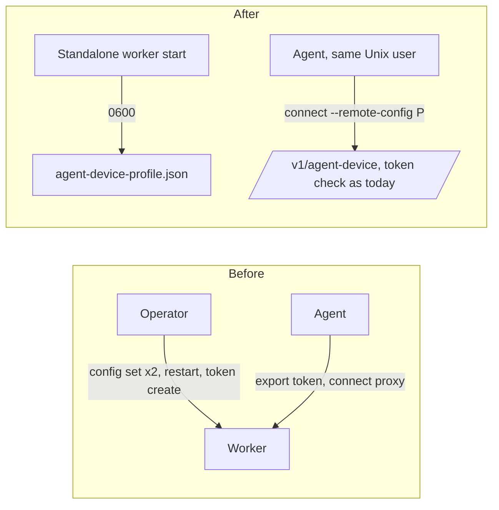
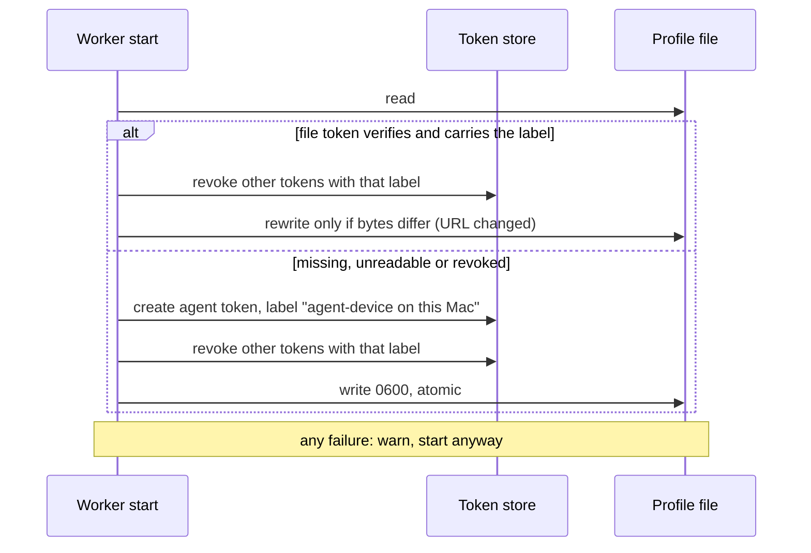

# 0046. A standalone worker serves agent-device by default and hands local agents a private profile

- **Status:** Accepted — not yet implemented
- **Date:** 2026-10-23
- **Issue:** [#952](https://github.com/callstackincubator/simlock/issues/952), from request #950
- **Narrows:** [ADR 0023](0023-agent-device-is-served-by-an-optional-edge-module.md)
  §1 ("The edge is off unless the operator turns it on"): on a standalone
  worker it is on unless the operator turns it off.
  [ADR 0030](0030-optional-modules-share-one-contract-and-load-only-when-turned-on.md)
  §2 ("When it is `false` or the section is missing, the host calls
  nothing"): a module may declare that a missing `enabled` means on for a
  standalone worker, and a local profile the host writes or withdraws from
  that declaration, loading none of the module's code; agent-device is the
  one that does.
  [ADR 0039](0039-joined-workers-refuse-their-own-http-listener.md)'s
  "A standalone worker retains optional HTTP": it stays optional, but is on
  by default.
  [ADR 0023](0023-agent-device-is-served-by-an-optional-edge-module.md)
  §3 ("While the edge is turned on ... `simlock doctor` says the same"):
  when agent-device is on only by default and its command is not found,
  the capability is `off` and doctor says nothing (§1 below).
  [ADR 0023](0023-agent-device-is-served-by-an-optional-edge-module.md)
  §4 ("Agents sharing a token share a tenant; the docs say not to"): the
  local profile gives every local agent one token on purpose (§4 below);
  the warning still holds for tokens an operator mints by hand.
  [ADR 0043](0043-physical-devices-reach-agent-device-through-a-second-daemon.md)
  §4 ("a simulator daemon that is not running makes the worker unavailable
  for agent-device" and "`simlock doctor` prints one line per daemon"):
  when agent-device is on only by default and its command is not found, the
  capability is `off` and doctor prints no line for either daemon (§1
  below).
- **Builds on:** ADR 0023 §4 (one simlock token is one tenant), ADR 0033
  (auth is unchanged: the profile carries an ordinary agent token).

## Context

agent-device is the main way agents use Simlock. On the same Mac as a
standalone worker it takes four operator steps today: turn on
`capabilities.agent-device.enabled` and `http.enabled` (both `false` by
default, `src/core/config.ts:894`, `:942`), restart, and mint an agent
token per agent. The CLI path needs none of them: the Unix socket is
guarded by file permissions.

agent-device 0.21.28 (the version `package.json` pins for
`@agent-device/proxy`) reads a remote-config profile (`--remote-config`)
whose keys include `daemonBaseUrl` and `daemonAuthToken`. After
`agent-device connect --remote-config <file> --session <name>`, every later
command with that `--session` sends `Authorization: Bearer <daemonAuthToken>`
read from the file, with no token in the environment (checked on
2026-10-23 against a local server: the `health` GET and the
`agent_device.lease.allocate` POST both carried it). The saved connection
stores the file's SHA-256 and refuses a changed file with "Active remote
connection config changed. Run agent-device connect --force to refresh
it." (`dist/src/cli.js`).

A command with no `--session` flag runs in the session that connected
last (`dist/src/cli.js`, `allowActiveFallback`), whatever token it carries.

## Decision

### 1. On by default on a standalone worker

On a worker with no `gateway.url`, `http.enabled` defaults to `true`
(`127.0.0.1:4701`), and agent-device is on unless
`capabilities.agent-device.enabled` is set. A joined worker keeps both off,
so ADR 0039's refusal is never hit by a default. A gateway keeps
`http.enabled: true` and agent-device off. A value the operator sets wins
everywhere, and a default is never written to `config.json`.

The module definition declares this ("on by default on a standalone
worker") as data. The config loader resolves it without naming the module:
an `enabled` that no layer sets becomes `true` on a standalone worker for a
definition that declares it. `config.get` shows the resolved value. The
loader also reports which modules' `enabled` came from a default; that fact
reaches the module host and the module, never `config.get`. No contract
shape changes.

When agent-device is on only by default and its command is not found, the
capability is `off`: no doctor finding, no warning in the console. Any
other failure (wrong version, not agent-device, start failed), or a
not-found when the operator set `enabled: true`, stays `unavailable` with
today's finding.

A taken port is not handled specially: a worker whose HTTP cannot bind
fails to start, as it does today with `http.enabled: true`.

### 2. A private profile for local agents

The agent-device definition declares a local profile: the file name, the
token label, and how to render the file from the URL and the token. When a
worker starts with HTTP on and agent-device turned on (set, or by default,
whether or not the command is found), the module host writes `<data dir>/agent-device-profile.json` (mode 0600, atomic) holding:

```json
{
  "clientId": "a51a51a51a51a51a",
  "daemonAuthToken": "slk_…",
  "daemonBaseUrl": "http://127.0.0.1:4701/v1/agent-device",
  "daemonTransport": "http",
  "leaseProvider": "proxy",
  "runId": "simlock-local",
  "sessionIsolation": "tenant",
  "tenant": "local"
}
```

The URL uses `http.host` and `http.port`; a wildcard host (`0.0.0.0`, `::`)
becomes `127.0.0.1`, and any other IPv6 host is bracketed. The token is an ordinary `agent` token with the label
`agent-device on this Mac`. A local agent connects once per session:

```console
$ agent-device connect --remote-config ~/.simlock/agent-device-profile.json --session "$CLAUDE_CODE_SESSION_ID"
$ agent-device open --platform ios --session "$CLAUDE_CODE_SESSION_ID"
```

### 3. The profile is stable

At each start, after the socket claim and before HTTP listens, the host
reuses the token in the file while it still verifies and carries the label;
otherwise it mints one. Either way it revokes every other token with that
label, so at most one stays live. It rewrites the file only when its bytes
would change, so a saved agent-device connection survives restarts. When
HTTP or agent-device is off (a joined worker always has HTTP off), it
deletes the file and revokes the labelled tokens. A gateway never writes
one.

A failure to mint, write or delete is logged as a warning; the worker
starts anyway, and tokens made by hand keep working.

### 4. Every local agent shares one token

Agents that use the profile share one Simlock token and so one
agent-device tenant. They keep apart by their agent-device sessions, so
every command passes the agent's own `--session`.





## Consequences

- No change to auth or the HTTP API: the profile's token is checked as
  today. Other accounts, browser pages and other machines get 401 as
  today.
- Any process running as the daemon's user can read the file, the same
  boundary as the Unix socket and `admin.token`.
- Local agents see each other's leased devices in `agent-device devices`,
  and can end each other's leases by id. An agent that leaves `--session`
  off a command, or reuses another's, drives the other agent's device.
- On a standalone Mac without agent-device, the profile and its token are
  still written (agent-device is on by default, only not found); they do
  nothing until agent-device is installed and the worker restarts.
- `simlock token list` shows the profile's token; revoking it cuts every
  local agent off until the next start, which mints a new one. agent-device
  then answers "Active remote connection config changed. Run agent-device
  connect --force to refresh it."
- An upgraded standalone worker opens 127.0.0.1:4701 and starts
  agent-device daemons when the command is on `PATH`. A port already in use
  stops it until the operator sets `http.port` or turns HTTP off.
- Test harnesses that start several workers on one machine pin
  `http.enabled` and `capabilities.agent-device.enabled` off unless a test
  needs them.

## Alternatives considered

- **No token for loopback callers.** A new auth strategy would let a
  credential-less request from 127.0.0.1 in as a shared local agent, with
  guards against browsers (`Origin`, `Sec-Fetch-Site`), reverse proxies
  (forwarding headers) and DNS rebinding (`Host`). Every account on the Mac,
  and a tunnel that adds no forwarding header, would act as the developer.
  Rejected once the profile showed the same zero-step setup with the socket's
  boundary.
- **A tenant per session, read from the request.** agent-device sends its
  tenant in the RPC body and not on uploads, and the session fallback above
  would carry the wrong tenant anyway.
- **Off by default, opt-in.** Leaves an operator step before the first use.
- **Run without HTTP when the default port is taken.** Adds a second start
  path; rejected for one rule.
