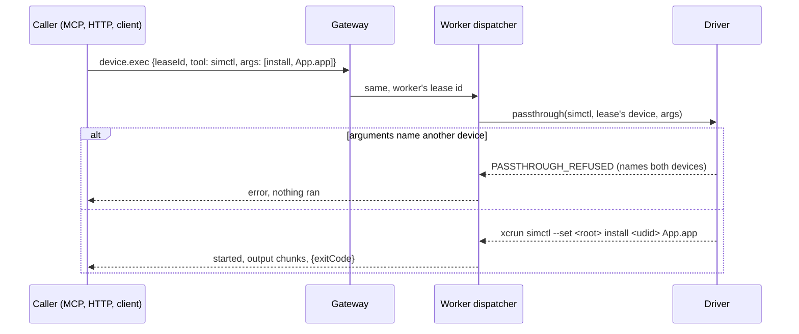

# 0047. `device.exec` fills in the lease's device, and refuses another

- **Status:** Accepted — not yet implemented
- **Date:** 2026-10-23
- **Issue:** [#951](https://github.com/callstackincubator/simlock/issues/951)
- **Extends:** [ADR 0005](0005-gateway-and-worker-modes.md) §19a (the
  driver resolves the command). Nothing in 0005 is replaced.
- **Narrows:** [ADR 0003](0003-one-typed-daemon-contract-behind-every-frontend.md)
  §11's MCP tool-call serialization: `run_on_device` does not queue (§6).

## Context

`device.exec` runs one `simctl`, `adb` or `devicectl` command against a
lease on the worker that holds the device (ADR 0005 §19a). Only
physical devices get it from the lease: the driver adds
`--device <udid>` to `devicectl` unless the arguments name one
(`src/drivers/ios/devicectl-exec.ts:211`), and `-s <serial>` to a
phone's `adb` (`src/drivers/android/physical-handler.ts:234`). For `simctl` and for `adb`
on an emulator, the caller's arguments must name the device, and the
daemon parses none of them (`src/daemon/dispatcher.ts:696-712`). So every
caller copies the UDID or the adb serial out of the grant into every
command, and nothing stops one that copies the wrong one:
`simctl install booted …` can reach another agent's simulator in the
same device set.

Two requests need the device to be implied: an MCP tool that runs these
commands against the session's lease (#951), and `simlock simctl` /
`simlock adb` on a worker scoped to the caller's lease (#948). Where the
device sits differs per tool and per verb, and the drivers already own
each tool's grammar and refusal list (drivers rule 6).

## Decision

1. **The driver fills the lease's device in.** When `passthrough` is
   given a device (today only `device.exec` gives one), the driver puts
   that device into the command where the tool expects it. A caller
   leaves the device out:

   | Tool, device | Where the device goes | Already named |
   | --- | --- | --- |
   | `simctl`, simulator | First operand after the verb and the verb's own options, for verbs on the driver's device-verb list | Left as is when it is the lease's UDID (any letter case) |
   | `adb`, emulator | `-s <serial>` before the subcommand, unless the subcommand is on the driver's no-device list (`devices`, `version`, `help`, …) | `-s <the lease's serial>` left as is |
   | `adb`, physical phone | `-s <serial>`, as today | Any leading flag refused, as today |
   | `devicectl`, physical iPhone or iPad | `--device <udid>`, as today | `--device` / `-d` with the lease's UDID left as is |

   The two lists, read from `xcrun simctl help` (Xcode 27.0) and
   `adb help` (platform-tools 37.0.0):

   - **simctl device verbs**, device first: `addmedia`, `appinfo`, `boot`, `bootstatus`,
     `get_app_container`, `getenv`, `icloud_sync`, `install`,
     `install_app_data`, `io`, `keychain`, `listapps`, `location`,
     `openurl`, `privacy`, `push`, `reboot`, `rename`, `shutdown`,
     `status_bar`, `terminate`, `ui`, `uninstall`, `upgrade`; device after
     the verb's own options: `launch`, `spawn`, `pbcopy`, `pbpaste`. Among
     those options only `-a` takes a separate value.
   - **adb no-device subcommands**: `devices`, `help`, `version`,
     `connect`, `disconnect`, `pair`, `mdns`, `keygen`, `start-server`,
     `kill-server`, `reconnect offline`, and `forward --list`. `reconnect`
     alone and `reverse --list` act on a device and get it filled in.

   A `simctl` verb not on its list (`list`, `runtime`, `help`, `pair`,
   `pbsync`, `clone`, …) passes as today, with nothing filled in and
   nothing checked. An emulator whose address is empty gets nothing filled
   in.

2. **Naming another device is refused.** Where the table above fills a
   device in, an argument that names a different device is refused with
   `PASSTHROUGH_REFUSED` before anything runs. The message names both the
   device the arguments named, as the caller wrote it, and the lease's
   own. For `simctl` that is another UUID-shaped operand or `booted`
   (`booted`, `0A1B…`). For an emulator's `adb` it is `-s <other serial>`,
   `-d`, `-e` or `-t <id>` (`-s emulator-5556`, `-e`, `-t 3`). For
   `devicectl` it is a `--device` / `-d` whose value is not the lease's
   UDID (`--device 00008110-…`), names and ECIDs included. This is still an accident
   boundary, not a security one: `xcrun simctl` stays reachable (drivers
   known gaps).

3. **Every `device.exec` caller gets it.** HTTP, the gateway relay, the
   programmatic client and MCP all reach the same driver call, so there
   is no opt-in flag. A caller that already names the lease's own device
   sees no change. Through a gateway the worker fills the device in, as
   it resolves every other part of the command.

4. **No contract change.** `device.exec`'s input and output keep their
   shape and the protocol is not bumped. A worker older than this change
   runs the arguments as given.

5. **The local path stays as it is until #948.** `driver.passthrough`
   passes no device, so `simlock simctl` and `simlock adb` on a worker
   are unchanged. #948 can pass the caller's lease's device to the same
   driver call and get the same rule.

6. **The MCP tool built on it does not queue.** `run_on_device` (#951)
   reads the session's lease when it starts and runs beside the other
   tool calls, so `lease_status` and `release_simulator` answer while a
   command runs. A release or a session end during a command goes ahead;
   the command runs on to its exit or `exec.timeoutMs`, as a command does
   today when its connection closes (`docs/internal/flows/device-exec.md`,
   "Detach").

## Consequences

- A caller writes `["install", "App.app"]` or `["shell", "getprop"]` and
  never copies a UDID or serial. The website's "name your device in the
  arguments" advice and the Android serial lookup go away.
- An HTTP caller that sends `booted` today, which the docs already tell
  it never to do, gets `PASSTHROUGH_REFUSED`. So does `simlock simctl`
  through a gateway, which runs on `device.exec` (`src/cli/AGENTS.md:85`):
  the website's `simlock --gateway simctl install booted ./MyApp.app`
  example is refused until task #958 rewrites it.
- Each driver keeps a device-verb list (iOS) or a no-device list
  (Android). A new `simctl` verb is passed through unfilled until it is
  added to the list.
- A caller that names its own device another way (a simctl device name,
  a devicectl ECID or name, adb `-t <own transport id>`) is refused or,
  for a simctl name, gets the UDID put in front of it and simctl fails.
  The UDID or serial is the one form that passes.
- In a fleet whose workers run mixed versions, a command that leaves the
  device out works only on workers that have this change.

## Alternatives considered

- **The MCP tool fills the device in itself.** That puts each tool's
  grammar in a frontend, which ADR 0005 §19c rules out for the refusal
  list for the same reason. HTTP and #948 would each need their own copy.
- **An opt-in `fillDevice` field on `device.exec`.** This bumps the
  protocol and leaves two behaviours to test and document. Callers that
  already name their own device see no change without it, so the flag
  buys nothing.
- **Fill in only, refuse nothing.** Smaller, but it leaves the
  wrong-device accident open on the one path that now knows where the
  device argument sits.
