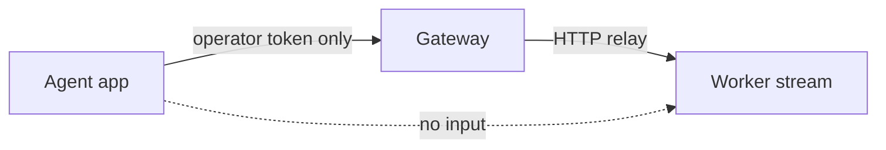
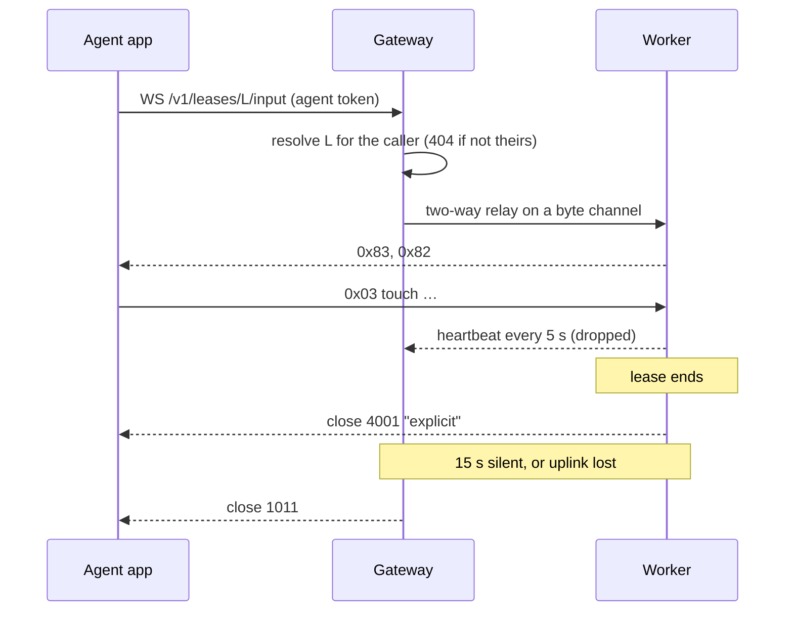

# 0049. A lease holder watches and drives its device's screen

- **Status:** Accepted
- **Date:** 2026-10-26
- **Issue:** [#1013](https://github.com/callstackincubator/simlock/issues/1013)
- **Narrows:** [ADR 0045](0045-a-devices-screen-streams-to-operators-not-a-leases.md)
  §2 ("Operators only") and its rejected alternative "Keep the lease route
  beside the device route": a lease holder now streams its own lease. The
  device route, its operator-only rule and §4's lifetime stay.
- **Narrows:** [ADR 0028](0028-the-uplink-carries-byte-channels-and-small-messages-go-first.md)
  §4 (a relay is one HTTP exchange; §5 here adds a two-way relay that keeps
  both directions of its byte channel open) and
  [ADR 0030](0030-optional-modules-share-one-contract-and-load-only-when-turned-on.md)
  §3 (a module's routes sit under its name; §2 here lets a module own one
  route under a lease).

## Context

Only an operator token can watch a device (ADR 0045 §2), and nobody can
tap it: the stream is view-only (`src/stream/AGENTS.md`, Known gaps). An
app that shows a person the device its agent leased must hold an operator
token, which sees and stops every device in the fleet, and still cannot
take over for a sign-in (#1010).

ADR 0045 dropped the lease route because the console was its only caller,
and a second access model costs tests. It names no security flaw in the
lease-owner model. A second caller now exists: T3 Code's device panel
(pingdotgg/t3code PR #25259), which today asks for an operator token and
runs a view-only client mode.

T3 Code, EAS and expo-device-hub already speak serve-sim's input messages:
one tag byte, then UTF-8 JSON, on a WebSocket. Expo's serve-sim adds
`0x83` (input admitted) and `inputUnavailable` in `0x82`; T3 Code sends no
input before `0x83`.

Today's relay carries one HTTP exchange: once the worker's target answers,
the rest of the request body is cut off (`src/daemon/relay.ts:240`). An
input socket needs both directions open at once.

## Decision

1. **Two lease routes.** `GET /v1/leases/{id}/stream` serves today's stream
   frames for one lease. `WS /v1/leases/{id}/input` takes input for it. Both
   answer the lease's owner and any operator; anyone else, and an unknown
   lease, get 404 `UNKNOWN_LEASE`, as `GET /v1/leases/{id}` does. Both run on
   a gateway and on a standalone worker.
2. **A module may own one route under a lease.** Besides `/v1/<name>/*`, an
   optional module may own `/v1/leases/{id}/<name>`. The HTTP layer resolves
   the lease for the caller once, as `lease.get` does, and hands the module
   the lease; the module never checks ownership itself. `stream` owns
   `/stream`; a new optional module `input` owns `/input`. A segment no loaded
   module owns answers 404. The module host refuses to load a module whose name
   is a core lease sub-route (`renew`, `exec`), as it refuses a name that
   clashes with a core first segment: the core route wins.
3. **Input speaks expo serve-sim's messages**, pinned at
   expo/expo-device-hub `1357114`: `0x03` touch, `0x04` button, `0x06` key,
   `0x0b` scroll in; `0x83` admitted, `0x82` screen config, `0x90` control
   reply out. Positions are fractions of the screen. The same messages serve
   iOS and Android; Simlock adds the button `back` for Android. Rotation
   (`0x07`) is dropped on every platform: agents rotate through
   agent-device, and the device input re-reads the screen size every 2 s so
   taps stay right after they do. A broken message is dropped, as serve-sim
   drops it. When
   serve-sim changes, Simlock adds a compatibility layer rather than
   following silently.
4. **Input is its own capability**, `capabilities.input.enabled`, off by
   default, and needs no open stream. A lease has one device input, shared
   by up to 8 sockets as serve-sim shares its injector; a 9th socket is
   closed with 1013. On Android it is a control-only scrcpy server, on an
   iOS simulator a HID helper; a physical iPhone has none and says
   `inputUnavailable`. Where keys cannot be injected (an iOS 27 runtime),
   `0x82` says `keyboardUnavailable`, as serve-sim does. On an iOS
   simulator only Home is pressed (through `simctl`); the app switcher and
   Lock are dropped.
5. **The relay gains a two-way mode.** A two-way relay keeps both directions
   of its link byte channel open until either side ends it, carries
   length-prefixed messages, and ends after 15 s with no bytes from the
   worker. The worker's input session sends a heartbeat every 5 s; the
   gateway drops it. Every input socket, on a gateway or a standalone
   worker, pings its client every 15 s and ends when no pong comes within
   15 s.
6. **The worker ends both when the lease ends.** The stream's last frame is
   a new tag `0x07` with `{"reason"}`, on the device route too; readers that
   do not know it skip it. The input socket closes with 4001 and the reason.
   A link reset carries no text, so the worker sends the reason as a message
   before it ends the channel. The gateway also closes what is left when it
   sees the lease go.

## Consequences

- An agent token can now see and touch its own lease's screen. It could
  already do anything to that device through agent-device, so no new power
  is granted; another agent's lease stays 404.
- The HTTP layer gains a lease-route seam, the module host gains a socket
  handler and a two-way relay, and `ports` gains upgrade routing beside the
  uplink's. The protocol is bumped once for the relay.
- A person cannot rotate a device through Simlock. On iOS simulators they
  also cannot type hardware keys on iOS 27 runtimes or press the app
  switcher or Lock. On 2026-10-26, on Xcode 27, neither serve-sim's
  GSEvent, nor Simulator.app (Xcode 27 ships none), nor CoreDevice's vendor
  channel (it cannot see a custom device set, and does not rotate a
  non-foldable iPhone) rotated a Simlock simulator. #1024 follows up.
- Two viewers still run two captures (#602).

## Alternatives considered

- **A short-lived preview `{url, token}` per lease.** Lets a browser connect
  directly. Rejected for now: the first caller proxies every request.
- **serve-emu on Android.** No change for T3 Code on Android, but a second
  third-party protocol to follow. Rejected.
- **EvanBacon serve-sim, the copy we vendored.** It has no `0x83`, so T3
  Code would never send input. Rejected.
- **Routes under the module prefixes** (`/v1/stream/leases/{id}`,
  `/v1/input/leases/{id}`). Fits the one-prefix rule with no new seam.
  Rejected: the maintainer chose the lease-scoped paths.
- **Rotation through Simulator.app or CoreDevice on iOS, and through
  `user_rotation` on Android.** Rejected: the iOS paths do not work on
  Xcode 27 (see Consequences), and rotating Android alone would give the
  two platforms different input.
- **A heartbeat in the link layer.** It proves only that the worker process
  runs, which the uplink already proves. Rejected for one sent by the input
  session.
