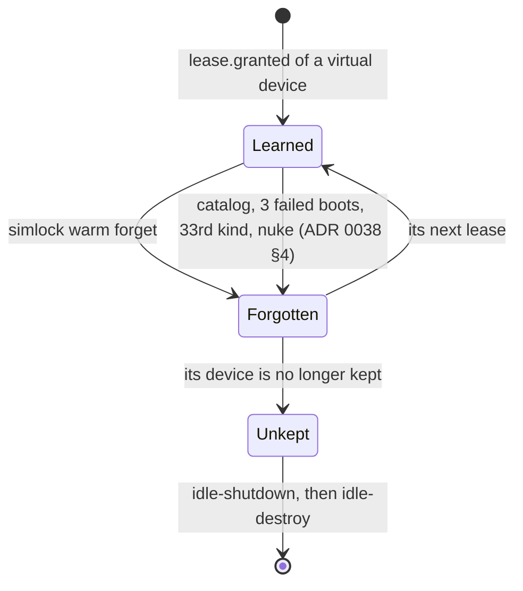

# 0050. An operator can forget a learned warm kind

- **Status:** Accepted
- **Date:** 2026-10-28
- **Issue:** none; opened as a draft PR from a lab worker's report.
- **Narrows:** [ADR 0038](0038-the-warm-pool-learns-its-kinds-from-leases-and-boots-for-every-queued-request.md)
  §4 (when a kind is forgotten) gains one way, the operator's
  `warm.forget`. Its rejected alternative "Forget a kind after a fixed
  time" stays rejected: nothing here expires a kind on its own.

## Context

A lab Mac worker has two managed Android slots. A quoting mistake leased
`--device Pixel` (avdmanager's generic `pixel` profile) instead of
`Pixel 9`. Both leases were released. Since then the stray "Pixel"
emulator has stayed booted: `status` shows `managed 2/2, running 2`, and
`simlock cleanup --dry-run` proposes nothing.

That is ADR 0038 working as written. The kind `android/Pixel/36/full` is
learned; `targetedDevices()` keeps one ready device of every learned kind,
so `idle-shutdown` spares it and `idle-destroy` never sees it. Leasing
evicts it when another model needs the slot, a newer learned kind
displaces it (§3), and so does a configured target short for its slot
([ADR 0051](0051-configured-warm-targets-come-first-and-learning-can-be-turned-off.md)
§2), so nothing is blocked. But the slot and its RAM are
spent on a kind nobody wants until then.

There is no supported way to undo one mistaken lease. `device remove` is
for physical devices only, no operation forgets one kind, and `nuke`
resets every lease and forgets every kind. The only workaround is to stop
the daemon and delete rows from `state.db` by hand.

## Decision

An admin operation, `warm.forget { platform, model, osVersion?, mode?,
imageTag? }`, forgets every learned kind of the model on the platform,
narrowed by each field given. It answers `{ forgotten: [...] }` with each
kind's platform, model, OS version, mode and image tag, logs one `info`
line per kind, and asks for a pass.

It does not act on a device. The device is no longer kept, so the reaper's
idle rules shut it down and delete it through `ManagedDeviceLifecycle`,
as for any idle device. A device that never served a lease is shut down
by the pool's never-leased idle rule `idle.shutdownAfterMs` after it
became ready, then deleted by `idle-destroy`. A configured target is
untouched, its retry backoff included. A gateway
refuses it with `UNSUPPORTED_IN_GATEWAY_MODE`, like `nuke.run`.

The CLI is `simlock warm forget <platform> <model> [<os>] [--mode]
[--image-tag] [--json]`; the admin client's method is `forgetWarmKind`.
The protocol version rises by one.

## Consequences

- Undoing a mistaken lease is one command. Both idle rules count from the
  lease's end, so a device whose lease ended long ago is shut down and
  deleted on the reaper's next runs. A device that never served a lease
  counts from when it became ready instead.
- The next lease of the model learns the kind again.
- Nobody notices a stray kind on a worker nobody watches: it holds its
  slot until another kind needs it, as before.
- No HTTP route or MCP tool: the CLI and the admin client cover the
  operator, and an agent never needs it.

## Alternatives considered

- **Expire a learned kind after a time with no lease.** Deferred: ADR 0038
  rejected it, leasing's eviction already keeps a stray kind from blocking
  anything, and a kind leased less often than the time would pay a cold
  boot. It can be proposed again if workers show kinds piling up.
- **Turn learning off with `warmPool.learn: false` (ADR 0051 §3).**
  Rejected as the fix: it stops keeping every learned kind, the real ones
  with the stray, and the stray comes back when learning is turned on
  again within 24 hours.
- **A virtual-device delete on `device remove`.** Rejected: the idle rules
  already delete an unkept device through the lifecycle, and a second
  delete path would need its own claim and revalidation.
- **Forget through `nuke`.** Rejected: it ends every lease and forgets
  every kind, iOS included.
