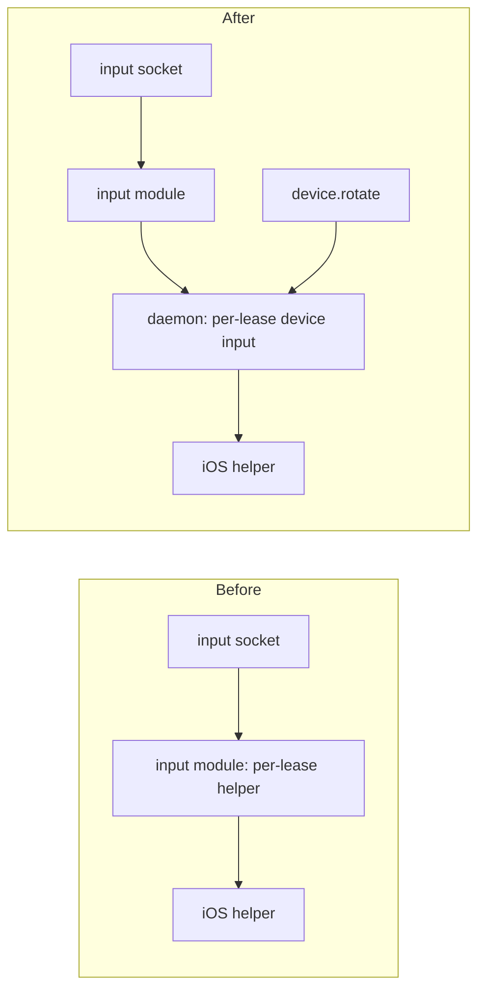
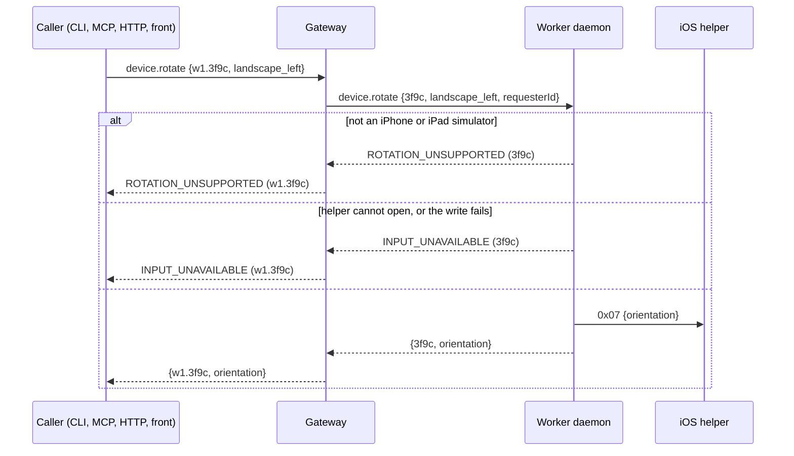

# 0053. The daemon owns each lease's device input, and `device.rotate` uses it

- **Status:** Accepted
- **Date:** 2026-10-30
- **Issue:** [#1105](https://github.com/callstackincubator/simlock/issues/1105)
- **Narrows:** [ADR 0049](0049-a-lease-holder-watches-and-drives-its-devices-screen.md)
  §4 ("A lease has one device input", held by the optional `input` module,
  which is off by default) and
  [ADR 0052](0052-an-ios-simulator-takes-serve-sims-rotation.md) §1
  (`0x07` is an input message: a rotation can now also be sent without the
  input socket).

## Context

ADR 0052 lets an iOS simulator take serve-sim's rotation, but only as `0x07`
on the lease's input WebSocket. That socket belongs to the optional `input`
module, which is off unless `capabilities.input.enabled` is on, on the
worker and on the gateway. An agent using the CLI, MCP, plain HTTP or
agent-device cannot send it (#1098).

The one device input per lease, an iOS input helper process
(`simlock-screen-capture <udid> --input`), is opened and shared inside the
input module today (`src/input/sessions.ts`): the first socket opens it,
the last one leaving closes it, a failed one is dropped, and lease end
closes it through the module's `beforeDeviceReclaim` hook. A rotation that
does not go through a socket needs the same helper, whether or not the
module is loaded. Two helpers on one simulator at once are untested, and
nothing needs them.

A device input's `send` returns nothing today: a failed write is reported
later, through `onFailed`. A caller that answers "sent" cannot know.

## Decision

1. The daemon keeps one device input per lease, keyed by lease id, opened
   through the driver catalog on first use and shared by every user. Users
   are the input module's sockets and an in-flight `device.rotate`. It
   closes when no socket holds it and no rotate is in flight, and when the
   lease ends. One that fails is dropped, and the next user opens a fresh
   one.
2. The input module takes the lease's device input from the daemon through
   its context instead of opening its own. Its socket behaviour (limits,
   close codes, `0x82`, failure handling) does not change.
3. `DeviceInput.send` returns a promise that resolves once the message is
   written to the device and rejects when the write fails. Socket callers
   ignore it; a failed write still reaches them through `onFailed`.
4. `device.rotate {leaseId, orientation, requesterId?}` is a core contract
   operation, role `agent`, authorized as `device.exec` is. It is always on,
   independent of `capabilities.input.enabled`. On a lease of an iOS
   simulator whose model is an iPhone or iPad (its name starts with `iPhone`
   or `iPad`, the iOS driver's phone and tablet families) it takes the lease's device input,
   sends `0x07 {orientation}`, awaits the write and answers
   `{leaseId, orientation}`, then lets the input go. It reports no new
   orientation and does not wait for the screen.
5. Any other lease is refused with `ROTATION_UNSUPPORTED` before a device
   input is opened. A device input that cannot open, or a write that fails,
   is `INPUT_UNAVAILABLE`.
6. A gateway forwards `device.rotate` to the lease's worker, as it forwards
   `device.exec`, and answers with the caller's own lease id in the output
   and in both errors.

## Consequences

- An agent rotates an iOS simulator from any surface with the input module
  off.
- The daemon gains a small per-lease registry it did not have; the input
  module loses one. Lease end closes the device input in the daemon, not
  only through the module's hook.
- Every driver's `send` returns a promise; the change is internal.
- A rotate with no socket open pays the helper's start each time (bounded at
  10 s).
- The contract grows one operation and two error codes, and the protocol is
  bumped.

## Alternatives considered

- **A rotate route inside the input module, gated by
  `capabilities.input.enabled`.** Rejected: modules add HTTP routes, not
  contract operations, so the CLI and MCP could not reach it, and the
  setting is off by default.
- **A second helper for each rotate, outside the module.** Rejected: two
  helpers on one simulator at once are untested, and sharing costs little.
- **Keep a rotate's helper until the lease ends.** Rejected: an idle process
  per rotated lease for a call that is rare.
- **Answer once `send` is called, without awaiting the write.** Rejected: a
  rotate could report success for a write that failed.
