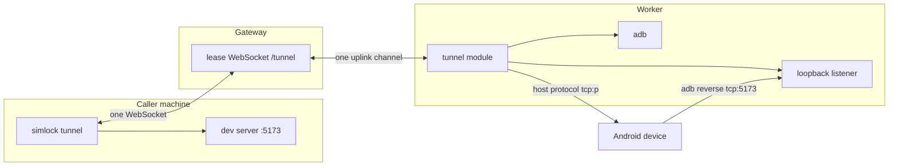

# 0054. A lease holder tunnels device ports to its own machine

- **Status:** Accepted
- **Date:** 2026-10-30
- **Issue:** [#1110](https://github.com/callstackincubator/simlock/issues/1110)
- **Narrows:** [ADR 0005](0005-gateway-and-worker-modes.md) Non-goals ("A
  byte-heavy data plane": port forwarding is not proxied) for TCP tunnels
  between a lease's Android device and its holder's machine. ADR 0005
  Decisions 1 and 8 stand: the gateway's port stays the only inbound port,
  and no worker address reaches a client.
- **Builds on:** [ADR 0028](0028-the-uplink-carries-byte-channels-and-small-messages-go-first.md)
  (byte channels), [ADR 0049](0049-a-lease-holder-watches-and-drives-its-devices-screen.md)
  (a module owns a lease WebSocket, relayed to the worker).

## Context

An agent on another machine runs `adb reverse tcp:5173 tcp:5173` through
`device.exec`, and the device reaches port 5173 on the worker, not the
agent's dev server (#1100). Every device test of a local build has to move
to the worker.

ADR 0005 left port forwarding out because the gateway proxied requests,
not sessions. ADR 0028 since gave the uplink byte channels built for live
streams, and ADR 0049 streams screens and input through the gateway on a
lease WebSocket. The transport exists; only the decision to carry ports on
it is missing.

Two limits shape it. The uplink opens at most 64 channels per side at once,
for every lease on a worker, and a dev server page opens dozens of
connections. And adb can do both directions without a listening worker
port: `adb reverse tcp:<device> tcp:<worker loopback port>` makes a device
connection reach a worker listener, and adb's host protocol
(`host:transport:<serial>`, then `tcp:<port>`) opens one stream to a device
port with no `adb forward` rule (both checked with adb 37.0.0 on
2026-10-30).



## Decision

1. A new optional module, `tunnel`, owns `GET /v1/leases/{id}/tunnel`, a
   WebSocket on a lone worker and on a gateway, which relays it to the
   lease's worker as the input socket is relayed: frames wrapped
   `[len u32][tag u8][payload]`, a worker heartbeat every 5 s, and close
   codes carried in a close frame. It is on only under
   `capabilities.tunnel.enabled`, off by default on every role. Only the
   lease's holder and operators reach it.
2. One socket carries every tunnel and every TCP connection of one
   `simlock tunnel` run, so a run costs one uplink channel. The client
   names its tunnels first (`reverse` or `forward`, a device port 1024 to
   65535); the worker opens all of them or none and answers which. At most
   8 tunnels per lease at once.
3. Inside the socket each TCP connection has an id. Binary messages open,
   carry data for, give credit to, half-close and reset a connection; a
   message carries at most 64 KiB of data, each direction of a connection
   has a 256 KiB window, and at most 256 connections are open at once.
   A slow reader stops only its own connection.
4. `reverse` on Android: the worker listens on a loopback port it picks and
   runs `adb reverse --no-rebind tcp:<device port> tcp:<that port>`; a
   device port already reversed is refused. Each accepted connection is
   announced to the client, which connects to its own loopback port.
   The listener accepts any connection that reaches the worker's loopback
   port, and no listener check is added: while a tunnel is open, another
   lease's device on the same worker (an emulator at 10.0.2.2, any device
   through an `adb reverse` set with `device.exec`) or a local process can
   reach the holder's tunnelled port.
   `forward` on Android: the client listens on its own loopback port; each
   connection is announced to the worker, which opens the device port
   through adb's host protocol. The caller side touches loopback only.
5. The module reaches adb only through a port the daemon gives it, as the
   stream and input modules reach screens and input; the Android driver
   implements it for emulators and enrolled phones. Other devices are
   refused.
6. A tunnel lives while its socket does. When the socket closes, the
   worker removes its `reverse` rules and closes its listeners and
   connections; the removal is awaited before lease end lets reclaim run,
   and a removal that fails keeps its loopback port reserved until reclaim.
   When the lease ends, every socket of it closes. Android reclaim acts on
   emulators only. Once an emulator is proved Simlock's own, reclaim removes every `reverse` rule on the
   device, the tunnel's and any an agent made through `exec`, and every
   `forward` rule the adb server holds for that device's serial. It never
   runs `forward --remove-all`: forward rules live in the server, which
   other devices and tools share. On an enrolled phone Simlock removes only
   the `reverse` rules its own tunnels set, when their socket closes, each
   phone command behind the default server's version check (safety rule 9);
   it never runs `reverse --remove-all` or removes a `forward` rule on a
   phone (safety rule 1, ADR 0022 §3). A tunnel rule a daemon crash leaves
   on a phone stays until the phone reboots or a person removes it. Tunnel listeners use only loopback ports
   47000 to 47999, reserved for tunnels. At start, before any lease is
   served, the worker reads `reverse` rules on every Android emulator it
   proves its own, and on every phone it proves enrolled it reads `reverse --list`
   and changes nothing: each port in the range a phone's rule points to stays
   reserved, so a stale rule a daemon crash or a failed removal left never
   sees its port given to another tunnel. A phone's reclaim reads its rules
   again and frees only the ports no rule on it points to. On an idle emulator it removes each rule whose host side is
   in that range: the range is reserved for tunnels (a holder's own rule
   pointed there is removed too, and the docs say so), and no tunnel
   survives a restart. On a leased device it removes nothing, since no
   cleanup may target a leased device (safety rule 2): it marks the ports
   those rules point to as taken, so no new tunnel listener is given one,
   and the device's reclaim removes the rules. Rules pointing elsewhere, a
   holder's own made through `exec`, stay, so leases kept across a restart
   (ADR 0019) keep them.
7. The socket's frames are not daemon-contract operations, but both ends
   must agree on them: their codec is a helper in the contract, which the
   CLI and the module both import. The tunnel's refusals are contract error
   codes, so every surface reports them the same way; adding them is one
   protocol bump.
8. `simlock tunnel` opens the socket with `ws`, through a ports adapter in
   the barrel that loads `ws` with `import()` on first use, so no other CLI
   command and not the MCP server ever load it. Node's built-in client
   sends headers, but it hides a refused upgrade's status and body and the
   server's pings, which the command needs to report a refusal and to tell
   an idle tunnel from a dead one. The comment that said Node 22 cannot set
   headers is corrected.

```mermaid
sequenceDiagram
  participant C as simlock tunnel (caller)
  participant G as Gateway
  participant W as Worker tunnel module
  participant D as Device
  C->>G: WebSocket /v1/leases/{id}/tunnel (agent token)
  G->>W: two-way relay, one channel
  C->>W: tunnels: reverse 5173
  W->>D: adb reverse --no-rebind tcp:5173 tcp:<loopback>
  alt port already reversed
    W-->>C: refused (port in use), socket closes
  else
    W-->>C: ready
    D->>W: connection on tcp:5173
    W->>C: open conn 1
    C->>C: connect localhost:5173
    C-->>W: data / credit / end
  end
  Note over C,W: socket closes → rules removed; lease ends → 4001
```

## Consequences

- An agent anywhere tests a local build on a leased Android device with one
  command, through the gateway's one port.
- An operator who turns the module on lets lease holders move arbitrary TCP
  bytes between their machine and the device. The holder reaches only the
  device's ports, but a `reverse` listener is open to anything that reaches
  the worker's loopback port while the tunnel lives: another lease's device
  on the same worker or a local process can connect to the holder's
  tunnelled port. The operator accepts this with the module.
- `dataPlane` on the lease stays reserved; tunnels are a module route, not
  a lease field.
- Reclaim gains a step on Android emulators, and rules made by hand there no
  longer leak into the next lease. On an enrolled phone the rules a holder
  made stay.
- A stale tunnel rule on a phone holds its port until the phone reboots or
  a person removes it.
- The first daemon-contract helper for a module's own socket protocol.
- A third file loads `ws`, and only when `simlock tunnel` runs.
- Each worker reserves loopback ports 47000 to 47999 for tunnels.
- iOS simulators are not covered: their `reverse` would be a port on the
  worker shared by every lease, the host-port problem #162 owns.

## Alternatives considered

- **One WebSocket per TCP connection.** Rejected: a busy dev server would
  use up the worker's 64 uplink channels and stall every other relay.
- **A direct path from caller to worker.** Rejected: it needs an inbound
  port on every worker, against ADR 0005 Decision 1.
- **`adb forward` rules on the worker.** Rejected: each would hold a worker
  port; the host protocol reaches the device port with none.
- **Replace an existing `reverse` rule.** Rejected: it would silently break
  a rule the agent set up itself.
