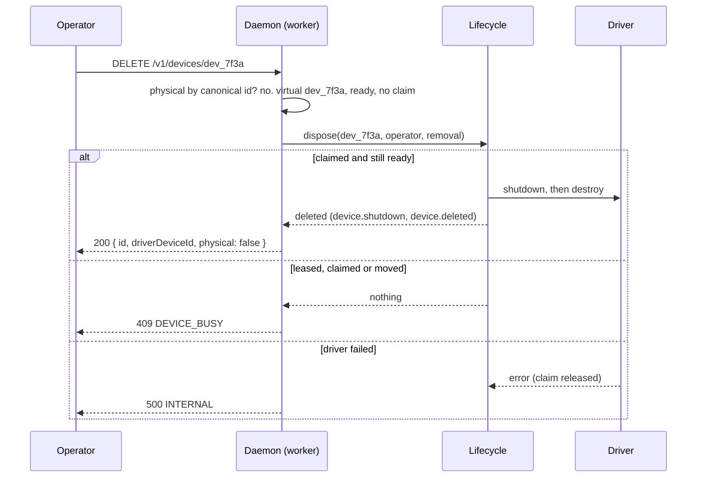
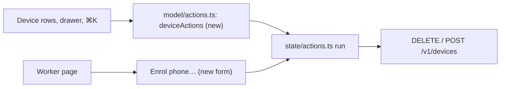

# 0055. `device remove` deletes an idle simulator or emulator, and the console offers device actions on a worker

- **Status:** Proposed
- **Date:** 2026-10-31
- **Issue:** [#1131](https://github.com/callstackincubator/simlock/issues/1131)
  (from request [#1130](https://github.com/callstackincubator/simlock/issues/1130))
- **Supersedes:** nothing. Narrows [ADR
  0050](0050-an-operator-can-forget-a-learned-warm-kind.md): its rejected
  alternative "A virtual-device delete on `device remove`" is taken up
  here, on the lifecycle's existing delete, not a second path. Extends
  [ADR 0022](0022-a-physical-device-is-a-second-device-type-the-core-knows.md)
  §2's `device remove` to a virtual record, and [ADR
  0037](0037-the-console-acts-through-the-http-routes-on-base-ui.md) §3's
  action lists with one for devices.
- **Depends on:** ADR 0012 (a single host is a fleet of one), ADR 0022,
  ADR 0037, ADR 0050.

## Context

#1130 asks the console to manage the devices themselves. Two of its asks
fit routes and rules that exist:

- Enrol a USB phone and remove an enrolled one. `POST /v1/devices` and
  `DELETE /v1/devices/{id}` exist, answer on a worker, and a gateway
  refuses both by design: they act on a device plugged into one machine.
- Delete an idle simulator or emulator the operator no longer wants. No
  route does it. The idle rules delete an unkept device after
  `idle.shutdownAfterMs` and `idle.deleteAfterMs` (10 and 60 minutes by
  default), and `nuke --delete-devices` deletes them all.

ADR 0050 rejected a virtual delete on `device remove` because "a second
delete path would need its own claim and revalidation". The lifecycle
already has a delete that claims and revalidates: `dispose` shuts a
`ready` device down and destroys it, under one claim, and answers nothing
for a device that is leased, claimed or moved. Leasing already calls it.
So the delete needs no second path, only a caller.

ADR 0037 §3 lists actions for leases, requests, workers and Inbox items.
Devices have none, and the console has no form: every action so far is a
click, at most a typed name to confirm.

## Decision

### 1. `device remove` deletes an idle simulator or emulator

`device.remove { id }` (`DELETE /v1/devices/{id}`, `simlock device remove
<id>`) looks up `id` in two places, in order:

1. An enrolled physical device whose canonical id is `id`, as today. It is
   unenrolled, as today.
2. A virtual device whose registry id (`dev_…`) is `id`. It is shut down
   when `ready`, then deleted from disk, through the lifecycle's `dispose`
   under a new claim kind, `removal`.

| Virtual device state                     | Answer                                     |
| ---------------------------------------- | ------------------------------------------ |
| `ready`, no claim                        | shut down, deleted: 200, `physical: false` |
| `shutdown`, no claim                     | deleted: 200, `physical: false`            |
| `leased`                                 | 409 `DEVICE_BUSY`, reason `leased`         |
| `reclaiming`, or a `reclaim` claim       | 409 `DEVICE_BUSY`, reason `reclaiming`     |
| any other state, or any other claim      | 409 `DEVICE_BUSY`, reason `busy`           |
| `deleted`, or no such id                 | 404 `UNKNOWN_DEVICE`                       |

A device that moves between the check and the claim (a grant, a boot, a
reclaim) answers `DEVICE_BUSY` `busy`: `dispose` answered nothing, so
nothing was touched.

Events: `device.shutdown` (when it was `ready`) and `device.deleted`, both
with initiator `operator`, the initiator `device remove` already uses for
a physical device. No new event and no new error code: `DEVICE_BUSY`'s
reasons stay `leased`, `reclaiming` and `busy`.

The answer gains `physical` (a boolean), so a caller can say what
happened: the CLI prints "Removed … It is no longer enrolled; nothing on
the device changed." for a phone, as today, and a line saying the device
was deleted for a simulator or emulator. The input keeps its shape. The
protocol rises by one.

The warm pool is not asked. A device a target or a learned kind keeps is
deleted like any other, and the pool's next pass makes a new one if the
kind is still kept. Forgetting the kind stays `warm forget`'s (ADR 0050).

A driver failure answers 500 `INTERNAL` and leaves the device where it
got to: still `ready` when the shutdown failed, `shutdown` when only the
delete did. The idle rules delete a `shutdown` device later, as for any.

### 2. A gateway still refuses it

`device.remove` and `device.add` stay refused on a gateway with
`UNSUPPORTED_IN_GATEWAY_MODE`. Deleting or enrolling across a fleet from
one endpoint is the fleet-wide command `docs/internal/IDEAS.md` defers.

### 3. The console offers device actions on a worker only

`ui/src/model/actions.ts` gains a device action list, read by the worker
page's device rows, the device drawer and ⌘K like every other list:

| Action        | Route                     | Offered when                                                    | Before it runs                                  |
| ------------- | ------------------------- | --------------------------------------------------------------- | ----------------------------------------------- |
| Remove phone  | `DELETE /v1/devices/{id}` | worker mode, a physical device `ready`, `absent` or `quarantined` | a confirm naming the phone                      |
| Delete device | `DELETE /v1/devices/{id}` | worker mode, a virtual device `ready` or `shutdown`              | a confirm naming the model and that disk goes   |

The worker gains **Enrol phone…** in worker mode: a dialog with the
platform and the phone's id, which sends `POST /v1/devices`. It is the
console's first action with a form; the form is a `ds/` component, and
the action list holds its fields.

The console reads the mode as ADR 0037 §4 says, and offers none of these
when it is `gateway` or unknown. Results show as for every action: a
toast, and the change once the daemon's event marks the page stale.

## Consequences

- An operator can delete a simulator or emulator at once instead of
  waiting for the idle rules, from the CLI, the HTTP API and the console.
- `simlock device remove dev_…`, which answered `UNKNOWN_DEVICE`, now
  deletes the device. A script that relied on the refusal changes
  behaviour; none is known.
- An older daemon answers the console's Delete with `UNKNOWN_DEVICE`; the
  error toast shows its message.
- A console on a gateway still sends the operator to the worker's own
  console or CLI for device actions.
- `website/.../reference/events.mdx`, `errors.mdx`, the CLI reference and
  the console pages change with the tasks of #1131.

## Alternatives considered

- **A new route, `DELETE /v1/virtual-devices/{id}`, and a new operation.**
  Rejected: two verbs for "this device goes", a second operation, and a CLI
  command beside `device remove`. Ids do not collide: a virtual id is
  `dev_…`, a physical one is the phone's own.
- **Let a delete also forget the device's warm kind.** Rejected: it mixes
  two operator intents. `warm forget` already does the second.
- **Relay device actions through a gateway.** Deferred, with the other
  fleet-wide commands in `docs/internal/IDEAS.md`.
- **Delete a quarantined virtual device too.** Deferred: the quarantine
  coordinator owns it and gives up on its own; `dispose` does not claim
  that state.
