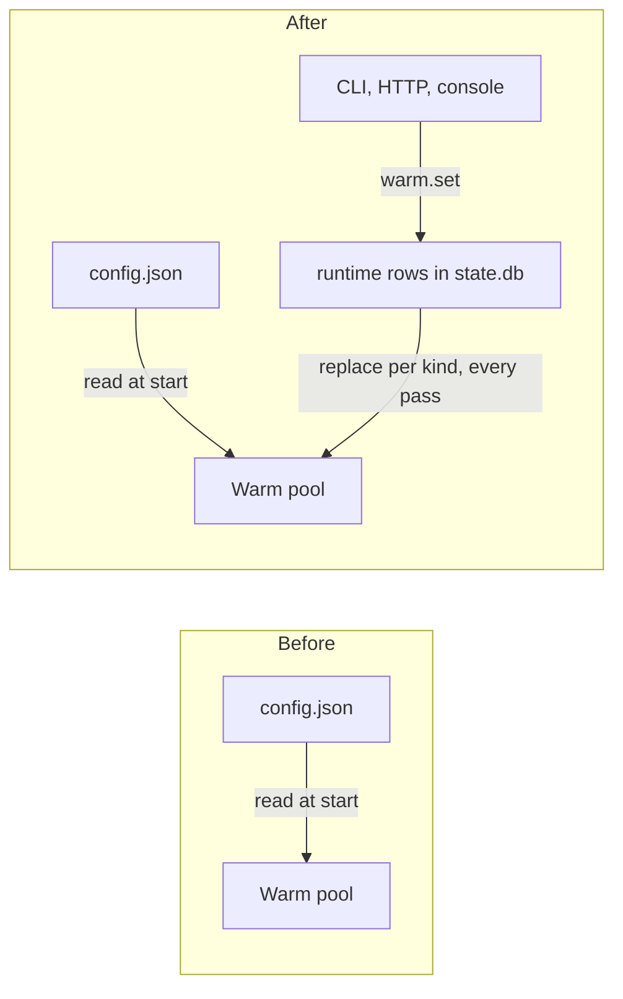
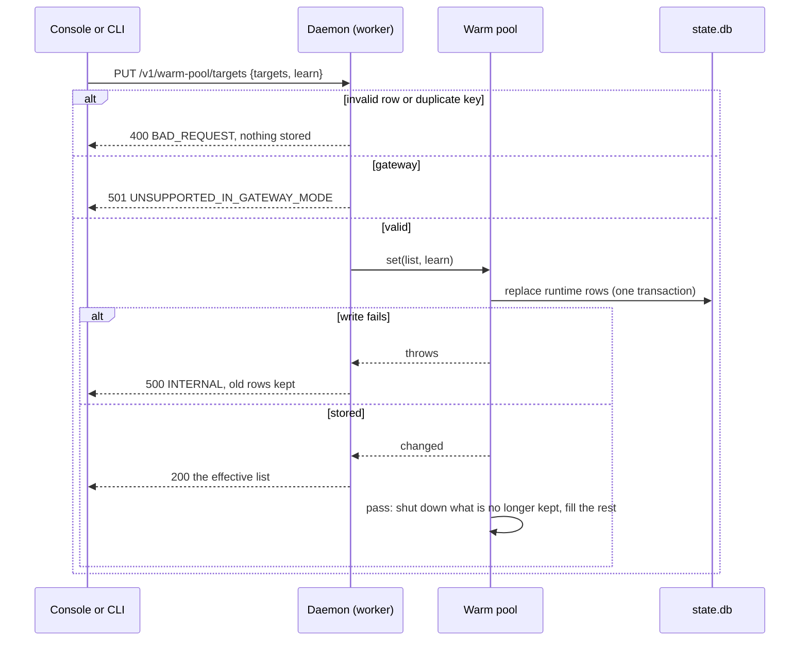

# 0056. An operator sets warm targets at runtime, and they replace the config's

- **Status:** Proposed
- **Date:** 2026-10-31
- **Issue:** [#1137](https://github.com/callstackincubator/simlock/issues/1137)
  (request [#1130](https://github.com/callstackincubator/simlock/issues/1130),
  items 3 and 4)
- **Supersedes:** [ADR
  0017](0017-the-warm-pool-is-a-module-beside-the-lease-transaction.md)'s
  deferred alternative "Targets changed at runtime through an admin
  operation", and the matching line of
  [IDEAS.md](../IDEAS.md) ("changing targets without a restart").
- **Narrows:** ADR 0017 §8 ("Read at daemon start"; "`count` is a positive
  integer"): `warmPool.targets` and `warmPool.learn` are still read at
  start, but a runtime row replaces them (§1, §2), and a runtime count may
  be 0. ADR 0017 §5 step 3, as ADR 0051 §2 left it: a lowered target shuts
  its idle devices down at once (§4).
- **Narrows:** [ADR
  0051](0051-configured-warm-targets-come-first-and-learning-can-be-turned-off.md)
  §1 and §3: runtime rows rank with the configured counts (§3 below), and
  `learn` may be set at runtime.
- **Narrows:** [ADR
  0050](0050-an-operator-can-forget-a-learned-warm-kind.md)'s
  consequence "No HTTP route or MCP tool": `warm.forget` gains an HTTP route
  (§6), still no MCP tool.
- **Depends on:** [ADR
  0036](0036-daemon-state-is-a-sqlite-database-whose-tables-each-owner-keeps.md)
  (each owner keeps its own tables), [ADR
  0003](0003-one-typed-daemon-contract-behind-every-frontend.md) (one typed
  contract behind every frontend), [ADR
  0037](0037-the-console-acts-through-the-http-routes-on-base-ui.md) (the
  console acts through the HTTP routes).

## Context

An operator who wants a different set of devices running ("keep one Pixel 8
and one iPhone 17 warm, shut the rest down") edits `config.json` with
`simlock config set warmPool.targets …` and restarts the daemon
(`src/cli/commands/config.ts:61`: "takes effect on daemon restart").

The pool already re-reads its targets and `learn` on every pass
(`src/core/warm-pool/converger.ts:454`, `:246`). Only the value is fixed:
the daemon loads the config once and freezes it
(`src/core/config.ts:626`). ADR 0017 deferred runtime targets because "it
needs an operation on every transport and a rule for a gateway; nobody has
asked for it yet". #1130 asks for it, from the console.

Adding a virtual device from the catalog (#1130 item 3) is the same lever.
A device made outside a lease and kept by nothing is shut down after
`idle.shutdownAfterMs` (10 minutes by default) by the pool's never-leased
rule, so a bare "create" would vanish. A target of one keeps it.

## Decision

### 1. Runtime rows live in the warm pool's own tables

The warm pool owns two more tables in `state.db` (ADR 0036), beside
`warm_kinds` and `warm_kind_leases`: the runtime target list, in order, and
the runtime `learn` value. Its schema owner `warm-pool` rises by one
version and ships one migration step. A restart keeps the rows. `nuke`
leaves them: they are the operator's settings, not something the pool
learned. `config.json` is never written by the daemon.

A runtime row is written like a configured target: `platform`, `model`,
optional `osVersion` (a version or a range), optional `mode`, and `count`,
an integer from 0 to 256. Its **key** is its written `platform`, `model`,
`osVersion` and `mode`, exactly as given; an absent field is part of the
key. Two rows of one list with the same key are refused, and so is a list
whose effective list (§2) would hold more than 256 rows, so status stays
within the bound it has today.

### 2. A runtime row replaces the configured target with the same key

The **effective list** is the configured targets in config order, each one
whose key a runtime row has replaced by that row, then the runtime rows no
configured target has, in their list's order. `config.json` may hold two
targets of one key; a runtime row of that key replaces all of them, once, at
the first one's place. The pool plans from the
effective list exactly as it planned from `warmPool.targets`: rows that
resolve to one spec merge, counts summed (ADR 0017).

A row with count 0 keeps nothing and creates nothing. A runtime row's count
is exact for the spec it resolves to: that spec's learned count is not
planned while the row is there, so 0 means "keep none", learned or not. The
pool still records the spec's leases, so removing the row brings the
learned count back.

The runtime `learn` value, when set, replaces `warmPool.learn`. Removing a
runtime row, or the runtime `learn` value, brings back the config's.

### 3. Where runtime rows sit in ADR 0051's order

Every row of the effective list is a configured count for ADR 0051: all of
them fill, in effective-list order, before any learned count, and one short
for a running slot or the reserve may displace (ADR 0051 §2).

### 4. A change that keeps fewer devices shuts them down at once

When a change takes effect, the pool compares the devices it kept before
(`targeted()`) with those it keeps after. Every device kept before and not
after that is still `ready`, unleased, unclaimed and serves no waiting
request is shut down in the pass the change asks for, with initiator
`warm-pool`. The daemon log line names the reason `target-lowered`;
`device.shutdown` carries no reason, as today. It is then deleted by the
idle rules (`idle-destroy`), as any shut-down device.

A boot or creation already running for a lowered row finishes. Its device
is kept if the effective list still wants it, and otherwise left to the
never-leased idle rule.

### 5. Two operations, one event

- `warm.list` (admin, read) answers the effective list, each row with its
  origin (`configured` or `runtime`), for a runtime row that replaced
  configured ones their summed count, the OS version and mode it resolved
  to, and the learned peak of that spec; the stored runtime list and `learn`, as stored; the
  effective `learn` and its origin; and the learned kinds with their
  counts. A client that raises a count raises it from the larger of the
  row's count and that peak, so a raise never keeps fewer.
- `warm.set` (admin, write) takes the whole runtime list and an optional
  `learn`, and replaces both. The same list, in the same order, with the
  same `learn`, changes nothing. Two operators writing at once: the last write wins.
- A change emits `warm-pool.targets-changed` with the runtime list, the
  runtime `learn` when set, and the caller's principal as `requesterId` (as
  the lease events name it), then asks for
  a pass. A `warm.set` that changes nothing emits nothing.
- The status figures' `origin` gains `runtime`, and
  `warm-pool.target-missed` covers runtime rows with origin `runtime`.

The protocol version rises by one.

### 6. Every frontend, worker only

HTTP: `GET /v1/warm-pool` (`warm.list`), `PUT /v1/warm-pool/targets`
(`warm.set`), and `DELETE /v1/warm-pool/learned` with the match in the
query (`warm.forget`, ADR 0050). The CLI gains `simlock warm list`,
`simlock warm set`, `simlock warm unset` and `simlock warm learn`. The
console's Warm pool tab edits the runtime rows, and its "Add device…"
raises one row's count by one; both only in worker mode (ADR 0037 §4).

A gateway refuses `warm.list`, `warm.set` and `warm.forget` with
`UNSUPPORTED_IN_GATEWAY_MODE`, and its HTTP routes answer 501. Fleet-level
targets on a gateway stay deferred.

## Consequences

- Warm up, warm down and "choose what runs" need no restart and no file
  edit, from the CLI, the HTTP API and the console.
- `config.json` stays the base and is never written by the daemon. A
  runtime row hides the configured target with its key until it is
  removed; `simlock warm list` shows which rows are runtime.
- Rolling back to a Simlock before this change refuses to open `state.db`
  ("this Simlock knows up to"): the `warm-pool` owner is one version
  higher. Moving `state.db` away loses the learned kinds and runtime rows.
- A runtime row can name a kind that also has a configured target under a
  different key (`osVersion` `26` against `26.0`); both are planned and
  their counts sum, as two configured targets of one spec do today.
- Who changed the targets is in the event; ADR 0037's "who did an action is
  not recorded" stays true for the other console actions. #703 may later
  move this record.

## Alternatives considered

- **The daemon writes `config.json` and reloads `warmPool`.** Rejected: a
  second writer of the CLI's file, and every other block of the config
  stays frozen, so a reload of one block is a rule nobody can see.
- **Pin single devices ("keep this device").** Rejected: a spent `fresh`
  device is deleted by reclaim, and a deleted device loses its pin; the pool
  thinks in kinds.
- **A `device.create` operation for "Add device…".** Rejected: a second
  create path beside leasing's, a capacity check outside the lease
  transaction, and a device the idle rules reap ten minutes later.
- **Rows keyed by the spec they resolve to.** Rejected: a row that does not
  resolve today (no runtime yet) would have no key, and the console could
  not tell which configured row a runtime row replaces.
- **A revision number on `warm.set` to refuse a stale write.** Deferred:
  one operator per worker is the common case; the event marks every
  console's list stale.
