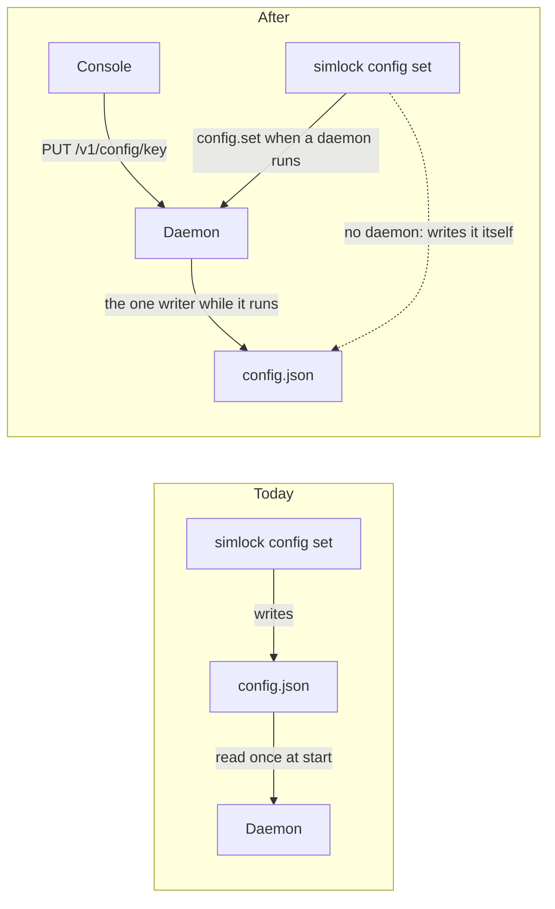
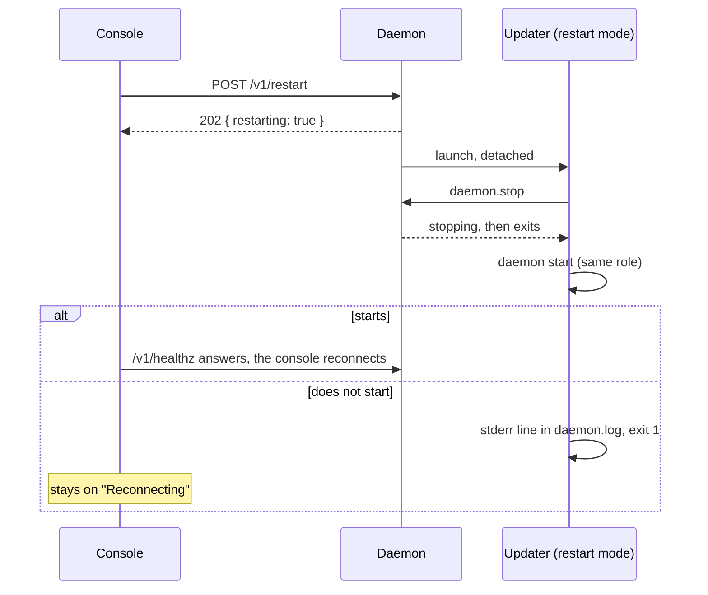

# 0057. The daemon owns config.json while it runs, and the console edits every setting through it

- **Status:** Proposed
- **Date:** 2026-10-31
- **Issue:** [#1151](https://github.com/callstackincubator/simlock/issues/1151)
  (request [#1130](https://github.com/callstackincubator/simlock/issues/1130),
  item 5)
- **Narrows:** [ADR
  0056](0056-an-operator-sets-warm-targets-at-runtime-and-they-replace-the-configs.md)
  (Proposed) §1 and Consequences, "`config.json` is never written by the
  daemon": `warm.set` still never writes it; `config.set` (§2 below) is the
  one call that does.
- **Narrows:** [ADR
  0037](0037-the-console-acts-through-the-http-routes-on-base-ui.md)'s
  action list: the console gains settings edits and a restart, each through
  an HTTP route (§6).
- **Depends on:** [ADR
  0003](0003-one-typed-daemon-contract-behind-every-frontend.md) (one typed
  contract behind every frontend), [ADR
  0042](0042-simlock-updates-itself-through-a-frozen-call-and-a-detached-updater.md) (the
  updater process that restarts the daemon), [ADR
  0044](0044-the-console-reads-what-its-page-shows-and-events-mark-it-stale.md)
  (events mark the console's reads stale).

## Context

Every setting lives in `config.json`. Only `simlock config set` changes
it, and it writes the file itself, without the daemon
(`src/cli/commands/config.ts:46-54`). It validates the whole file with the
same loader the daemon starts with (`loadConfig`, called from
`src/cli/environment.ts:419-434`). The daemon reads the file once, at start
(`src/daemon/main.ts:286-298`), and freezes it (`src/core/config.ts:626`),
so every change "takes effect on daemon restart"
(`src/cli/commands/config.ts:61`).

`config.get` answers the running config as written, secrets included
(`src/daemon/dispatcher.ts:835`, `src/core/config.ts:416-423`); #1097
reports that as a leak. Nothing restarts a daemon but the updater, which
sends `daemon.stop` and runs `daemon start` (ADR 0042 §7). The console has
no settings page and no config route.

#1130 asks to change settings from the console. The maintainer asked for
full control: every key `config set` takes, not a read-only page.

## Decision

### 1. One writer: the daemon, while it runs

While a daemon runs, only that daemon writes its `config.json`, through
`config.set`, one call at a time. `simlock config set` sends `config.set`
to the running daemon of the role it targets, and never starts one to do
so. With no daemon of that role running, it writes the file itself, as
today. A file edited by hand stays legal: each `config.set` reads the file
from disk, changes one key, validates the result and writes it, so it keeps
every other key the file holds.

Each write is atomic and owner-only (`0600`), as `config set` writes today
(`src/cli/environment.ts:410-417`).

### 2. Two operations read and change settings

- **`config.list`** (admin, read) answers one row per setting. A row holds
  its key, its kind (`boolean`, `number`, `string`, `enum` with its
  values, or `json`), the running value, the saved value (what the file
  gives at the next start), the default, whether it applies `live` or on
  `restart`, whether it is secret, and whether it is `pending` (saved
  differs from running: a hand edit, or a restart key saved). A secret row carries no value,
  only whether it is set (§4). A file that no longer loads gives rows with
  no saved value and one `fileProblem` message.
- **`config.set`** (admin, write) takes one key and one JSON value: any
  key `simlock config set` takes, a parent (`idle`) or a field inside a
  `json` row (`http.proxyAuth.header`) included. It does what `config set`
  does: drop the retired `eventLog.rotateBytes`, change the key, validate
  the file through `loadConfig` with the daemon's role and modules, an
  unknown key refused. A refusal is `BAD_REQUEST` with the message
  `Invalid config after setting <key>: <loader message>`. It answers the
  rows the key touched (the row of that key, the rows under it, or the
  `json` row holding it), and the retired keys it dropped.

The rows come from the contract's config shape (`configSchema`): every
object recurses, at any depth, optional ones included; every other field
(an array, a record, a union) is one `json` row; plus a `drivers` row (the shape leaves `drivers`
out) and `http.proxyAuth` as one `json` row (its four fields are only
valid together). `mode` is no row: it is not a key. Unset is not offered,
as in `config set` today.

### 3. A closed list of keys applies live

`idle.shutdownAfterMs`, `idle.deleteAfterMs` and
`diskPressure.freeBytesThreshold` apply live: after `config.set` writes
the file, the daemon swaps the running value everywhere it is held: the
cleanup reaper's config, the warm pool's `idle` copy
(`src/core/create-core.ts:265`) and the config `config.get` answers. The
reaper and the warm pool read it on their next run. They read these values on every
run already (`src/core/cleanup/idle-shutdown.ts:16`,
`src/core/cleanup/idle-destroy.ts:16-17`, `src/core/reaper.ts:236`); only
the frozen copy stops a change today.

Every other key applies on restart: the file changes, the running value
does not, and the row reads `pending` until the next start. Adding a key
to the live list is a code change with its own test, never a setting.

### 4. Secrets are write-only

`gateway.token` and `gateway.alerts.destinations` (whose entries hold a
`url` and a `secret`) are secret rows: the keys `redactConfig` masks
(`src/core/config.ts:482-500`), taken from one list both read. `config.list`
says only whether each is set in the saved file (in the running config
when the file does not load); a secret row can be pending like any other. `config.set` replaces one whole; its answer
and every error message carry no value. `config.get` is not changed here
(#1097 owns it).

### 5. A restart through the updater process

**`daemon.restart`** (admin, write) answers `{ restarting: true }`, then
launches the updater process in a restart mode: `daemon.stop`, wait until
the socket is free and the old pid has exited (10 minutes, then SIGKILL, as
an update waits), `daemon start` for the same role (running within 2
minutes, else exit 1). No install, no
database copy, no rollback. A restart keeps leases as any restart does; a
lease request still waiting fails, as any restart makes it. During an
update it answers `DAEMON_UPDATING`. A second call while one runs answers
`{ restarting: true }` again and starts nothing. While a restart runs, a
`daemon.update` that would start an update answers `DAEMON_STOPPING`;
`daemon.update {query}` answers as before, since `daemon.update` is frozen.
A restart is not an update: it shows in no update field and a failed one
emits no `daemon.update-failed`.

A daemon that does not start again is reported on the updater's stderr,
which is `daemon.log`, as an update's failed start is.

### 6. The console's Settings page

A Settings page, in a Configure group last in the sidebar, groups the rows by their first key
segment. Each row shows its running value (and, when pending, its saved
one; a secret: "Set" or "Not set"), its
default, and `Live` or `On restart` (`Restart pending` when pending). An
edit sends `PUT /v1/config/{key}`; `GET /v1/config` reads the rows;
`POST /v1/restart` restarts. A page with a pending row offers **Restart
daemon** behind a confirm that says a waiting lease request fails.

Keys that can cut the console off ask first, naming the risk:
`http.enabled`, `http.host`, `http.port` and `http.proxyAuth`. Not
`gateway.url` or `gateway.token`: the loader refuses either saved alone,
and a worker with both set has its own HTTP off, so its console is never
reached. After such a save the page shows the address the
console will have after the restart, computed from the saved `http` values
the way `status.get` computes `consoleUrl`, or that the console will be
off.

`warmPool.targets` and `warmPool.learn` are shown read-only, with a link to
the Warm pool tab, which edits them at runtime (ADR 0056). `config.set`
still takes them, as the base list a restart reads.

### 7. A gateway edits its own settings only

A gateway answers `config.list` and `config.set` for itself, with the keys
it reads (`GATEWAY_CONFIG_KEYS`, without `gateway.url`, `token` and
`label`). Changing a worker's settings through the gateway is deferred.

### 8. One event names the keys and the caller

`config.changed` `{ keys, applied, requesterId }`: the touched rows' keys
(the given key when it touched none), `live` when every touched row is
live, else `restart`, and the admin session's principal. Never a value. Emitted after
the file is written (and, for a live key, after the running value
changed). It marks the console's settings read stale. A file written by the
CLI with no daemon running emits nothing.

## Consequences

- Every setting can be seen and changed from the console, the HTTP API and
  the CLI through one validator. Three keys need no restart.
- The CLI's `config set` now needs the admin token when a daemon runs (it
  finds it as every admin command does). Without one it fails, rather than
  writing behind the daemon's back.
- A hand edit while the daemon runs is still read by the next
  `config.set` and the next start; one made between a `config.set`'s read
  and write is lost. Rare: one operator, seconds apart.
- `config.get` still returns secrets; #1097 decides how it redacts.
- A port or host change can leave the console on an address the operator
  must type; turning HTTP off ends the console until the CLI turns it on.
- The protocol rises by one for `config.list`, `config.set` and
  `daemon.restart`.

## Alternatives considered

- **A read-only page first.** Rejected by the maintainer: they want to
  change settings from the console.
- **The CLI stays the one writer; the console asks the CLI.** Rejected: the
  console reaches only the daemon's HTTP routes (ADR 0037).
- **The daemon reloads the whole file on every change.** Rejected: most
  values are copied into modules at start (leasing, drivers, HTTP), so a
  reload would apply some keys and silently not others.
- **Runtime rows in `state.db` over the file, as ADR 0056 does for warm
  targets.** Rejected for settings: the file would no longer say what the
  daemon runs with, and `config.get`, `simlock config` and a hand edit
  would all read a value that is not the one in force.
- **Restart from the service manager (launchd, systemd).** Rejected: a
  daemon started by hand has none, and the updater already restarts both.
