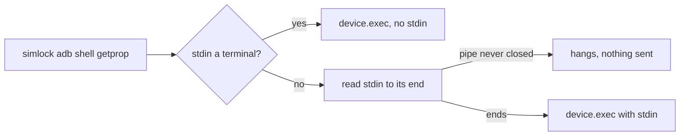
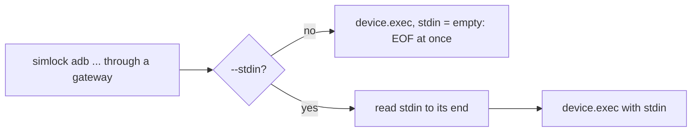

# 0058. Through a gateway, `simlock adb` and `simlock simctl` send stdin only with `--stdin`

- **Status:** Proposed
- **Date:** 2026-11-01
- **Issue:** [#1174](https://github.com/callstackincubator/simlock/issues/1174) (request [#1172](https://github.com/callstackincubator/simlock/issues/1172))
- **Narrows:** [ADR 0005](0005-gateway-and-worker-modes.md) §19c ("a piped
  stdin is read to EOF first and sent as 19a's one-shot string").

## Context

Against a gateway, `simlock adb` and `simlock simctl` run the command on the
lease's worker through `device.exec`, whose `stdin` is one string written to
the command and then closed (ADR 0005 §19a). So §19c has the CLI read any
stdin that is not a terminal to its end before it sends anything
(`src/cli/commands/passthrough.ts:57`, `src/cli/stdio.ts:5`).

A pipe nobody closes never ends. Coding agents and scripts often start
the CLI with a piped stdin they never close, and then `simlock adb shell
getprop` through a gateway hangs forever with no output. The CLI's manual
lists this as a known gap and tells callers to redirect from `/dev/null`;
the gateway e2e test does exactly that to avoid it.

## Decision

1. Through a gateway, the CLI reads stdin only when the caller passes
   `--stdin`. Like `--lease`, it comes before the tool's own arguments, in
   either order with `--lease`.
2. With `--stdin`, the CLI reads stdin to its end, a terminal included (a
   person ends it with Ctrl-D), and sends it as `device.exec`'s one-shot
   `stdin`, as §19c does today.
3. Without `--stdin`, the CLI never reads stdin and sends `stdin` as the
   empty string, so the command sees end of input at once, exactly as
   with today's workaround `< /dev/null`.
4. On a worker, `--stdin` is accepted and ignored, as `--lease` is: the
   command already runs here with the caller's own stdin.
5. Nothing on the wire changes: `device.exec` keeps its one-shot `stdin`,
   and HTTP, MCP and the gateway uplink are untouched. There is no
   deprecation period; the release notes say piped input now needs
   `--stdin`.

## Consequences

- No caller hangs on an open pipe: a command that needs no input runs at once.
- Breaking: `echo x | simlock adb shell cat` through a gateway now needs
  `simlock adb --stdin shell cat`. Without the flag, `cat` gets empty input.
- A command that reads stdin and was run from a terminal without a pipe
  used to wait for the exec timeout (the worker never closed its stdin);
  it now gets end of input at once.
- `-i` and `--interactive` stay free for a later mode that streams input
  while the command runs.

## Alternatives considered

- **Opt-out flag (`--no-stdin`)**: nothing breaks, but a caller that does
  not know the flag still hangs with no output.
- **By stdin kind**: read a file or `/dev/null` on its own and a pipe only
  with the flag. Two rules to learn for one flag.
- **Send what arrived within a short wait**: depends on timing and loses
  input from a slow writer.
- **Stream stdin while the command runs**: needs a two-way channel from the
  CLI to the worker and changes the wire on every transport. A separate
  feature; the name `--interactive` is kept for it.
- **Call the flag `-i` / `--interactive`**: matches `docker exec -i`, but
  nothing here is interactive; the name would promise a live mode this is
  not.
