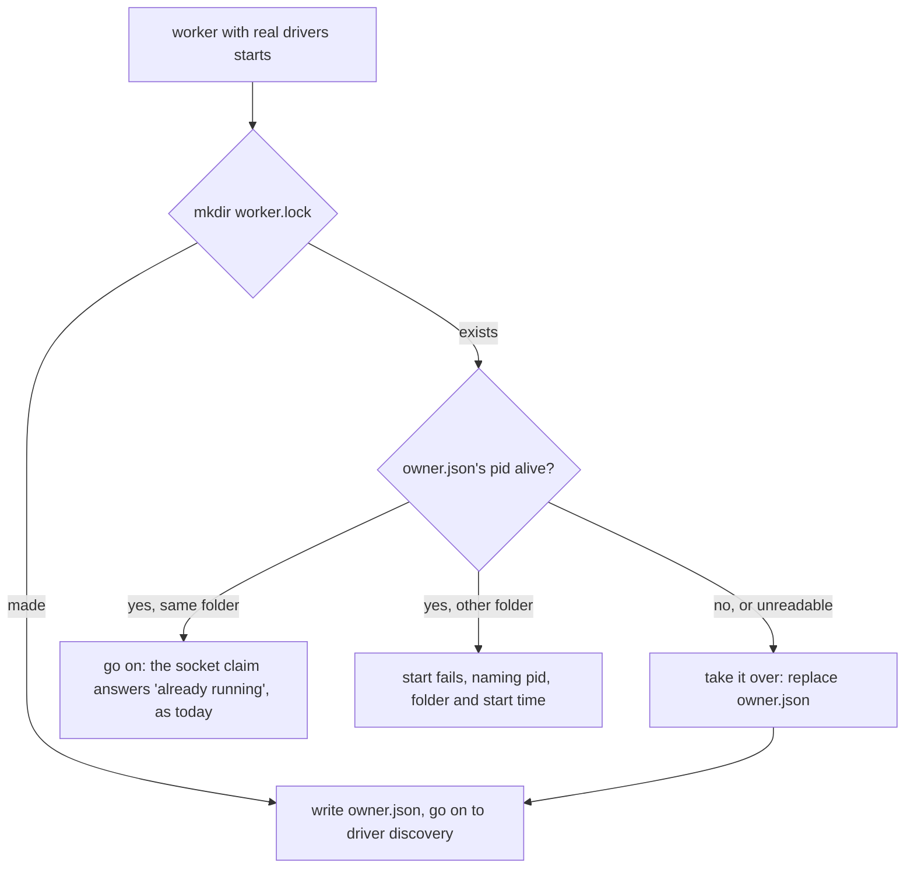

# 0059. A worker with real drivers holds a per-user lock

- **Status:** Accepted
- **Date:** 2026-11-02
- **Issue:** [#1189](https://github.com/callstackincubator/simlock/issues/1189), from bug [#264](https://github.com/callstackincubator/simlock/issues/264)
- **Narrows:** [ADR 0034](0034-one-worker-per-user-and-the-folder-says-what-a-daemon-is.md)
  §1, "No new lock is needed". [ADR 0001](0001-simlock-owned-device-roots.md)'s
  Consequences line "Two Simlock instances on one machine now need distinct
  `adbServerPort` values" now holds only for workers with substituted drivers.
- **Depends on:** ADR 0034 (one worker per user, `SIMLOCK_HOME` for tests only),
  ADR 0001 (owned roots, Simlock's adb server, the startup sweep).

## Context

ADR 0034 makes one worker per OS user the rule, and relies on the socket
`~/.simlock/daemon.sock` to refuse a second one. `SIMLOCK_HOME` still moves
that socket, so a second worker with another `SIMLOCK_HOME` starts next to
the first. The website still tells users to do that for "a separate install".

Two real-driver workers on one machine share what no folder separates: the
Android console ports 5586–5682, the emulators on them, and the iOS runtimes.
At start, the Android driver announces every console port in that range to its
own adb server (ADR 0001's sweep), so the second worker attaches the first
one's emulators (#264). An agent leased from the second worker then sees, and
can drive, devices leased to agents of the first.

The one real case today is the slow e2e lane: it starts a real-driver worker
under a temporary `SIMLOCK_HOME` on a Mac whose own worker may be running.

Workers with substituted drivers (`SIMLOCK_DRIVERS_MODULE`, or drivers passed
to `startDaemon`) touch no device, port or adb server. The fast e2e lane runs
four of them at once, and `e2e/gateway-fleet.test.ts` runs two workers in one
test. They must keep working.

## Decision

### 1. A worker with real drivers takes a per-user lock before it discovers drivers

A worker whose drivers are discovered (no `SIMLOCK_DRIVERS_MODULE`, no drivers
passed in) takes the lock before driver discovery, so before any adb server
starts and before the sweep. A gateway never takes it. A worker with
substituted drivers never takes it.

The lock is per OS user, at a path that does not depend on `SIMLOCK_HOME` or
`HOME`:

| Platform       | Lock                                   |
| -------------- | -------------------------------------- |
| macOS, Linux   | `/tmp/simlock-<uid>/worker.lock/`      |
| Windows        | `<os.tmpdir()>\simlock\worker.lock\`   |

On macOS and Linux, `<uid>` is `process.getuid()`; the parent folder is created
`0700` and must be owned by the user. On Windows, `os.tmpdir()` is already the
user's own folder (`%LOCALAPPDATA%\Temp`), so no owner or mode check runs there.
The lock is a directory, made with one `mkdir` (atomic), holding `owner.json`:
`{ pid, folder, startedAt }`, where `folder` is the worker's data directory and
`startedAt` an ISO time. Like the slow lane's own lock (`scripts/slow-e2e.sh`,
a directory holding a `pid` file), a lock whose pid is gone is stale.

### 2. Who wins

- **Held by a live pid with another folder:** the start fails before driver
  discovery. The daemon logs `Daemon failed to start` with the message, and the
  CLI prints `The daemon could not start: <message>` as for every start failure.
- **Held by a live pid with the same folder:** the lock does not decide. The
  socket claim already answers a second daemon on one folder.
- **Holder's pid gone:** the lock is stale and is taken over. Emulators the old
  holder left running stay running; the new holder's sweep may attach them, as
  happens today after a restart.

### 3. The lock is released when the worker stops

A stop removes the lock after the drivers are disposed (their adb server
reaped), so no other worker sweeps while this one still acts on devices, and
only when `owner.json` is still the one this daemon wrote. A start that fails
after taking the lock removes it the same way. A crash leaves it
stale, and the next start takes it over (§2).

### 4. The slow lane refuses to run while a worker holds the machine

`scripts/slow-e2e.sh`'s machine check, after it has killed the lane's own
leftovers, fails when the lock names a live pid: the script exits 69 ("machine
not fit"), naming the holder and how to stop it. Not 75 ("busy"): that code
means another lane run that will end, and a user's own worker never ends by
itself.

## Consequences

- #264 can no longer happen for one user: a second real-driver worker never
  reaches the sweep.
- A user who follows the old "separate install" docs gets a clear refusal in
  place of two workers that fight over emulators. The docs line goes.
- Running the slow lane needs your own worker stopped first.
- Two OS users on one machine can still each run a worker; ADR 0034 §1 keeps
  that as a known gap, and this lock does not close it.
- A pid reused by an unrelated process after a crash keeps the lock looking
  held until that process ends. `/tmp` is emptied at reboot on macOS, where the
  reuse is most likely, so this is accepted.

## Alternatives considered

- **Attach only emulators whose AVD sits in this worker's folder.** Fixes the
  sweep only; iOS runtimes and the other "this instance only" gaps of ADR 0034
  stay. Needs adb behaviour nobody has checked (detaching one emulator).
- **A console port range per instance.** New config, fewer devices each, and
  the same gaps for iOS.
- **Lock every worker.** Breaks the fast e2e lane's parallel workers and the
  two-worker gateway tests; a test-only bypass would bypass it in the slow lane
  too.
- **A lock for the whole machine, across OS users.** Rejected again for ADR
  0034's reasons: permissions between users and their stale locks.
- **No product lock; only the slow lane checks.** Cheaper, but a user who set
  `SIMLOCK_HOME` still gets #264.
