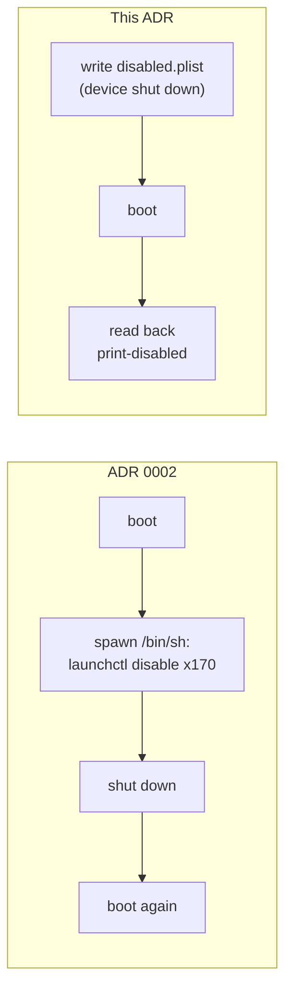

# 0060. iOS slim writes launchd overrides while the simulator is shut down

- **Status:** Accepted — not yet implemented
- **Date:** 2026-11-02
- **Issue:** [#1192](https://github.com/callstackincubator/simlock/issues/1192) (request [#1049](https://github.com/callstackincubator/simlock/issues/1049))
- **Supersedes:** [ADR 0002](0002-opt-in-slim-ios-simulators.md) §2, §3, §5, §8 and §9, and its
  Context and Consequences where they say the overrides live inside the
  device's data partition, that `simctl erase` removes them, or that a slim
  device boots twice, and its "No `launchctl enable` pass" cost. Narrows
  §10 to decision 2's table.

## Context

ADR 0002 slims a simulator by booting it, running `launchctl disable` for
each label through `simctl spawn <udid> /bin/sh -c`, then shutting it down
and booting it again. Three things about that turned out false or broke:

- **No shell.** The iOS 26.5, 27.0 and 27.1 runtimes reported in #1049 have
  only `df` and `launchctl` in `RuntimeRoot/bin`, so the spawned `/bin/sh`
  fails and every slim lease on them is granted full.
- **Load.** At a load average of 127 to 253, a batch of 19 labels overran
  its 60 s limit; the labels it had already disabled took effect on the next
  boot while Simlock reported the device as full (#206).
- **Where the overrides live.** `launchd_sim` is a host process. It keeps a
  simulator's disable overrides in
  `/private/var/tmp/com.apple.CoreSimulator.SimDevice.<udid>/disabled.plist`,
  outside the device folder, keyed only by UDID. Checked on Xcode 27.0 with
  a simulator in a private device set: `simctl erase` and `simctl delete`
  both leave that file in place. So the overrides are not "inside the
  device's data partition", erase does not undo them, and every deleted
  simulator leaves its folder behind (299 folders, 917 MB on one
  maintainer Mac, mostly `launchd.log`).

The same Mac showed that `launchd_sim` honours a `disabled.plist` written
while the simulator is shut down, from the first boot: a new iOS 27.0
simulator with three labels written as disabled booted once (25 s) and
`launchctl print-disabled system` listed all three as disabled. simslim
(MIT, v0.13.0) ships this as its offline path (`disabled_store.go`,
`slim.go` `ensureOffline`).

## Decision

### 1. Slim is a file written before boot

For a `prepare` boot of a slim device on iOS 18.5 or newer, the iOS driver
merges the slim labels into the device's `disabled.plist` before
`simctl boot`, then boots once. The store root
(`/private/var/tmp`) is a driver option, so tests point it elsewhere.

- The file is an XML property list whose top-level dict maps a bare launchd
  label (no `system/` prefix) to `true` (disabled) or `false` (enabled).
- Simlock manages every label in its slim categories plus the never-disable
  labels below. A managed label in a configured category is written `true`;
  every other managed label is written `false`, so narrowing
  `ios.slim.categories` turns the dropped services back on at the next
  `prepare`. The write merges: entries the runtime wrote, and labels Simlock
  does not manage, keep their value. It is atomic (temporary file in the same
  folder, then rename), the file mode is `0644`, and a folder Simlock
  creates is `0700`.
- Labels simslim marks as never to be disabled (`assistantd`, `gamed` and
  `sharingd` at v0.13.0) are written as `false`, so a device slimmed under
  an older list gets them back.
- No `simctl spawn /bin/sh`, no reboot and no batches remain.

### 2. The boot is read back; not honoured means full

After the boot, the driver runs
`simctl spawn <udid> launchctl print-disabled system` (`launchctl` is in
every runtime) and compares it with what it wrote.

The mode comes from the readback, compared with the labels Simlock meant to
write, whether or not the write succeeded: a re-leased device keeps the file
it had through the erase, so a failed write can still boot slim.

A label reads disabled when its line says `disabled` or `true` (older
launchd builds print the second form). A label written `true` is as wanted
when it reads disabled; a label written `false` is as wanted when it does
not (absent counts as enabled, as in simslim). The readback is limited to
120 s, simslim's limit for a simulator just after its first boot. A file Simlock cannot read as a plist dict is
left unchanged and counts as a failed write.

| File write | Readback after boot                  | Device mode | Logged                |
| ---------- | ------------------------------------ | ----------- | --------------------- |
| ok         | every label as wanted                | `slim`      | `device.slimmed`      |
| failed     | every label as wanted                | `slim`      | slim skipped + reason, no `device.slimmed` |
| any        | any label not as wanted              | `full`      | slim skipped + reason |
| any        | failed or timed out                  | `slim`      | slim skipped + reason |

An "ok" write includes a write skipped because the file already holds what
is wanted: the boot and readback still run, and a matching readback grants
`slim` and fires `device.slimmed`, as today's reclaimed device fires one on
every `prepare`.

`device.slimmed` fires only on row 1: the write succeeded (or was skipped
as unchanged) and the readback shows every managed label as wanted. Rows 2 to 4 log slim skipped with the
reason and emit no event. It fires after that readback, not after a reboot
and installer probe as in ADR 0002 §9, and its fields do not change:
`labelCount` is the number of labels written `true`; `unknownLabels` the
unknown category names from `resolveSlimCategories`; `durationMs` runs from
the start of the file read to the end of the readback; `signature` is
`slimSignature(categories)`.

ADR 0002 §7 still holds: a label for a daemon the runtime lacks is written
and read back like any other, and is never a boot failure.

A `purpose: "recover"` boot writes nothing and runs no readback; the driver
returns the mode exactly as it does today (the `planSlimBoot` "off" path in
`index.ts`).

There is no fallback to running `launchctl disable` inside the simulator. A
readback that cannot run keeps ADR 0002's rule that an uncertain device is
reported slim: a caller told "slim" when it is full loses nothing, one told
"full" when it is slim sees push, Spotlight and StoreKit fail with no
reason.

### 3. The file is the record; driver data keeps none

What is slim is read from the file and the readback, so the driver no
longer writes `slimSignature` or `slimMarkToken`. Their nullable columns in
`ios_device_data` stay, unread, so no migration is needed. A write that
would change nothing is skipped and counts as an `ok` write (§2): the boot
and readback still run, and `device.slimmed` fires on a matching readback.

### 4. Erase keeps the overrides; delete removes them

Reclaim still erases, and the overrides survive it, so a reclaimed slim
device boots slim; the next `prepare` still writes and reads back. A device
is slim or full for its whole life (ADR 0007), so a full device never meets
a slim file.

`destroy` and `destroyLegacy` remove
`/private/var/tmp/com.apple.CoreSimulator.SimDevice.<udid>/` after
`simctl delete` succeeds. A failure to remove it is logged and does
not fail the destroy. The folder removed is always the UDID of the
simulator that call just deleted, so it follows `destroy`'s own ownership
proof (safety rule 1, including `doctor --purge-orphans`). Folders left by simulators deleted before this change stay.

### 5. One boot is the estimate and the deadline

A slim boot is one boot. `Driver.estimate` quotes the cold-boot estimate for
slim and full specs alike. `ios.slim.bootTimeoutMs` keeps its meaning (the
boot deadline of a slim boot) and its default.

### 6. The label list follows simslim v0.13.0

`slim-labels.ts` is re-synced from simslim's `profiles.go` at v0.13.0
(`d594c230fe9ed5080189b0ce76afabda6104bae0`), keeping its MIT notice. At
that commit `navd` joins `widgets`, and `assistantd` and `gamed` leave the
slimmable set; with `sharingd` (never in Simlock's list) they form
decision 1's `false` list. Category names do not change.

## Consequences

**Good.**

- Slim works on runtimes with no shell, which is every current one.
- A slim boot costs one boot, not two, and has no in-simulator step that
  load can cut short.
- A slim grant is proven by the readback, not assumed.
- Destroy stops leaking a folder per simulator.

**Costs.**

- **An undocumented CoreSimulator file.** Apple can move or ignore it. The
  readback turns that into full devices with a logged reason, not a wrong
  mode.
- **Host state outside the device root.** Simlock now writes and removes a
  folder under `/private/var/tmp`, keyed by a UDID it owns.
- **A recovery boot never writes.** ADR 0002's "a recovery boot never
  slims" now means the driver writes nothing on it; the device keeps the
  overrides it had, as it does today.

## Alternatives considered

**Keep the in-simulator pass, with per-label spawns instead of a shell.**
Rejected: about 170 `simctl spawn` calls and a second boot, slow under load,
and it keeps #206's partial-apply cases.

**Fall back to that pass when the readback disagrees.** Rejected for the
same cost; a full device with a logged reason is the honest result.

**Vendor or require the simslim binary.** Rejected: it ships for arm64 only,
and the part Simlock needs is one file write and one readback.
