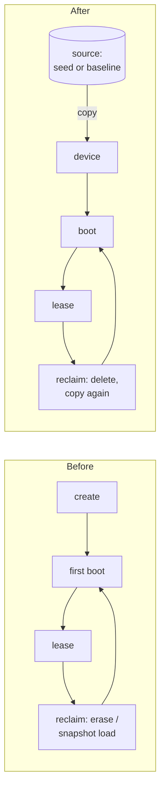

# 0061. Every virtual device is a copy of a source, and a baseline is a named source

- **Status:** Proposed
- **Date:** 2026-11-02
- **Issue:** [#327](https://github.com/callstackincubator/simlock/issues/327) (request [#1049](https://github.com/callstackincubator/simlock/issues/1049), points 1 and 4)
- **Supersedes:** nothing. Narrows [ADR 0060](0060-ios-slim-writes-launchd-overrides-while-the-simulator-is-shut-down.md)
  §4 ("Reclaim still erases"): an iOS reclaim deletes and clones instead.
  Narrows [ADR 0007](0007-a-lease-request-chooses-the-device-mode.md) §6
  and [ADR 0015](0015-a-lease-request-is-a-set-of-constraints.md) §6–7:
  the baseline is one more pool-identity key beside the mode and image
  tag. Narrows [ADR 0009](0009-gateway-routing-is-a-list-of-stages.md)
  §2, §4 and §6: one more stage, one more fast-fail code, one more
  warm-hit key. Narrows [ADR 0038](0038-the-warm-pool-learns-its-kinds-from-leases-and-boots-for-every-queued-request.md)
  §5: a learned kind carries the baseline. Replaces the IDEAS.md entry
  "Clone-from-golden baseline option (iOS)".

## Context

Every lease starts from a factory device, and every reset brings the
factory first boot back:

- **iOS.** `provision` runs `simctl create`; `reclaim` runs `simctl erase`
  (`src/drivers/ios/index.ts:1091-1101`). Both are followed by a full first
  boot. Measured on an M3 Pro, Xcode with iOS 27.0, iPhone 17: a new
  simulator's first boot took 36.4 s, an erase plus boot 39.9 s. A
  `simctl clone` of a shut-down simulator that had booted once took 2.3 s,
  and the clone booted in 7.2 s, with the source's files and preferences in
  place. #1049 measured 2.4 s and 136 CPU-seconds against 804 for erase
  plus boot.
- **Android.** A reset loads the per-AVD `simlock_clean_baseline` snapshot
  into the running emulator (`src/drivers/android/index.ts:1190-1245`). One
  load hung for 18 minutes (#1047, now bounded at 60 s); a failed load wipes
  the disk; an AVD change invalidated every other device's snapshot
  (#1048). A wipe or a factory snapshot throws away anything prepared, so
  nobody can keep apps or settings across leases.
- **Prepared state.** Teams want a device prepared once (apps installed,
  Chrome updated from the Play Store, animations off, a test account) and
  every lease to start there (#327 comments). Simlock has no way to keep
  such a device or hand out copies.

What the copies must respect, measured on the same Mac (emulator 36.5.11,
API 36 `google_apis` arm64):

- `simctl clone` copies the device's `data/` folder and `device.plist`, not
  the root `simlock-mark.json`, and not
  `/private/var/tmp/com.apple.CoreSimulator.SimDevice.<udid>/` (ADR 0060's
  `disabled.plist` lives there).
- A hard `emu kill` right after preparing an emulator lost the prepared
  writes. `adb shell sync` then `adb shell reboot -p` kept them (2.2 s).
- A quick-boot snapshot saved in an AVD failed to load in a copy of that
  AVD under another name ("Failed to load snapshot"); the emulator then
  cold-booted the copied disk by itself (15.7 s), with no wipe.
- The same copy kept under the **same AVD name**, in its own AVD home
  (`ANDROID_AVD_HOME=<root>/<device>`), copied with `cp -c -p` (timestamps
  kept), loaded the snapshot: two such copies booted at once were ready in
  3.8 s and 4.4 s, and a reset (kill, delete, copy, boot) took 2.8 s. Each
  answered `emu avd path` with its own directory. Both had the source's
  `ANDROID_ID`.
- Copying a whole iOS data folder to another UDID, or a whole Android
  `/data`, breaks apps (#327, TUNA-NOPE); `simctl clone` and a whole-AVD
  copy avoid both.

## Decision

### 1. A source is a shut-down device Simlock keeps only to copy

A **source** is a device that has booted at least once, was shut down
cleanly, and is never leased, booted or erased again. Every virtual device
Simlock makes is a copy of one source. There are two kinds:

- A **seed**: made by Simlock for plain leases, one per platform, model,
  OS and image tag (the spec without the mode, since iOS slim is written
  before each boot by ADR 0060 and Android has no slim). It is made on the
  first provision that needs it: create, one cold boot to ready, clean
  shutdown. It is internal: no command lists or names it.
- A **baseline**: saved by an operator from a device they hold, under a
  name (§4).

A source lives under the platform's owned device root (ADR 0001) and has a
record in `state.db` (owner `sources`, ADR 0036), so doctor, nuke and
`listManaged` know it and it is never read as an orphan.

### 2. Making a device is copying a source

| Step | iOS | Android |
| ---- | --- | ------- |
| Copy | `simctl clone <source> simlock-<id>` in the device set; then write both marks (the clone has no root mark and carries the source's `data/` mark); then copy the source's `/private/var/tmp/…SimDevice.<source udid>/disabled.plist`, if any, to the clone's UDID | `mkdir <root>/<id>`; `cp -c -p -R` (reflink where the filesystem has it, else a full copy keeping timestamps) of the source AVD into it under the same AVD name, plus its `.ini` with `path=` rewritten; every command for that device carries `ANDROID_AVD_HOME=<root>/<id>` |
| Boot | as today (ADR 0060 writes the slim file first) | `-snapshot simlock_boot -no-snapshot-save`; a snapshot that does not load cold-boots the same disk (the emulator does this itself); never `-wipe-data` |
| Reclaim | shut down, `simctl delete`, copy again; returns `shutdown` | ownership gate, `emu kill`, delete `<root>/<id>`, copy again, boot; returns `ready` |

`ReclaimResult.strategy` gains `"copy"` for both. `"erase"`, `"snapshot"`
and `"wipe"` are no longer returned for virtual devices; physical devices
keep `"uninstall"`. The ownership gate (`emu avd path` names this device's
own AVD directory) is unchanged: each copy has its own directory.

An Android source carries one quick-boot snapshot, `simlock_boot`, saved
after one cold boot of the finished source. The per-AVD
`simlock_clean_baseline` snapshot, its marker file and the config-hash wipe
go; the internal word for what is left is "boot snapshot", so "baseline"
means only §4's.

### 3. A source goes stale; a stale source is never copied

A source is stale when the runtime or system image it was made from is gone
or changed, or, on Android, when the emulator build changed (the config
hash of today's driver, kept with the source). A stale seed is deleted and
made again on the next provision. A stale baseline is kept, marked stale
with the reason, and a request naming it fails at once
(`BASELINE_STALE`); it is never replaced by a seed copy.

### 4. A baseline is a named source an operator saves from a held lease

`baseline.save {leaseId, name, note?}` is an admin operation. It ends the
lease: the device is shut down cleanly (iOS `simctl shutdown`; Android
`adb shell sync`, `adb shell reboot -p`, then the gate and kill if it has
not stopped), copied as a source (with its boot snapshot on Android), and
the leased device goes through its normal reclaim. The baseline carries the
device's platform, model, OS, mode and image tag, a version that starts
at 1, the note, its size and when it was saved.

Saving under an existing name replaces it: the version goes up, new
devices copy the new source, devices already made keep running, and the old
source is deleted once no device made from it remains. There is no
rollback. `baseline.remove` is refused while a lease holds a device made
from it; otherwise it deletes the source and every idle device made from
it. Only the operator, nuke or a stale-and-removed path deletes a
baseline; idle cleanup never does. `baseline.list` shows each baseline's
name, version, spec, note, size, saved time and stale reason.

### 5. The baseline is a pool key

A device record carries the baseline name and version it was copied from,
or none. A request carries an optional `baseline` name (CLI `--baseline`,
`SIMLOCK_BASELINE`, HTTP, MCP, client, agent-device allocate). `fits` and
`sameSpec` compare it like the image tag: unset matches only unset, a name
matches only that name. A request naming a baseline takes the baseline's
model, OS, mode and image tag; a request that names any of them differently
fails at once (`BASELINE_MISMATCH`), and an unknown name fails at once
(`UNKNOWN_BASELINE`). A device of an older version than the baseline's
current one is never granted; it is destroyed when idle. A grant and
`lease.granted` carry the baseline name and version.

A learned warm kind carries the baseline name, so the pool keeps baseline
devices warm with no configuration.

### 6. A gateway routes by the baselines a worker holds

A worker's view carries its baselines' names, versions, specs and stale
flags. A routing stage `has-baseline` follows `can-serve`; a request
naming a baseline that no worker holds, fresh, fails at once with
`UNKNOWN_BASELINE`. A warm hit also needs the baseline to match.
`baseline.save` on a gateway goes to the worker of the lease; `baseline.remove`
and `baseline.list` on a gateway take a `worker` and go to it, or list every
worker's baselines.

## Consequences

- Plain leases get faster on both platforms: iOS from ~37–40 s to a clone
  and a ~7 s boot; Android from a 4–6 s in-place snapshot load to a ~3 s
  copy and snapshot boot, with no in-place load left to hang (#1047) and no
  shared hash to invalidate (#1048).
- The first lease of a new kind pays the seed once: a first boot, a clean
  shutdown, then the copy and boot (on Android also the snapshot save).
- Disk: each source costs its size once (an Android source with its
  snapshot ~4.8 GB measured). Copies are copy-on-write on APFS and on
  Linux filesystems with reflink; elsewhere each Android copy is a full
  copy.
- Copies share identity: on Android the same `ANDROID_ID`, and every copy
  of a baseline carries the same signed-in accounts. Two leases at once may
  log each other out. The docs say so.
- Existing devices made before this change have no source. Each is
  destroyed at its next reclaim, and the next provision copies a seed.
- The words "Simlock wipes a device every time a lease ends" on the website
  become "Simlock resets a device to the state it was made from".

## Alternatives considered

- **Shared `-read-only` AVD per source.** Several emulators can run one AVD
  read-only (measured: two at once, writes discarded, snapshot boot
  6.7 s). Every instance then answers `emu avd path` with the same
  directory and the same AVD name, so the ownership gate that #52, #256
  and #284 shaped could no longer tell devices apart. Rejected.
- **Copy under a new AVD name.** Simple, but the snapshot does not load in
  the copy, so every boot is a ~16 s cold boot. Kept only as the fallback
  when a snapshot fails.
- **Keep erase and the in-place snapshot load for plain leases.** Leaves
  #1049's first-boot cost and the hang and wipe paths in place, and keeps
  two reset paths. Rejected by the maintainer.
- **Simlock runs an operator program before first boot (#1049).**
  Simlock would run configured code on every new device. Rejected: the
  operator prepares on a held lease; a pre-boot hook can be its own
  request.
- **Agents save back to a baseline they hold.** Needs per-name holds and an
  agent-role write. Rejected for now: only the operator saves.
