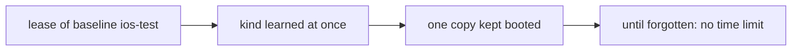
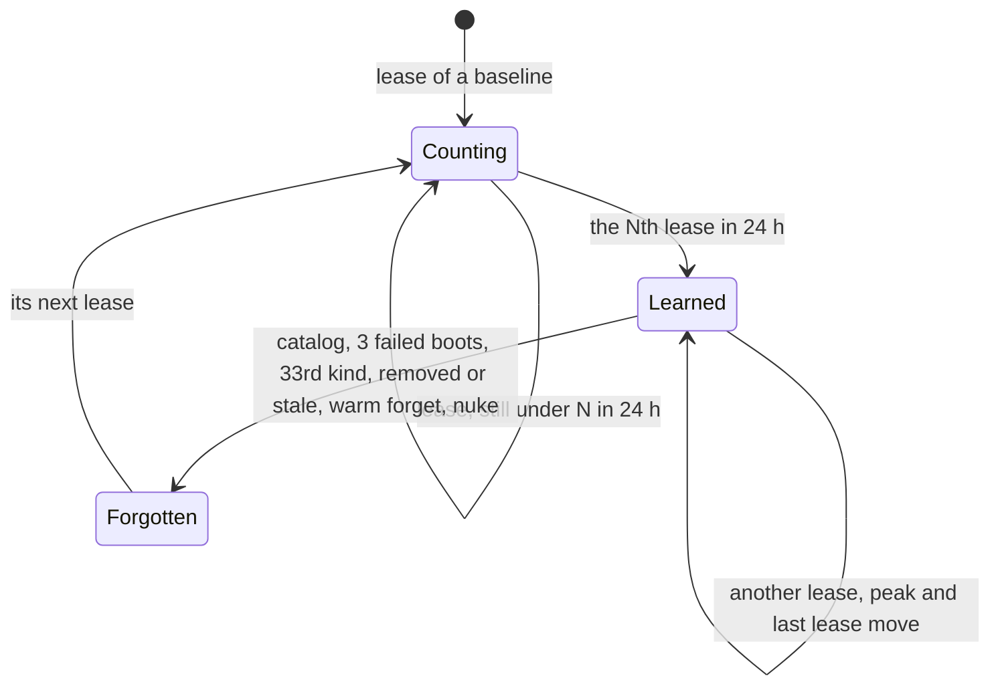

# 0062. The warm pool learns a baseline after repeated leases, and follows its newest version

- **Status:** Proposed
- **Date:** 2026-11-04
- **Issue:** #1257 (request #1255)
- **Narrows:** [ADR 0038](0038-the-warm-pool-learns-its-kinds-from-leases-and-boots-for-every-queued-request.md)
  §1 (a kind is learned from every lease) and §5 (the record's tables), for
  baseline kinds only, and
  [ADR 0061](0061-every-virtual-device-is-a-copy-of-a-source-and-a-baseline-is-a-named-source.md)
  §5 (a learned kind carries the baseline name). Plain kinds keep ADR 0038
  as written. ADR 0038's rejected alternative "Forget a kind after a fixed
  time" stays rejected.

## Context

ADR 0061 §5 made a baseline lease learn its own kind: the plain kind's
model, OS, mode and image tag plus the baseline name. Since every
baseline is one more kind, a worker keeps one more device booted per
baseline it ever leased. On 2026-11-04 a test worker on an M3 Pro, after
one lease each of `ios-test` and `android-test`, kept four kinds warm (two
plain, two baselines): three simulators and two emulators booted at once,
a load average of 217, and baseline leases of 39 s and 60 s instead of
about 25 s. One lease to try a baseline costs that slot until the kind is
forgotten, and nothing forgets it on its own.

A second gap: the record keys a baseline kind on the leased device's
model, OS, mode and image tag, and each pass only swaps in the baseline's
newest version number. When a new version is saved from a device of
another model, OS or image tag, the pool still plans copies of the old
model with the new version's source.

## Decision

### 1. A baseline kind is learned on its Nth lease within 24 hours

A lease of a plain kind learns its kind at once, as today. A lease of a
baseline is recorded but its kind is not learned until the baseline has
been leased at least N times within the last 24 hours, counted back from
the newest of those leases; that lease learns it. N is the worker setting
`warmPool.baselineLearnAfter`, a positive integer, default 3. `1` gives
the behaviour of ADR 0061 §5. A worker reads it at start, like every
`warmPool` key.

Until it is learned, a baseline's kind is not planned, not kept, not
spared from the idle shutdown and not listed in the warm pool's figures.
A lease of it is a copy and a boot, and nothing stays booted.

Once learned, a baseline kind stays learned as a plain kind does: until
the catalog, three failed boots, the 33rd kind on its platform, the
baseline's removal or staleness, `simlock warm forget` or `simlock nuke`
forgets it. A forgotten baseline kind starts counting again from zero.
Its count is ADR 0038 §2's peak, unchanged.

### 2. A baseline kind is one record per baseline, and its spec is the newest version's

The record keys a baseline kind on its platform and baseline name only.
Leases of every version of one baseline count toward one N and one peak.
At every pass the kind's model, OS version, mode, image tag and version
are those of the baseline's newest version, so a version saved from
another model is warmed as that model at once. A plain kind keeps ADR
0038 §1's key.

`simlock warm forget <platform> <model> …` matches a baseline kind by the
model, OS, mode and image tag the pool warms it as: those of the newest
version.

### 3. The record gains its third schema version

The pool's owner in `state.db` gains one schema version. It keys a
baseline row on platform and name, and marks whether a baseline row is
learned. Rows of baseline kinds written before it are deleted with their
lease rows: baselines have been in no release, and the next leases learn
them again under §1. Plain rows and their lease rows are kept.

A row counting toward N is a row: it counts toward the 32 kinds per
platform, and the oldest by last lease is dropped first, as today.

## Consequences

- A baseline used fewer than N times a day never holds a booted device;
  its leases pay a copy and a boot each.
- A worker whose agents lease one baseline all day still gets it warm,
  from the Nth lease on.
- An operator who wants no baseline warm sets `baselineLearnAfter` high;
  `warmPool.learn: false` still turns all learning off.
- The protocol rises by one: `config.get`'s `warmPool` carries the new key.
- A new version of a learned baseline saved from another model is warmed
  as that model on the next pass.

## Alternatives considered

- **Keep a baseline kind only while it still has N leases in the last 24
  hours.** Rejected by the maintainer: a baseline kind would behave unlike
  a plain kind, and ADR 0038 already rejected forgetting a kind on a timer.
- **Keep today's key and rewrite the model, OS, mode and image tag each
  pass.** Rejected: a lease of a version saved from another model would
  make a second row, splitting the count and the peak across versions.
- **Name a baseline in `warmPool.targets`.** Out of scope for this
  decision.
