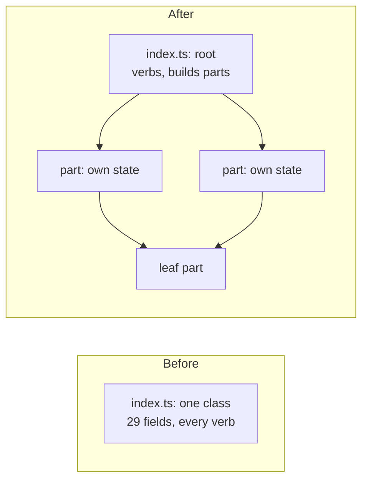
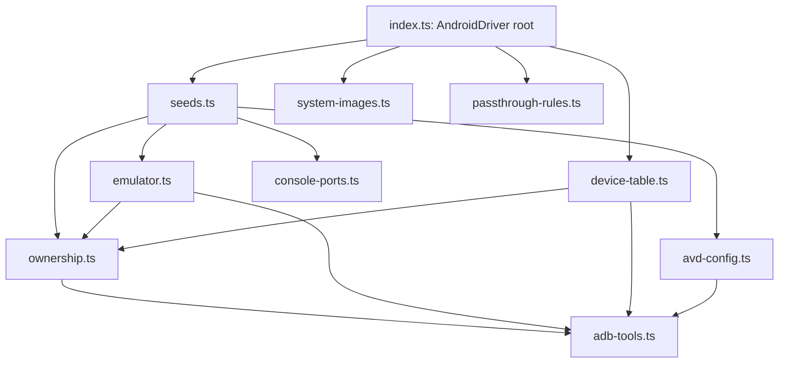

# 0063. A big module is one composition root over parts that own their state

- **Status:** Proposed
- **Date:** 2026-11-04
- **Issue:** [#1259](https://github.com/callstackincubator/simlock/issues/1259) (request [#1251](https://github.com/callstackincubator/simlock/issues/1251))
- **Supersedes:** nothing.

## Context

On 059a270 22 tracked files are above 1,400 lines (code) or 2,500 lines
(tests). The worst is `src/drivers/android/index.ts`: 3,573 lines, one
`AndroidDriver` class with 29 private fields. Its test file is 8,442
lines. A coding agent cannot read these files whole. It reads them in
many small ranges (198 ranges of the Android driver in 10 sessions), and
it misses what sits next to the range it read.

Cutting the file into pieces with the same class does not fix this. The
Android driver's methods share private state. Boot alone reads seven
fields, and three pairs of method groups call each other in a loop (the
`#dataFor`, `#avdFolder`, `#env` helpers, and the ownership check with
the seed code). Moved methods would still need the whole class to make
sense.

The folder already has parts built this way: `AdbRegistrar`,
`AdbServerSupervisor`, `AndroidPhysicalHandler`, `DeviceProfileRegistry`.
Each takes an options object, owns its own state, and has its own test
file.

Fallow 3.36.0, which this repo runs, has no file-length limit. Its
`health.maxUnitSize` caps one function, and `--max-file-size` only skips
parsing files above a size in megabytes.

## Decision

### 1. One composition root, and parts that own their state

A module whose file passes the size limit (§3) becomes one composition
root and a set of parts.

- **The root** keeps the module's surface: the same exports, the same
  class or function names, the same behaviour. It builds the parts and
  delegates to them. It is the only code that knows every part.
- **A part** owns the state it needs (fields, maps, locks, tables) and
  exposes a small interface. It takes its collaborators in an options
  object, as the existing parts do. A part never calls the root.
- **No loops.** The parts form a graph with no cycle. A helper two parts
  both need goes into a leaf part both call.
- **Files, not folders, by default.** A part is a file beside the root.
  A part becomes a folder with its own `index.ts` only when more than one
  file serves that one responsibility.
- Nothing outside the module imports a part. The module's surface stays
  its `index.ts`.

### 2. Tests sit with the part that owns the behaviour

A behaviour that one part owns is tested through that part's interface,
in that part's test file. The root's test file keeps the tests that need
the whole module: wiring, and behaviours that cross parts. Each test file
then follows its code file. A helper that more than one test file uses
lives once in the module's `testing.ts` or a `test-<name>.ts` beside the
tests, never copied.

### 3. Size limits, kept by a unit test

A tracked code file may be at most 1,400 lines and a test file at most
2,500. A unit test in `pnpm check` enforces this. Its list of files that
were already over the limit when it landed may only shrink. A listed file
may not grow past its listed length, and a listed file that is now under
the limit must be removed from the list.

### 4. The Android driver is the first module

`src/drivers/android/index.ts` is decomposed first. It sets the pattern
for the other six code files (iOS driver, `daemon/main.ts`,
`daemon/server.ts`, the fleet coordinator, the lease acquisition
coordinator, `contract/schemas.ts`), which later features design one by
one.

| Part | Owns | Does |
| --- | --- | --- |
| `index.ts` (root) | the built parts | `create`, every `Driver` verb, screen, input and tunnel wiring, catalog verbs |
| `seeds.ts` | the sources table, the set of seeds being made | make a seed, copy it into a device, save and destroy sources |
| `device-table.ts` | device states, per-device locks | list managed devices, reattach after a restart, register serials |
| `system-images.ts` | none | installed images, component install and remove, licenses, API levels |
| `passthrough-rules.ts` | none | pure: which adb commands are refused or filled in |
| `emulator.ts` | none | start an emulator, wait until ready, shut down, read its log |
| `avd-config.ts` | none | `config.ini`, the config hash, ownership marks |
| `console-ports.ts` | port reservations, shared per process runner | hand out and free console ports |
| `ownership.ts` | none | the `emu avd path` check before any kill, snapshot load or destroy |
| `adb-tools.ts` | none | environment, running a command, a device's AVD folder and driver data |

The ownership check stays one check: every caller that stops, loads or
destroys an emulator goes through `ownership.ts`.

## Consequences

- Every file an agent opens fits one read. A change to boot reads
  `emulator.ts` and its tests, not 12,000 lines.
- The Android driver is rebuilt in about nine PRs, leaf parts first. Open
  PRs that touch `android/index.ts` resolve their conflicts by hand, since
  git does not follow code moved into a new file.
- A feature that grows a file past the limit has to split it in the same
  PR. The 22 files already over stay on the list until their feature
  lands.
- Module manuals name the new files, and grow by one row each.

## Alternatives considered

- **Move-only split along today's methods** (the request's first
  proposal). Methods that read the class's fields cannot move without
  passing that state around, and the loops between method groups stay.
  The Android file would still be about 2,500 lines. Rejected.
- **A folder with an `index.ts` for every part.** Boundaries enforced by
  the lint, but many one-file folders and a manual each. Kept only for a
  part made of several files.
- **Fallow as the size guard.** It has no file-length rule (Context).
  Rejected.
- **The size guard last, after every module is split.** Files would keep
  growing meanwhile: the Android driver grew 500 lines in the week before
  this ADR. Rejected.
