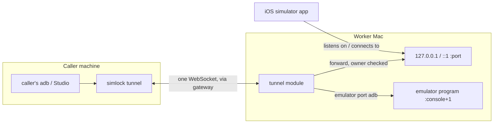
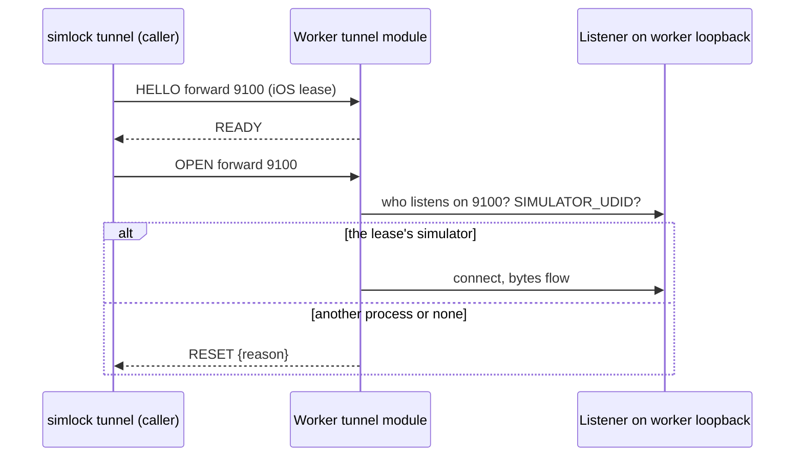

# 0064. A tunnel reaches an iOS simulator's ports and an emulator's adb port

- **Status:** Accepted
- **Date:** 2026-11-04
- **Issue:** [#1282](https://github.com/callstackincubator/simlock/issues/1282)
- **Narrows:** [ADR 0054](0054-a-lease-holder-tunnels-device-ports-to-its-own-machine.md)
  §2 (a tunnel is "reverse or forward" on "a device port"), §5 ("Other
  devices are refused"), §6 (listeners in 47000 to 47999) for iOS
  simulators, and its Consequence "iOS simulators are not covered".
  [ADR 0001](0001-simlock-owned-device-roots.md) §4 ("the user's adb
  server and Android Studio cannot see, drive, or kill a Simlock
  emulator") for a holder's own adb on its own machine.
  [ADR 0005](0005-gateway-and-worker-modes.md) Non-goals (port forwarding)
  further, as ADR 0054 did.

## Context

`simlock tunnel` carries TCP between the caller's machine and a leased
Android device (ADR 0054). Two everyday cases are still out of reach.

An iOS simulator's lease is refused. A simulator has no network stack of
its own: an app in it that listens on port 9100 listens on the worker
Mac's loopback, and an app that opens `localhost:8081` reaches the worker's
port 8081. Every simulator on a worker shares that one port space. So
Metro, a mock API or Flutter's VM Service cannot cross machines on iOS.

A local adb, and so Android Studio, cannot see a remote emulator. adb
talks to an emulator through a TCP port the emulator program opens on the
worker (console port + 1), not through any port inside Android, so a
device-port tunnel cannot reach it.

A spike on 2026-11-04 (Xcode 27.0, iOS 26.4.1 runtime, emulator 36.5.11,
adb 37.0.0) checked what this rests on:

- A second adb server attached to an emulator's adb port through a plain
  TCP relay: `adb connect` gave `device`; shell, install, `logcat` and
  `adb reverse` worked on both servers at once; Simlock's server kept
  `emulator-<port> device` throughout and after the second one left.
- `adb emu …` from the second server fails: the console is a separate port.
- A `google_apis` image has `ro.adb.secure` 0 and takes any key; a
  `google_apis_playstore` image has 1 and answers `unauthorized` to a key
  it was not booted with.
- A process a simulator runs carries `SIMULATOR_UDID=<udid>` in its
  environment, readable with `ps eww` without root in about 15 ms; its
  parent chain breaks once it double-forks.
- An app's `getaddrinfo("localhost")` gives `::1`, then `127.0.0.1`; a
  refused `::1` costs no time. Two simulators cannot bind the same port.
- With a process holding `[::]:
`, Node still bound `127.0.0.1:
` and
  `::1:
` (spec check, same day).

## Decision

1. **Two target kinds.** A tunnel names a **device port**, as today: a
   port opened on the device, for `reverse` or `forward`. Or it names an
   **emulator port**: a port the emulator program opens on the worker for
   one emulator, named, never numbered by the caller. The only name is
   `adb`. The console needs the worker's auth token and gRPC runs with
   `-grpc-use-token`, so they are left out; a later name is one more value.
   `HELLO` names one as `{kind: "emulator", emulatorPort: "adb"}`.

2. **iOS simulator, forward.** Each caller connection makes the worker
   list the processes listening on the device port and the address each
   listens on, and connect only to an address that a process carrying
   `SIMULATOR_UDID` equal to the lease's simulator holds. It dials
   `127.0.0.1:
` when a lease process holds `127.0.0.1:
`, or holds
   `*:
` while no other process holds `127.0.0.1:
`; otherwise
   `[::1]:
` by the same rule. It never dials an address another process
   holds more specifically, because a loopback connect reaches the most
   specific bind. Any other listener, or none, resets that connection
   with a reason; the tunnel stays. The check runs per connection, because
   an app starts, stops and restarts while a tunnel is open. So a holder
   never reaches the daemon, its adb server, or another lease's app.

3. **iOS simulator, reverse.** The worker listens on exactly the device
   port, on both `127.0.0.1` and `::1`, so `localhost` reaches it whichever
   address an app tries first. If anything already answers on the port
   at either loopback address (a listener on all interfaces included), or
   either bind fails, the tunnel is
   refused `TUNNEL_PORT_IN_USE`: the first listener on a worker wins a
   port. The bind alone is not the check, because macOS lets both
   loopback binds succeed while another process holds the port on all
   interfaces, as the worker's own HTTP server can. Nothing
   is set on the device, so these listeners are outside 47000 to 47999,
   sweep and reclaim have nothing to remove, and the listeners close with
   the socket. Like ADR 0054 §4, any simulator or local process on the
   worker can reach the listener while it is open.

4. **An iPhone stays refused**, for device ports and emulator ports.

5. **Emulator port `adb`.** Each caller connection makes the worker
   connect to `127.0.0.1:<console port + 1>` of the lease's own emulator.
   A phone or an iOS lease is refused `TUNNEL_UNSUPPORTED`. The holder's
   adb then has the whole emulator, with none of `simlock adb`'s
   refusals: those guard the worker's shared adb server and the console,
   and this tunnel reaches neither. A reboot or a crash is a device lost
   mid-lease, as today. ADR 0001 §4 now reads: the user's adb server and
   Android Studio cannot see a Simlock emulator on the worker; a holder's
   own adb, through its own tunnel, may. A Play Store image answers `unauthorized`; the docs say to
   lease a `google_apis` image.

6. **CLI.** `simlock tunnel emulator adb[:<caller-port>]`. With no caller
   port it listens on a free one. Once `READY`, it runs `adb connect
   127.0.0.1:<caller port>` on the caller's machine, and `adb disconnect`
   for that address when it exits. No adb found, or a failed connect, is a
   warning that prints the command to run; the tunnel stays.

7. **No protocol bump.** The frames are a contract helper outside the
   bump check, and no error code is added. A new CLI against an older
   worker gets that worker's `BAD_REQUEST` for the unknown kind.

## Consequences

- Metro, mock servers and Flutter's VM Service work on a remote iOS
  simulator, and a local adb or Android Studio works on a remote emulator.
- Two leases on one worker cannot reverse the same port on iOS; the
  second is refused and must pick another port.
- A forward connection on iOS costs a listener lookup (about 0.1 s).
- The caller's own adb reverse rules show in the worker's
  `adb reverse --list` for that emulator; they go when the emulator is
  destroyed at lease end.
- A Play Store emulator image cannot take the caller's adb.

## Alternatives considered

- **Any loopback port for an iOS forward, or all but Simlock's own.**
  Rejected: the worker's adb server drives every emulator, and other
  leases' apps listen on the same loopback.
- **Wait for host ports leased with the device (#162) before iOS
  reverse.** Rejected: Metro's fixed 8081 is the common case, and a
  refused clash is clear.
- **Filter the caller's adb traffic.** Rejected: large, fragile, and the
  refusals it would copy guard what this tunnel cannot reach.
- **Tunnel the console and gRPC ports too.** Rejected for now: both need
  a per-worker secret the caller does not have.
- **A raw worker port number.** Rejected: the caller cannot know it, and
  it would reach other leases' emulators.
