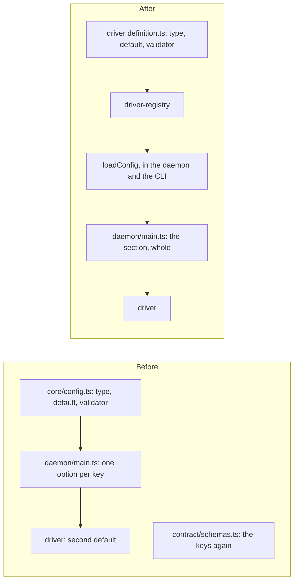

# 0065. A driver owns its config keys, and a module takes the config sections it reads

- **Status:** Accepted
- **Date:** 2026-11-05
- **Issue:** none; the case is [#1315](https://github.com/callstackincubator/simlock/issues/1315)
  and its PR [#1321](https://github.com/callstackincubator/simlock/pull/1321)
- **Supersedes:** nothing. Widens architecture rule 2 to a driver's keys
  under `ios.*` and `android.*`, and gives drivers the config layout
  ADR 0030 gave optional modules.

## Context

Task #1315 added two driver settings, `ios.full.bootTimeoutMs` and
`android.bootTimeoutMs`. Its PR changed 41 files. Nine of them were the
change itself (the two drivers and their tests). The rest came from how
config was built:

- **17 test files** only added the two keys to a whole `Config` written
  by hand. `createLeasing` reads `lease` and `health`, the reaper reads
  `diskPressure` and `idle`, but both took the whole `Config`, so their
  tests spelled out iOS boot timeouts. 22 files held 26 such literals.
- **Core owned the drivers' keys.** `core/config.ts` held the type, the
  default and the validator of `ios.slim`, `ios.simulator` and
  `android.emulator`. `daemon/main.ts` then handed them to the driver one
  by one under new names, and each driver kept a second default.
- **The contract declared the same keys again.** `configSchema` is typed
  by hand, and a key it leaves out is dropped from `config.get` without
  a word (#1309). So every driver key was a wire shape change and a
  protocol bump, though no client reads a driver key: clients read
  `lease`, `downloads` and `http`.
- **The protocol number was copied** into two manuals and a test.

The same pattern shows in earlier changes: `ios.simulator.audio` (#1258)
touched 33 files, `ios.simulator.headless` (#1290) touched 48.

## Decision

### 1. A module takes the config sections it reads

A module's options name the sections it reads, as a `Pick` of `Config`:
`CoreConfig` (`createCore`), `DoctorConfig`, `CleanupConfig`,
`LeasingConfig` (`createLeasing`). Only what answers or carries the whole
config takes it whole: the two dispatchers (`config.get`), the server
and the module host.

A test builds the slice its module takes. A test that needs a whole
config calls `testConfig(overrides)` (`core/testing.ts`), which runs the
loader over its own defaults, so a new key reaches every fixture without
an edit. No test writes a whole `Config` by hand.

### 2. A driver declares its own keys



- Each driver has a `definition.ts` that exports a `DriverConfigEntry`:
  its platform, a validator per key and the defaults, typed as the driver
  reads them (`IosDriverConfig`, `AndroidDriverConfig`). The file imports
  none of the driver's code (dependency rule `definition-is-light`).
- `src/driver-registry` lists the entries. The daemon and the CLI hand
  the list to `loadConfig` (`driverSections`), as they hand it the
  modules' entries, so `simlock config set` and the daemon accept and
  refuse the same keys.
- The loader merges an entry's keys into its platform's section, next
  to core's own keys there (`defaultMode`, `defaultModels`). It
  validates, defaults and warns about unknown keys through the entry and
  reads none of the values. `Config["ios"]` and `Config["android"]` type
  only core's keys.
- The daemon passes the section whole: `driverConfig(config, entry)`
  gives it as the driver's type, and the driver takes it as its `config`
  option. No key is named in `daemon/main.ts`.
- The key names in `config.json` do not change. `drivers.<platform>.*`
  stays as it is.

### 3. `config.get` carries a driver's keys unread

`configSchema` types `ios` and `android` by core's keys and carries the
rest as sent, the way ADR 0030 types `capabilities`:

```ts
ios: z.object({ defaultMode, defaultModels }).catchall(z.unknown()),
android: z.object({ defaultModels }).catchall(z.unknown()),
```

A new driver key is then no wire shape change and needs no protocol
bump. The values were validated by the worker's loader; a gateway holds
one such answer per worker and reads none of these keys.

### 4. The protocol number is written once

`PROTOCOL_VERSION_RANGE` in `src/contract/protocol.ts` is the only place
that writes the number. A manual names the constant (documentation
rule 8), and no test pins the value.

## Consequences

- A new driver setting changes the driver's `definition.ts`, the code
  that reads it, their tests and the website page. Nothing in core, the
  contract, the daemon, leasing, the gateway, HTTP or the CLI changes.
- A new key of a core section changes `core/config.ts`, `configSchema`
  when a client must see it, and the module that reads it. Test fixtures
  do not change.
- This change itself changes the wire shape of `config.get` once
  (`ios`, `android`), so it bumps the protocol by one.
- A config loaded without a driver's entry holds none of that driver's
  keys, and a file that sets one gets the unknown-key warning. Tests of
  a driver's keys live with the driver (`definition.test.ts`).
- Not done here: `daemon/main.ts` still names each driver to create it
  (`discoverDrivers`), and core still names the two platforms for its own
  per-platform keys. A driver registry with `create` is a later step.
