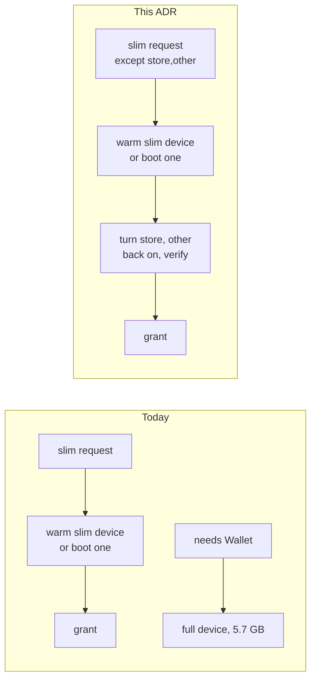

# 0066. A slim lease may keep named categories running, turned back on at grant

- **Status:** Proposed
- **Date:** 2026-11-05
- **Issue:** [#1326](https://github.com/callstackincubator/simlock/issues/1326) (request [#1244](https://github.com/callstackincubator/simlock/issues/1244))
- **Narrows:** [ADR 0060](0060-ios-slim-writes-launchd-overrides-while-the-simulator-is-shut-down.md) §6 (the label list moves to simslim v0.14.0, and gains one category); [ADR 0007](0007-a-lease-request-chooses-the-device-mode.md) §9 (a device reports `except` beside `mode`).

## Context

A lease chooses `slim` or `full` (ADR 0007). The categories a slim device
turns off are fixed per worker, in `ios.slim.categories`. A test that needs
one slimmed capability must take `full`. The request's PassKit case: a
`full` lease taken only for Wallet costs 5.7 GB on iPhone 17 Pro / iOS 26.2,
4.5 times a slim one.

Putting the category set into the device spec would split the warm pool:
every distinct set becomes its own kind, its own warm devices and its own
learned demand. The maintainer rejected that.

An experiment on iOS 26.4 (26.4.1, 23E254a, iPhone 17, a private device
set) showed the other way works. A simulator booted slim with every
category can turn `store` and `other` back on while it runs:

- `launchctl enable system/<label>` then `launchctl bootstrap system
  <RuntimeRoot>/System/Library/LaunchDaemons/<label>.plist`, through
  `simctl spawn`, exited 0 for all 26 labels, about 20 s in all.
- Afterwards `launchctl print system/<label>` found all 26 loaded; 12 ran
  at once (`passd`, `financed` among them, `runs = 1`, never exited 30 s
  later), 14 were loaded and idle until asked for.
- `enable` rewrites the device's `disabled.plist`, so a later reboot keeps
  them on.
- Opening Wallet proves nothing: it opened the same with `passd` booted out.

Every simulator serves one lease and is deleted after it (ADR 0061 §2), so
a change made at grant never reaches a second lease.

simslim v0.14.0 (`profiles.go`, merge commit `ab8ce9f` of MobAI-App/simslim#66)
adds a `mdm` category and two labels to `other`. Its `on --except <ids>`
leaves the named categories enabled.

## Decision

### 1. A slim lease request may name categories to keep running

`lease.request` takes an optional `except`: a list of 1 to 16 distinct iOS
slim category names. The CLI flag is `--except <name,...>`; HTTP and MCP
take the field as the contract does; the agent-device front maps its
`deviceExcept` to it, as it maps `deviceMode` to `mode`. The word is
simslim's.

A request with `except` is refused `BAD_REQUEST` when:

- it is physical, or its platform is not iOS;
- its `mode` is `full`, or it names no `mode` and the worker's
  `ios.defaultMode` is `full`;
- a name is not a category of this Simlock's list;
- a name is not in the worker's slim set (`ios.slim.categories`, every
  category when unset).

### 2. The device is slimmed as today; the kept categories are turned back on before the grant

The device spec does not change: a request with `except` resolves to the
same slim spec as one without. Warm devices, the warm pool's kinds,
learned demand, seeds and baselines see no difference.

Once leasing has picked a ready slim device for the request (warm, booted or
new), and before the grant commit, the iOS driver turns the kept categories
back on, under the device's claim and outside the lock:

1. Labels: every label of each kept category. A label that is also in a
   category still slimmed is turned on (simslim's rule: an excepted
   category wins). A never-disable label is already on and is skipped.
2. For each label whose plist the device's runtime does not ship, nothing
   is done: it does not run on a full boot either.
3. For each other label: `launchctl enable system/<label>`, then
   `launchctl bootstrap` into the domain its plist's folder names
   (`LaunchDaemons` → `system`), through `simctl spawn`.
4. Verify: `launchctl print <domain>/<label>` finds every label of step 3
   loaded. Running is not required; on-demand jobs stay idle until asked.

The step has one deadline, 60 s. A device granted `full` (a runtime below
18.5, or a readback that did not match) has every category running already:
the step is skipped, and the device reports no `except`.

### 3. A device that is not as asked is never granted

A failed `enable`, `bootstrap` or verify, or the deadline, ends the step.
The device is destroyed, as after a boot failure, and the request plans
again once. A second failure rejects it `PROVISION_FAILED` with the step's
message. A client gets the categories it named running, or no device.

### 4. The device reports what it keeps

The device record keeps `except`, written in the grant commit. The lease
reply, `lease.get`, `list.get` devices and `status.get` report it beside
`mode`; a device with none reports no key. `lease.requested` carries the
request's `except`, as it carries `mode`.

A recovery boot under the lease writes nothing and reads nothing back (ADR
0060); the rewritten `disabled.plist` keeps the categories on.

### 5. A worker advertises its slim set, and a gateway routes by it

A worker's `catalog.get` carries, for iOS, `slimCategories`: the names its
slim set resolves to. A gateway's routing drops a worker whose
`slimCategories` lacks a name the request excepts. `assess` answers
`BAD_REQUEST` when no known worker has them all.

### 6. The label list follows simslim v0.14.0

`slim-labels.ts` is re-synced from simslim's `profiles.go` at v0.14.0
(`7e374b38`), keeping its MIT notice: a `mdm` category
(`remotemanagementd`, `RemoteManagementAgent`, `managedassetsd`), and
`com.apple.accessibility.axassetsd` and `com.apple.ClipServices.clipserviced`
in `other`. A worker with `ios.slim.categories` unset slims `mdm` too.
simslim's `forbiddenLabels` and the Watch companion labels CoreSimulator
rewrites at each boot stay out of the list.

## Consequences

- One warm pool serves slim leases with and without `except`.
- A lease with `except` takes about 20 s longer than a slim lease, warm or
  cold. A cold one takes about 80 s.
- A category's labels change at a re-sync; the step reads them from the
  list, so nothing else moves.
- `launchctl bootstrap` prints a deprecation warning for the `system`
  domain on iOS 26; it still works. A runtime that refuses it fails the
  step, and the lease, rather than granting a device that is not as asked.
- The protocol version goes up: a new request field, device field and
  catalog field.

## Alternatives considered

- **The category set in the device spec.** Exact from the first boot, but
  every set is a kind of its own in the warm pool. Rejected by the
  maintainer.
- **Runtime for warm devices, a narrower file before boot for cold ones.**
  Saves about 20 s on a cold lease, at the cost of a second path through
  provision, boot, readback and warm-device choice.
- **Operator presets in config.** A request names a preset instead of
  categories. More config, and a client still has to know each worker's
  names.
- **Grant a device whose step failed, and report the gap.** Every client
  would have to check; rejected for the same reason `full` is a guarantee.
