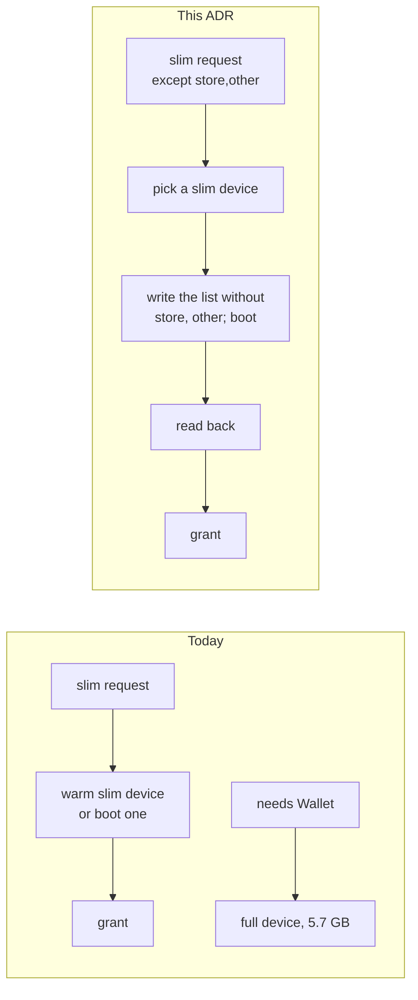

# 0066. A slim lease may keep named categories running

- **Status:** Accepted — not yet implemented
- **Date:** 2026-11-05
- **Issue:** [#1326](https://github.com/callstackincubator/simlock/issues/1326) (request [#1244](https://github.com/callstackincubator/simlock/issues/1244))
- **Narrows:** [ADR 0060](0060-ios-slim-writes-launchd-overrides-while-the-simulator-is-shut-down.md) §1 (the categories written come from the request too), §2 (a boot of a lease with `except` fails on a failed write, an unrunnable readback or an enabled kept label, where 0060 grants `slim` or `full`) and §6 (the label list moves to simslim v0.14.0, and gains one category); [ADR 0007](0007-a-lease-request-chooses-the-device-mode.md) §8 (the same failures grant `slim` there) and §9 (a device reports `except` beside `mode`); [ADR 0008](0008-the-catalog-pairs-models-with-runtimes-and-status-carries-host-facts.md) §4 (a gateway's `slimCategories` is the union of its workers', and it reports no `defaultMode`) and §9 (two config-derived fields join the catalog); [ADR 0009](0009-gateway-routing-is-a-list-of-stages.md) §2 (a filter, `cannot-keep-except`, can leave a request with no worker that could ever serve it) and §4 (the fast-fail table gains a `BAD_REQUEST` row).

## Context

A lease chooses `slim` or `full` (ADR 0007). The categories a slim device
turns off are fixed per worker, in `ios.slim.categories`. A test that needs
one slimmed capability must take `full`. The request's PassKit case: a
`full` lease taken only for Wallet costs 5.7 GB on iPhone 17 Pro / iOS 26.2,
4.5 times a slim one.

Putting the category set into the device spec would split the warm pool:
every distinct set becomes its own kind, its own warm devices and its own
learned demand. The maintainer rejected that.

Every simulator serves one lease and is deleted after it (ADR 0061 §2). So
the device a lease is about to get can be changed before the grant, and the
change never reaches a second lease.

Two ways to change it were tried on iOS 26.4 (26.4.1, 23E254a), on a
throwaway iPhone 17 in a private device set:

- **Live:** `launchctl enable` and `launchctl bootstrap` per label through
  `simctl spawn`. It loaded all 26 labels of `store` and `other` in about
  20 s. But it finds a job by its plist file name, and on that runtime ten
  slim labels have no `LaunchDaemons/<label>.plist`: two ship under another
  file name (`com.apple.Maps.mapspushd` in `com.apple.Maps.pushdaemon.plist`)
  and some are XPC services in frameworks, which launchd starts on demand
  (`com.apple.siri.acousticsignature`). It is also one or two spawns per
  label inside the simulator, the kind of step ADR 0060 removed because load
  cut it short (#206).
- **Boot:** `enable` rewrites the device's `disabled.plist`, and after a
  shutdown and a boot (9 s) the re-enabled jobs ran. launchd reads the file
  at boot, whatever a job's file name and whether or not it has a plist.

This ADR takes the boot. It is ADR 0060's own mechanism with a smaller list.

simslim v0.14.0 (`profiles.go`, unchanged since MobAI-App/simslim#66's merge
commit `ab8ce9f`) adds a `mdm` category and two labels to `other`. Its
`on --except <ids>` leaves the named categories enabled.

## Decision

### 1. A slim lease request may name categories to keep running

`lease.request` takes an optional `except`: a list of 1 to 16 distinct
names, each 1 to 32 characters of `a-z`, `0-9` and `-`, starting with a
letter. The CLI flag is `--except <name,...>`; HTTP and MCP take the field
as the contract does; the agent-device front maps its `deviceExcept` to it,
as it maps `deviceMode` to `mode`. The word is simslim's.

The contract refuses, as `BAD_REQUEST`, a request with `except` that is
physical, whose platform is not `ios`, or whose `mode` is `full`.

The request's effective mode is the baseline's when it names one, else its
`mode`, else the worker's `ios.defaultMode`. The worker refuses it, as
`BAD_REQUEST`, when:

- its effective mode is `full` (a full baseline, or no `mode`, no baseline
  and a worker whose default is `full`);
- a name is not a category of this Simlock's list;
- a name is not in the worker's slim set (`ios.slim.categories`, every
  category when unset).

### 2. The device spec does not change; the device is booted with the smaller list before the grant

A request with `except` resolves to the same slim spec as one without.
Warm devices, the warm pool's kinds, learned demand and seeds see no
difference.

The categories written for that lease's device are the worker's slim set
minus `except`. A label of a kept category is written `false` even when a
category still slimmed lists it too (simslim's rule: an excepted category
wins). The never-disable labels stay `false`.

- **A device booted for the request** (provisioned, or a shut-down one
  booted) gets the smaller list at its `prepare` boot, before the boot, as
  ADR 0060 §1 writes any list.
- **A ready device** (warm) is claimed, shut down, written the smaller list,
  and booted again with `prepare`, before the grant.

The readback after that boot is ADR 0060 §2's, over the smaller list, with
one change for such a boot, which narrows ADR 0060 §2 and ADR 0007 §8: a kept
label not read back `false` (enabled), a write that failed, or a readback
that could not run fails the boot (§3) instead of granting `slim` or `full`.
A lease that asked to keep a category must not be granted a device that may
have it slimmed. Any other label not as written grants `full`, as
today. A device granted `full` reports no `except`. On a runtime below
18.5 the request is granted `full` as today (every category runs) and
reports no `except`. The boot deadline is the slim boot's
(`ios.slim.bootTimeoutMs`).

### 3. A failed boot before the grant is retried once

A boot of §2 that fails or passes its deadline destroys the device, and the
request plans again once. A second failure rejects it `PROVISION_FAILED`
with the boot's message. This counts one failure per request, across
provision and both boots of §2.

### 4. The device reports what it keeps

The device record keeps `except`, written in the grant commit. The lease
reply's device and the devices of `list.get` and `status.get` report it
beside `mode`; a device with none reports no key. `lease.requested` carries
the request's `except`, as it carries `mode`.

A recovery boot under the lease writes nothing and reads nothing back (ADR
0060); the file keeps the smaller list.

### 5. A worker advertises its slim set, and a gateway routes by it

A worker's `catalog.get` carries, for iOS, `slimCategories` (the names its
slim set resolves to) and `defaultMode`. The catalog is what a gateway keeps
for a restarting worker, so both stay known. This narrows ADR 0008 §9: two
config-derived fields join the catalog. A gateway's own `catalog.get` reports
`slimCategories` as the union of its workers' (ADR 0008 §4) and no
`defaultMode`, as a fleet has no default mode (ADR 0007).

A gateway forwards `except` and routes a request with it only to a worker
whose `slimCategories` holds every name and whose effective mode for it (§1,
with the baseline narrowed first, as every stage does) is `slim`. This is the
`cannot-keep-except` filter, a waiting request shows a dropped worker as
`cannot-keep-except`, and it narrows ADR 0009 §2, which lets only stages 1
and 2 decide whether a request can be served at all.

The fast-fail table (ADR 0009 §4) gains a row right after its model and
runtime rows (3 and 4), before `NO_CAPACITY` for a worker that cannot take
requests: `assess` answers `BAD_REQUEST` when no known worker both serves the
model and the runtime and is such a worker. It is judged per worker, so a
worker with the model but not the category plus another with the category but
not the model fails at once and never waits behind the filter.

### 6. The label list follows simslim v0.14.0

`slim-labels.ts` is re-synced from simslim's `profiles.go` at v0.14.0
(`7e374b38`), keeping its MIT notice: a `mdm` category
(`remotemanagementd`, `RemoteManagementAgent`, `managedassetsd`), and
`com.apple.accessibility.axassetsd` and `com.apple.ClipServices.clipserviced`
in `other`. A worker with `ios.slim.categories` unset slims `mdm` too.
simslim's `forbiddenLabels` and the Watch companion labels CoreSimulator
rewrites at each boot stay out of the list.

## Consequences

- One warm pool serves slim leases with and without `except`.
- A lease with `except` granted a warm device waits for one shutdown and
  boot (9 s measured on an idle Mac, more under load). A cold one takes as
  long as a slim cold boot.
- `Driver.estimate` is unchanged; a warm `except` grant is not in it.
- No step runs inside the simulator beyond ADR 0060's readback.
- The protocol version goes up: a new request field, device field and
  catalog field.

## Alternatives considered

- **The category set in the device spec.** Exact from the first boot, but
  every set is a kind of its own in the warm pool. Rejected by the
  maintainer.
- **Turn categories back on live, with `launchctl enable` and `bootstrap`.**
  About 20 s, no reboot. It misses jobs whose plist has another name or
  that have none, unless it reads every plist's `Label` and lifts the
  override alone for the rest, as simslim v0.14.0's `live.go` does; and it
  is one or two spawns per label inside the simulator, which load can cut
  short (#206).
- **Operator presets in config.** A request names a preset instead of
  categories. More config, and a client still has to know each worker's
  names.
- **Grant a device not as asked, and report the gap.** Every client would
  have to check; rejected for the same reason `full` is a guarantee.
