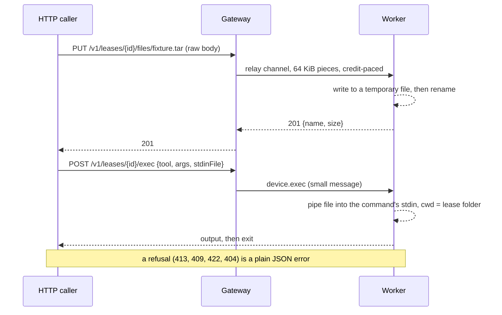

# 0067. A lease has a file folder on its worker that HTTP callers fill and read

- **Status:** Proposed
- **Date:** 2026-11-06
- **Issue:** [#1351](https://github.com/callstackincubator/simlock/issues/1351) (request [#1323](https://github.com/callstackincubator/simlock/issues/1323))
- **Narrows:** [ADR 0005](0005-gateway-and-worker-modes.md) Non-goals
  ("File transfer … out of scope for v1") and §19b′ (the `device.upload`
  seam "left open by design, not built"): it builds that seam, as HTTP
  routes rather than request-scoped pushes.
  [ADR 0026](0026-agent-device-through-a-gateway-relays-over-the-uplink.md)
  §1's convention that every relay target is a module's ("the core names
  no relay target", `src/daemon/relay.ts:2`): the daemon adds one of its
  own, `files`.

## Context

A remote caller reaches a leased device through `device.exec`, whose
`stdin` is one string sent with the request and capped at 8,388,608
characters (`src/contract/operations.ts:426`), because the whole request is
parsed as one string and, through a gateway, sent as one uplink message
that may not pass 8 MiB (`src/ports/uplink-websocket.ts:414`). Two e2e
suites send fixture archives of about 90 MB this way, base64-encoded, from
ten callers at once, and break at the cap.

The gateway's HTTP relay already streams a request body to a worker over a
link byte channel, credit-paced, without holding it
(`src/gateway/relay.ts:221-247`, `src/daemon/relay.ts:208-229`). Nothing
on a worker keeps files for a lease today.

## Decision

1. **Each lease has a file folder on its worker.** It holds flat files the
   lease's holder (or an operator) puts there and commands write there. It
   is created on first use and deleted when the lease ends, before the
   device is reclaimed (a lease-end participant, ADR 0024). Startup deletes
   the folder of every lease that is no longer live. It is built into the
   daemon, not an optional module, and is always on.
2. **HTTP is the way in.** On a worker and on a gateway:
   - `PUT /v1/leases/{id}/files/{name}`: the raw body, streamed, becomes
     the file. The stored file changes only when the whole body has
     arrived; a cut request leaves the previous file (or none). While one
     `PUT` to a name runs, a second is refused `409 FILE_BUSY`.
   - `GET /v1/leases/{id}/files/{name}`: the file, streamed; one
     `Range: bytes=` range answers `206`, an unsatisfiable one `416`.
   - `GET /v1/leases/{id}/files`: names and sizes.
   - `DELETE /v1/leases/{id}/files/{name}`: `204`.
   A gateway relays each to the lease's worker over the existing relay
   channel, so no request holds a whole file in memory on either side.
3. **Names are flat:** `[A-Za-z0-9][A-Za-z0-9._-]{0,127}`. Anything else
   is `400 BAD_REQUEST`.
4. **Limits are fixed:** a file may not pass 2 GiB (`413 FILE_TOO_LARGE`);
   the bytes in a lease's folder may not pass 4 GiB, counting files a
   command wrote (`413 LEASE_FILES_FULL`); an upload is refused while the
   worker's free disk is below its disk-pressure threshold
   (`422 INSUFFICIENT_DISK_SPACE`). An unknown name is
   `404 UNKNOWN_FILE`.
5. **`device.exec` uses the folder.** Every `device.exec` runs with the
   lease's folder as its working directory, so a relative path in its
   arguments names a stored file and a command can write one for download.
   A new optional `stdinFile` names a stored file that is piped to the
   command's stdin; with `stdin` too, it is `400 BAD_REQUEST`. `stdin`
   keeps its one-shot string and its cap; ADR 0058 is untouched.
6. **A relayed file request is bounded by silence while its body flows.**
   Through a gateway, the relay's 330 s deadline for the worker's answer
   starts once the request body has been fully sent; while bytes flow, only
   the 330 s idle bound applies. Other relays keep today's deadline.
7. **The relay target `files` is the core's.** The worker serves it beside
   the modules' targets, and no optional module may be named `files`.
8. **No business events.** A transfer is a request, logged like any other.

## Consequences

- A remote caller moves a file of up to 2 GiB to a leased device's worker
  with no base64 and no stdin cap, and can fetch one back.
- Two calls instead of one for the stdin case: upload, then exec.
- The working directory of `device.exec` moves from the daemon's own to
  the lease's folder; a command that relied on the daemon's directory
  sees a different one.
- A file lives only as long as its lease; there is no sharing between
  leases.
- A single upload must fit one request: a caller behind a CDN with a
  body-size or time limit below its file cannot upload it yet.
- The local CLI, `simlock/client` and MCP gain nothing; they keep the
  8 MiB `stdin`.

## Alternatives considered

- **Streamed `stdin` for `device.exec`**: one call and no state, but it
  changes exec on every hop, narrows 0005 §19c and 0058, overlaps the
  interactive mode of #1177, feeds only stdin (not `simctl install
  <path>`), and makes the whole transfer one long request.
- **Resumable uploads (tus 1.0, or the IETF draft)**: survive a cut and
  CDN body caps, at the cost of partial-file state and a protocol to
  document. Left for later; it can sit beside `PUT` on the same URLs.
- **An optional module**: a module's lease route is one exact path
  (`src/http/app.ts:833`) and cannot reach `device.exec`.
- **Keep the relay's 330 s total for uploads**: no relay change, but a
  2 GiB upload through a gateway would need about 6.5 MB/s.
- **Unpacking an uploaded archive into folders** (an iOS `.app`): needs
  path-safety rules for every entry; not in this decision.
